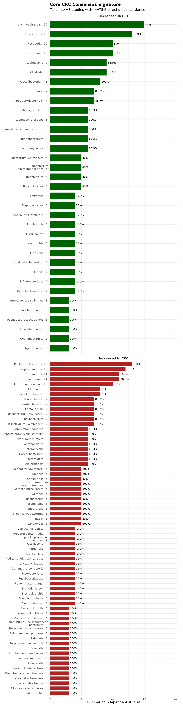
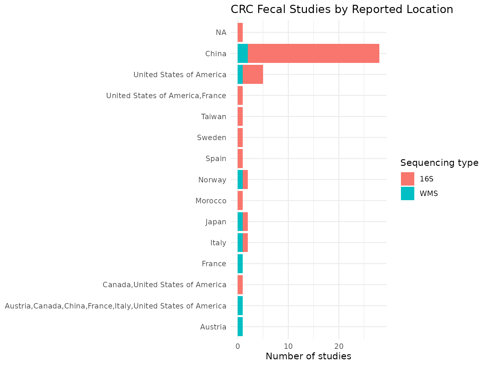
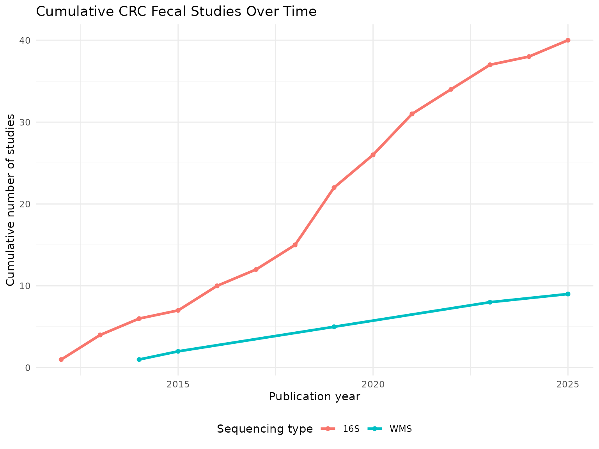
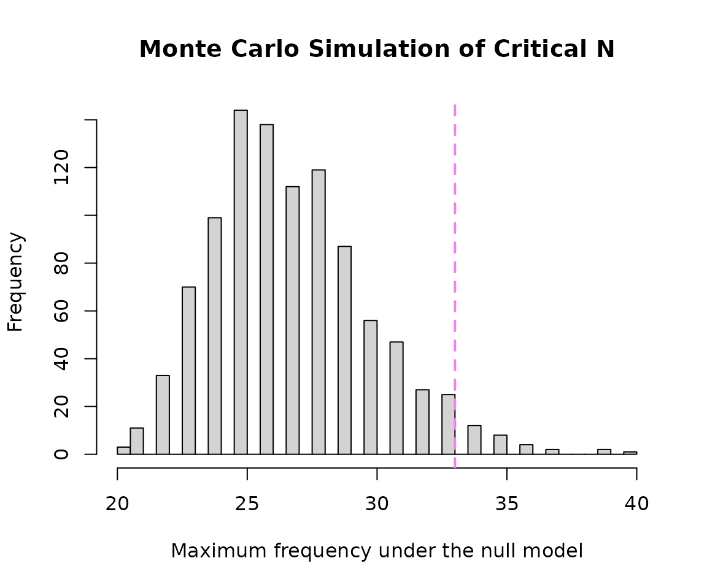

# Exploratory Analysis of Colorectal Cancer (CRC) Microbial Signatures

## Introduction

This vignette demonstrates an exploratory analysis of microbial
signatures associated with colorectal cancer (CRC) using data obtained
from BugSigDB and functions provided by the bugSigSimple package.

## Analysis objectives

1.  Downloading the data from BugSigDB
2.  Filtering of the data to select relevant signatures and remove
    similar/duplicate signatures
3.  Restricting to fecal samples (the body site with the most
    consistent, human, non-tissue evidence)
4.  Description of the studies
5.  Description of the taxa
6.  Basic statistical tests
7.  Monte Carlo simulation to calculate critical N
8.  Heatmaps and dendrograms

## Making sure packages are installed

``` r

if (!require("BiocManager", quietly = TRUE))
    install.packages("BiocManager")
BiocManager::install(c("devtools", "tidyverse", "kableExtra"))
BiocManager::install(c("waldronlab/bugSigSimple", "waldronlab/BugSigDBStats", "waldronlab/bugsigdbr"))
```

## Download BugSigDB data

``` r

full.dat <- bugsigdbr::importBugSigDB(cache = FALSE)
```

``` r

dim(full.dat)
```

    ## [1] 7425   51

The BugSigDB database was downloaded using the
[`importBugSigDB()`](https://rdrr.io/pkg/bugsigdbr/man/importBugSigDB.html)
function from the **bugsigdbr** package. The result contains all curated
microbial signatures together with study metadata such as disease, body
site, sequencing platform, and abundance direction.

## Remove empty signatures

``` r

ind1 <- lengths(full.dat[["MetaPhlAn taxon names"]]) > 0
ind2 <- lengths(full.dat[["NCBI Taxonomy IDs"]]) > 0

dat <- full.dat[ind1 & ind2, ]

dim(dat)
```

    ## [1] 7425   51

Signatures without annotated taxa were removed to ensure that only
complete microbial signatures were included in downstream analyses.

## Select CRC-related signatures

``` r

pattern <- paste(
  "Colorectal cancer",
  "Colorectal Neoplasms",
  "Colorectal carcinoma",
  "Colorectal adenocarcinoma",
  "Colonic Neoplasms",
  "Rectal Neoplasms",
  "Colorectal adenoma",
  "Colorectal polyp",
  "colon cancer",
  "rectal cancer",
  "CRC",
  sep = "|"
)

crc.dat <- dat %>%
  filter(
    grepl(pattern, Condition, ignore.case = TRUE) |
      grepl(pattern, `Group 0 name`, ignore.case = TRUE) |
      grepl(pattern, `Group 1 name`, ignore.case = TRUE)
  ) %>%
  filter(
    grepl(pattern, Condition, ignore.case = TRUE)
  )

nrow(crc.dat)
```

    ## [1] 304

``` r

crc.dat %>%
  count(Condition, sort = TRUE)
```

    ##                               Condition   n
    ## 1                     Colorectal cancer 227
    ## 2                    Colorectal adenoma  33
    ## 3                  Colorectal carcinoma  13
    ## 4             Colorectal adenocarcinoma   9
    ## 5          Metastatic colorectal cancer   7
    ## 6   Colorectal cancer,Diabetes mellitus   5
    ## 7       Nutraceutical,Colorectal cancer   4
    ## 8  Colorectal adenoma,Colorectal cancer   2
    ## 9           Colorectal cancer cell line   2
    ## 10      Colorectal cancer,Nutraceutical   2

To capture the complete body of evidence related to colorectal cancer
(CRC), signatures were identified using both the primary disease
terminology (colorectal cancer / neoplasms) and related terms covering
adenomas, polyps, and site-specific variants (colon/rectal cancer).
Disease-related terms were searched across the Condition, Group 0 name,
and Group 1 name fields to recover studies curated under different
naming conventions. Finally, only records whose primary condition
corresponded to a CRC-related disease were retained.

## Remove similar signatures

``` r

crc.filtered <- crc.dat %>%
  distinct()

nrow(crc.filtered)
```

    ## [1] 304

Exact duplicate records were removed using
[`distinct()`](https://dplyr.tidyverse.org/reference/distinct.html) to
reduce redundancy before downstream analyses. This step retains unique
CRC-associated microbial signatures while preserving the overall study
representation.

## Restrict to fecal samples

``` r

crc.filtered %>%
  count(`Body site`, sort = TRUE) %>%
  knitr::kable()
```

| Body site                 |   n |
|:--------------------------|----:|
| Feces                     | 194 |
| Intestine                 |  41 |
| Colon                     |  17 |
| Colorectum                |  15 |
| Colorectal mucosa         |  12 |
| Oral cavity               |  10 |
| Saliva                    |   9 |
| Intestinal mucosa         |   4 |
| Mucosa of ascending colon |   2 |

``` r

# Feces is the dominant, human, non-tissue body site in the CRC signatures.
# One study (PMID 26397137) used a mouse model rather than human subjects and
# is excluded so that the signature set reflects human fecal microbiome findings.
crc.filtered <- crc.filtered %>%
  filter(`Body site` == "Feces") %>%
  filter(PMID != 26397137)

nrow(crc.filtered)
```

    ## [1] 192

CRC signatures in BugSigDB were curated from several body sites,
including feces, mucosal tissue, and oral samples, as well as from a
small number of mouse studies. To keep the downstream comparisons
consistent, the analysis was restricted to fecal signatures from human
studies, which represent the largest and most directly comparable body
of evidence for the gut microbiome in CRC.

## Study characteristics

``` r

study.summary <-
  crc.filtered %>%
  count(`Body site`, `Sequencing type`)

knitr::kable(study.summary)
```

| Body site | Sequencing type |   n |
|:----------|:----------------|----:|
| Feces     | 16S             | 146 |
| Feces     | WMS             |  46 |

The selected CRC fecal signatures span multiple studies and sequencing
approaches. Summarizing study characteristics provides context for
interpreting downstream analyses and highlights the diversity of
experimental designs represented in BugSigDB.

## Taxonomic summary

``` r

taxa.table <- createTaxonTable(crc.filtered)

head(taxa.table)
```

    ## # A tibble: 6 × 6
    ##   `Taxon Name`       `Taxonomic Level` total_signatures increased_signatures
    ##   <chr>              <chr>                        <int>                <int>
    ## 1 Lachnospiraceae    family                          24                    6
    ## 2 Peptostreptococcus genus                           24                   24
    ## 3 Parvimonas         genus                           23                   23
    ## 4 Bacteroides        genus                           19                   10
    ## 5 Clostridium        genus                           18                    6
    ## 6 Ruminococcus       genus                           18                    9
    ## # ℹ 2 more variables: decreased_signatures <int>, `Binomial Test pval` <dbl>

``` r

knitr::kable(head(taxa.table, 10))
```

| Taxon Name | Taxonomic Level | total_signatures | increased_signatures | decreased_signatures | Binomial Test pval |
|:---|:---|---:|---:|---:|---:|
| Lachnospiraceae | family | 24 | 6 | 18 | 2.3e-02 |
| Peptostreptococcus | genus | 24 | 24 | 0 | 1.0e-07 |
| Parvimonas | genus | 23 | 23 | 0 | 2.0e-07 |
| Bacteroides | genus | 19 | 10 | 9 | 1.0e+00 |
| Clostridium | genus | 18 | 6 | 12 | 2.4e-01 |
| Ruminococcus | genus | 18 | 9 | 9 | 1.0e+00 |
| Pseudomonadota | phylum | 18 | 8 | 10 | 8.1e-01 |
| Porphyromonas | genus | 17 | 15 | 2 | 2.3e-03 |
| Rikenellaceae | family | 17 | 11 | 6 | 3.3e-01 |
| Coprococcus | genus | 16 | 4 | 12 | 7.7e-02 |

The taxonomic summary identifies microorganisms that recur across
CRC-associated signatures. Frequently reported taxa may represent
microbial features that are consistently observed across independent CRC
studies.

## Split by sequencing type

``` r

crc.wms <- crc.filtered %>% filter(`Sequencing type` == "WMS")
crc.16s <- crc.filtered %>% filter(`Sequencing type` == "16S")

cat("WMS  - signatures:", nrow(crc.wms), "| studies:", n_distinct(crc.wms$PMID), "\n")
```

    ## WMS  - signatures: 46 | studies: 9

``` r

cat("16S  - signatures:", nrow(crc.16s), "| studies:", n_distinct(crc.16s$PMID), "\n")
```

    ## 16S  - signatures: 146 | studies: 40

Splitting by sequencing platform makes it possible to check later
whether whole-metagenome shotgun (WMS) and 16S rRNA studies agree on the
direction of the taxa they report.

## Long-format taxon table

``` r

sigs.feces <- bugsigdbr::getSignatures(crc.filtered, tax.id.type = "taxname")

taxon.long <- purrr::map_dfr(seq_along(sigs.feces), function(i) {
  taxa <- sigs.feces[[i]]
  if (length(taxa) == 0) return(NULL)
  tibble::tibble(sig_id = i, taxon = taxa)
}) %>%
  left_join(
    crc.filtered %>%
      mutate(sig_id = row_number()) %>%
      select(sig_id, PMID, Condition, `Sequencing type`, `Abundance in Group 1`),
    by = "sig_id"
  ) %>%
  rename(direction = `Abundance in Group 1`)

nrow(taxon.long)
```

    ## [1] 1960

Each signature was expanded into one row per taxon and joined back to
its study metadata (PMID, condition, sequencing type, and reported
direction). This long-format table underlies all of the frequency,
concordance, enrichment, and co-occurrence analyses below.

## Taxon frequency across studies

``` r

taxon.freq <- taxon.long %>%
  distinct(PMID, taxon, direction) %>%
  count(taxon, direction, name = "n_studies") %>%
  group_by(taxon) %>%
  mutate(total_studies = sum(n_studies)) %>%
  ungroup() %>%
  arrange(desc(total_studies))

n_distinct(taxon.freq$taxon)
```

    ## [1] 639

``` r

taxon.freq %>%
  distinct(taxon, total_studies) %>%
  slice_max(total_studies, n = 10) %>%
  knitr::kable()
```

| taxon                 | total_studies |
|:----------------------|--------------:|
| Lachnospiraceae       |            18 |
| Bacteroides           |            13 |
| Coprococcus           |            13 |
| Peptostreptococcus    |            13 |
| Phascolarctobacterium |            13 |
| Ruminococcus          |            13 |
| Clostridium           |            12 |
| Porphyromonas         |            12 |
| Fusobacterium         |            11 |
| Parvimonas            |            11 |
| Streptococcus         |            11 |

The most frequently reported taxa give a first impression of which
microbes are consistently associated with CRC across independent
studies, before accounting for direction of change or statistical
significance.

## Core consensus signature

``` r

concordance <- taxon.long %>%
  distinct(PMID, taxon, direction) %>%
  group_by(taxon) %>%
  summarise(
    n_studies       = n_distinct(PMID),
    n_increased     = sum(direction == "increased"),
    n_decreased     = sum(direction == "decreased"),
    concordance_pct = round(max(n_increased, n_decreased) / n_studies * 100, 1),
    majority_dir    = if_else(n_increased >= n_decreased, "increased", "decreased"),
    .groups = "drop"
  ) %>%
  arrange(desc(n_studies), desc(concordance_pct))

# Formal threshold for a "core" signature: reported in at least 3 independent
# studies, with at least 75% of those studies agreeing on direction
core.sig <- concordance %>%
  filter(n_studies >= 3, concordance_pct >= 75) %>%
  arrange(majority_dir, desc(n_studies))

nrow(core.sig)
```

    ## [1] 102

``` r

knitr::kable(core.sig)
```

| taxon | n_studies | n_increased | n_decreased | concordance_pct | majority_dir |
|:---|---:|---:|---:|---:|:---|
| Lachnospiraceae | 15 | 6 | 12 | 80.0 | decreased |
| Coprococcus | 13 | 3 | 10 | 76.9 | decreased |
| Clostridium | 10 | 4 | 8 | 80.0 | decreased |
| Roseburia | 10 | 2 | 8 | 80.0 | decreased |
| Clostridia | 9 | 1 | 8 | 88.9 | decreased |
| Lachnospira | 9 | 2 | 8 | 88.9 | decreased |
| Faecalibacterium | 8 | 1 | 8 | 100.0 | decreased |
| Anaerobutyricum hallii | 7 | 1 | 6 | 85.7 | decreased |
| Blautia | 7 | 1 | 6 | 85.7 | decreased |
| Faecalibacterium prausnitzii | 6 | 1 | 6 | 100.0 | decreased |
| Lachnospira eligens | 6 | 0 | 6 | 100.0 | decreased |
| Actinomycetota | 6 | 1 | 5 | 83.3 | decreased |
| Bifidobacterium | 6 | 2 | 5 | 83.3 | decreased |
| Subdoligranulum | 6 | 1 | 5 | 83.3 | decreased |
| Butyricicoccus | 5 | 2 | 4 | 80.0 | decreased |
| Eubacteriales | 5 | 1 | 4 | 80.0 | decreased |
| Eubacterium coprostanoligenes | 5 | 1 | 4 | 80.0 | decreased |
| Eubacterium ventriosum | 5 | 1 | 4 | 80.0 | decreased |
| Bifidobacteriaceae | 4 | 0 | 4 | 100.0 | decreased |
| Bifidobacteriales | 4 | 0 | 4 | 100.0 | decreased |
| Romboutsia | 4 | 0 | 4 | 100.0 | decreased |
| Roseburia intestinalis | 4 | 0 | 4 | 100.0 | decreased |
| Tyzzerella | 4 | 0 | 4 | 100.0 | decreased |
| Bilophila | 4 | 2 | 3 | 75.0 | decreased |
| Clostridiales bacterium | 4 | 2 | 3 | 75.0 | decreased |
| Klebsiella | 4 | 1 | 3 | 75.0 | decreased |
| Leptotrichia | 4 | 1 | 3 | 75.0 | decreased |
| Oscillibacter | 4 | 1 | 3 | 75.0 | decreased |
| Staphylococcus | 4 | 1 | 3 | 75.0 | decreased |
| Agathobacter | 3 | 0 | 3 | 100.0 | decreased |
| Cyanobacteriota | 3 | 1 | 3 | 100.0 | decreased |
| Fusicatenibacter | 3 | 0 | 3 | 100.0 | decreased |
| Pseudocoprococcus catus | 3 | 0 | 3 | 100.0 | decreased |
| Roseburia faecis | 3 | 1 | 3 | 100.0 | decreased |
| Streptococcus salivarius | 3 | 0 | 3 | 100.0 | decreased |
| Peptostreptococcus | 13 | 13 | 0 | 100.0 | increased |
| Porphyromonas | 12 | 11 | 1 | 91.7 | increased |
| Parvimonas | 11 | 11 | 0 | 100.0 | increased |
| Fusobacterium | 11 | 10 | 1 | 90.9 | increased |
| Enterobacteriaceae | 10 | 8 | 2 | 80.0 | increased |
| Erysipelotrichaceae | 8 | 6 | 4 | 75.0 | increased |
| Odoribacter | 8 | 6 | 3 | 75.0 | increased |
| Fusobacterium nucleatum | 7 | 7 | 0 | 100.0 | increased |
| Parabacteroides | 7 | 7 | 1 | 100.0 | increased |
| \[Clostridium\] symbiosum | 7 | 7 | 1 | 100.0 | increased |
| Fusobacteriota | 7 | 6 | 1 | 85.7 | increased |
| Lactobacillus | 7 | 6 | 2 | 85.7 | increased |
| Rikenellaceae | 7 | 6 | 2 | 85.7 | increased |
| Akkermansia | 6 | 6 | 1 | 100.0 | increased |
| Parvimonas micra | 6 | 6 | 0 | 100.0 | increased |
| Peptostreptococcus stomatis | 6 | 6 | 0 | 100.0 | increased |
| Bacteroidota | 6 | 5 | 1 | 83.3 | increased |
| Corynebacterium | 6 | 5 | 1 | 83.3 | increased |
| Enterococcus | 6 | 5 | 2 | 83.3 | increased |
| Lactobacillales | 6 | 5 | 2 | 83.3 | increased |
| Porphyromonadaceae | 6 | 5 | 1 | 83.3 | increased |
| Actinomyces | 5 | 5 | 1 | 100.0 | increased |
| Bilophila wadsworthia | 5 | 5 | 0 | 100.0 | increased |
| Eggerthella | 5 | 5 | 0 | 100.0 | increased |
| Escherichia | 5 | 5 | 1 | 100.0 | increased |
| Gemella | 5 | 5 | 0 | 100.0 | increased |
| Gemella morbillorum | 5 | 5 | 0 | 100.0 | increased |
| Porphyromonas asaccharolytica | 5 | 5 | 0 | 100.0 | increased |
| Shigella | 5 | 5 | 1 | 100.0 | increased |
| Solobacterium moorei | 5 | 5 | 0 | 100.0 | increased |
| Bacilli | 5 | 4 | 1 | 80.0 | increased |
| Fusobacteriia | 5 | 4 | 1 | 80.0 | increased |
| Selenomonas | 5 | 4 | 1 | 80.0 | increased |
| Bacteroidaceae | 4 | 4 | 0 | 100.0 | increased |
| Escherichia coli | 4 | 4 | 0 | 100.0 | increased |
| Flavonifractor plautii | 4 | 4 | 0 | 100.0 | increased |
| Megasphaera | 4 | 4 | 0 | 100.0 | increased |
| Morganella | 4 | 4 | 1 | 100.0 | increased |
| Peptostreptococcus anaerobius | 4 | 4 | 0 | 100.0 | increased |
| Prevotella intermedia | 4 | 4 | 0 | 100.0 | increased |
| Verrucomicrobiota | 4 | 4 | 2 | 100.0 | increased |
| Erysipelotrichales | 4 | 3 | 1 | 75.0 | increased |
| Erysipelotrichia | 4 | 3 | 1 | 75.0 | increased |
| Fusobacteriaceae | 4 | 3 | 1 | 75.0 | increased |
| Fusobacteriales | 4 | 3 | 1 | 75.0 | increased |
| Gammaproteobacteria | 4 | 3 | 1 | 75.0 | increased |
| Lactobacillaceae | 4 | 3 | 2 | 75.0 | increased |
| Mediterraneibacter torques | 4 | 3 | 1 | 75.0 | increased |
| Oscillospira | 4 | 3 | 1 | 75.0 | increased |
| Abiotrophia | 3 | 3 | 1 | 100.0 | increased |
| Alloprevotella tannerae | 3 | 3 | 0 | 100.0 | increased |
| Bacteroides fragilis | 3 | 3 | 0 | 100.0 | increased |
| Corynebacteriaceae | 3 | 3 | 0 | 100.0 | increased |
| Desulfovibrio desulfuricans | 3 | 3 | 0 | 100.0 | increased |
| Enterocloster bolteae | 3 | 3 | 0 | 100.0 | increased |
| Hungatella | 3 | 3 | 0 | 100.0 | increased |
| Lachnoclostridium | 3 | 3 | 0 | 100.0 | increased |
| Odoribacter splanchnicus | 3 | 3 | 0 | 100.0 | increased |
| Olsenella | 3 | 3 | 0 | 100.0 | increased |
| Porphyromonas uenonis | 3 | 3 | 0 | 100.0 | increased |
| Ralstonia | 3 | 3 | 0 | 100.0 | increased |
| Selenomonas sputigena | 3 | 3 | 0 | 100.0 | increased |
| Streptococcus anginosus | 3 | 3 | 0 | 100.0 | increased |
| Verrucomicrobiaceae | 3 | 3 | 1 | 100.0 | increased |
| Verrucomicrobiales | 3 | 3 | 1 | 100.0 | increased |
| Verrucomicrobiia | 3 | 3 | 1 | 100.0 | increased |
| uncultured Oscillospiraceae bacterium | 3 | 3 | 0 | 100.0 | increased |

``` r

core.sig %>%
  mutate(
    direction_label = if_else(majority_dir == "increased",
                               "Increased in CRC", "Decreased in CRC"),
    # Wrap long taxon names onto a second line instead of letting them
    # overlap or run off the plot area
    taxon_label = paste0(str_wrap(taxon, width = 28), " (", n_studies, ")")
  ) %>%
  ggplot(aes(x = reorder(taxon_label, n_studies), y = n_studies, fill = direction_label)) +
  geom_col(width = 0.7) +
  geom_text(aes(label = paste0(concordance_pct, "%")), hjust = -0.15, size = 3.3) +
  coord_flip(clip = "off") +
  facet_wrap(~direction_label, scales = "free_y", ncol = 1) +
  scale_fill_manual(values = c("Increased in CRC" = "#B22222",
                                "Decreased in CRC" = "#006400")) +
  # Extra headroom on the right so the "%" labels never get clipped
  scale_y_continuous(expand = expansion(mult = c(0, 0.35))) +
  labs(
    title = "Core CRC Consensus Signature",
    subtitle = "Taxa in >=3 studies with >=75% direction concordance",
    x = NULL, y = "Number of independent studies", fill = NULL
  ) +
  theme_minimal(base_size = 12) +
  theme(
    legend.position = "none",
    plot.title = element_text(face = "bold"),
    axis.text.y = element_text(size = 10, lineheight = 0.9),
    strip.text = element_text(size = 11, face = "bold"),
    plot.margin = margin(t = 10, r = 20, b = 10, l = 10)
  )
```



Requiring at least three independent studies and at least 75%
directional agreement is a common, interpretable threshold for calling a
taxon “core”: it rules out one-off findings while still tolerating some
disagreement between studies that differ in cohort, region, or platform.

## WMS vs 16S concordance

``` r

dir.by.platform <- taxon.long %>%
  filter(`Sequencing type` %in% c("WMS", "16S")) %>%
  distinct(PMID, taxon, direction, `Sequencing type`) %>%
  count(taxon, `Sequencing type`, direction, name = "n_studies") %>%
  group_by(taxon, `Sequencing type`) %>%
  slice_max(n_studies, n = 1, with_ties = FALSE) %>%
  ungroup() %>%
  select(taxon, `Sequencing type`, majority_dir = direction)

platform.compare <- dir.by.platform %>%
  pivot_wider(names_from = `Sequencing type`, values_from = majority_dir) %>%
  filter(!is.na(WMS), !is.na(`16S`)) %>%
  rename(dir_WMS = WMS, dir_16S = `16S`) %>%
  mutate(agree = dir_WMS == dir_16S)

nrow(platform.compare)
```

    ## [1] 99

``` r

sum(platform.compare$agree)
```

    ## [1] 78

``` r

round(100 * mean(platform.compare$agree), 1)
```

    ## [1] 78.8

``` r

knitr::kable(platform.compare)
```

| taxon                                   | dir_16S   | dir_WMS   | agree |
|:----------------------------------------|:----------|:----------|:------|
| Acinetobacter                           | increased | decreased | FALSE |
| Actinomycetota                          | decreased | increased | FALSE |
| Agathobacter rectalis                   | decreased | decreased | TRUE  |
| Akkermansia muciniphila                 | increased | decreased | FALSE |
| Alistipes finegoldii                    | increased | increased | TRUE  |
| Alistipes onderdonkii                   | increased | increased | TRUE  |
| Alistipes putredinis                    | decreased | increased | FALSE |
| Alloprevotella tannerae                 | increased | increased | TRUE  |
| Anaerobutyricum hallii                  | decreased | decreased | TRUE  |
| Anaerococcus vaginalis                  | increased | increased | TRUE  |
| Anaerotruncus sp.                       | decreased | increased | FALSE |
| Bacilli                                 | increased | increased | TRUE  |
| Bacillota                               | decreased | decreased | TRUE  |
| Bacteroides                             | increased | increased | TRUE  |
| Bacteroides finegoldii                  | decreased | decreased | TRUE  |
| Bacteroides fragilis                    | increased | increased | TRUE  |
| Bacteroides intestinalis                | decreased | decreased | TRUE  |
| Bacteroides ovatus                      | decreased | increased | FALSE |
| Bacteroides salyersiae                  | increased | increased | TRUE  |
| Bacteroides thetaiotaomicron            | decreased | decreased | TRUE  |
| Bifidobacterium adolescentis            | decreased | decreased | TRUE  |
| Bifidobacterium animalis                | decreased | decreased | TRUE  |
| Bifidobacterium catenulatum             | increased | decreased | FALSE |
| Bifidobacterium longum                  | decreased | decreased | TRUE  |
| Bilophila                               | decreased | decreased | TRUE  |
| Bilophila wadsworthia                   | increased | increased | TRUE  |
| Blautia obeum                           | decreased | decreased | TRUE  |
| Blautia producta                        | decreased | increased | FALSE |
| Campylobacter rectus                    | increased | increased | TRUE  |
| Clostridium sp.                         | decreased | decreased | TRUE  |
| Desulfovibrio                           | decreased | increased | FALSE |
| Desulfovibrio desulfuricans             | increased | increased | TRUE  |
| Eggerthella                             | increased | increased | TRUE  |
| Escherichia coli                        | increased | increased | TRUE  |
| Eubacterium                             | decreased | decreased | TRUE  |
| Eubacterium ventriosum                  | decreased | decreased | TRUE  |
| Faecalibacterium                        | decreased | decreased | TRUE  |
| Faecalibacterium prausnitzii            | decreased | decreased | TRUE  |
| Flavonifractor plautii                  | increased | increased | TRUE  |
| Fusobacteriia                           | increased | increased | TRUE  |
| Fusobacteriota                          | increased | increased | TRUE  |
| Fusobacterium                           | increased | increased | TRUE  |
| Fusobacterium nucleatum                 | increased | increased | TRUE  |
| Gemella                                 | increased | increased | TRUE  |
| Gemella morbillorum                     | increased | increased | TRUE  |
| Granulicatella adiacens                 | increased | increased | TRUE  |
| Hungatella                              | increased | increased | TRUE  |
| Hungatella hathewayi                    | increased | increased | TRUE  |
| Klebsiella oxytoca                      | increased | increased | TRUE  |
| Lachnospira eligens                     | decreased | decreased | TRUE  |
| Lachnospira pectinoschiza               | decreased | decreased | TRUE  |
| Lachnospiraceae bacterium               | decreased | increased | FALSE |
| Lachnospiraceae bacterium 3_1_57FAA_CT1 | increased | increased | TRUE  |
| Lactobacillaceae                        | increased | decreased | FALSE |
| Lactobacillales                         | increased | decreased | FALSE |
| Lactobacillus                           | increased | decreased | FALSE |
| Leptotrichia                            | decreased | increased | FALSE |
| Mediterraneibacter torques              | increased | increased | TRUE  |
| Negativicutes                           | decreased | increased | FALSE |
| Neisseria                               | decreased | increased | FALSE |
| Olsenella                               | increased | increased | TRUE  |
| Parabacteroides distasonis              | decreased | increased | FALSE |
| Paraprevotella                          | decreased | decreased | TRUE  |
| Parasutterella                          | decreased | decreased | TRUE  |
| Parvimonas                              | increased | increased | TRUE  |
| Parvimonas micra                        | increased | increased | TRUE  |
| Parvimonas sp.                          | increased | increased | TRUE  |
| Pasteurellaceae                         | increased | increased | TRUE  |
| Peptostreptococcus                      | increased | increased | TRUE  |
| Peptostreptococcus anaerobius           | increased | increased | TRUE  |
| Peptostreptococcus sp.                  | increased | increased | TRUE  |
| Peptostreptococcus stomatis             | increased | increased | TRUE  |
| Porphyromonadaceae                      | increased | increased | TRUE  |
| Porphyromonas                           | increased | increased | TRUE  |
| Porphyromonas asaccharolytica           | increased | increased | TRUE  |
| Porphyromonas somerae                   | increased | increased | TRUE  |
| Porphyromonas uenonis                   | increased | increased | TRUE  |
| Prevotella intermedia                   | increased | increased | TRUE  |
| Pseudocoprococcus catus                 | decreased | decreased | TRUE  |
| Pseudoflavonifractor capillosus         | decreased | increased | FALSE |
| Pseudomonadota                          | increased | increased | TRUE  |
| Roseburia intestinalis                  | decreased | decreased | TRUE  |
| Ruminococcus                            | decreased | decreased | TRUE  |
| Ruminococcus bromii                     | decreased | decreased | TRUE  |
| Segatella oris                          | decreased | increased | FALSE |
| Selenomonadales                         | decreased | increased | FALSE |
| Selenomonas                             | increased | increased | TRUE  |
| Slackia sp.                             | increased | increased | TRUE  |
| Solobacterium moorei                    | increased | increased | TRUE  |
| Streptococcaceae                        | increased | decreased | FALSE |
| Streptococcus anginosus                 | increased | increased | TRUE  |
| Streptococcus salivarius                | decreased | decreased | TRUE  |
| Subdoligranulum                         | decreased | decreased | TRUE  |
| Tissierellia                            | increased | increased | TRUE  |
| Veillonella atypica                     | increased | increased | TRUE  |
| Veillonella parvula                     | decreased | decreased | TRUE  |
| Veillonellaceae                         | increased | increased | TRUE  |
| \[Clostridium\] symbiosum               | increased | increased | TRUE  |
| uncultured Oscillospiraceae bacterium   | increased | increased | TRUE  |

For taxa reported by both sequencing platforms, this compares the
majority-reported direction from WMS studies against the
majority-reported direction from 16S studies. High agreement supports
the idea that a taxon’s association with CRC is a real biological signal
rather than a platform-specific artifact; disagreement flags taxa where
sequencing approach may be driving the result.

## Taxon enrichment analysis

``` r

n.universe <- n_distinct(taxon.long$taxon)
n.sigs     <- length(sigs.feces)

enrichment.df <- taxon.freq %>%
  distinct(taxon, total_studies) %>%
  mutate(
    observed         = total_studies,
    expected         = n.sigs / n.universe,
    enrichment_ratio = observed / expected,
    log2_enrichment  = log2(enrichment_ratio),
    p_value = purrr::map_dbl(observed, ~ binom.test(
      x = .x, n = n.sigs, p = 1 / n.universe, alternative = "greater"
    )$p.value),
    p_adj = p.adjust(p_value, method = "BH")
  ) %>%
  arrange(p_adj, desc(log2_enrichment))

sum(enrichment.df$p_adj < 0.05)
```

    ## [1] 167

``` r

knitr::kable(head(enrichment.df, 15))
```

| taxon | total_studies | observed | expected | enrichment_ratio | log2_enrichment | p_value | p_adj |
|:---|---:|---:|---:|---:|---:|---:|---:|
| Lachnospiraceae | 18 | 18 | 0.3004695 | 59.90625 | 5.904635 | 0 | 0 |
| Bacteroides | 13 | 13 | 0.3004695 | 43.26562 | 5.435149 | 0 | 0 |
| Coprococcus | 13 | 13 | 0.3004695 | 43.26562 | 5.435149 | 0 | 0 |
| Peptostreptococcus | 13 | 13 | 0.3004695 | 43.26562 | 5.435149 | 0 | 0 |
| Phascolarctobacterium | 13 | 13 | 0.3004695 | 43.26562 | 5.435149 | 0 | 0 |
| Ruminococcus | 13 | 13 | 0.3004695 | 43.26562 | 5.435149 | 0 | 0 |
| Clostridium | 12 | 12 | 0.3004695 | 39.93750 | 5.319672 | 0 | 0 |
| Porphyromonas | 12 | 12 | 0.3004695 | 39.93750 | 5.319672 | 0 | 0 |
| Fusobacterium | 11 | 11 | 0.3004695 | 36.60938 | 5.194141 | 0 | 0 |
| Parvimonas | 11 | 11 | 0.3004695 | 36.60938 | 5.194141 | 0 | 0 |
| Streptococcus | 11 | 11 | 0.3004695 | 36.60938 | 5.194141 | 0 | 0 |
| Enterobacteriaceae | 10 | 10 | 0.3004695 | 33.28125 | 5.056638 | 0 | 0 |
| Erysipelotrichaceae | 10 | 10 | 0.3004695 | 33.28125 | 5.056638 | 0 | 0 |
| Lachnospira | 10 | 10 | 0.3004695 | 33.28125 | 5.056638 | 0 | 0 |
| Roseburia | 10 | 10 | 0.3004695 | 33.28125 | 5.056638 | 0 | 0 |

A binomial test compares each taxon’s observed frequency against the
frequency expected if taxa were reported at random from the full pool of
fecal CRC taxa. Taxa with a small adjusted p-value are reported far more
often than chance would predict, independent of the core-signature
concordance threshold above.

## Co-occurrence and co-exclusion

``` r

top.taxa <- taxon.freq %>%
  distinct(taxon, total_studies) %>%
  slice_max(total_studies, n = 30) %>%
  pull(taxon)

presence.mat <- taxon.long %>%
  filter(taxon %in% top.taxa) %>%
  distinct(PMID, taxon) %>%
  mutate(present = 1L) %>%
  pivot_wider(names_from = taxon, values_from = present, values_fill = 0L) %>%
  column_to_rownames("PMID") %>%
  as.matrix()

co.occ.mat <- t(presence.mat) %*% presence.mat
diag(co.occ.mat) <- 0

co.occ.pairs <- which(upper.tri(co.occ.mat), arr.ind = TRUE) %>%
  as.data.frame() %>%
  mutate(
    taxon_a   = rownames(co.occ.mat)[row],
    taxon_b   = colnames(co.occ.mat)[col],
    n_studies = co.occ.mat[cbind(row, col)]
  ) %>%
  filter(n_studies > 0) %>%
  arrange(desc(n_studies)) %>%
  slice_max(n_studies, n = 15)

knitr::kable(co.occ.pairs %>% select(taxon_a, taxon_b, n_studies))
```

| taxon_a               | taxon_b             | n_studies |
|:----------------------|:--------------------|----------:|
| Coprococcus           | Lachnospiraceae     |         9 |
| Peptostreptococcus    | Parvimonas          |         9 |
| Porphyromonas         | Peptostreptococcus  |         8 |
| Porphyromonas         | Fusobacterium       |         8 |
| Streptococcus         | Bacteroides         |         7 |
| Roseburia             | Coprococcus         |         7 |
| Roseburia             | Lachnospiraceae     |         7 |
| Clostridia            | Lachnospiraceae     |         7 |
| Lachnospiraceae       | Erysipelotrichaceae |         7 |
| Coprococcus           | Ruminococcus        |         7 |
| Anaerostipes          | Lachnospira         |         7 |
| Porphyromonas         | Parvimonas          |         7 |
| Fusobacterium         | Parvimonas          |         7 |
| Streptococcus         | Roseburia           |         6 |
| Bacteroides           | Roseburia           |         6 |
| Streptococcus         | Clostridium         |         6 |
| Streptococcus         | Coprococcus         |         6 |
| Phascolarctobacterium | Coprococcus         |         6 |
| Bacteroides           | Lachnospiraceae     |         6 |
| Clostridium           | Lachnospiraceae     |         6 |
| Phascolarctobacterium | Lachnospiraceae     |         6 |
| Coprococcus           | Erysipelotrichaceae |         6 |
| Roseburia             | Anaerostipes        |         6 |
| Phascolarctobacterium | Anaerostipes        |         6 |
| Coprococcus           | Anaerostipes        |         6 |
| Peptostreptococcus    | Ruminococcus        |         6 |
| Lachnospiraceae       | Ruminococcus        |         6 |
| Clostridium           | Odoribacter         |         6 |
| Lachnospiraceae       | Odoribacter         |         6 |
| Lachnospiraceae       | Oscillospiraceae    |         6 |
| Roseburia             | Lachnospira         |         6 |
| Phascolarctobacterium | Lachnospira         |         6 |
| Coprococcus           | Lachnospira         |         6 |
| Lachnospiraceae       | Lachnospira         |         6 |
| Lachnospiraceae       | Enterobacteriaceae  |         6 |
| Peptostreptococcus    | Fusobacterium       |         6 |
| Lachnospiraceae       | Fusobacterium       |         6 |
| Lachnospiraceae       | Faecalibacterium    |         6 |

``` r

co.excl <- taxon.long %>%
  filter(taxon %in% top.taxa) %>%
  distinct(PMID, taxon, direction) %>%
  inner_join(
    taxon.long %>% filter(taxon %in% top.taxa) %>% distinct(PMID, taxon, direction),
    by = "PMID", suffix = c("_a", "_b"), relationship = "many-to-many"
  ) %>%
  filter(taxon_a < taxon_b, direction_a != direction_b) %>%
  count(taxon_a, taxon_b, name = "n_coexclusion") %>%
  filter(n_coexclusion >= 2) %>%
  arrange(desc(n_coexclusion))

nrow(co.excl)
```

    ## [1] 208

``` r

knitr::kable(head(co.excl, 15))
```

| taxon_a             | taxon_b            | n_coexclusion |
|:--------------------|:-------------------|--------------:|
| Bacillota           | Pseudomonadota     |             5 |
| Bacteroides         | Lachnospiraceae    |             5 |
| Enterobacteriaceae  | Faecalibacterium   |             5 |
| Erysipelotrichaceae | Lachnospiraceae    |             5 |
| Faecalibacterium    | Parvimonas         |             5 |
| Lachnospira         | Parvimonas         |             5 |
| Lachnospiraceae     | Parabacteroides    |             5 |
| Roseburia           | Streptococcus      |             5 |
| Alistipes           | Streptococcus      |             4 |
| Anaerostipes        | Lachnospiraceae    |             4 |
| Bacillota           | Porphyromonas      |             4 |
| Bacteroides         | Clostridium        |             4 |
| Bacteroides         | Enterobacteriaceae |             4 |
| Bacteroides         | Odoribacter        |             4 |
| Bacteroides         | Oscillospiraceae   |             4 |

Co-occurrence identifies taxa that tend to be reported together within
the same study, suggestive of a shared microbial community shift.
Co-exclusion identifies taxa reported in *opposite* directions within
the same study, which may point to competitive or antagonistic
relationships between taxa in the CRC gut environment.

## Cross-disease overlap

``` r

comparison.conditions <- c(
  "Crohn's disease", "Ulcerative colitis", "Inflammatory Bowel Diseases",
  "Non-alcoholic fatty liver disease", "Obesity", "Colorectal adenoma"
)

other.diseases <- dat %>% filter(Condition %in% comparison.conditions)

disease.taxa <- purrr::map_dfr(comparison.conditions, function(cond) {
  sub.df <- other.diseases %>% filter(Condition == cond)
  if (nrow(sub.df) == 0) return(NULL)
  sigs.sub <- bugsigdbr::getSignatures(sub.df, tax.id.type = "taxname")
  tibble::tibble(taxon = unique(unlist(sigs.sub)), condition = cond)
})

crc.taxa.set <- unique(unlist(sigs.feces))

overlap.summary <- purrr::map_dfr(comparison.conditions, function(cond) {
  other.set <- disease.taxa %>% filter(condition == cond) %>% pull(taxon)
  if (length(other.set) == 0) return(NULL)
  tibble::tibble(
    condition          = cond,
    n_taxa_other       = length(other.set),
    n_shared_with_crc  = length(intersect(crc.taxa.set, other.set)),
    jaccard            = round(length(intersect(crc.taxa.set, other.set)) /
                                  length(union(crc.taxa.set, other.set)), 3)
  )
})

knitr::kable(overlap.summary)
```

| condition                         | n_taxa_other | n_shared_with_crc | jaccard |
|:----------------------------------|-------------:|------------------:|--------:|
| Crohn’s disease                   |          260 |               148 |   0.197 |
| Ulcerative colitis                |          211 |               135 |   0.189 |
| Non-alcoholic fatty liver disease |          124 |                82 |   0.120 |
| Obesity                           |          510 |               277 |   0.318 |
| Colorectal adenoma                |          177 |               136 |   0.200 |

Comparing the CRC taxon set against related diseases (IBD, obesity,
NAFLD, adenoma) gives a sense of specificity: a “core” CRC signature
that overlaps heavily with several unrelated conditions is more likely
to reflect general gut dysbiosis than a disease-specific mechanism.
**Note:** the `comparison.conditions` strings should be checked against
`unique(dat$Condition)` in your own session, since exact BugSigDB
condition labels can differ slightly from common usage.

## Geographic trends

``` r

crc.filtered %>%
  distinct(PMID, `Location of subjects`) %>%
  count(`Location of subjects`, sort = TRUE) %>%
  knitr::kable()
```

| Location of subjects                                       |   n |
|:-----------------------------------------------------------|----:|
| China                                                      |  28 |
| United States of America                                   |   5 |
| Italy                                                      |   2 |
| Japan                                                      |   2 |
| Austria                                                    |   1 |
| Austria,Canada,China,France,Italy,United States of America |   1 |
| Canada,United States of America                            |   1 |
| France                                                     |   1 |
| Morocco                                                    |   1 |
| Norway                                                     |   1 |
| Spain                                                      |   1 |
| Sweden                                                     |   1 |
| Taiwan                                                     |   1 |
| United States of America,France                            |   1 |
| NA                                                         |   1 |

``` r

crc.filtered %>%
  distinct(PMID, `Location of subjects`, `Sequencing type`) %>%
  count(`Location of subjects`, `Sequencing type`) %>%
  ggplot(aes(x = reorder(`Location of subjects`, n), y = n, fill = `Sequencing type`)) +
  geom_col() +
  coord_flip() +
  labs(
    title = "CRC Fecal Studies by Reported Location",
    x = NULL, y = "Number of studies"
  ) +
  theme_minimal(base_size = 11)
```



Geographic distribution matters for a “core” CRC signature: if the
signature is driven almost entirely by studies from one region, it is
less safe to generalize as a universal CRC marker.

## Temporal trends

``` r

crc.filtered %>%
  distinct(PMID, Year, `Sequencing type`) %>%
  count(Year, `Sequencing type`) %>%
  group_by(`Sequencing type`) %>%
  arrange(Year) %>%
  mutate(cumulative_n = cumsum(n)) %>%
  ungroup() %>%
  ggplot(aes(x = Year, y = cumulative_n, color = `Sequencing type`)) +
  geom_line(linewidth = 1.2) +
  geom_point() +
  labs(
    title = "Cumulative CRC Fecal Studies Over Time",
    x = "Publication year", y = "Cumulative number of studies", color = "Sequencing type"
  ) +
  theme_minimal(base_size = 11) +
  theme(legend.position = "bottom")
```



Tracking publication year shows whether the evidence base is still
growing and whether older, low-throughput studies (mostly 16S) are
gradually being supplemented or superseded by newer WMS studies.

## Diagnostic-relevance framing

``` r

known.crc.markers <- c(
  "Fusobacterium nucleatum", "Parvimonas micra", "Peptostreptococcus anaerobius",
  "Solobacterium moorei", "Gemella morbillorum", "Porphyromonas asaccharolytica",
  "Prevotella intermedia", "Alistipes finegoldii"
)

marker.pattern <- paste(known.crc.markers, collapse = "|")

diagnostic.check <- core.sig %>%
  mutate(known_marker = str_detect(taxon, regex(marker.pattern, ignore_case = TRUE))) %>%
  select(taxon, majority_dir, n_studies, concordance_pct, known_marker)

knitr::kable(diagnostic.check)
```

| taxon | majority_dir | n_studies | concordance_pct | known_marker |
|:---|:---|---:|---:|:---|
| Lachnospiraceae | decreased | 15 | 80.0 | FALSE |
| Coprococcus | decreased | 13 | 76.9 | FALSE |
| Clostridium | decreased | 10 | 80.0 | FALSE |
| Roseburia | decreased | 10 | 80.0 | FALSE |
| Clostridia | decreased | 9 | 88.9 | FALSE |
| Lachnospira | decreased | 9 | 88.9 | FALSE |
| Faecalibacterium | decreased | 8 | 100.0 | FALSE |
| Anaerobutyricum hallii | decreased | 7 | 85.7 | FALSE |
| Blautia | decreased | 7 | 85.7 | FALSE |
| Faecalibacterium prausnitzii | decreased | 6 | 100.0 | FALSE |
| Lachnospira eligens | decreased | 6 | 100.0 | FALSE |
| Actinomycetota | decreased | 6 | 83.3 | FALSE |
| Bifidobacterium | decreased | 6 | 83.3 | FALSE |
| Subdoligranulum | decreased | 6 | 83.3 | FALSE |
| Butyricicoccus | decreased | 5 | 80.0 | FALSE |
| Eubacteriales | decreased | 5 | 80.0 | FALSE |
| Eubacterium coprostanoligenes | decreased | 5 | 80.0 | FALSE |
| Eubacterium ventriosum | decreased | 5 | 80.0 | FALSE |
| Bifidobacteriaceae | decreased | 4 | 100.0 | FALSE |
| Bifidobacteriales | decreased | 4 | 100.0 | FALSE |
| Romboutsia | decreased | 4 | 100.0 | FALSE |
| Roseburia intestinalis | decreased | 4 | 100.0 | FALSE |
| Tyzzerella | decreased | 4 | 100.0 | FALSE |
| Bilophila | decreased | 4 | 75.0 | FALSE |
| Clostridiales bacterium | decreased | 4 | 75.0 | FALSE |
| Klebsiella | decreased | 4 | 75.0 | FALSE |
| Leptotrichia | decreased | 4 | 75.0 | FALSE |
| Oscillibacter | decreased | 4 | 75.0 | FALSE |
| Staphylococcus | decreased | 4 | 75.0 | FALSE |
| Agathobacter | decreased | 3 | 100.0 | FALSE |
| Cyanobacteriota | decreased | 3 | 100.0 | FALSE |
| Fusicatenibacter | decreased | 3 | 100.0 | FALSE |
| Pseudocoprococcus catus | decreased | 3 | 100.0 | FALSE |
| Roseburia faecis | decreased | 3 | 100.0 | FALSE |
| Streptococcus salivarius | decreased | 3 | 100.0 | FALSE |
| Peptostreptococcus | increased | 13 | 100.0 | FALSE |
| Porphyromonas | increased | 12 | 91.7 | FALSE |
| Parvimonas | increased | 11 | 100.0 | FALSE |
| Fusobacterium | increased | 11 | 90.9 | FALSE |
| Enterobacteriaceae | increased | 10 | 80.0 | FALSE |
| Erysipelotrichaceae | increased | 8 | 75.0 | FALSE |
| Odoribacter | increased | 8 | 75.0 | FALSE |
| Fusobacterium nucleatum | increased | 7 | 100.0 | TRUE |
| Parabacteroides | increased | 7 | 100.0 | FALSE |
| \[Clostridium\] symbiosum | increased | 7 | 100.0 | FALSE |
| Fusobacteriota | increased | 7 | 85.7 | FALSE |
| Lactobacillus | increased | 7 | 85.7 | FALSE |
| Rikenellaceae | increased | 7 | 85.7 | FALSE |
| Akkermansia | increased | 6 | 100.0 | FALSE |
| Parvimonas micra | increased | 6 | 100.0 | TRUE |
| Peptostreptococcus stomatis | increased | 6 | 100.0 | FALSE |
| Bacteroidota | increased | 6 | 83.3 | FALSE |
| Corynebacterium | increased | 6 | 83.3 | FALSE |
| Enterococcus | increased | 6 | 83.3 | FALSE |
| Lactobacillales | increased | 6 | 83.3 | FALSE |
| Porphyromonadaceae | increased | 6 | 83.3 | FALSE |
| Actinomyces | increased | 5 | 100.0 | FALSE |
| Bilophila wadsworthia | increased | 5 | 100.0 | FALSE |
| Eggerthella | increased | 5 | 100.0 | FALSE |
| Escherichia | increased | 5 | 100.0 | FALSE |
| Gemella | increased | 5 | 100.0 | FALSE |
| Gemella morbillorum | increased | 5 | 100.0 | TRUE |
| Porphyromonas asaccharolytica | increased | 5 | 100.0 | TRUE |
| Shigella | increased | 5 | 100.0 | FALSE |
| Solobacterium moorei | increased | 5 | 100.0 | TRUE |
| Bacilli | increased | 5 | 80.0 | FALSE |
| Fusobacteriia | increased | 5 | 80.0 | FALSE |
| Selenomonas | increased | 5 | 80.0 | FALSE |
| Bacteroidaceae | increased | 4 | 100.0 | FALSE |
| Escherichia coli | increased | 4 | 100.0 | FALSE |
| Flavonifractor plautii | increased | 4 | 100.0 | FALSE |
| Megasphaera | increased | 4 | 100.0 | FALSE |
| Morganella | increased | 4 | 100.0 | FALSE |
| Peptostreptococcus anaerobius | increased | 4 | 100.0 | TRUE |
| Prevotella intermedia | increased | 4 | 100.0 | TRUE |
| Verrucomicrobiota | increased | 4 | 100.0 | FALSE |
| Erysipelotrichales | increased | 4 | 75.0 | FALSE |
| Erysipelotrichia | increased | 4 | 75.0 | FALSE |
| Fusobacteriaceae | increased | 4 | 75.0 | FALSE |
| Fusobacteriales | increased | 4 | 75.0 | FALSE |
| Gammaproteobacteria | increased | 4 | 75.0 | FALSE |
| Lactobacillaceae | increased | 4 | 75.0 | FALSE |
| Mediterraneibacter torques | increased | 4 | 75.0 | FALSE |
| Oscillospira | increased | 4 | 75.0 | FALSE |
| Abiotrophia | increased | 3 | 100.0 | FALSE |
| Alloprevotella tannerae | increased | 3 | 100.0 | FALSE |
| Bacteroides fragilis | increased | 3 | 100.0 | FALSE |
| Corynebacteriaceae | increased | 3 | 100.0 | FALSE |
| Desulfovibrio desulfuricans | increased | 3 | 100.0 | FALSE |
| Enterocloster bolteae | increased | 3 | 100.0 | FALSE |
| Hungatella | increased | 3 | 100.0 | FALSE |
| Lachnoclostridium | increased | 3 | 100.0 | FALSE |
| Odoribacter splanchnicus | increased | 3 | 100.0 | FALSE |
| Olsenella | increased | 3 | 100.0 | FALSE |
| Porphyromonas uenonis | increased | 3 | 100.0 | FALSE |
| Ralstonia | increased | 3 | 100.0 | FALSE |
| Selenomonas sputigena | increased | 3 | 100.0 | FALSE |
| Streptococcus anginosus | increased | 3 | 100.0 | FALSE |
| Verrucomicrobiaceae | increased | 3 | 100.0 | FALSE |
| Verrucomicrobiales | increased | 3 | 100.0 | FALSE |
| Verrucomicrobiia | increased | 3 | 100.0 | FALSE |
| uncultured Oscillospiraceae bacterium | increased | 3 | 100.0 | FALSE |

``` r

cat(
  "Known literature markers recovered in the core signature:",
  sum(diagnostic.check$known_marker), "of", length(known.crc.markers), "\n"
)
```

    ## Known literature markers recovered in the core signature: 7 of 8

As a lightweight sanity check (not a formal validation), the core
consensus signature was cross-referenced against a small set of taxa
repeatedly reported as CRC-associated in the oncomicrobiome literature
(e.g. *Fusobacterium nucleatum*, *Parvimonas micra*, *Peptostreptococcus
anaerobius*). Recovering these taxa from an independent, database-driven
pipeline is reassuring; missing them does not invalidate the analysis,
but is worth noting when interpreting the core signature’s clinical
relevance. The `known.crc.markers` list is illustrative rather than
exhaustive and should be adapted to whichever markers are most relevant
to your research question.

## Monte Carlo critical N

``` r

siglengths <- lengths(crc.filtered$`MetaPhlAn taxon names`)

criticalN <- getCriticalN(
  relevant.sigs = crc.filtered$`MetaPhlAn taxon names`,
  siglengths = siglengths
)

criticalN
```

    ## $critical_n
    ## 95% 
    ##  33 
    ## 
    ## $ci_lower
    ## 2.5% 
    ##   32 
    ## 
    ## $ci_upper
    ## 97.5% 
    ##    33 
    ## 
    ## $simulated_values
    ##    [1] 27 26 25 25 25 27 27 24 29 29 26 21 26 30 33 25 23 27 26 27 25 29 24 23
    ##   [25] 24 25 26 24 26 29 30 28 27 28 29 23 28 36 22 27 25 27 30 26 23 25 27 24
    ##   [49] 26 28 26 29 24 25 31 31 25 25 25 27 29 26 22 30 31 29 25 34 26 24 29 28
    ##   [73] 23 33 31 28 28 30 26 31 29 24 24 29 23 27 24 28 32 26 26 32 25 27 26 29
    ##   [97] 27 24 25 29 26 36 21 27 31 25 23 20 30 27 23 29 27 27 28 24 29 27 25 31
    ##  [121] 30 23 28 34 27 25 29 24 29 22 27 29 26 28 28 21 28 28 25 24 26 31 25 27
    ##  [145] 28 31 27 28 30 28 28 33 31 29 25 26 27 27 26 32 33 24 33 23 26 22 24 28
    ##  [169] 23 22 28 22 23 24 28 24 25 29 32 31 25 34 28 25 24 27 32 30 29 24 25 24
    ##  [193] 31 33 28 30 24 26 25 25 33 25 30 29 31 29 27 31 30 22 25 28 30 28 24 27
    ##  [217] 27 26 27 25 30 26 25 32 24 29 39 30 33 27 25 29 24 26 26 28 28 27 31 29
    ##  [241] 30 25 27 24 29 25 27 39 35 25 26 26 33 25 30 21 31 28 28 27 28 24 26 25
    ##  [265] 25 24 23 26 23 25 25 26 29 27 28 27 24 23 22 27 27 25 27 25 28 27 24 28
    ##  [289] 27 33 23 24 26 23 28 23 27 24 27 33 24 21 25 23 26 25 35 27 31 31 24 24
    ##  [313] 26 33 31 26 29 24 29 25 28 27 32 25 25 24 32 25 24 24 27 35 26 26 23 29
    ##  [337] 26 26 23 32 31 30 27 29 30 25 28 29 24 26 31 28 23 27 30 22 25 25 22 24
    ##  [361] 27 26 31 33 27 30 25 26 30 29 25 26 25 27 23 25 26 26 28 27 25 28 23 28
    ##  [385] 26 23 24 22 30 24 28 24 28 30 30 28 25 29 31 30 27 28 28 27 26 34 33 22
    ##  [409] 28 26 29 35 25 28 26 28 27 25 27 26 31 30 26 27 28 26 25 29 25 28 27 33
    ##  [433] 26 28 28 26 25 26 28 28 31 26 26 22 27 28 23 25 26 24 25 24 24 29 28 30
    ##  [457] 27 29 24 23 27 28 23 25 26 25 25 26 26 31 29 25 27 30 23 26 26 29 23 25
    ##  [481] 24 25 26 31 30 26 29 28 27 30 29 23 26 35 23 30 29 27 25 27 25 26 28 30
    ##  [505] 20 24 26 26 24 26 24 24 26 26 22 26 24 26 25 28 23 31 24 22 26 22 29 29
    ##  [529] 27 25 26 30 24 33 33 28 23 27 29 23 26 25 27 27 24 23 27 31 25 23 31 27
    ##  [553] 25 28 26 26 24 23 27 22 24 23 22 25 22 25 29 30 29 28 23 24 30 37 29 25
    ##  [577] 28 26 32 27 25 24 23 28 25 29 28 26 27 25 26 24 29 30 22 26 22 24 23 30
    ##  [601] 24 30 25 26 28 34 28 31 31 27 25 27 25 28 29 25 25 24 27 25 25 26 32 28
    ##  [625] 24 28 27 33 27 27 28 25 28 29 30 27 26 26 32 26 26 28 26 25 28 25 26 23
    ##  [649] 23 34 28 24 29 28 26 32 28 24 24 29 25 28 23 25 21 26 25 26 25 25 28 21
    ##  [673] 23 28 22 28 29 30 25 29 27 29 30 26 25 27 32 24 23 25 27 23 31 25 24 28
    ##  [697] 27 26 26 29 26 27 27 24 22 26 24 26 25 29 25 26 31 23 36 26 26 23 24 27
    ##  [721] 25 32 25 26 27 26 26 22 26 35 26 30 25 25 26 24 31 26 29 30 24 26 32 22
    ##  [745] 23 28 24 26 22 22 28 24 26 29 30 25 26 28 29 23 25 28 30 28 26 29 32 29
    ##  [769] 29 30 23 23 28 24 24 21 24 20 27 25 24 27 27 29 27 35 27 25 26 25 27 25
    ##  [793] 25 33 26 27 27 24 28 31 27 23 23 30 25 31 26 33 26 29 28 24 27 25 29 23
    ##  [817] 24 28 29 25 23 26 29 30 26 23 29 33 26 24 28 34 28 26 24 31 25 28 26 27
    ##  [841] 27 31 33 28 25 23 27 32 24 23 32 24 23 25 22 32 32 21 26 25 34 24 24 30
    ##  [865] 28 25 22 26 25 36 23 28 34 28 26 25 28 32 21 27 23 29 25 28 32 27 28 25
    ##  [889] 30 28 32 21 25 27 29 31 40 28 26 31 29 34 29 29 29 29 25 32 34 29 27 34
    ##  [913] 25 28 26 23 33 27 29 29 24 32 28 25 25 28 24 25 28 23 26 27 25 31 30 31
    ##  [937] 28 25 26 28 22 28 23 23 30 31 30 26 27 29 24 31 24 26 35 31 28 24 25 30
    ##  [961] 30 27 24 29 29 37 28 23 28 25 32 26 26 26 22 22 22 23 29 28 25 25 33 31
    ##  [985] 27 24 25 33 28 26 25 24 28 27 28 28 25 25 25 26
    ## 
    ## $alpha
    ## [1] 0.05
    ## 
    ## $quantile_label
    ## [1] "95th percentile"

The Monte Carlo simulation estimates the critical number of independent
studies required before repeated observation of a taxon is unlikely to
occur by chance.

## Plot critical N

``` r

hist(
  criticalN$simulated_values,
  breaks = 30,
  main = "Monte Carlo Simulation of Critical N",
  xlab = "Maximum frequency under the null model"
)

abline(
  v = criticalN$critical_n,
  col = "violet",
  lwd = 2,
  lty = 2
)
```



The simulated distribution illustrates the study count threshold
required for statistical significance under random sampling.

## Signature similarity

``` r

allsigs <- bugsigdbr::getSignatures(
  crc.filtered,
  tax.id.type = "taxname"
)

# Keep signatures containing at least two taxa
allsigs <- allsigs[sapply(allsigs, length) > 1]

length(allsigs)
```

    ## [1] 175

``` r

# Pairwise overlaps
mydists <- BugSigDBStats::calcPairwiseOverlaps(allsigs)

dim(mydists)
```

    ## [1] 3037    8

``` r

# Jaccard similarity matrix
jmat <- BugSigDBStats::calcJaccardSimilarity(allsigs)

# Keep BugSigDB study/experiment identifiers
row_labels <- sub("^bsdb:", "PMID", sub("_.*$", "", rownames(jmat)))
col_labels <- sub("^bsdb:", "PMID", sub("_.*$", "", colnames(jmat)))
```

Microbial signatures were converted into a pairwise Jaccard similarity
matrix using functions provided by BugSigDBStats. This matrix was
subsequently used for both the heatmap and hierarchical clustering
analyses.

## Heatmap

``` r

library(grid)
library(ComplexHeatmap)

# Calculate signature lengths
siglengths <- sapply(allsigs, length)

# Short labels for display
short.labels <- paste0("S", seq_len(nrow(jmat)))

# Scale label font size down as the matrix grows, so labels stay
# legible without overlapping - but never smaller than 5pt
n.sigs.heat <- nrow(jmat)
label.fontsize <- max(5, min(8, 10 - 0.03 * n.sigs.heat))

# Top annotation
ha <- HeatmapAnnotation(
  `Signature\nLength` = anno_barplot(
    siglengths,
    gp = gpar(fill = 4:(length(siglengths) + 3)),
    annotation_name_gp = gpar(
      fontsize = 10,
      lineheight = 0.8
    )
  )
)

# Left annotation
hr <- rowAnnotation(
  `Signature\nLength` = anno_barplot(
    siglengths,
    gp = gpar(fill = 4:(length(siglengths) + 3)),
    annotation_name_gp = gpar(
      fontsize = 10,
      lineheight = 0.8
    )
  )
)

# Create heatmap
hm <- Heatmap(
  jmat,

  top_annotation = ha,
  left_annotation = hr,

  # More room reserved for labels so long PMID/study identifiers
  # aren't truncated
  row_names_max_width = unit(14, "cm"),
  column_names_max_height = unit(6, "cm"),

  row_labels = row_labels,
  column_labels = col_labels,

  row_names_gp = gpar(fontsize = label.fontsize),
  column_names_gp = gpar(fontsize = label.fontsize),
  column_names_rot = 45,

  column_title = "Heatmap of Similarity of CRC Microbial Signatures",
  column_title_gp = gpar(fontsize = 15),

  heatmap_legend_param = list(
    title = "Jaccard Similarity",
    direction = "horizontal"
  )
)

# Draw heatmap
draw(
  hm,
  heatmap_legend_side = "bottom",
  annotation_legend_side = "right",
  padding = unit(c(2, 2, 2, 10), "mm")
)
```


``` r

# Save the heatmap as a high-resolution PNG, sized to match the
# on-screen version above so nothing is re-cropped on export
png(
  filename = "CRC_heatmap.png",
  width = max(14, 0.25 * ncol(jmat) + 6),
  height = max(11, 0.25 * nrow(jmat) + 4),
  units = "in",
  res = 300
)

draw(
  hm,
  heatmap_legend_side = "bottom",
  annotation_legend_side = "right",
  padding = unit(c(2, 2, 2, 10), "mm")
)

dev.off()
```

    ## agg_png 
    ##       2

The heatmap visualizes pairwise Jaccard similarities among
CRC-associated microbial signatures, highlighting groups of studies with
similar taxonomic compositions.

## Dendrogram

``` r

# Convert similarity to distance
hc <- hclust(as.dist(1 - jmat))

# Assign labels directly on the hclust object (in the ORIGINAL row order
# of jmat) before converting to a dendrogram. as.dendrogram()/plot() then
# handle reordering internally via hc$order.
hc$labels <- row_labels

dend <- as.dendrogram(hc)

par(mar = c(4, 1, 3, 14))  # wide right margin for the horizontal labels

plot(
  dend,
  horiz = TRUE,
  main = "Hierarchical Cluster Map of CRC Microbial Signatures",
  xlab = "Distance (1 - Jaccard similarity)",
  cex.main = 1.1
)
```


hc \<- hclust(as.dist(1 - jmat)) hc\$labels \<- row_labels

dend \<- as.dendrogram(hc)

par(mar = c(4, 1, 3, 14))

plot( dend, horiz = TRUE, main = “Hierarchical Cluster Map of CRC
Microbial Signatures”, xlab = “Distance (1 - Jaccard similarity)”,
cex.main = 1.1 ) \`\`\`

Hierarchical clustering groups microbial signatures according to
taxonomic similarity, revealing patterns of shared microbial composition
across CRC studies.

## Discussion

This exploratory analysis identified 192 fecal, human-derived colorectal
cancer microbial signatures curated in BugSigDB. Beyond the taxonomic
summary, Monte Carlo critical-N estimation, and pairwise Jaccard
similarity/heatmap/dendrogram analyses, several additional layers of
evidence were used to characterize a candidate “core” CRC-associated
signature:

- A **formal core-signature threshold** (≥3 independent studies, ≥75%
  directional concordance) narrowed the taxon list to 102 taxa with
  consistent evidence.
- **WMS vs 16S concordance** checked whether that consistency holds
  across sequencing platforms, flagging taxa whose direction may be
  platform-dependent rather than biological.
- **Binomial enrichment testing** identified taxa reported far more
  often than chance, independent of the concordance threshold.
- **Co-occurrence and co-exclusion** analyses added a network view of
  which taxa move together or in opposition within the same studies.
- **Cross-disease overlap** with IBD, obesity, NAFLD, and adenoma
  assessed how specific the CRC signature is to CRC versus general gut
  dysbiosis.
- **Geographic and temporal trends** checked whether the evidence base
  is dominated by a single region or era.
- A **diagnostic-relevance check** against known oncomicrobiome markers
  (e.g. *Fusobacterium nucleatum*, *Parvimonas micra*) provided a
  lightweight sanity check on whether the database-derived signature
  recovers established biology.

Together, these results provide a multi-angle starting point for
identifying a candidate core CRC-associated gut microbial signature and
for prioritizing taxa for further validation, rather than relying on any
single metric in isolation.
