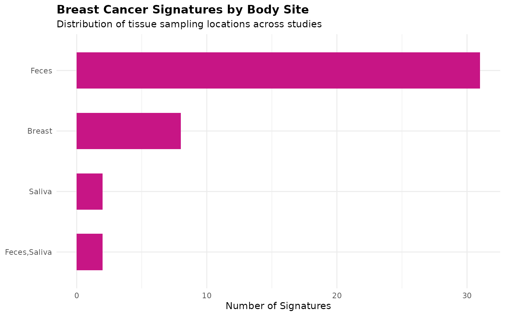
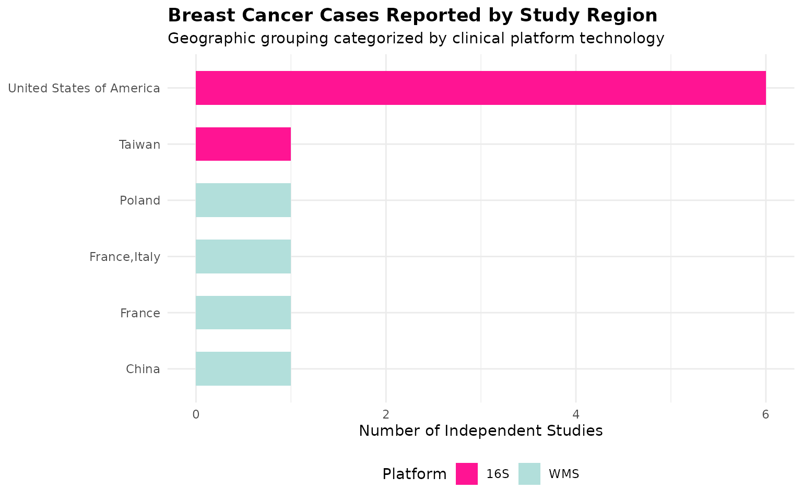
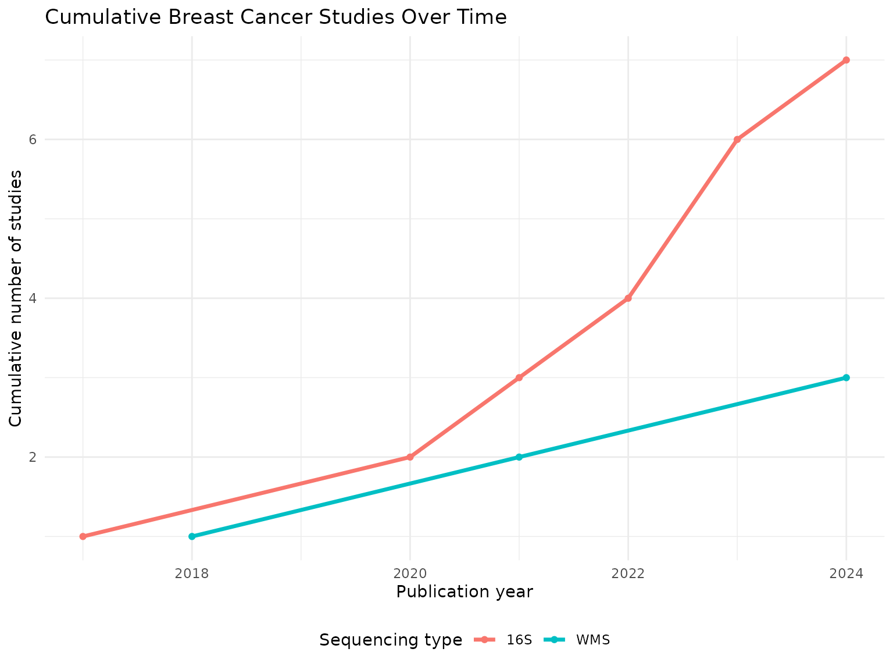
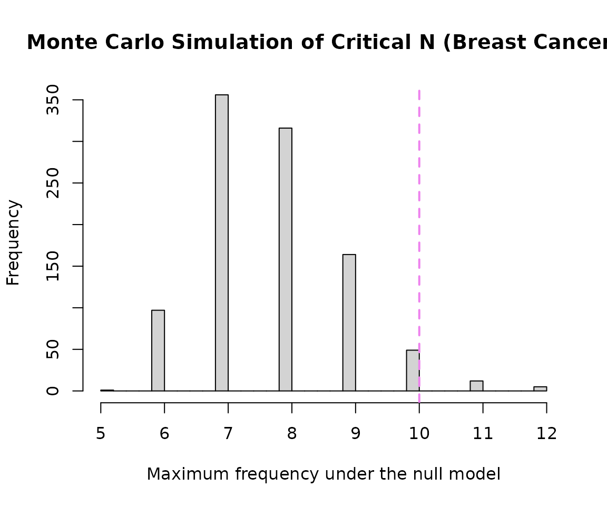
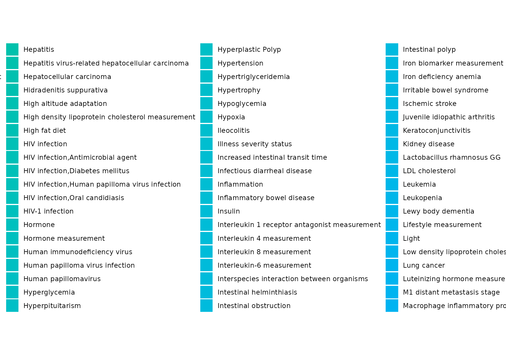
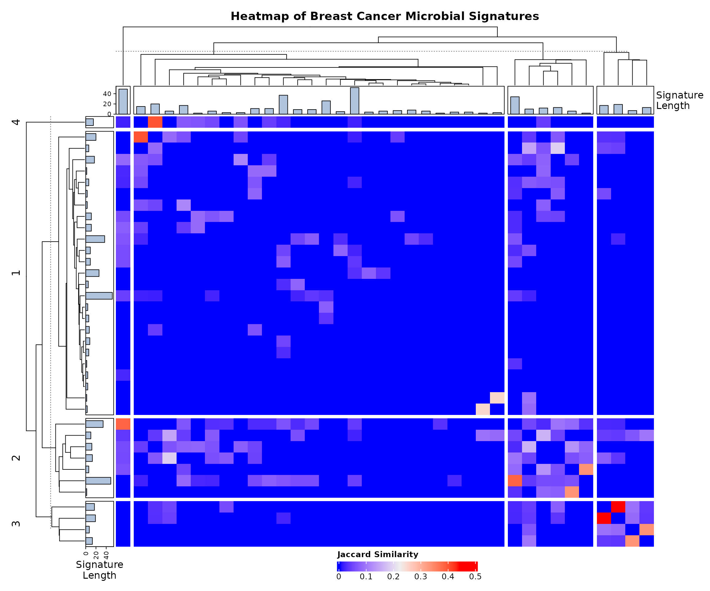

# Focused Sub-Analysis of Breast Cancer Microbial Signatures

## Introduction

This vignette demonstrates a focused sub-analysis of microbial
signatures associated specifically with breast cancer using BugSigDB.
Unlike the Cervical Cancer sub-analysis, no body-site restriction is
applied by default here: breast cancer microbiome research spans both
breast tissue itself and fecal/gut samples (investigating the gut-breast
axis), so restricting to breast tissue alone would discard a
substantial, legitimately relevant portion of the evidence base. This
notebook also evaluates how breast-cancer-associated taxa overlap with
other broader women’s health conditions.

## Download and Prepare Data

``` r

full.dat <- bugsigdbr::importBugSigDB(cache = FALSE)
```

``` r

# Remove empty signatures
ind1 <- lengths(full.dat[["MetaPhlAn taxon names"]]) > 0
ind2 <- lengths(full.dat[["NCBI Taxonomy IDs"]]) > 0
dat <- full.dat[ind1 & ind2, ]
```

## Select Breast Cancer Specific Signatures

``` r

breast_terms <- c(
  "Breast cancer",
  "Breast cancer stage",
  "Breast carcinoma",
  "HER2 Positive Breast Carcinoma"
)

breast_dat <- dat %>%
  filter(Condition %in% breast_terms) %>%
  distinct()

nrow(breast_dat)
```

    ## [1] 43

``` r

breast_dat %>%
  count(Condition, sort = TRUE) %>%
  knitr::kable()
```

| Condition                      |   n |
|:-------------------------------|----:|
| Breast cancer                  |  33 |
| Breast carcinoma               |   6 |
| Breast cancer stage            |   2 |
| HER2 Positive Breast Carcinoma |   2 |

## Study Characteristics

``` r

study.summary <- breast_dat %>%
  count(`Body site`, `Sequencing type`)

knitr::kable(study.summary)
```

| Body site    | Sequencing type |   n |
|:-------------|:----------------|----:|
| Breast       | 16S             |   8 |
| Feces        | 16S             |  22 |
| Feces        | WMS             |   9 |
| Feces,Saliva | 16S             |   2 |
| Saliva       | 16S             |   2 |

``` r

breast_dat %>%
  count(Year) %>%
  arrange(Year) %>%
  knitr::kable()
```

| Year |   n |
|-----:|----:|
| 2017 |   2 |
| 2018 |   2 |
| 2020 |   6 |
| 2021 |   8 |
| 2022 |   6 |
| 2023 |   4 |
| 2024 |  15 |

The body site breakdown above shows how the evidence splits between
breast tissue itself and other sites (most likely feces, reflecting
gut-breast axis research). Review this table before deciding whether a
body-site restriction is warranted for your specific research question -
the default here keeps all sites.

### Demographic & Anatomy Metrics Visualisations

``` r

breast_dat %>%
  count(`Body site`, sort = TRUE) %>%
  ggplot(aes(x = reorder(`Body site`, n), y = n)) +
  geom_col(fill = "#C71585", width = 0.6) +
  coord_flip() +
  labs(
    title = "Breast Cancer Signatures by Body Site",
    subtitle = "Distribution of tissue sampling locations across studies",
    x = NULL, y = "Number of Signatures"
  ) +
  theme_minimal(base_size = 11) +
  theme(plot.title = element_text(face = "bold"))
```



``` r

breast_dat %>%
  distinct(PMID, `Location of subjects`, `Sequencing type`) %>%
  count(`Location of subjects`, `Sequencing type`) %>%
  filter(!is.na(`Location of subjects`)) %>%
  ggplot(aes(x = reorder(`Location of subjects`, n), y = n, fill = `Sequencing type`)) +
  geom_col(width = 0.6) +
  scale_fill_manual(values = c("16S" = "#FF1493", "WMS" = "#B2DFDB")) +
  coord_flip() +
  labs(
    title = "Breast Cancer Cases Reported by Study Region",
    subtitle = "Geographic grouping categorized by clinical platform technology",
    x = NULL, y = "Number of Independent Studies", fill = "Platform"
  ) +
  theme_minimal(base_size = 11) +
  theme(
    plot.title = element_text(face = "bold"),
    legend.position = "bottom"
  )
```



``` r

breast_dat %>%
  distinct(PMID, Year, `Sequencing type`) %>%
  filter(!is.na(Year)) %>%
  count(Year, `Sequencing type`) %>%
  group_by(`Sequencing type`) %>%
  arrange(Year) %>%
  mutate(cumulative_n = cumsum(n)) %>%
  ungroup() %>%
  ggplot(aes(x = Year, y = cumulative_n, color = `Sequencing type`)) +
  geom_line(linewidth = 1.2) +
  geom_point() +
  labs(
    title = "Cumulative Breast Cancer Studies Over Time",
    x = "Publication year", y = "Cumulative number of studies", color = "Sequencing type"
  ) +
  theme_minimal(base_size = 11) +
  theme(legend.position = "bottom")
```



## Taxonomic Summary

``` r

taxa.table <- createTaxonTable(breast_dat)
knitr::kable(head(taxa.table, 20))
```

| Taxon Name | Taxonomic Level | total_signatures | increased_signatures | decreased_signatures | Binomial Test pval |
|:---|:---|---:|---:|---:|---:|
| Bacteroides | genus | 6 | 4 | 2 | 0.69 |
| Eggerthella | genus | 5 | 3 | 2 | 1.00 |
| Streptococcus | genus | 5 | 1 | 4 | 0.37 |
| Oscillospiraceae | family | 5 | 3 | 2 | 1.00 |
| Collinsella aerofaciens | species | 4 | 0 | 4 | 0.12 |
| Ruminococcus | genus | 4 | 1 | 3 | 0.63 |
| Lachnospiraceae | family | 4 | 1 | 3 | 0.63 |
| Anaerostipes | genus | 4 | 0 | 4 | 0.12 |
| Acidaminococcus | genus | 4 | 3 | 1 | 0.63 |
| Dialister | genus | 4 | 0 | 4 | 0.12 |

## Split by Sequencing Type

``` r

breast.wms <- breast_dat %>% filter(`Sequencing type` == "WMS")
breast.16s <- breast_dat %>% filter(`Sequencing type` == "16S")

cat("WMS  - signatures:", nrow(breast.wms), "| studies:", n_distinct(breast.wms$PMID), "\n")
```

    ## WMS  - signatures: 9 | studies: 3

``` r

cat("16S  - signatures:", nrow(breast.16s), "| studies:", n_distinct(breast.16s$PMID), "\n")
```

    ## 16S  - signatures: 34 | studies: 7

## Long-Format Taxon Table Setup

``` r

sigs.breast <- bugsigdbr::getSignatures(breast_dat, tax.id.type = "taxname")

# Also pull a broader copy for cross-condition reference background mapping
sigs.all <- bugsigdbr::getSignatures(dat, tax.id.type = "taxname")

taxon.long <- purrr::map_dfr(seq_along(sigs.all), function(i) {
  taxa <- sigs.all[[i]]
  if (length(taxa) == 0) return(NULL)
  tibble::tibble(sig_id = i, taxon = taxa)
}) %>%
  left_join(
    dat %>%
      mutate(sig_id = row_number()) %>%
      select(sig_id, PMID, Condition, `Sequencing type`, `Abundance in Group 1`),
    by = "sig_id"
  ) %>%
  rename(direction = `Abundance in Group 1`)

cat("Long-format table successfully built with", nrow(taxon.long), "rows.\n")
```

    ## Long-format table successfully built with 58971 rows.

``` r

knitr::kable(head(taxon.long), caption = "Preview of the Structured Long-Format Taxon Table")
```

| sig_id | taxon                      | PMID | Condition | Sequencing type | direction |
|-------:|:---------------------------|-----:|:----------|:----------------|:----------|
|      1 | Acinetobacter johnsonii    |   NA | Obesity   | WMS             | increased |
|      1 | Anaerostipes               |   NA | Obesity   | WMS             | increased |
|      1 | Anaerostipes caccae        |   NA | Obesity   | WMS             | increased |
|      1 | Brachyspira hyodysenteriae |   NA | Obesity   | WMS             | increased |
|      1 | Coprococcus                |   NA | Obesity   | WMS             | increased |
|      1 | Allocoprococcus comes      |   NA | Obesity   | WMS             | increased |

Preview of the Structured Long-Format Taxon Table {.table}

## Taxon Frequency Across Studies

``` r

taxon.freq <- taxon.long %>%
  filter(Condition %in% breast_terms) %>%
  distinct(PMID, taxon, direction) %>%
  count(taxon, direction, name = "n_studies") %>%
  group_by(taxon) %>%
  mutate(total_studies = sum(n_studies)) %>%
  ungroup() %>%
  arrange(desc(total_studies))

n_distinct(taxon.freq$taxon)
```

    ## [1] 294

``` r

taxon.freq %>%
  distinct(taxon, total_studies) %>%
  slice_max(total_studies, n = 15) %>%
  knitr::kable()
```

| taxon                                 | total_studies |
|:--------------------------------------|--------------:|
| Lachnospiraceae                       |             4 |
| Prevotella                            |             4 |
| Anaerostipes                          |             3 |
| Bacillota                             |             3 |
| Mediterraneibacter torques            |             3 |
| Alistipes                             |             2 |
| Bacteroides                           |             2 |
| Bacteroidota                          |             2 |
| Blautia                               |             2 |
| Dialister                             |             2 |
| Dorea longicatena                     |             2 |
| Eggerthella                           |             2 |
| Helotiales                            |             2 |
| Methanobrevibacter                    |             2 |
| Prevotellaceae                        |             2 |
| Saccharomyces                         |             2 |
| Saccharomycetaceae                    |             2 |
| Saccharomycetales                     |             2 |
| Saccharomycetes                       |             2 |
| Trichosporonaceae                     |             2 |
| Trichosporonales                      |             2 |
| \[Clostridium\] leptum                |             2 |
| uncultured Oscillospiraceae bacterium |             2 |

## Core Consensus Signature

``` r

concordance <- taxon.long %>%
  filter(Condition %in% breast_terms) %>%
  distinct(PMID, taxon, direction) %>%
  group_by(taxon) %>%
  summarise(
    n_studies       = n_distinct(PMID),
    n_increased     = sum(direction == "increased"),
    n_decreased     = sum(direction == "decreased"),
    concordance_pct = round(max(n_increased, n_decreased) / n_studies * 100, 1),
    majority_dir    = if_else(n_increased >= n_decreased, "increased", "decreased"),
    .groups = "drop"
  ) %>%
  arrange(desc(n_studies), desc(concordance_pct))

# Standard threshold (matching the General analysis): >=3 studies, >=75% concordance.
# If this returns very few/zero rows given the smaller sample size here, consider
# loosening to >=2 studies / >=70% concordance, as was done for Cervical Cancer -
# and note that deviation explicitly in the Discussion section if you do.
core.sig <- concordance %>%
  filter(n_studies >= 3, concordance_pct >= 75) %>%
  arrange(majority_dir, desc(n_studies))

nrow(core.sig)
```

    ## [1] 0

``` r

knitr::kable(core.sig)
```

| taxon | n_studies | n_increased | n_decreased | concordance_pct | majority_dir |
|-------|-----------|-------------|-------------|-----------------|--------------|

## Core Signature Visualisation

``` r

if (nrow(core.sig) > 0) {
  core.sig %>%
    group_by(majority_dir) %>%
    slice_max(n_studies, n = 15, with_ties = FALSE) %>%
    ungroup() %>%
    mutate(
      direction_label = if_else(majority_dir == "increased", "Increased", "Decreased"),
      taxon_label = paste0(str_wrap(taxon, width = 28), " (", n_studies, ")")
    ) %>%
    ggplot(aes(x = reorder(taxon_label, n_studies), y = n_studies, fill = direction_label)) +
    geom_col(width = 0.7) +
    geom_text(aes(label = paste0(concordance_pct, "%")), hjust = -0.15, size = 3.3) +
    coord_flip(clip = "off") +
    facet_wrap(~direction_label, scales = "free_y", ncol = 1) +
    scale_fill_manual(values = c("Increased" = "#FFB7D5", "Decreased" = "#FDF6E2")) +
    scale_y_continuous(expand = expansion(mult = c(0, 0.35))) +
    labs(
      title = "Core Breast Cancer Consensus Signature",
      x = NULL, y = "Number of independent studies", fill = NULL
    ) +
    theme_minimal(base_size = 12) +
    theme(legend.position = "none", plot.title = element_text(face = "bold"))
} else {
  cat("No taxa met the core-signature threshold at this sample size.")
}
```

    ## No taxa met the core-signature threshold at this sample size.

## WMS vs 16S Concordance

``` r

dir.by.platform <- taxon.long %>%
  filter(Condition %in% breast_terms) %>%
  filter(`Sequencing type` %in% c("WMS", "16S")) %>%
  distinct(PMID, taxon, direction, `Sequencing type`) %>%
  count(taxon, `Sequencing type`, direction, name = "n_studies") %>%
  group_by(taxon, `Sequencing type`) %>%
  slice_max(n_studies, n = 1, with_ties = FALSE) %>%
  ungroup() %>%
  select(taxon, `Sequencing type`, majority_dir = direction)

platform.compare <- dir.by.platform %>%
  pivot_wider(names_from = `Sequencing type`, values_from = majority_dir) %>%
  filter(!is.na(WMS), !is.na(`16S`)) %>%
  rename(dir_WMS = WMS, dir_16S = `16S`) %>%
  mutate(agree = dir_WMS == dir_16S)

nrow(platform.compare)
```

    ## [1] 8

``` r

if (nrow(platform.compare) > 0) {
  sum(platform.compare$agree)
  round(100 * mean(platform.compare$agree), 1)
  knitr::kable(platform.compare)
} else {
  cat("No taxa reported by both WMS and 16S in this breast-cancer dataset.")
}
```

| taxon                      | dir_16S   | dir_WMS   | agree |
|:---------------------------|:----------|:----------|:------|
| Bacillota                  | increased | decreased | FALSE |
| Bacteroides                | increased | increased | TRUE  |
| Bacteroidota               | decreased | increased | FALSE |
| Dialister                  | increased | decreased | FALSE |
| Dorea longicatena          | increased | increased | TRUE  |
| Mediterraneibacter torques | decreased | increased | FALSE |
| Prevotella                 | decreased | decreased | TRUE  |
| \[Clostridium\] leptum     | increased | increased | TRUE  |

## Taxon Enrichment Analysis

``` r

n.universe <- n_distinct(taxon.long %>% filter(Condition %in% breast_terms) %>% pull(taxon))
n.sigs     <- length(sigs.breast)

enrichment.df <- taxon.freq %>%
  distinct(taxon, total_studies) %>%
  mutate(
    observed         = total_studies,
    expected         = n.sigs / n.universe,
    enrichment_ratio = observed / expected,
    log2_enrichment  = log2(enrichment_ratio),
    p_value = purrr::map_dbl(observed, ~ binom.test(
      x = .x, n = n.sigs, p = 1 / n.universe, alternative = "greater"
    )$p.value),
    p_adj = p.adjust(p_value, method = "BH")
  ) %>%
  arrange(p_adj, desc(log2_enrichment))

sum(enrichment.df$p_adj < 0.05)
```

    ## [1] 5

``` r

knitr::kable(head(enrichment.df, 15))
```

| taxon | total_studies | observed | expected | enrichment_ratio | log2_enrichment | p_value | p_adj |
|:---|---:|---:|---:|---:|---:|---:|---:|
| Lachnospiraceae | 4 | 4 | 0.1462585 | 27.34884 | 4.773408 | 0.0000149 | 0.0021839 |
| Prevotella | 4 | 4 | 0.1462585 | 27.34884 | 4.773408 | 0.0000149 | 0.0021839 |
| Anaerostipes | 3 | 3 | 0.1462585 | 20.51163 | 4.358370 | 0.0004386 | 0.0257906 |
| Bacillota | 3 | 3 | 0.1462585 | 20.51163 | 4.358370 | 0.0004386 | 0.0257906 |
| Mediterraneibacter torques | 3 | 3 | 0.1462585 | 20.51163 | 4.358370 | 0.0004386 | 0.0257906 |
| Alistipes | 2 | 2 | 0.1462585 | 13.67442 | 3.773408 | 0.0095236 | 0.1217367 |
| Bacteroides | 2 | 2 | 0.1462585 | 13.67442 | 3.773408 | 0.0095236 | 0.1217367 |
| Bacteroidota | 2 | 2 | 0.1462585 | 13.67442 | 3.773408 | 0.0095236 | 0.1217367 |
| Blautia | 2 | 2 | 0.1462585 | 13.67442 | 3.773408 | 0.0095236 | 0.1217367 |
| Dialister | 2 | 2 | 0.1462585 | 13.67442 | 3.773408 | 0.0095236 | 0.1217367 |
| Dorea longicatena | 2 | 2 | 0.1462585 | 13.67442 | 3.773408 | 0.0095236 | 0.1217367 |
| Eggerthella | 2 | 2 | 0.1462585 | 13.67442 | 3.773408 | 0.0095236 | 0.1217367 |
| Helotiales | 2 | 2 | 0.1462585 | 13.67442 | 3.773408 | 0.0095236 | 0.1217367 |
| Methanobrevibacter | 2 | 2 | 0.1462585 | 13.67442 | 3.773408 | 0.0095236 | 0.1217367 |
| Prevotellaceae | 2 | 2 | 0.1462585 | 13.67442 | 3.773408 | 0.0095236 | 0.1217367 |

## Monte Carlo Critical N

``` r

siglengths <- lengths(breast_dat$`MetaPhlAn taxon names`)

criticalN <- getCriticalN(
  relevant.sigs = breast_dat$`MetaPhlAn taxon names`,
  siglengths = siglengths
)

criticalN
```

    ## $critical_n
    ## 95% 
    ##  10 
    ## 
    ## $ci_lower
    ## 2.5% 
    ##   10 
    ## 
    ## $ci_upper
    ## 97.5% 
    ##    10 
    ## 
    ## $simulated_values
    ##    [1]  7  7  7  8  7  8  7  8  7  7  7  6  9  7  7  7  7  7  9  7  8  6  9  8
    ##   [25]  6  8  8  8  6  8  8  8  7  6  7  8  6  6  9  7  7  7  8  9  6  9  8  9
    ##   [49]  7  7  8  8  7  8  7  6  7  7  8  7  8  9  8  9  9  9  8  8  7  7  9  8
    ##   [73]  8  6  8  8  8  7  8  9  8  8  7  9  8  7  9  6  7 10  7  6  7  7  8  7
    ##   [97]  8 10  7  7  7  7  7  8  6  8  8  7  7  7  8  8  8  8  7  8  7  8  8  9
    ##  [121]  6  7  6  9  5  8  7  7  9  8 11  8  9  7  6  7  7  8  9  9  8  7  7  9
    ##  [145]  6  8  7  6  8  7  7  7 11  7  6  8 10  9  8  8  8  9  8  7  9  8  9  7
    ##  [169]  9  8  7  9  8  8  7 10  7  8  9  7  8  8  8  6  7  7  8  8  8  9  8  8
    ##  [193]  9 12  7  9  9  7  9  6  7  8  9  7  8  8 10  8  6  8  7  8  9  7  7  7
    ##  [217]  7  8  8 10  7  7  7  7  8  8  8 10  8  7  9  9  6  8  9  8 10  9  7  8
    ##  [241]  9  8  9  9  7  8  7  6  8  9  7 10  8  7  7  8 10  7  8  7  8  8  8  6
    ##  [265]  7  8  7  8  9 11  9  8  9  7  9  8  8  8  9  7  7  7  8  7  7  8  6 12
    ##  [289]  7  9  9  7  7  8  6  8  7  9  7  9  7 10  9  8  7 11  7  7  8  9  9  7
    ##  [313]  9 11  7  9 10  8  6  8  8  8  7  7  8  7  9 10  7  9  7  8  7  7  7  8
    ##  [337] 10 10  8  8 10  9  9  6  7  7  6  8  6  8  9  8  7  9  7  7  6  7 10  6
    ##  [361]  7  8  9  8  9  7  9  7  7  8  9  8  7  8  7  8  7  9  8  9  7  8  7  7
    ##  [385]  8 11  9  7  7  7  9  7  9  8  7  7  7  9  7  7  9  7  6 10  7  8  8  7
    ##  [409]  7  7  6  8  8  8 11  6 10  6  8  7  7  7  9  8  6 10  6  8  8 10  7 11
    ##  [433]  8  7  6  7  7  8  8  8  8  8  8  7  7 10  7  8  8  7  9  7  6 10  7  7
    ##  [457]  7  7  6  8  8  7  8  8  7  8  7  9  8  7  7  7  8  6  7  9 10  7  7  7
    ##  [481]  8  7  9  7 10  8  8  8  8  7  7  8  8  9  7  7  6  9  6  8  8  7  9  6
    ##  [505]  8  9  8  7  6  7  8  7 12  9  8  7  8  7  7  8  6  9  7  7  8  9  6  9
    ##  [529]  8  6  8  8  7  9  8  7  7  7  7  9  8  7  8  7  9  7  7  8  9  7  6  7
    ##  [553]  7  7  9  7  7  7  7 10  8  8  9  7  7 10  8  9  7  7  7  8  9  9  7  6
    ##  [577]  6  8  7  6  7  9  7  8  9  7  7  7  8  9  9 10  8  7  7 10  7  9  7  7
    ##  [601]  9  7 11  7  9  6  8  7  9  8  6  8  9  8  7  9  6  6  9  6  8  8  7  8
    ##  [625] 11  6  9  8  7  8  8  9  8  7  7  6  8  6  8  7  7  9  6  7 12  8  7  8
    ##  [649]  8  8  9  8  7  8  8  7  8  8  8  9  8  7  8  8  6  7  7  8  7  6  9  8
    ##  [673]  7  8  7  6  8  7  9  8  7  8 10  8  7  7  6  7  9  8 12  8  7  8  7  7
    ##  [697]  6  7  8  7  8  7  6  7  8  7  8  6  7  7  8  7  9  7  7  7  9  7  7  7
    ##  [721]  8  7  8  6  7  9  8  7  9  9  8  9  6  7  7  9  8  7  7  7  9  8 10  8
    ##  [745]  7  8  8  7  8  7 10  7  7  7  9  7 10  8  9  9  7 10  8  8  6  8  8  8
    ##  [769]  8  7  7  7  8  9 10  8  8  7  8  8  9  8  6  7  8  8  9  8  9  9  6  9
    ##  [793]  6 10  7 10  9  7  9  9  7  6  7  8  8  7  8  7  7  7  7  6  7  7  7  9
    ##  [817] 10  8  8  8  7  9  9  9  8  8 10  8  8  8  7  9  8  7  6  6  8  9  8  8
    ##  [841]  8  8  7  8  6  9  8  7  9 10  9  8  9  7  6  7  7  6  8  7  9  9  7 10
    ##  [865]  8  8  8  8  8  7 10  8  8 11  8  7  6  8  8 10  8  7  7  8  7  7 10  9
    ##  [889]  7  6  7  7  7  7  6  7  8  7  8  8  8  8  9  7  7  7  7  8  8  8  7  9
    ##  [913]  8  8  6  8 11  7  8  8  8  7  8  7  6  7  9  7 10  6  8  7  7  7 10  8
    ##  [937]  7  8  6  7  6  9 10  6  7  9  8  7  7  8  8  9  7  8  9  7  7  8  9  7
    ##  [961]  8  9  9  9  8  7  8  6 10  7  8  7  9  7  7  7  9  8  8  7  8  6  6  8
    ##  [985]  9 10  7  6  7  8  9  7  7  8  7  7  7  7  6  8
    ## 
    ## $alpha
    ## [1] 0.05
    ## 
    ## $quantile_label
    ## [1] "95th percentile"

``` r

hist(
  criticalN$simulated_values,
  breaks = 30,
  main = "Monte Carlo Simulation of Critical N (Breast Cancer)",
  xlab = "Maximum frequency under the null model"
)

abline(
  v = criticalN$critical_n,
  col = "violet",
  lwd = 2,
  lty = 2
)
```



## Cross-Condition Taxa Overlap Analysis

This section explores whether the taxa altered in breast cancer are
unique to breast tissue/tumor microenvironment changes or represent
shared dysbiosis markers also seen across other women’s health
conditions.

``` r

breast_taxa <- taxon.long %>%
  filter(Condition %in% breast_terms) %>%
  distinct(taxon) %>%
  pull(taxon)

shared_taxa_counts <- taxon.long %>%
  filter(taxon %in% breast_taxa) %>%
  group_by(taxon) %>%
  summarise(
    total_womens_health_studies = n_distinct(PMID),
    distinct_conditions_linked = n_distinct(Condition),
    top_other_conditions = paste(
      head(setdiff(unique(Condition), breast_terms), 3),
      collapse = ", "
    ),
    .groups = "drop"
  ) %>%
  arrange(desc(distinct_conditions_linked))

shared_taxa_counts %>%
  slice_max(distinct_conditions_linked, n = 20, with_ties = FALSE) %>%
  knitr::kable(
    caption = "Top Breast-Cancer-Associated Taxa and Their Links to Other Women's Health Conditions",
    col.names = c("Taxon Name", "Total WH Studies", "Total Distinct Conditions", "Other Conditions it Often Appears In")
  )
```

| Taxon Name | Total WH Studies | Total Distinct Conditions | Other Conditions it Often Appears In |
|:---|---:|---:|:---|
| Prevotella | 354 | 211 | Illness severity status, Antimicrobial agent, Obesity |
| Lactobacillus | 335 | 201 | Antimicrobial agent, Oxygen, Illness severity status |
| Bacteroides | 345 | 199 | Autism, Autoimmune disease, Obesity |
| Lachnospiraceae | 331 | 199 | Autoimmune disease, Smoking behavior, Irritable bowel syndrome |
| Bacillota | 313 | 190 | Type II diabetes mellitus, Autism, Autoimmune disease |
| Faecalibacterium | 278 | 183 | Obesity, Autoimmune disease, Irritable bowel syndrome |
| Bifidobacterium | 275 | 177 | Food allergy, Irritable bowel syndrome, Autism |
| Clostridium | 258 | 175 | Irritable bowel syndrome, Autism, Autoimmune disease |
| Actinomycetota | 265 | 171 | Autism, Ethnic group,Place of residence measurement, Ulcerative colitis |
| Pseudomonadota | 241 | 166 | Autism, Autoimmune disease, Ethnic group,Place of residence measurement |
| Roseburia | 228 | 165 | Autoimmune disease, Smoking behavior, Irritable bowel syndrome |
| Blautia | 246 | 164 | Autoimmune disease, Irritable bowel syndrome, Colorectal cancer |
| Veillonella | 241 | 161 | Obesity, Antimicrobial agent, Oxygen |
| Bacteroidota | 247 | 158 | Autism, Autoimmune disease, Irritable bowel syndrome |
| Enterobacteriaceae | 213 | 155 | Autoimmune disease, Irritable bowel syndrome, Sampling site |
| Alistipes | 198 | 148 | Autoimmune disease, Irritable bowel syndrome, Colorectal cancer |
| Ruminococcus | 218 | 147 | Autism, Autoimmune disease, Irritable bowel syndrome |
| Parabacteroides | 208 | 145 | Autism, Autoimmune disease, Irritable bowel syndrome |
| Clostridia | 188 | 140 | Type II diabetes mellitus, Autoimmune disease, Colorectal carcinoma |
| Lactobacillaceae | 194 | 134 | Autoimmune disease, Antimicrobial agent, Psoriasis |

Top Breast-Cancer-Associated Taxa and Their Links to Other Women’s
Health Conditions {.table}

## Shared Dysbiosis Visualisation

``` r

top_shared_taxa <- shared_taxa_counts %>%
  filter(distinct_conditions_linked > 1) %>%
  slice_max(total_womens_health_studies, n = 15, with_ties = FALSE) %>%
  pull(taxon)

if (length(top_shared_taxa) > 0) {
  taxon.long %>%
    filter(taxon %in% top_shared_taxa) %>%
    mutate(Condition_Group = if_else(Condition %in% breast_terms, "Breast Cancer", Condition)) %>%
    count(taxon, Condition_Group) %>%
    ggplot(aes(x = reorder(taxon, n), y = n, fill = Condition_Group)) +
    geom_col() +
    coord_flip() +
    labs(
      title = "Breast Cancer Taxa Active in Other Conditions",
      subtitle = "Tracking where prominent breast-cancer-associated microbes show up elsewhere",
      x = NULL, y = "Total Signature Mentions", fill = "Condition Group"
    ) +
    theme_minimal(base_size = 11) +
    theme(legend.position = "right")
}
```



## Signature Similarity and Heatmap

``` r

allsigs <- bugsigdbr::getSignatures(breast_dat, tax.id.type = "taxname")
allsigs <- allsigs[sapply(allsigs, length) > 1]

if (length(allsigs) > 1) {
  jmat <- BugSigDBStats::calcJaccardSimilarity(allsigs)
  siglengths <- sapply(allsigs, length)

  ha <- HeatmapAnnotation(
    `Signature\nLength` = anno_barplot(siglengths, gp = gpar(fill = "#B0C4DE"), height = unit(1.2, "cm"))
  )
  hr <- rowAnnotation(
    `Signature\nLength` = anno_barplot(siglengths, gp = gpar(fill = "#B0C4DE"), width = unit(1.2, "cm"))
  )

  hm <- Heatmap(
    jmat,
    top_annotation = ha,
    left_annotation = hr,
    show_row_names = FALSE,
    show_column_names = FALSE,

    row_km = 4,
    column_km = 4,
    row_gap = unit(1.5, "mm"),
    column_gap = unit(1.5, "mm"),

    row_dend_width = unit(2.5, "cm"),
    column_dend_height = unit(2.5, "cm"),

    column_title = "Heatmap of Breast Cancer Microbial Signatures",
    column_title_gp = gpar(fontsize = 14, fontface = "bold"),
    heatmap_legend_param = list(
      title = "Jaccard Similarity",
      direction = "horizontal",
      legend_width = unit(6, "cm")
    )
  )

  draw(hm, heatmap_legend_side = "bottom", padding = unit(c(5, 5, 5, 5), "mm"))

  png(filename = "BreastCancer_heatmap.png", width = 12, height = 10, units = "in", res = 300)
  draw(hm, heatmap_legend_side = "bottom", padding = unit(c(5, 5, 5, 5), "mm"))
  dev.off()
}
```



    ## agg_png 
    ##       2

## Dendrogram

``` r

if (exists("jmat") && nrow(jmat) > 1) {
  hc <- hclust(as.dist(1 - jmat))
  dend <- as.dendrogram(hc)

  par(mar = c(5, 2, 4, 2))

  plot(
    dend,
    horiz = TRUE,
    leaflab = "none",
    main = "Hierarchical Cluster Map of Breast Cancer Microbial Signatures",
    xlab = "Distance (1 - Jaccard similarity)",
    cex.main = 1.3,
    lwd = 0.8
  )
}
```


