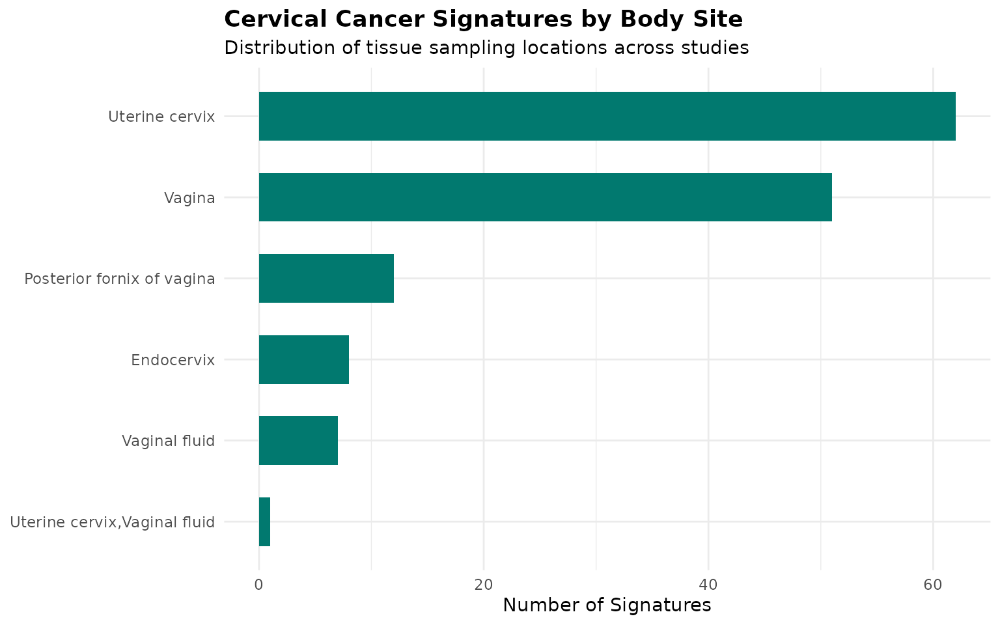
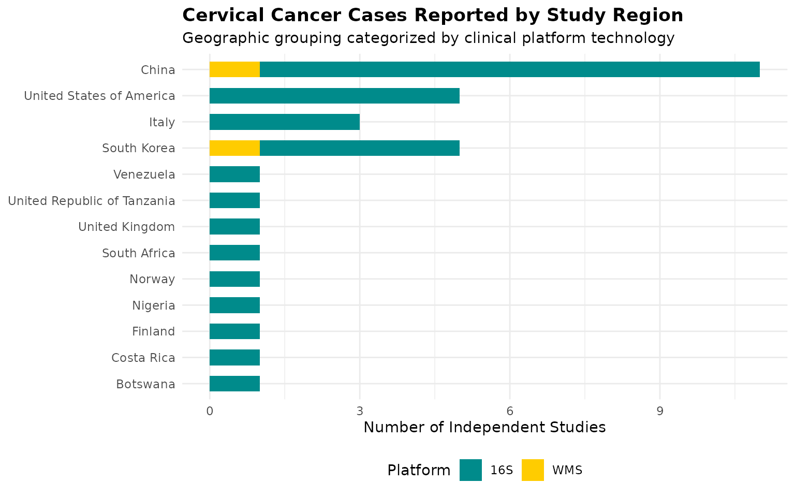
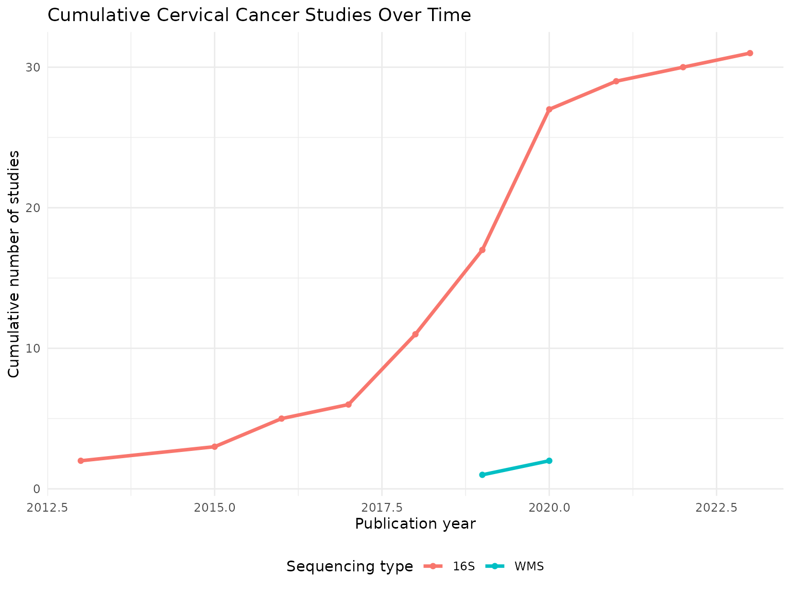
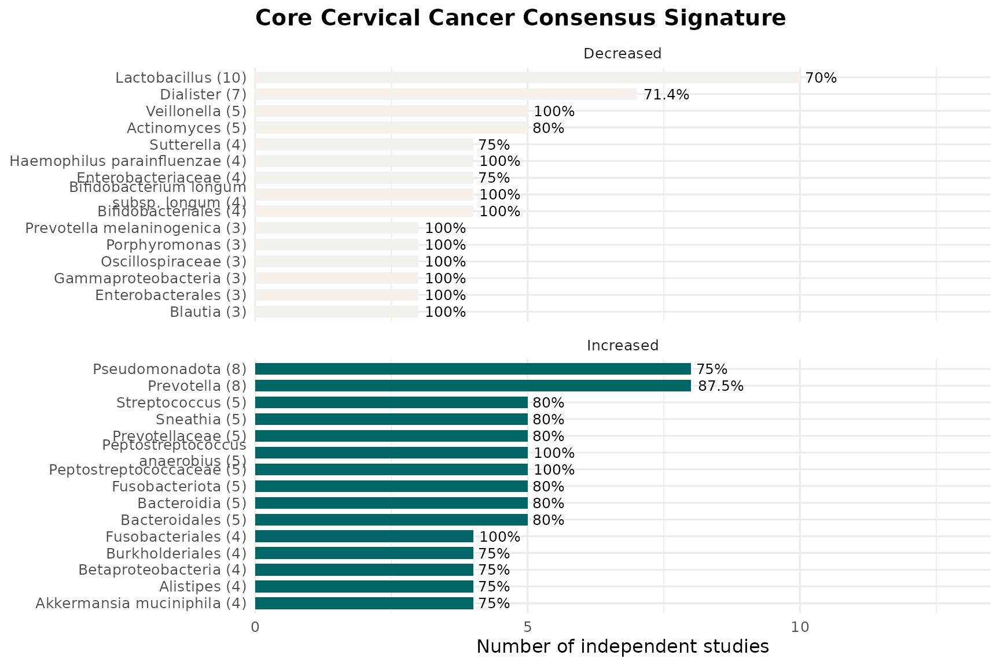
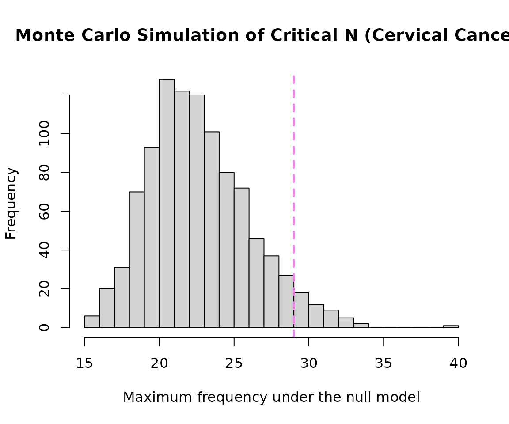
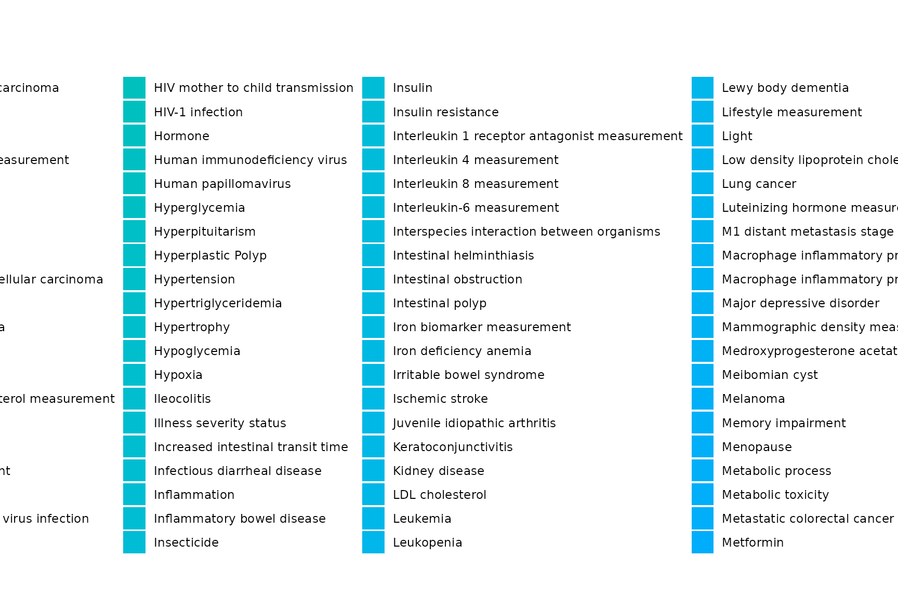
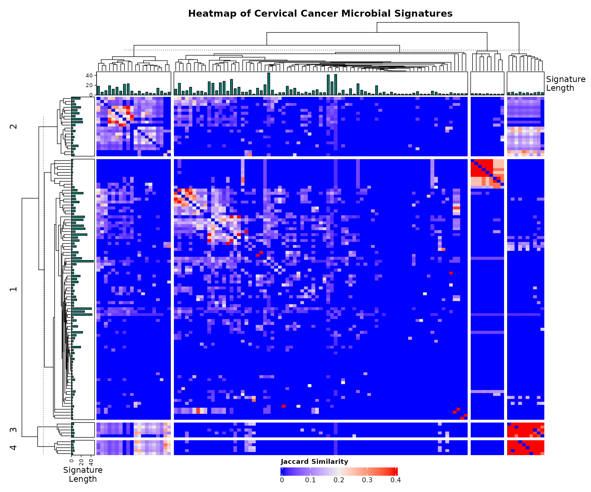

# Focused Sub-Analysis of Cervical Cancer Microbial Signatures

## Introduction

This vignette demonstrates a focused sub-analysis of microbial
signatures associated specifically with cervical cancer and its
precursors (HPV and cervical neoplasia) using BugSigDB. This notebook
also evaluates how these specific taxa overlap with other broader
women’s health conditions.

## Download and Prepare Data

``` r

full.dat <- bugsigdbr::importBugSigDB(cache = FALSE)
```

``` r

# Remove empty signatures
ind1 <- lengths(full.dat[["MetaPhlAn taxon names"]]) > 0
ind2 <- lengths(full.dat[["NCBI Taxonomy IDs"]]) > 0
dat <- full.dat[ind1 & ind2, ]
```

## Select Cervical Cancer Specific Signatures

Here we filter exclusively for cervical cancer, cervical intraepithelial
neoplasia, and HPV-related conditions. We restrict our data workspace to
reproductive tract body sites to strip out unrelated background noise.

``` r

cervical_terms <- c(
  "Cervical cancer", 
  "Cervical glandular intraepithelial neoplasia",
  "Cervical glandular intraepithelial neoplasia,Cervical cancer",
  "Cervical glandular intraepithelial neoplasia,Human papilloma virus infection",
  "Cervix erosion", 
  "Human papilloma virus infection", 
  "Human papilloma virus infection,Age",
  "Human papilloma virus infection,Cervical cancer",
  "Human papilloma virus infection,Cervical glandular intraepithelial neoplasia",
  "Chlamydophila infectious disease,Human papilloma virus infection"
)

# Filter conditions and ensure relevant reproductive tract body sites
cervical_dat <- dat %>%
  filter(Condition %in% cervical_terms) %>%
  filter(str_detect(`Body site`, "vagina|Vagina|cervix|Cervix|Endocervix|fornix")) %>%
  distinct()

nrow(cervical_dat)
```

    ## [1] 141

``` r

cervical_dat %>%
  count(Condition, sort = TRUE) %>%
  knitr::kable()
```

| Condition | n |
|:---|---:|
| Human papilloma virus infection | 67 |
| Cervical glandular intraepithelial neoplasia | 48 |
| Cervical cancer | 12 |
| Cervical glandular intraepithelial neoplasia,Human papilloma virus infection | 6 |
| Cervical glandular intraepithelial neoplasia,Cervical cancer | 2 |
| Cervix erosion | 2 |
| Chlamydophila infectious disease,Human papilloma virus infection | 2 |
| Human papilloma virus infection,Cervical cancer | 2 |

## Study Characteristics

``` r

study.summary <- cervical_dat %>%
  count(`Body site`, `Sequencing type`)

knitr::kable(study.summary)
```

| Body site                    | Sequencing type |   n |
|:-----------------------------|:----------------|----:|
| Endocervix                   | 16S             |   8 |
| Posterior fornix of vagina   | 16S             |  12 |
| Uterine cervix               | 16S             |  58 |
| Uterine cervix               | WMS             |   4 |
| Uterine cervix,Vaginal fluid | 16S             |   1 |
| Vagina                       | 16S             |  51 |
| Vaginal fluid                | 16S             |   5 |
| Vaginal fluid                | WMS             |   2 |

``` r

cervical_dat %>%
  count(Year) %>%
  arrange(Year) %>%
  knitr::kable()
```

| Year |   n |
|-----:|----:|
| 2013 |   6 |
| 2015 |   2 |
| 2016 |   8 |
| 2017 |   4 |
| 2018 |  31 |
| 2019 |  34 |
| 2020 |  42 |
| 2021 |  11 |
| 2022 |   1 |
| 2023 |   2 |

### Demographic & Anatomy Metrics Visualisations

``` r

# Plotting the unique anatomic anatomical tracking points for Cervical Cancer tracking
cervical_dat %>%
  count(`Body site`, sort = TRUE) %>%
  ggplot(aes(x = reorder(`Body site`, n), y = n)) +
  geom_col(fill = "#01796F", width = 0.6) +
  coord_flip() +
  labs(
    title = "Cervical Cancer Signatures by Body Site",
    subtitle ="Distribution of tissue sampling locations across studies" ,
    x = NULL, y = "Number of Signatures"
  ) +
  theme_minimal(base_size = 11) +
  theme(plot.title = element_text(face = "bold"))
```



## Geographical Trends

``` r

# Plotting case counts reported across international tracking zones
cervical_dat %>%
  distinct(PMID, `Location of subjects`, `Sequencing type`) %>%
  count(`Location of subjects`, `Sequencing type`) %>%
  filter(!is.na(`Location of subjects`)) %>%
  ggplot(aes(x = reorder(`Location of subjects`, n), y = n, fill = `Sequencing type`)) +
  geom_col(width = 0.6) +
  scale_fill_manual(values = c("16S" = "#008B8B", "WMS" = "#FFCC00")) +
  coord_flip() +
  labs(
    title = "Cervical Cancer Cases Reported by Study Region",
    subtitle = "Geographic grouping categorized by clinical platform technology",
    x = NULL, y = "Number of Independent Studies", fill = "Platform"
  ) +
  theme_minimal(base_size = 11) +
  theme(
    plot.title = element_text(face = "bold"),
    legend.position = "bottom"
  )
```



## Temporal trends plot

``` r

cervical_dat %>%
  distinct(PMID, Year, `Sequencing type`) %>%
  filter(!is.na(Year)) %>%
  count(Year, `Sequencing type`) %>%
  group_by(`Sequencing type`) %>%
  arrange(Year) %>%
  mutate(cumulative_n = cumsum(n)) %>%
  ungroup() %>%
  ggplot(aes(x = Year, y = cumulative_n, color = `Sequencing type`)) +
  geom_line(linewidth = 1.2) +
  geom_point() +
  labs(
    title = "Cumulative Cervical Cancer Studies Over Time",
    x = "Publication year", y = "Cumulative number of studies", color = "Sequencing type"
  ) +
  theme_minimal(base_size = 11) +
  theme(legend.position = "bottom")
```



## Taxonomic Summary

``` r

taxa.table <- createTaxonTable(cervical_dat)
knitr::kable(head(taxa.table, 20))
```

| Taxon Name | Taxonomic Level | total_signatures | increased_signatures | decreased_signatures | Binomial Test pval |
|:---|:---|---:|---:|---:|---:|
| Lactobacillus | genus | 26 | 6 | 20 | 0.00940 |
| Sneathia | genus | 19 | 16 | 3 | 0.00440 |
| Gardnerella | genus | 14 | 7 | 7 | 1.00000 |
| Gardnerella vaginalis | species | 14 | 14 | 0 | 0.00012 |
| Lactobacillales | order | 14 | 1 | 13 | 0.00180 |
| Megasphaera | genus | 14 | 12 | 2 | 0.01300 |
| Prevotella | genus | 13 | 11 | 2 | 0.02200 |
| Dialister | genus | 12 | 6 | 6 | 1.00000 |
| Bacilli | class | 11 | 1 | 10 | 0.01200 |
| Lactobacillaceae | family | 11 | 1 | 10 | 0.01200 |

``` r

cervical.wms <- cervical_dat %>% filter(`Sequencing type` == "WMS")
cervical.16s <- cervical_dat %>% filter(`Sequencing type` == "16S")

cat("WMS  - signatures:", nrow(cervical.wms), "| studies:", n_distinct(cervical.wms$PMID), "\n")
```

    ## WMS  - signatures: 6 | studies: 2

``` r

cat("16S  - signatures:", nrow(cervical.16s), "| studies:", n_distinct(cervical.16s$PMID), "\n")
```

    ## 16S  - signatures: 135 | studies: 31

## Long-Format Taxon Table Setup

``` r

sigs.cervical <- bugsigdbr::getSignatures(cervical_dat, tax.id.type = "taxname")

# Also pull a broader copy for cross-condition reference background mapping
sigs.all <- bugsigdbr::getSignatures(dat, tax.id.type = "taxname")

taxon.long <- purrr::map_dfr(seq_along(sigs.all), function(i) {
  taxa <- sigs.all[[i]]
  if (length(taxa) == 0) return(NULL)
  tibble::tibble(sig_id = i, taxon = taxa)
}) %>%
  left_join(
    dat %>%
      mutate(sig_id = row_number()) %>%
      select(sig_id, PMID, Condition, `Sequencing type`, `Abundance in Group 1`),
    by = "sig_id"
  ) %>%
  rename(direction = `Abundance in Group 1`)

# --- ADD THESE LINES TO CREATE A VISIBLE PREVIEW ---
cat("Long-format table successfully built with", nrow(taxon.long), "rows.\n")
```

    ## Long-format table successfully built with 58971 rows.

``` r

# Display the first 6 rows of your processed data frame as a styled report table
knitr::kable(head(taxon.long), caption = "Preview of the Structured Long-Format Taxon Table")
```

| sig_id | taxon                      | PMID | Condition | Sequencing type | direction |
|-------:|:---------------------------|-----:|:----------|:----------------|:----------|
|      1 | Acinetobacter johnsonii    |   NA | Obesity   | WMS             | increased |
|      1 | Anaerostipes               |   NA | Obesity   | WMS             | increased |
|      1 | Anaerostipes caccae        |   NA | Obesity   | WMS             | increased |
|      1 | Brachyspira hyodysenteriae |   NA | Obesity   | WMS             | increased |
|      1 | Coprococcus                |   NA | Obesity   | WMS             | increased |
|      1 | Allocoprococcus comes      |   NA | Obesity   | WMS             | increased |

Preview of the Structured Long-Format Taxon Table {.table}

## Core Consensus Signature

``` r

concordance <- taxon.long %>%
  filter(Condition %in% cervical_terms) %>%
  distinct(PMID, taxon, direction) %>%
  group_by(taxon) %>%
  summarise(
    n_studies       = n_distinct(PMID),
    n_increased     = sum(direction == "increased"),
    n_decreased     = sum(direction == "decreased"),
    concordance_pct = round(max(n_increased, n_decreased) / n_studies * 100, 1),
    majority_dir    = if_else(n_increased >= n_decreased, "increased", "decreased"),
    .groups = "drop"
  ) %>%
  arrange(desc(n_studies), desc(concordance_pct))

core.sig <- concordance %>%
  filter(n_studies >= 2, concordance_pct >= 70) %>%
  arrange(majority_dir, desc(n_studies))

knitr::kable(core.sig)
```

| taxon | n_studies | n_increased | n_decreased | concordance_pct | majority_dir |
|:---|---:|---:|---:|---:|:---|
| Lactobacillus | 10 | 5 | 7 | 70.0 | decreased |
| Dialister | 7 | 3 | 5 | 71.4 | decreased |
| Veillonella | 5 | 1 | 5 | 100.0 | decreased |
| Actinomyces | 5 | 1 | 4 | 80.0 | decreased |
| Bifidobacteriales | 4 | 1 | 4 | 100.0 | decreased |
| Bifidobacterium longum subsp. longum | 4 | 0 | 4 | 100.0 | decreased |
| Haemophilus parainfluenzae | 4 | 1 | 4 | 100.0 | decreased |
| Enterobacteriaceae | 4 | 2 | 3 | 75.0 | decreased |
| Sutterella | 4 | 1 | 3 | 75.0 | decreased |
| Blautia | 3 | 0 | 3 | 100.0 | decreased |
| Enterobacterales | 3 | 1 | 3 | 100.0 | decreased |
| Gammaproteobacteria | 3 | 1 | 3 | 100.0 | decreased |
| Oscillospiraceae | 3 | 0 | 3 | 100.0 | decreased |
| Porphyromonas | 3 | 2 | 3 | 100.0 | decreased |
| Prevotella melaninogenica | 3 | 0 | 3 | 100.0 | decreased |
| Streptococcus parasanguinis | 3 | 1 | 3 | 100.0 | decreased |
| Bifidobacterium pseudocatenulatum | 2 | 0 | 2 | 100.0 | decreased |
| Collinsella aerofaciens | 2 | 0 | 2 | 100.0 | decreased |
| Eggerthella | 2 | 0 | 2 | 100.0 | decreased |
| Escherichia | 2 | 1 | 2 | 100.0 | decreased |
| Mobiluncus mulieris | 2 | 1 | 2 | 100.0 | decreased |
| Porphyromonas endodontalis | 2 | 0 | 2 | 100.0 | decreased |
| Prevotella amnii | 2 | 1 | 2 | 100.0 | decreased |
| Roseburia intestinalis | 2 | 0 | 2 | 100.0 | decreased |
| Ruminococcus sp. 5_1_39BFAA | 2 | 0 | 2 | 100.0 | decreased |
| Schaalia odontolytica | 2 | 0 | 2 | 100.0 | decreased |
| Shigella | 2 | 1 | 2 | 100.0 | decreased |
| Shuttleworthella | 2 | 1 | 2 | 100.0 | decreased |
| Spirochaetota | 2 | 0 | 2 | 100.0 | decreased |
| Streptococcaceae | 2 | 1 | 2 | 100.0 | decreased |
| Streptococcus agalactiae | 2 | 1 | 2 | 100.0 | decreased |
| Tyzzerella | 2 | 0 | 2 | 100.0 | decreased |
| Ureaplasma | 2 | 0 | 2 | 100.0 | decreased |
| Veillonella montpellierensis | 2 | 1 | 2 | 100.0 | decreased |
| Veillonellaceae | 2 | 0 | 2 | 100.0 | decreased |
| Prevotella | 8 | 7 | 5 | 87.5 | increased |
| Pseudomonadota | 8 | 6 | 2 | 75.0 | increased |
| Peptostreptococcaceae | 5 | 5 | 0 | 100.0 | increased |
| Peptostreptococcus anaerobius | 5 | 5 | 0 | 100.0 | increased |
| Bacteroidales | 5 | 4 | 2 | 80.0 | increased |
| Bacteroidia | 5 | 4 | 2 | 80.0 | increased |
| Fusobacteriota | 5 | 4 | 2 | 80.0 | increased |
| Prevotellaceae | 5 | 4 | 1 | 80.0 | increased |
| Sneathia | 5 | 4 | 2 | 80.0 | increased |
| Streptococcus | 5 | 4 | 3 | 80.0 | increased |
| Fusobacteriales | 4 | 4 | 0 | 100.0 | increased |
| Akkermansia muciniphila | 4 | 3 | 2 | 75.0 | increased |
| Alistipes | 4 | 3 | 1 | 75.0 | increased |
| Betaproteobacteria | 4 | 3 | 1 | 75.0 | increased |
| Burkholderiales | 4 | 3 | 1 | 75.0 | increased |
| Clostridia | 4 | 3 | 1 | 75.0 | increased |
| Escherichia coli | 4 | 3 | 1 | 75.0 | increased |
| Gemella | 4 | 3 | 1 | 75.0 | increased |
| Lactobacillaceae | 4 | 3 | 2 | 75.0 | increased |
| Mediterraneibacter torques | 4 | 3 | 2 | 75.0 | increased |
| Pasteurellaceae | 4 | 3 | 2 | 75.0 | increased |
| Segatella copri | 4 | 3 | 1 | 75.0 | increased |
| Veillonella parvula | 4 | 3 | 2 | 75.0 | increased |
| Acinetobacter | 3 | 3 | 0 | 100.0 | increased |
| Atopobium | 3 | 3 | 2 | 100.0 | increased |
| Caldimonas | 3 | 3 | 0 | 100.0 | increased |
| Coprococcus | 3 | 3 | 0 | 100.0 | increased |
| Enterocloster bolteae | 3 | 3 | 0 | 100.0 | increased |
| Aggregatibacter | 2 | 2 | 0 | 100.0 | increased |
| Anaerococcus | 2 | 2 | 1 | 100.0 | increased |
| Bacteroidaceae | 2 | 2 | 0 | 100.0 | increased |
| Bacteroides caccae | 2 | 2 | 0 | 100.0 | increased |
| Bacteroides intestinalis | 2 | 2 | 0 | 100.0 | increased |
| Campylobacter gracilis | 2 | 2 | 0 | 100.0 | increased |
| Cardiobacterium | 2 | 2 | 0 | 100.0 | increased |
| Citrobacter | 2 | 2 | 0 | 100.0 | increased |
| Eikenella corrodens | 2 | 2 | 0 | 100.0 | increased |
| Enterobacter cloacae | 2 | 2 | 0 | 100.0 | increased |
| Fusobacteriaceae | 2 | 2 | 0 | 100.0 | increased |
| Gardnerella vaginalis | 2 | 2 | 0 | 100.0 | increased |
| Granulicatella | 2 | 2 | 0 | 100.0 | increased |
| Granulicatella elegans | 2 | 2 | 0 | 100.0 | increased |
| Haemophilus influenzae | 2 | 2 | 0 | 100.0 | increased |
| Klebsiella | 2 | 2 | 0 | 100.0 | increased |
| Ligilactobacillus salivarius | 2 | 2 | 1 | 100.0 | increased |
| Lysobacteraceae | 2 | 2 | 0 | 100.0 | increased |
| Moryella | 2 | 2 | 1 | 100.0 | increased |
| Mycoplasmataceae | 2 | 2 | 0 | 100.0 | increased |
| Neisseria oralis | 2 | 2 | 0 | 100.0 | increased |
| Neisseria subflava | 2 | 2 | 1 | 100.0 | increased |
| Neisseriaceae | 2 | 2 | 0 | 100.0 | increased |
| Oscillospira | 2 | 2 | 0 | 100.0 | increased |
| Parvimonas micra | 2 | 2 | 0 | 100.0 | increased |
| Peptostreptococcus stomatis | 2 | 2 | 0 | 100.0 | increased |
| Phocaeicola plebeius | 2 | 2 | 0 | 100.0 | increased |
| Prevotella bivia | 2 | 2 | 1 | 100.0 | increased |
| Rhizobiaceae | 2 | 2 | 0 | 100.0 | increased |
| Ruminococcus | 2 | 2 | 0 | 100.0 | increased |
| Selenomonas sputigena | 2 | 2 | 0 | 100.0 | increased |
| Sneathia sanguinegens | 2 | 2 | 1 | 100.0 | increased |
| Sneathia sp. | 2 | 2 | 0 | 100.0 | increased |
| Stenotrophomonas | 2 | 2 | 0 | 100.0 | increased |
| Streptococcus constellatus | 2 | 2 | 0 | 100.0 | increased |
| Streptococcus vestibularis | 2 | 2 | 0 | 100.0 | increased |
| Tannerella | 2 | 2 | 0 | 100.0 | increased |
| \[Eubacterium\] infirmum | 2 | 2 | 0 | 100.0 | increased |

## Taxon Frequency Across Studies

``` r

taxon.freq <- taxon.long %>%
  filter(Condition %in% cervical_terms) %>%
  distinct(PMID, taxon, direction) %>%
  count(taxon, direction, name = "n_studies") %>%
  group_by(taxon) %>%
  mutate(total_studies = sum(n_studies)) %>%
  ungroup() %>%
  arrange(desc(total_studies))

n_distinct(taxon.freq$taxon)
```

    ## [1] 774

``` r

taxon.freq %>%
  distinct(taxon, total_studies) %>%
  slice_max(total_studies, n = 15) %>%
  knitr::kable()
```

| taxon                 | total_studies |
|:----------------------|--------------:|
| Lactobacillus         |            12 |
| Prevotella            |            12 |
| Bacillota             |            11 |
| Bifidobacterium       |            10 |
| Actinomycetota        |             9 |
| Bacteroidota          |             8 |
| Dialister             |             8 |
| Pseudomonadota        |             8 |
| Bifidobacteriaceae    |             7 |
| Lactobacillales       |             7 |
| Megasphaera           |             7 |
| Streptococcus         |             7 |
| Bacteroidales         |             6 |
| Bacteroides           |             6 |
| Bacteroides uniformis |             6 |
| Bacteroidia           |             6 |
| Corynebacterium       |             6 |
| Enterobacter          |             6 |
| Enterococcus          |             6 |
| Eubacteriales         |             6 |
| Faecalibacterium      |             6 |
| Fusobacteriota        |             6 |
| Parabacteroides       |             6 |
| Sneathia              |             6 |
| Veillonella           |             6 |

## Core Signature Visualisation

``` r

if(nrow(core.sig) > 0) {
  core.sig %>%
    group_by(majority_dir) %>%
    slice_max(n_studies, n = 15, with_ties = FALSE) %>%
    ungroup() %>%
    mutate(
      direction_label = if_else(majority_dir == "increased", "Increased", "Decreased"),
      taxon_label = paste0(str_wrap(taxon, width = 28), " (", n_studies, ")")
    ) %>%
    ggplot(aes(x = reorder(taxon_label, n_studies), y = n_studies, fill = direction_label)) +
    geom_col(width = 0.7) +
    geom_text(aes(label = paste0(concordance_pct, "%")), hjust = -0.15, size = 3.3) +
    coord_flip(clip = "off") +
    facet_wrap(~direction_label, scales = "free_y", ncol = 1) +
    scale_fill_manual(values = c("Increased" = "#006666", "Decreased" = "#F4F0EC")) +
    scale_y_continuous(expand = expansion(mult = c(0, 0.35))) +
    labs(
      title = "Core Cervical Cancer Consensus Signature",
      x = NULL, y = "Number of independent studies", fill = NULL
    ) +
    theme_minimal(base_size = 12) +
    theme(legend.position = "none", plot.title = element_text(face = "bold"))
}
```



## WMS vs. 16S concordance

``` r

dir.by.platform <- taxon.long %>%
  filter(Condition %in% cervical_terms) %>%
  filter(`Sequencing type` %in% c("WMS", "16S")) %>%
  distinct(PMID, taxon, direction, `Sequencing type`) %>%
  count(taxon, `Sequencing type`, direction, name = "n_studies") %>%
  group_by(taxon, `Sequencing type`) %>%
  slice_max(n_studies, n = 1, with_ties = FALSE) %>%
  ungroup() %>%
  select(taxon, `Sequencing type`, majority_dir = direction)

platform.compare <- dir.by.platform %>%
  pivot_wider(names_from = `Sequencing type`, values_from = majority_dir) %>%
  filter(!is.na(WMS), !is.na(`16S`)) %>%
  rename(dir_WMS = WMS, dir_16S = `16S`) %>%
  mutate(agree = dir_WMS == dir_16S)

nrow(platform.compare)
```

    ## [1] 29

``` r

if (nrow(platform.compare) > 0) {
  sum(platform.compare$agree)
  round(100 * mean(platform.compare$agree), 1)
  knitr::kable(platform.compare)
} else {
  cat("No taxa reported by both WMS and 16S in this cervical-restricted dataset.")
}
```

| taxon                                | dir_16S   | dir_WMS   | agree |
|:-------------------------------------|:----------|:----------|:------|
| Actinomyces                          | decreased | decreased | TRUE  |
| Actinomycetes                        | decreased | decreased | TRUE  |
| Actinomycetota                       | increased | decreased | FALSE |
| Aerococcus                           | decreased | decreased | TRUE  |
| Arcanobacterium                      | decreased | decreased | TRUE  |
| Bacillota                            | increased | decreased | FALSE |
| Bacteroidota                         | decreased | increased | FALSE |
| Bifidobacteriaceae                   | decreased | decreased | TRUE  |
| Bifidobacteriales                    | decreased | decreased | TRUE  |
| Bifidobacterium                      | decreased | decreased | TRUE  |
| Bifidobacterium longum subsp. longum | decreased | decreased | TRUE  |
| Campylobacter                        | increased | decreased | FALSE |
| Clostridia                           | increased | increased | TRUE  |
| Corynebacterium                      | decreased | decreased | TRUE  |
| Enterobacter                         | increased | decreased | FALSE |
| Enterococcus faecium                 | increased | decreased | FALSE |
| Erwinia                              | decreased | increased | FALSE |
| Eubacteriales                        | increased | increased | TRUE  |
| Neisseria                            | decreased | increased | FALSE |
| Pseudomonadota                       | increased | decreased | FALSE |
| Pseudomonas                          | decreased | increased | FALSE |
| Pseudomonas aeruginosa               | decreased | increased | FALSE |
| Pseudomonas viridiflava              | decreased | increased | FALSE |
| Roseburia                            | decreased | increased | FALSE |
| Spirochaetota                        | decreased | decreased | TRUE  |
| Staphylococcus haemolyticus          | increased | decreased | FALSE |
| Streptococcus cristatus              | increased | decreased | FALSE |
| Streptococcus salivarius             | decreased | increased | FALSE |
| Veillonella parvula                  | decreased | increased | FALSE |

## Taxon enrichment analysis

``` r

n.universe <- n_distinct(taxon.long %>% filter(Condition %in% cervical_terms) %>% pull(taxon))
n.sigs     <- length(sigs.cervical)

enrichment.df <- taxon.freq %>%
  distinct(taxon, total_studies) %>%
  mutate(
    observed         = total_studies,
    expected         = n.sigs / n.universe,
    enrichment_ratio = observed / expected,
    log2_enrichment  = log2(enrichment_ratio),
    p_value = purrr::map_dbl(observed, ~ binom.test(
      x = .x, n = n.sigs, p = 1 / n.universe, alternative = "greater"
    )$p.value),
    p_adj = p.adjust(p_value, method = "BH")
  ) %>%
  arrange(p_adj, desc(log2_enrichment))

sum(enrichment.df$p_adj < 0.05)
```

    ## [1] 246

``` r

knitr::kable(head(enrichment.df, 15))
```

| taxon | total_studies | observed | expected | enrichment_ratio | log2_enrichment | p_value | p_adj |
|:---|---:|---:|---:|---:|---:|---:|---:|
| Lactobacillus | 12 | 12 | 0.1821705 | 65.87234 | 6.041601 | 0 | 0.0e+00 |
| Prevotella | 12 | 12 | 0.1821705 | 65.87234 | 6.041601 | 0 | 0.0e+00 |
| Bacillota | 11 | 11 | 0.1821705 | 60.38298 | 5.916070 | 0 | 0.0e+00 |
| Bifidobacterium | 10 | 10 | 0.1821705 | 54.89362 | 5.778567 | 0 | 0.0e+00 |
| Actinomycetota | 9 | 9 | 0.1821705 | 49.40426 | 5.626563 | 0 | 0.0e+00 |
| Bacteroidota | 8 | 8 | 0.1821705 | 43.91489 | 5.456638 | 0 | 0.0e+00 |
| Dialister | 8 | 8 | 0.1821705 | 43.91489 | 5.456638 | 0 | 0.0e+00 |
| Pseudomonadota | 8 | 8 | 0.1821705 | 43.91489 | 5.456638 | 0 | 0.0e+00 |
| Bifidobacteriaceae | 7 | 7 | 0.1821705 | 38.42553 | 5.263993 | 0 | 1.0e-07 |
| Lactobacillales | 7 | 7 | 0.1821705 | 38.42553 | 5.263993 | 0 | 1.0e-07 |
| Megasphaera | 7 | 7 | 0.1821705 | 38.42553 | 5.263993 | 0 | 1.0e-07 |
| Streptococcus | 7 | 7 | 0.1821705 | 38.42553 | 5.263993 | 0 | 1.0e-07 |
| Bacteroidales | 6 | 6 | 0.1821705 | 32.93617 | 5.041601 | 0 | 1.2e-06 |
| Bacteroides | 6 | 6 | 0.1821705 | 32.93617 | 5.041601 | 0 | 1.2e-06 |
| Bacteroides uniformis | 6 | 6 | 0.1821705 | 32.93617 | 5.041601 | 0 | 1.2e-06 |

## Monte Carlo critical N

``` r

siglengths <- lengths(cervical_dat$`MetaPhlAn taxon names`)

criticalN <- getCriticalN(
  relevant.sigs = cervical_dat$`MetaPhlAn taxon names`,
  siglengths = siglengths
)

criticalN
```

    ## $critical_n
    ## 95% 
    ##  29 
    ## 
    ## $ci_lower
    ## 2.5% 
    ##   29 
    ## 
    ## $ci_upper
    ## 97.5% 
    ##    30 
    ## 
    ## $simulated_values
    ##    [1] 24 22 18 24 20 23 27 26 19 27 25 19 21 20 25 21 21 29 22 28 19 21 27 20
    ##   [25] 21 25 30 27 24 20 25 24 23 20 23 17 20 21 27 23 17 24 24 22 20 25 21 21
    ##   [49] 21 22 24 21 25 21 19 29 25 22 19 23 19 26 23 21 25 24 23 31 28 21 19 20
    ##   [73] 21 21 25 20 21 28 28 21 21 24 21 19 21 21 24 23 17 22 24 18 26 32 23 23
    ##   [97] 24 25 23 25 32 25 23 26 20 20 25 25 21 27 26 26 21 21 26 24 21 23 30 17
    ##  [121] 21 26 31 29 18 19 22 22 24 20 24 21 26 33 28 26 21 26 19 23 24 21 25 24
    ##  [145] 22 32 27 17 25 21 21 24 22 23 19 32 24 20 25 24 25 30 23 18 22 23 25 22
    ##  [169] 23 21 24 18 24 23 19 27 21 21 22 20 25 21 22 20 25 25 24 22 27 24 23 26
    ##  [193] 19 22 22 16 27 28 24 23 23 19 22 24 19 24 22 26 22 22 22 23 22 29 29 20
    ##  [217] 26 23 29 28 21 18 19 30 20 31 26 22 25 22 29 20 20 18 24 19 23 24 26 30
    ##  [241] 22 24 25 22 25 20 17 25 20 23 23 19 26 17 23 21 30 27 25 21 26 22 24 25
    ##  [265] 19 21 27 28 27 23 25 24 23 27 20 27 20 29 20 27 20 22 26 26 29 18 28 22
    ##  [289] 26 25 21 21 28 23 28 31 21 21 25 21 19 25 23 22 20 22 21 26 17 26 20 20
    ##  [313] 18 21 28 23 26 21 21 27 21 22 23 23 26 24 24 22 22 23 30 23 23 20 23 22
    ##  [337] 22 25 28 21 26 30 24 23 21 22 22 21 24 23 22 33 22 25 23 21 20 27 19 22
    ##  [361] 21 24 23 22 20 19 23 29 24 25 25 29 26 25 28 26 22 24 25 22 19 19 23 23
    ##  [385] 24 24 22 23 20 19 21 19 26 20 21 24 24 26 22 22 22 19 19 26 28 22 26 17
    ##  [409] 26 25 25 31 18 21 28 25 28 25 24 25 21 26 21 24 27 23 17 30 22 24 22 26
    ##  [433] 26 26 30 29 22 28 21 24 21 26 15 23 24 23 17 20 28 29 26 32 20 22 22 17
    ##  [457] 26 23 29 25 25 22 22 22 23 23 27 19 24 23 20 19 23 33 21 33 22 25 19 19
    ##  [481] 24 25 27 21 22 21 21 17 20 24 26 26 19 24 30 20 23 16 27 24 20 23 18 20
    ##  [505] 22 22 22 28 18 28 22 19 30 25 21 22 22 21 21 20 21 23 23 24 22 28 23 20
    ##  [529] 26 23 23 23 20 19 26 23 21 27 23 19 22 23 25 22 26 20 18 18 19 19 19 24
    ##  [553] 24 20 19 25 25 24 24 22 22 29 27 21 31 24 21 21 24 27 25 26 20 27 22 29
    ##  [577] 18 19 32 20 19 25 20 21 23 24 24 21 26 20 25 22 24 23 20 23 19 18 26 18
    ##  [601] 17 31 28 31 23 28 20 21 24 20 26 23 22 21 23 23 23 26 29 26 32 18 25 24
    ##  [625] 19 23 34 20 23 22 26 25 24 23 27 21 32 28 22 18 19 21 21 22 20 22 25 23
    ##  [649] 19 23 22 19 20 25 27 21 21 23 31 22 22 25 29 20 26 19 24 24 25 28 26 24
    ##  [673] 22 25 17 24 16 24 19 18 23 29 23 23 19 23 28 24 25 22 22 24 25 23 19 21
    ##  [697] 28 24 26 24 22 19 23 18 23 20 25 21 23 24 19 21 28 22 22 26 20 21 27 20
    ##  [721] 16 23 22 31 28 27 24 29 21 24 26 29 17 27 20 25 24 26 26 20 19 27 21 20
    ##  [745] 21 30 27 23 21 22 24 20 20 25 21 32 24 20 19 28 21 20 27 20 17 24 26 24
    ##  [769] 17 31 23 24 21 21 26 19 20 20 22 22 21 25 21 27 23 21 24 27 22 19 23 20
    ##  [793] 19 20 21 25 20 21 27 28 19 26 23 21 16 21 23 23 21 24 23 20 30 21 40 21
    ##  [817] 21 25 27 18 22 25 23 22 21 26 20 21 27 21 25 22 25 20 21 23 26 22 34 21
    ##  [841] 18 24 20 22 21 20 20 23 21 21 25 23 29 26 30 25 23 19 20 23 24 25 22 21
    ##  [865] 29 20 31 18 19 22 24 23 23 21 24 17 21 26 25 29 24 23 23 25 24 25 28 20
    ##  [889] 25 21 21 27 18 23 26 23 27 23 24 20 22 24 27 20 26 22 22 24 18 27 30 21
    ##  [913] 29 29 20 23 18 22 21 22 22 19 23 22 28 22 21 22 27 21 22 23 22 25 20 22
    ##  [937] 21 24 18 24 20 23 18 24 22 26 23 20 20 24 22 19 21 26 19 27 22 28 23 28
    ##  [961] 23 18 22 19 29 30 22 22 27 26 26 21 21 24 19 21 30 23 19 19 22 20 20 19
    ##  [985] 28 22 22 22 17 24 20 33 18 20 23 21 20 19 22 23
    ## 
    ## $alpha
    ## [1] 0.05
    ## 
    ## $quantile_label
    ## [1] "95th percentile"

## Plot

``` r

hist(
  criticalN$simulated_values,
  breaks = 30,
  main = "Monte Carlo Simulation of Critical N (Cervical Cancer)",
  xlab = "Maximum frequency under the null model"
)

abline(
  v = criticalN$critical_n,
  col = "violet",
  lwd = 2,
  lty = 2
)
```



## Cross-Condition Taxa Overlap Analysis

This section explores whether the taxa altered in cervical cancer
settings are unique to malignant cervical environments or represent
shared dysbiosis tracking markers across other women’s health
conditions.

``` r

# 1. Identify all unique taxa present in our targeted cervical cancer dataset signatures
cervical_taxa <- taxon.long %>% 
  filter(Condition %in% cervical_terms) %>% 
  distinct(taxon) %>% 
  pull(taxon)

# 2. Count distinct conditions linked to these specific microbes
shared_taxa_counts <- taxon.long %>%
  filter(taxon %in% cervical_taxa) %>%
  group_by(taxon) %>%
  summarise(
    total_womens_health_studies = n_distinct(PMID),
    distinct_conditions_linked = n_distinct(Condition),
    top_other_conditions = paste(
      head(setdiff(unique(Condition), cervical_terms), 3), 
      collapse = ", "
    ),
    .groups = "drop"
  ) %>%
  arrange(desc(distinct_conditions_linked))

# Display top 20 multi-condition overlapping taxa
shared_taxa_counts %>%
  slice_max(distinct_conditions_linked, n = 20, with_ties = FALSE) %>%
  knitr::kable(
    caption = "Top Cervical-Associated Taxa and Their Links to Other Women's Health Conditions",
    col.names = c("Taxon Name", "Total WH Studies", "Total Distinct Conditions", "Other Conditions it Often Appears In")
  )
```

| Taxon Name | Total WH Studies | Total Distinct Conditions | Other Conditions it Often Appears In |
|:---|---:|---:|:---|
| Streptococcus | 347 | 214 | Granulomatosis with Polyangiitis, Diet, Autism |
| Prevotella | 354 | 211 | Illness severity status, Antimicrobial agent, Obesity |
| Lactobacillus | 335 | 201 | Antimicrobial agent, Oxygen, Illness severity status |
| Bacteroides | 345 | 199 | Autism, Autoimmune disease, Obesity |
| Lachnospiraceae | 331 | 199 | Autoimmune disease, Smoking behavior, Irritable bowel syndrome |
| Bacillota | 313 | 190 | Type II diabetes mellitus, Autism, Autoimmune disease |
| Faecalibacterium | 278 | 183 | Obesity, Autoimmune disease, Irritable bowel syndrome |
| Oscillospiraceae | 273 | 183 | Autoimmune disease, Smoking behavior, Colorectal carcinoma |
| Bifidobacterium | 275 | 177 | Food allergy, Irritable bowel syndrome, Autism |
| Clostridium | 258 | 175 | Irritable bowel syndrome, Autism, Autoimmune disease |
| Actinomycetota | 265 | 171 | Autism, Ethnic group,Place of residence measurement, Ulcerative colitis |
| Pseudomonadota | 241 | 166 | Autism, Autoimmune disease, Ethnic group,Place of residence measurement |
| Roseburia | 228 | 165 | Autoimmune disease, Smoking behavior, Irritable bowel syndrome |
| Blautia | 246 | 164 | Autoimmune disease, Irritable bowel syndrome, Colorectal cancer |
| Veillonella | 241 | 161 | Obesity, Antimicrobial agent, Oxygen |
| Bacteroidota | 247 | 158 | Autism, Autoimmune disease, Irritable bowel syndrome |
| Eubacteriales | 219 | 156 | Autoimmune disease, Colorectal carcinoma, Psoriasis |
| Enterobacteriaceae | 213 | 155 | Autoimmune disease, Irritable bowel syndrome, Sampling site |
| Haemophilus | 208 | 153 | Illness severity status, Diet, Autoimmune disease |
| Alistipes | 198 | 148 | Autoimmune disease, Irritable bowel syndrome, Colorectal cancer |

Top Cervical-Associated Taxa and Their Links to Other Women’s Health
Conditions {.table}

## Shared Dysbiosis Visualisation

``` r

top_shared_taxa <- shared_taxa_counts %>% 
  filter(distinct_conditions_linked > 1) %>%
  slice_max(total_womens_health_studies, n = 15, with_ties = FALSE) %>%
  pull(taxon)

if(length(top_shared_taxa) > 0) {
  taxon.long %>%
    filter(taxon %in% top_shared_taxa) %>%
    mutate(Condition_Group = if_else(Condition %in% cervical_terms, "Cervical/HPV", Condition)) %>%
    count(taxon, Condition_Group) %>%
    ggplot(aes(x = reorder(taxon, n), y = n, fill = Condition_Group)) +
    geom_col() +
    coord_flip() +
    labs(
      title = "Cervical Cancer Taxa Active in Other Conditions",
      subtitle = "Tracking where prominent cervical microbes show up elsewhere",
      x = NULL, y = "Total Signature Mentions", fill = "Condition Group"
    ) +
    theme_minimal(base_size = 11) +
    theme(legend.position = "right")
}
```



## Signature Similarity and Heatmap

``` r

allsigs <- bugsigdbr::getSignatures(cervical_dat, tax.id.type = "taxname")
allsigs <- allsigs[sapply(allsigs, length) > 1]

if (length(allsigs) > 1) {
  jmat <- BugSigDBStats::calcJaccardSimilarity(allsigs)
  siglengths <- sapply(allsigs, length)
  
  # Adjusted size and padding of top bar plots to give the main grid more room
  ha <- HeatmapAnnotation(
    `Signature\nLength` = anno_barplot(siglengths, gp = gpar(fill = "#01796F"), height = unit(1.2, "cm"))
  )
  hr <- rowAnnotation(
    `Signature\nLength` = anno_barplot(siglengths, gp = gpar(fill = "#01796F"), width = unit(1.2, "cm"))
  )
  
  hm <- Heatmap(
    jmat,
    top_annotation = ha,
    left_annotation = hr,
    show_row_names = FALSE,
    show_column_names = FALSE,
    
    #  SPREAD CONTROLS: Breaks the squeezed block into distinct biological sub-clusters
    row_km = 4,
    column_km = 4,
    row_gap = unit(1.5, "mm"),
    column_gap = unit(1.5, "mm"),
    
    # DENDROGRAM HEIGHT: Shrinks the tree branches so the main square matrix has more room
    row_dend_width = unit(2.5, "cm"),
    column_dend_height = unit(2.5, "cm"),
    
    column_title = "Heatmap of Cervical Cancer Microbial Signatures",
    column_title_gp = gpar(fontsize = 14, fontface = "bold"),
    heatmap_legend_param = list(
      title = "Jaccard Similarity", 
      direction = "horizontal",
      legend_width = unit(6, "cm")
    )
  )
  
  # Draw directly to the R Markdown / HTML output screen with solid margin padding
  draw(hm, heatmap_legend_side = "bottom", padding = unit(c(5, 5, 5, 5), "mm"))
  
  # Save a crisp offline image file matching the spacious layout dimensions
  png(filename = "CervicalCancer_heatmap.png", width = 12, height = 10, units = "in", res = 300)
  draw(hm, heatmap_legend_side = "bottom", padding = unit(c(5, 5, 5, 5), "mm"))
  dev.off()
}
```



    ## agg_png 
    ##       2

## Dendrogram

``` r

if (exists("jmat") && nrow(jmat) > 1) {
  hc <- hclust(as.dist(1 - jmat))
  dend <- as.dendrogram(hc)
  
  # Custom margin expansion to handle high vertical density layout
  par(mar = c(5, 2, 4, 2))
  
  plot(
    dend,
    horiz = TRUE,
    leaflab = "none",
    main = "Hierarchical Cluster Map of Cervical Cancer Microbial Signatures",
    xlab = "Distance (1 - Jaccard similarity)",
    cex.main = 1.3,
    
    #  LINE THICKNESS: Thins down the structural tree paths to avoid bleeding together
    lwd = 0.8
  )
}
```


\`\`\`
