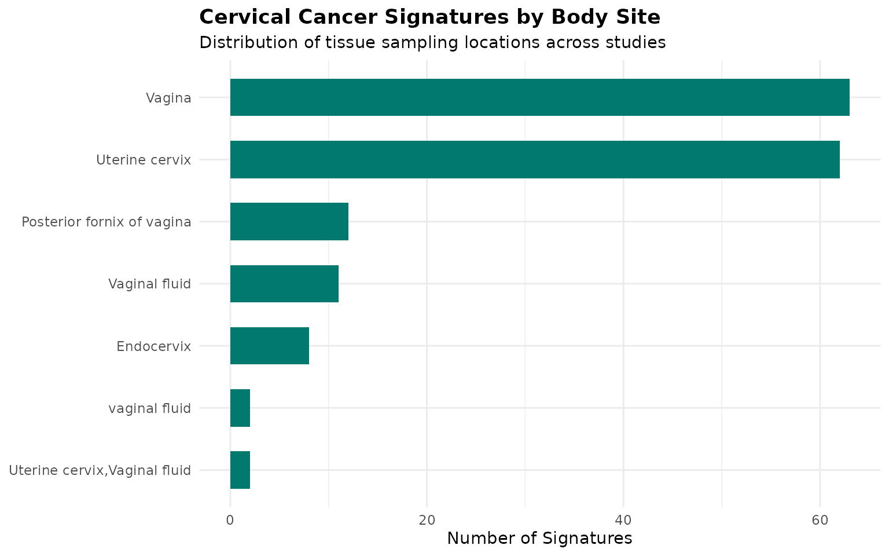
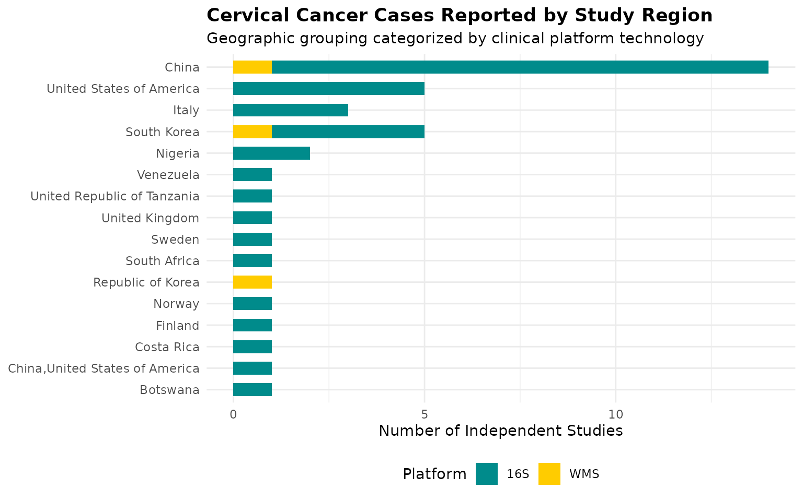
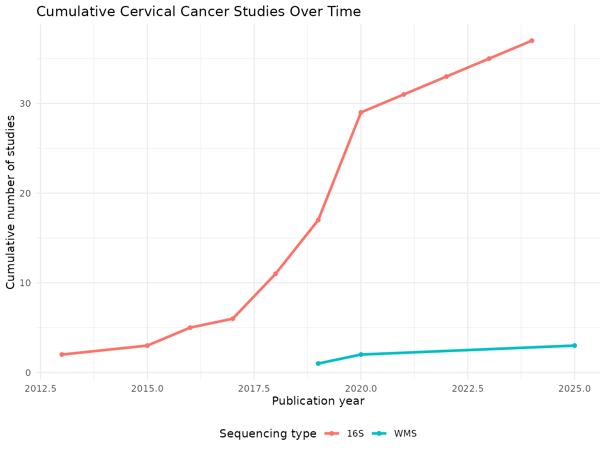
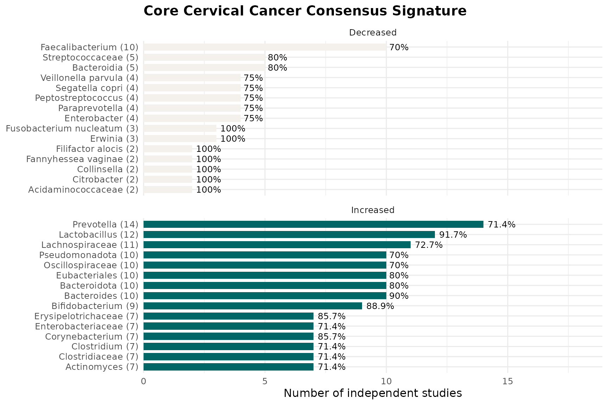
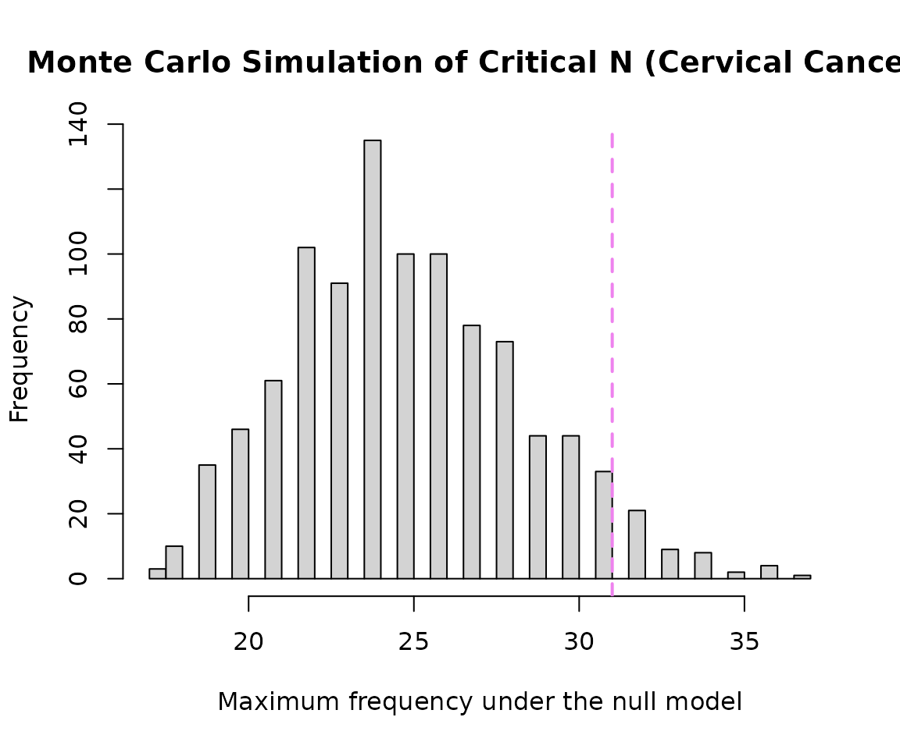
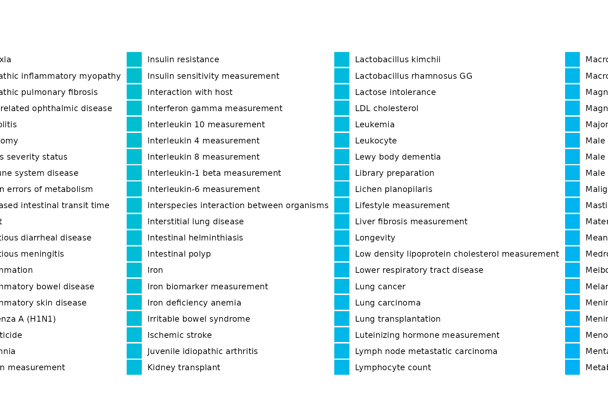
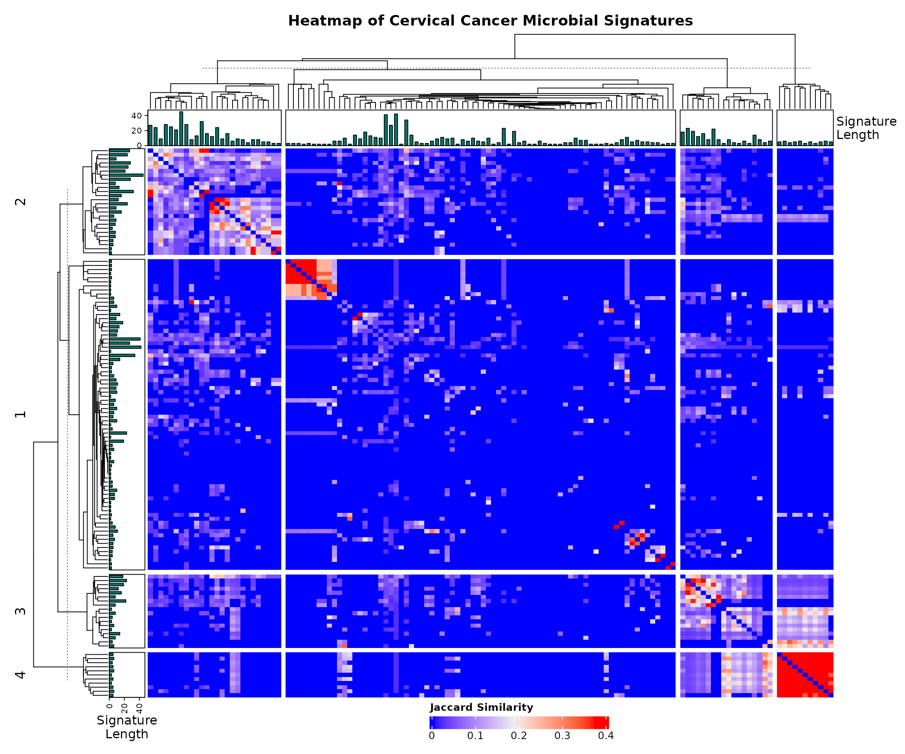

# Focused Sub-Analysis of Cervical Cancer Microbial Signatures

## Introduction

This vignette demonstrates a focused sub-analysis of microbial
signatures associated specifically with cervical cancer and its
precursors (HPV and cervical neoplasia) using BugSigDB. This notebook
also evaluates how these specific taxa overlap with other broader
women’s health conditions.

## Download and Prepare Data

``` r

full.dat <- bugsigdbr::importBugSigDB(cache = FALSE)
```

``` r

# Remove empty signatures
ind1 <- lengths(full.dat[["MetaPhlAn taxon names"]]) > 0
ind2 <- lengths(full.dat[["NCBI Taxonomy IDs"]]) > 0
dat <- full.dat[ind1 & ind2, ]
```

## Select Cervical Cancer Specific Signatures

Here we filter exclusively for cervical cancer, cervical intraepithelial
neoplasia, and HPV-related conditions. We restrict our data workspace to
reproductive tract body sites to strip out unrelated background noise.

``` r

cervical_terms <- c(
  "Cervical cancer", 
  "Cervical glandular intraepithelial neoplasia",
  "Cervical glandular intraepithelial neoplasia,Cervical cancer",
  "Cervical glandular intraepithelial neoplasia,Human papilloma virus infection",
  "Cervix erosion", 
  "Human papilloma virus infection", 
  "Human papilloma virus infection,Age",
  "Human papilloma virus infection,Cervical cancer",
  "Human papilloma virus infection,Cervical glandular intraepithelial neoplasia",
  "Chlamydophila infectious disease,Human papilloma virus infection"
)

# Filter conditions and ensure relevant reproductive tract body sites
cervical_dat <- dat %>%
  filter(Condition %in% cervical_terms) %>%
  filter(str_detect(`Body site`, "vagina|Vagina|cervix|Cervix|Endocervix|fornix")) %>%
  distinct()

nrow(cervical_dat)
```

    ## [1] 160

``` r

cervical_dat %>%
  count(Condition, sort = TRUE) %>%
  knitr::kable()
```

| Condition | n |
|:---|---:|
| Human papilloma virus infection | 79 |
| Cervical glandular intraepithelial neoplasia | 48 |
| Cervical cancer | 19 |
| Cervical glandular intraepithelial neoplasia,Human papilloma virus infection | 6 |
| Cervical glandular intraepithelial neoplasia,Cervical cancer | 2 |
| Cervix erosion | 2 |
| Chlamydophila infectious disease,Human papilloma virus infection | 2 |
| Human papilloma virus infection,Cervical cancer | 2 |

## Study Characteristics

``` r

study.summary <- cervical_dat %>%
  count(`Body site`, `Sequencing type`)

knitr::kable(study.summary)
```

| Body site                    | Sequencing type |   n |
|:-----------------------------|:----------------|----:|
| Endocervix                   | 16S             |   8 |
| Posterior fornix of vagina   | 16S             |  12 |
| Uterine cervix               | 16S             |  58 |
| Uterine cervix               | WMS             |   4 |
| Uterine cervix,Vaginal fluid | 16S             |   2 |
| Vagina                       | 16S             |  57 |
| Vagina                       | WMS             |   6 |
| Vaginal fluid                | 16S             |   9 |
| Vaginal fluid                | WMS             |   2 |
| vaginal fluid                | 16S             |   2 |

``` r

cervical_dat %>%
  count(Year) %>%
  arrange(Year) %>%
  knitr::kable()
```

| Year |   n |
|-----:|----:|
| 2013 |   6 |
| 2015 |   2 |
| 2016 |   8 |
| 2017 |   4 |
| 2018 |  31 |
| 2019 |  34 |
| 2020 |  45 |
| 2021 |  11 |
| 2022 |   6 |
| 2023 |   4 |
| 2024 |   3 |
| 2025 |   6 |

### Demographic & Anatomy Metrics Visualisations

``` r

# Plotting the unique anatomic anatomical tracking points for Cervical Cancer tracking
cervical_dat %>%
  count(`Body site`, sort = TRUE) %>%
  ggplot(aes(x = reorder(`Body site`, n), y = n)) +
  geom_col(fill = "#01796F", width = 0.6) +
  coord_flip() +
  labs(
    title = "Cervical Cancer Signatures by Body Site",
    subtitle ="Distribution of tissue sampling locations across studies" ,
    x = NULL, y = "Number of Signatures"
  ) +
  theme_minimal(base_size = 11) +
  theme(plot.title = element_text(face = "bold"))
```



## Geographical Trends

``` r

# Plotting case counts reported across international tracking zones
cervical_dat %>%
  distinct(PMID, `Location of subjects`, `Sequencing type`) %>%
  count(`Location of subjects`, `Sequencing type`) %>%
  filter(!is.na(`Location of subjects`)) %>%
  ggplot(aes(x = reorder(`Location of subjects`, n), y = n, fill = `Sequencing type`)) +
  geom_col(width = 0.6) +
  scale_fill_manual(values = c("16S" = "#008B8B", "WMS" = "#FFCC00")) +
  coord_flip() +
  labs(
    title = "Cervical Cancer Cases Reported by Study Region",
    subtitle = "Geographic grouping categorized by clinical platform technology",
    x = NULL, y = "Number of Independent Studies", fill = "Platform"
  ) +
  theme_minimal(base_size = 11) +
  theme(
    plot.title = element_text(face = "bold"),
    legend.position = "bottom"
  )
```



## Temporal trends plot

``` r

cervical_dat %>%
  distinct(PMID, Year, `Sequencing type`) %>%
  filter(!is.na(Year)) %>%
  count(Year, `Sequencing type`) %>%
  group_by(`Sequencing type`) %>%
  arrange(Year) %>%
  mutate(cumulative_n = cumsum(n)) %>%
  ungroup() %>%
  ggplot(aes(x = Year, y = cumulative_n, color = `Sequencing type`)) +
  geom_line(linewidth = 1.2) +
  geom_point() +
  labs(
    title = "Cumulative Cervical Cancer Studies Over Time",
    x = "Publication year", y = "Cumulative number of studies", color = "Sequencing type"
  ) +
  theme_minimal(base_size = 11) +
  theme(legend.position = "bottom")
```



## Taxonomic Summary

``` r

taxa.table <- createTaxonTable(cervical_dat)
knitr::kable(head(taxa.table, 20))
```

| Taxon Name | Taxonomic Level | total_signatures | increased_signatures | decreased_signatures | Binomial Test pval |
|:---|:---|---:|---:|---:|---:|
| Lactobacillus | genus | 28 | 6 | 22 | 3.7e-03 |
| Sneathia | genus | 21 | 18 | 3 | 1.5e-03 |
| Gardnerella | genus | 16 | 9 | 7 | 8.0e-01 |
| Gardnerella vaginalis | species | 15 | 15 | 0 | 6.1e-05 |
| Lactobacillales | order | 15 | 1 | 14 | 9.8e-04 |
| Megasphaera | genus | 15 | 13 | 2 | 7.4e-03 |
| Prevotella | genus | 14 | 12 | 2 | 1.3e-02 |
| Lactobacillus iners | species | 13 | 7 | 6 | 1.0e+00 |
| Bacilli | class | 12 | 1 | 11 | 6.3e-03 |
| Lactobacillaceae | family | 12 | 1 | 11 | 6.3e-03 |

``` r

cervical.wms <- cervical_dat %>% filter(`Sequencing type` == "WMS")
cervical.16s <- cervical_dat %>% filter(`Sequencing type` == "16S")

cat("WMS  - signatures:", nrow(cervical.wms), "| studies:", n_distinct(cervical.wms$PMID), "\n")
```

    ## WMS  - signatures: 12 | studies: 3

``` r

cat("16S  - signatures:", nrow(cervical.16s), "| studies:", n_distinct(cervical.16s$PMID), "\n")
```

    ## 16S  - signatures: 148 | studies: 37

## Long-Format Taxon Table Setup

``` r

sigs.cervical <- bugsigdbr::getSignatures(cervical_dat, tax.id.type = "taxname")

# Also pull a broader copy for cross-condition reference background mapping
sigs.all <- bugsigdbr::getSignatures(dat, tax.id.type = "taxname")

taxon.long <- purrr::map_dfr(seq_along(sigs.all), function(i) {
  taxa <- sigs.all[[i]]
  if (length(taxa) == 0) return(NULL)
  tibble::tibble(sig_id = i, taxon = taxa)
}) %>%
  left_join(
    dat %>%
      mutate(sig_id = row_number()) %>%
      select(sig_id, PMID, Condition, `Sequencing type`, `Abundance in Group 1`),
    by = "sig_id"
  ) %>%
  rename(direction = `Abundance in Group 1`)

# --- ADD THESE LINES TO CREATE A VISIBLE PREVIEW ---
cat("Long-format table successfully built with", nrow(taxon.long), "rows.\n")
```

    ## Long-format table successfully built with 96257 rows.

``` r

# Display the first 6 rows of your processed data frame as a styled report table
knitr::kable(head(taxon.long), caption = "Preview of the Structured Long-Format Taxon Table")
```

| sig_id | taxon         | PMID | Condition | Sequencing type | direction |
|-------:|:--------------|-----:|:----------|:----------------|:----------|
|      1 | Serratia      |   NA | COVID-19  | WMS             | increased |
|      1 | Veillonella   |   NA | COVID-19  | WMS             | increased |
|      2 | Enterobacter  |   NA | COVID-19  | WMS             | increased |
|      2 | Prevotella    |   NA | COVID-19  | WMS             | increased |
|      2 | Veillonella   |   NA | COVID-19  | WMS             | increased |
|      2 | Streptococcus |   NA | COVID-19  | WMS             | increased |

Preview of the Structured Long-Format Taxon Table {.table}

## Core Consensus Signature

``` r

concordance <- taxon.long %>%
  filter(Condition %in% cervical_terms) %>%
  distinct(PMID, taxon, direction) %>%
  group_by(taxon) %>%
  summarise(
    n_studies       = n_distinct(PMID),
    n_increased     = sum(direction == "increased"),
    n_decreased     = sum(direction == "decreased"),
    concordance_pct = round(max(n_increased, n_decreased) / n_studies * 100, 1),
    majority_dir    = if_else(n_increased >= n_decreased, "increased", "decreased"),
    .groups = "drop"
  ) %>%
  arrange(desc(n_studies), desc(concordance_pct))

core.sig <- concordance %>%
  filter(n_studies >= 2, concordance_pct >= 70) %>%
  arrange(majority_dir, desc(n_studies))

knitr::kable(core.sig)
```

| taxon | n_studies | n_increased | n_decreased | concordance_pct | majority_dir |
|:---|---:|---:|---:|---:|:---|
| Faecalibacterium | 10 | 3 | 7 | 70.0 | decreased |
| Bacteroidia | 5 | 2 | 4 | 80.0 | decreased |
| Streptococcaceae | 5 | 2 | 4 | 80.0 | decreased |
| Enterobacter | 4 | 1 | 3 | 75.0 | decreased |
| Paraprevotella | 4 | 1 | 3 | 75.0 | decreased |
| Peptostreptococcus | 4 | 2 | 3 | 75.0 | decreased |
| Segatella copri | 4 | 1 | 3 | 75.0 | decreased |
| Veillonella parvula | 4 | 1 | 3 | 75.0 | decreased |
| Erwinia | 3 | 1 | 3 | 100.0 | decreased |
| Fusobacterium nucleatum | 3 | 0 | 3 | 100.0 | decreased |
| Acidaminococcaceae | 2 | 0 | 2 | 100.0 | decreased |
| Citrobacter | 2 | 1 | 2 | 100.0 | decreased |
| Collinsella | 2 | 0 | 2 | 100.0 | decreased |
| Fannyhessea vaginae | 2 | 0 | 2 | 100.0 | decreased |
| Filifactor alocis | 2 | 1 | 2 | 100.0 | decreased |
| Fusobacteriota | 2 | 1 | 2 | 100.0 | decreased |
| Johnsonella | 2 | 0 | 2 | 100.0 | decreased |
| Johnsonella ignava | 2 | 0 | 2 | 100.0 | decreased |
| Klebsiella oxytoca | 2 | 0 | 2 | 100.0 | decreased |
| Leptotrichiaceae | 2 | 0 | 2 | 100.0 | decreased |
| Mobiluncus mulieris | 2 | 1 | 2 | 100.0 | decreased |
| Oxalobacteraceae | 2 | 0 | 2 | 100.0 | decreased |
| Porphyromonas pasteri | 2 | 0 | 2 | 100.0 | decreased |
| Shuttleworthella | 2 | 1 | 2 | 100.0 | decreased |
| Streptococcus australis | 2 | 0 | 2 | 100.0 | decreased |
| Streptococcus mitis | 2 | 0 | 2 | 100.0 | decreased |
| Veillonella atypica | 2 | 0 | 2 | 100.0 | decreased |
| Veillonella montpellierensis | 2 | 0 | 2 | 100.0 | decreased |
| Prevotella | 14 | 10 | 10 | 71.4 | increased |
| Lactobacillus | 12 | 11 | 6 | 91.7 | increased |
| Lachnospiraceae | 11 | 8 | 5 | 72.7 | increased |
| Bacteroides | 10 | 9 | 5 | 90.0 | increased |
| Bacteroidota | 10 | 8 | 5 | 80.0 | increased |
| Eubacteriales | 10 | 8 | 4 | 80.0 | increased |
| Oscillospiraceae | 10 | 7 | 4 | 70.0 | increased |
| Pseudomonadota | 10 | 7 | 3 | 70.0 | increased |
| Bifidobacterium | 9 | 8 | 3 | 88.9 | increased |
| Corynebacterium | 7 | 6 | 1 | 85.7 | increased |
| Erysipelotrichaceae | 7 | 6 | 2 | 85.7 | increased |
| Actinomyces | 7 | 5 | 2 | 71.4 | increased |
| Clostridiaceae | 7 | 5 | 2 | 71.4 | increased |
| Clostridium | 7 | 5 | 4 | 71.4 | increased |
| Enterobacteriaceae | 7 | 5 | 3 | 71.4 | increased |
| Pasteurellaceae | 7 | 5 | 3 | 71.4 | increased |
| Haemophilus | 6 | 5 | 2 | 83.3 | increased |
| Lactobacillaceae | 5 | 5 | 2 | 100.0 | increased |
| Verrucomicrobiaceae | 5 | 5 | 0 | 100.0 | increased |
| Actinomycetota | 5 | 4 | 1 | 80.0 | increased |
| Akkermansia | 5 | 4 | 1 | 80.0 | increased |
| Enterobacterales | 5 | 4 | 2 | 80.0 | increased |
| Fusobacterium | 5 | 4 | 2 | 80.0 | increased |
| Neisseria | 5 | 4 | 3 | 80.0 | increased |
| Porphyromonas | 5 | 4 | 2 | 80.0 | increased |
| Verrucomicrobiales | 4 | 4 | 0 | 100.0 | increased |
| Verrucomicrobiia | 4 | 4 | 0 | 100.0 | increased |
| Bifidobacterium longum | 4 | 3 | 1 | 75.0 | increased |
| Catenibacterium | 4 | 3 | 3 | 75.0 | increased |
| Clostridia | 4 | 3 | 1 | 75.0 | increased |
| Erysipelotrichia | 4 | 3 | 1 | 75.0 | increased |
| Eubacterium | 4 | 3 | 2 | 75.0 | increased |
| Pseudomonas | 4 | 3 | 2 | 75.0 | increased |
| Turicibacter | 4 | 3 | 1 | 75.0 | increased |
| Veillonellaceae | 4 | 3 | 2 | 75.0 | increased |
| Verrucomicrobiota | 4 | 3 | 1 | 75.0 | increased |
| Alcaligenaceae | 3 | 3 | 1 | 100.0 | increased |
| Bacteroides xylanisolvens | 3 | 3 | 0 | 100.0 | increased |
| Cyanobacteriota | 3 | 3 | 0 | 100.0 | increased |
| Lachnospira | 3 | 3 | 0 | 100.0 | increased |
| Lactobacillus crispatus | 3 | 3 | 1 | 100.0 | increased |
| Lactobacillus gasseri | 3 | 3 | 1 | 100.0 | increased |
| Megasphaera | 3 | 3 | 2 | 100.0 | increased |
| Oribacterium | 3 | 3 | 0 | 100.0 | increased |
| Pseudobutyrivibrio | 3 | 3 | 0 | 100.0 | increased |
| Acidaminococcus | 2 | 2 | 0 | 100.0 | increased |
| Acidaminococcus intestini | 2 | 2 | 0 | 100.0 | increased |
| Aggregatibacter segnis | 2 | 2 | 1 | 100.0 | increased |
| Alteromonadales | 2 | 2 | 2 | 100.0 | increased |
| Arcobacter | 2 | 2 | 1 | 100.0 | increased |
| Bacteroides ovatus | 2 | 2 | 0 | 100.0 | increased |
| Bacteroides thetaiotaomicron | 2 | 2 | 0 | 100.0 | increased |
| Bacteroides uniformis | 2 | 2 | 0 | 100.0 | increased |
| Beijerinckiaceae | 2 | 2 | 1 | 100.0 | increased |
| Bifidobacterium breve | 2 | 2 | 0 | 100.0 | increased |
| Bifidobacterium pseudocatenulatum | 2 | 2 | 0 | 100.0 | increased |
| Burkholderiaceae | 2 | 2 | 0 | 100.0 | increased |
| Campylobacterota | 2 | 2 | 0 | 100.0 | increased |
| Chitinophagaceae | 2 | 2 | 0 | 100.0 | increased |
| Comamonas | 2 | 2 | 0 | 100.0 | increased |
| Corynebacteriaceae | 2 | 2 | 0 | 100.0 | increased |
| Enterococcus faecium | 2 | 2 | 2 | 100.0 | increased |
| Escherichia/Shigella sp. | 2 | 2 | 0 | 100.0 | increased |
| Eubacteriaceae | 2 | 2 | 0 | 100.0 | increased |
| Hoylesella buccalis | 2 | 2 | 1 | 100.0 | increased |
| Hyphomicrobiales | 2 | 2 | 0 | 100.0 | increased |
| Intrasporangiaceae | 2 | 2 | 0 | 100.0 | increased |
| Lacticaseibacillus rhamnosus | 2 | 2 | 0 | 100.0 | increased |
| Limosilactobacillus fermentum | 2 | 2 | 0 | 100.0 | increased |
| Lysobacteraceae | 2 | 2 | 1 | 100.0 | increased |
| Mediterraneibacter torques | 2 | 2 | 0 | 100.0 | increased |
| Megamonas | 2 | 2 | 1 | 100.0 | increased |
| Methanomassiliicoccus | 2 | 2 | 1 | 100.0 | increased |
| Moraxellaceae | 2 | 2 | 0 | 100.0 | increased |
| Olsenella | 2 | 2 | 0 | 100.0 | increased |
| Oribacterium sinus | 2 | 2 | 0 | 100.0 | increased |
| Parabacteroides distasonis | 2 | 2 | 0 | 100.0 | increased |
| Parabacteroides merdae | 2 | 2 | 0 | 100.0 | increased |
| Parasutterella | 2 | 2 | 0 | 100.0 | increased |
| Parvimonas | 2 | 2 | 2 | 100.0 | increased |
| Porphyromonas sp. | 2 | 2 | 1 | 100.0 | increased |
| Prevotella disiens | 2 | 2 | 1 | 100.0 | increased |
| Rickenellaceae | 2 | 2 | 0 | 100.0 | increased |
| Sphingobacteriaceae | 2 | 2 | 0 | 100.0 | increased |
| Staphylococcaceae | 2 | 2 | 1 | 100.0 | increased |
| Streptococcus mutans | 2 | 2 | 0 | 100.0 | increased |
| Streptococcus salivarius | 2 | 2 | 1 | 100.0 | increased |
| Subdoligranulum | 2 | 2 | 0 | 100.0 | increased |
| Sutterella | 2 | 2 | 0 | 100.0 | increased |
| Vibrionaceae | 2 | 2 | 1 | 100.0 | increased |
| Yersinia | 2 | 2 | 1 | 100.0 | increased |

## Taxon Frequency Across Studies

``` r

taxon.freq <- taxon.long %>%
  filter(Condition %in% cervical_terms) %>%
  distinct(PMID, taxon, direction) %>%
  count(taxon, direction, name = "n_studies") %>%
  group_by(taxon) %>%
  mutate(total_studies = sum(n_studies)) %>%
  ungroup() %>%
  arrange(desc(total_studies))

n_distinct(taxon.freq$taxon)
```

    ## [1] 669

``` r

taxon.freq %>%
  distinct(taxon, total_studies) %>%
  slice_max(total_studies, n = 15) %>%
  knitr::kable()
```

| taxon                 | total_studies |
|:----------------------|--------------:|
| Prevotella            |            20 |
| Streptococcus         |            18 |
| Lactobacillus         |            17 |
| Bacteroides           |            14 |
| Bacillota             |            13 |
| Bacteroidota          |            13 |
| Lachnospiraceae       |            13 |
| Bacteroidales         |            12 |
| Eubacteriales         |            12 |
| Bifidobacterium       |            11 |
| Oscillospiraceae      |            11 |
| Peptostreptococcaceae |            11 |
| Veillonella           |            11 |
| Dialister             |            10 |
| Faecalibacterium      |            10 |
| Pseudomonadota        |            10 |
| Roseburia             |            10 |

## Core Signature Visualisation

``` r

if(nrow(core.sig) > 0) {
  core.sig %>%
    group_by(majority_dir) %>%
    slice_max(n_studies, n = 15, with_ties = FALSE) %>%
    ungroup() %>%
    mutate(
      direction_label = if_else(majority_dir == "increased", "Increased", "Decreased"),
      taxon_label = paste0(str_wrap(taxon, width = 28), " (", n_studies, ")")
    ) %>%
    ggplot(aes(x = reorder(taxon_label, n_studies), y = n_studies, fill = direction_label)) +
    geom_col(width = 0.7) +
    geom_text(aes(label = paste0(concordance_pct, "%")), hjust = -0.15, size = 3.3) +
    coord_flip(clip = "off") +
    facet_wrap(~direction_label, scales = "free_y", ncol = 1) +
    scale_fill_manual(values = c("Increased" = "#006666", "Decreased" = "#F4F0EC")) +
    scale_y_continuous(expand = expansion(mult = c(0, 0.35))) +
    labs(
      title = "Core Cervical Cancer Consensus Signature",
      x = NULL, y = "Number of independent studies", fill = NULL
    ) +
    theme_minimal(base_size = 12) +
    theme(legend.position = "none", plot.title = element_text(face = "bold"))
}
```



## WMS vs. 16S concordance

``` r

dir.by.platform <- taxon.long %>%
  filter(Condition %in% cervical_terms) %>%
  filter(`Sequencing type` %in% c("WMS", "16S")) %>%
  distinct(PMID, taxon, direction, `Sequencing type`) %>%
  count(taxon, `Sequencing type`, direction, name = "n_studies") %>%
  group_by(taxon, `Sequencing type`) %>%
  slice_max(n_studies, n = 1, with_ties = FALSE) %>%
  ungroup() %>%
  select(taxon, `Sequencing type`, majority_dir = direction)

platform.compare <- dir.by.platform %>%
  pivot_wider(names_from = `Sequencing type`, values_from = majority_dir) %>%
  filter(!is.na(WMS), !is.na(`16S`)) %>%
  rename(dir_WMS = WMS, dir_16S = `16S`) %>%
  mutate(agree = dir_WMS == dir_16S)

nrow(platform.compare)
```

    ## [1] 26

``` r

if (nrow(platform.compare) > 0) {
  sum(platform.compare$agree)
  round(100 * mean(platform.compare$agree), 1)
  knitr::kable(platform.compare)
} else {
  cat("No taxa reported by both WMS and 16S in this cervical-restricted dataset.")
}
```

| taxon                 | dir_16S   | dir_WMS   | agree |
|:----------------------|:----------|:----------|:------|
| Actinomycetota        | increased | increased | TRUE  |
| Anaerovibrio          | decreased | decreased | TRUE  |
| Bacteroides fragilis  | increased | decreased | FALSE |
| Beijerinckiaceae      | decreased | increased | FALSE |
| Bifidobacteriaceae    | decreased | increased | FALSE |
| Bifidobacteriales     | decreased | increased | FALSE |
| Bifidobacterium       | increased | increased | TRUE  |
| Burkholderiaceae      | increased | increased | TRUE  |
| Chitinophagaceae      | increased | increased | TRUE  |
| Erwinia               | decreased | decreased | TRUE  |
| Erysipelotrichaceae   | increased | increased | TRUE  |
| Faecalibacterium      | decreased | decreased | TRUE  |
| Granulicatella        | increased | decreased | FALSE |
| Hyphomicrobiales      | increased | increased | TRUE  |
| Intrasporangiaceae    | increased | increased | TRUE  |
| Lachnospira           | increased | increased | TRUE  |
| Pasteurellaceae       | increased | decreased | FALSE |
| Peptostreptococcaceae | decreased | decreased | TRUE  |
| Prevotella            | decreased | decreased | TRUE  |
| Pseudobutyrivibrio    | increased | increased | TRUE  |
| Pseudomonadota        | increased | increased | TRUE  |
| Romboutsia            | increased | decreased | FALSE |
| Rothia                | increased | decreased | FALSE |
| Streptococcus         | increased | decreased | FALSE |
| Veillonella           | increased | decreased | FALSE |
| Veillonella parvula   | decreased | decreased | TRUE  |

## Taxon enrichment analysis

``` r

n.universe <- n_distinct(taxon.long %>% filter(Condition %in% cervical_terms) %>% pull(taxon))
n.sigs     <- length(sigs.cervical)

enrichment.df <- taxon.freq %>%
  distinct(taxon, total_studies) %>%
  mutate(
    observed         = total_studies,
    expected         = n.sigs / n.universe,
    enrichment_ratio = observed / expected,
    log2_enrichment  = log2(enrichment_ratio),
    p_value = purrr::map_dbl(observed, ~ binom.test(
      x = .x, n = n.sigs, p = 1 / n.universe, alternative = "greater"
    )$p.value),
    p_adj = p.adjust(p_value, method = "BH")
  ) %>%
  arrange(p_adj, desc(log2_enrichment))

sum(enrichment.df$p_adj < 0.05)
```

    ## [1] 132

``` r

knitr::kable(head(enrichment.df, 15))
```

| taxon | total_studies | observed | expected | enrichment_ratio | log2_enrichment | p_value | p_adj |
|:---|---:|---:|---:|---:|---:|---:|---:|
| Prevotella | 20 | 20 | 0.2376682 | 84.15094 | 6.394908 | 0 | 0 |
| Streptococcus | 18 | 18 | 0.2376682 | 75.73585 | 6.242904 | 0 | 0 |
| Lactobacillus | 17 | 17 | 0.2376682 | 71.52830 | 6.160442 | 0 | 0 |
| Bacteroides | 14 | 14 | 0.2376682 | 58.90566 | 5.880334 | 0 | 0 |
| Bacillota | 13 | 13 | 0.2376682 | 54.69811 | 5.773419 | 0 | 0 |
| Bacteroidota | 13 | 13 | 0.2376682 | 54.69811 | 5.773419 | 0 | 0 |
| Lachnospiraceae | 13 | 13 | 0.2376682 | 54.69811 | 5.773419 | 0 | 0 |
| Bacteroidales | 12 | 12 | 0.2376682 | 50.49057 | 5.657942 | 0 | 0 |
| Eubacteriales | 12 | 12 | 0.2376682 | 50.49057 | 5.657942 | 0 | 0 |
| Bifidobacterium | 11 | 11 | 0.2376682 | 46.28302 | 5.532411 | 0 | 0 |
| Oscillospiraceae | 11 | 11 | 0.2376682 | 46.28302 | 5.532411 | 0 | 0 |
| Peptostreptococcaceae | 11 | 11 | 0.2376682 | 46.28302 | 5.532411 | 0 | 0 |
| Veillonella | 11 | 11 | 0.2376682 | 46.28302 | 5.532411 | 0 | 0 |
| Dialister | 10 | 10 | 0.2376682 | 42.07547 | 5.394908 | 0 | 0 |
| Faecalibacterium | 10 | 10 | 0.2376682 | 42.07547 | 5.394908 | 0 | 0 |

## Monte Carlo critical N

``` r

siglengths <- lengths(cervical_dat$`MetaPhlAn taxon names`)

criticalN <- getCriticalN(
  relevant.sigs = cervical_dat$`MetaPhlAn taxon names`,
  siglengths = siglengths
)

criticalN
```

    ## $critical_n
    ## 95% 
    ##  31 
    ## 
    ## $ci_lower
    ## 2.5% 
    ##   31 
    ## 
    ## $ci_upper
    ## 97.5% 
    ##    32 
    ## 
    ## $simulated_values
    ##    [1] 27 23 20 22 22 29 27 21 28 27 20 23 28 21 27 30 21 27 20 27 26 24 28 33
    ##   [25] 25 21 21 28 31 22 21 26 22 24 24 19 24 19 24 18 26 23 26 22 24 22 23 20
    ##   [49] 28 25 24 19 24 22 33 20 21 24 26 36 30 23 21 29 19 29 23 22 30 25 23 23
    ##   [73] 27 20 26 21 27 25 23 24 25 24 37 26 22 24 27 23 25 30 26 23 24 24 26 26
    ##   [97] 26 25 25 27 20 30 28 22 34 21 19 26 32 25 22 24 23 32 24 23 27 27 31 28
    ##  [121] 21 27 24 21 30 26 26 31 29 28 23 26 23 26 22 24 19 30 22 28 31 27 32 26
    ##  [145] 20 28 24 30 21 22 28 23 27 24 22 33 23 24 19 24 25 28 29 25 22 28 26 32
    ##  [169] 24 22 22 19 20 25 30 26 24 17 22 25 19 24 27 25 24 24 24 25 28 30 24 28
    ##  [193] 26 31 25 23 22 30 24 32 21 29 22 30 23 19 22 23 22 24 26 29 22 31 22 22
    ##  [217] 28 19 28 28 23 31 21 22 21 24 28 30 27 28 24 31 24 24 23 30 29 26 23 25
    ##  [241] 30 25 26 28 25 32 22 19 23 26 26 28 24 32 26 34 24 25 26 23 31 30 24 26
    ##  [265] 22 22 30 22 25 25 22 27 19 31 22 26 19 31 20 27 25 23 32 27 23 20 24 28
    ##  [289] 25 24 23 27 29 24 19 26 25 23 28 27 21 30 28 27 24 22 26 25 27 26 33 27
    ##  [313] 23 25 25 23 29 21 20 29 22 22 22 22 35 27 29 26 28 31 27 26 24 24 30 20
    ##  [337] 20 24 26 20 25 25 22 22 24 22 28 22 21 29 24 23 24 26 23 17 27 24 22 25
    ##  [361] 24 34 24 36 20 25 34 25 24 28 27 22 26 18 30 25 19 29 23 26 28 29 25 24
    ##  [385] 25 26 31 24 27 22 21 29 26 26 22 21 30 33 31 28 24 26 19 28 26 26 26 22
    ##  [409] 25 20 23 28 27 24 21 24 21 22 31 27 28 26 30 19 24 22 29 24 20 29 21 19
    ##  [433] 27 24 27 23 29 27 30 21 31 25 28 21 24 24 24 24 32 18 29 24 27 31 21 22
    ##  [457] 27 28 29 23 27 21 31 28 34 20 26 23 28 21 19 27 28 23 23 26 20 23 24 27
    ##  [481] 25 20 18 23 22 21 22 26 24 22 20 28 32 28 24 29 25 30 22 25 21 24 23 31
    ##  [505] 25 26 28 27 26 22 22 33 20 21 24 20 24 31 22 28 25 28 22 24 25 21 23 18
    ##  [529] 28 22 19 36 28 27 28 21 22 24 24 30 21 22 27 23 22 30 31 27 26 23 30 23
    ##  [553] 24 32 22 20 23 29 25 22 27 25 30 24 26 19 20 24 24 23 20 26 19 24 27 23
    ##  [577] 23 27 27 24 24 30 25 26 28 28 24 28 23 24 26 31 24 26 21 32 31 18 25 22
    ##  [601] 22 25 28 25 20 21 28 26 30 21 26 33 26 18 24 36 30 25 24 18 25 26 25 24
    ##  [625] 26 25 21 22 20 29 26 21 28 33 21 26 20 24 24 32 29 28 29 22 26 29 24 24
    ##  [649] 26 23 27 30 30 21 23 26 23 26 26 30 21 22 22 25 23 26 25 34 27 22 22 35
    ##  [673] 26 22 25 19 25 24 26 27 31 25 22 25 24 22 20 25 23 29 25 21 25 25 22 33
    ##  [697] 27 21 28 24 21 27 26 24 21 27 29 23 24 24 19 23 27 25 26 22 25 27 20 31
    ##  [721] 25 29 22 30 28 23 24 25 24 26 24 21 25 27 27 25 24 20 24 31 25 27 17 29
    ##  [745] 23 23 26 20 22 26 19 23 28 32 27 31 26 21 26 25 26 21 26 26 26 32 19 22
    ##  [769] 22 26 22 25 30 19 23 23 34 32 23 24 25 25 24 22 24 28 24 28 21 25 26 29
    ##  [793] 26 23 24 25 27 29 25 25 24 24 29 24 30 23 25 28 23 23 24 23 28 19 23 26
    ##  [817] 25 24 23 25 29 24 26 24 23 24 25 25 21 23 26 24 22 31 20 23 25 26 25 24
    ##  [841] 20 21 27 18 31 27 25 32 24 19 22 29 31 27 20 32 30 30 27 21 25 23 28 27
    ##  [865] 21 21 22 24 20 22 27 23 24 22 20 26 24 20 32 23 22 25 19 29 32 22 23 25
    ##  [889] 22 20 29 23 30 22 25 27 19 23 25 23 23 25 22 25 27 22 21 24 28 27 25 25
    ##  [913] 29 26 25 29 28 21 34 29 30 27 22 19 26 26 28 31 26 24 23 29 22 20 22 29
    ##  [937] 24 30 24 19 29 27 21 28 20 23 25 26 20 24 26 24 28 24 25 22 22 22 24 27
    ##  [961] 20 21 27 24 26 32 23 24 18 23 31 24 28 22 28 31 28 24 28 27 23 30 23 28
    ##  [985] 23 28 27 26 19 21 22 30 26 24 25 27 28 20 27 24
    ## 
    ## $alpha
    ## [1] 0.05
    ## 
    ## $quantile_label
    ## [1] "95th percentile"

## Plot

``` r

hist(
  criticalN$simulated_values,
  breaks = 30,
  main = "Monte Carlo Simulation of Critical N (Cervical Cancer)",
  xlab = "Maximum frequency under the null model"
)

abline(
  v = criticalN$critical_n,
  col = "violet",
  lwd = 2,
  lty = 2
)
```



## Cross-Condition Taxa Overlap Analysis

This section explores whether the taxa altered in cervical cancer
settings are unique to malignant cervical environments or represent
shared dysbiosis tracking markers across other women’s health
conditions.

``` r

# 1. Identify all unique taxa present in our targeted cervical cancer dataset signatures
cervical_taxa <- taxon.long %>% 
  filter(Condition %in% cervical_terms) %>% 
  distinct(taxon) %>% 
  pull(taxon)

# 2. Count distinct conditions linked to these specific microbes
shared_taxa_counts <- taxon.long %>%
  filter(taxon %in% cervical_taxa) %>%
  group_by(taxon) %>%
  summarise(
    total_womens_health_studies = n_distinct(PMID),
    distinct_conditions_linked = n_distinct(Condition),
    top_other_conditions = paste(
      head(setdiff(unique(Condition), cervical_terms), 3), 
      collapse = ", "
    ),
    .groups = "drop"
  ) %>%
  arrange(desc(distinct_conditions_linked))

# Display top 20 multi-condition overlapping taxa
shared_taxa_counts %>%
  slice_max(distinct_conditions_linked, n = 20, with_ties = FALSE) %>%
  knitr::kable(
    caption = "Top Cervical-Associated Taxa and Their Links to Other Women's Health Conditions",
    col.names = c("Taxon Name", "Total WH Studies", "Total Distinct Conditions", "Other Conditions it Often Appears In")
  )
```

| Taxon Name | Total WH Studies | Total Distinct Conditions | Other Conditions it Often Appears In |
|:---|---:|---:|:---|
| Streptococcus | 557 | 334 | COVID-19, Health study participation, Diet |
| Bacteroides | 548 | 321 | Health study participation, Irritable bowel syndrome, Autism |
| Prevotella | 542 | 320 | COVID-19, Health study participation, Illness severity status |
| Lachnospiraceae | 508 | 302 | Type II diabetes mellitus, Autoimmune disease, Smoking behavior |
| Oscillospiraceae | 447 | 300 | Autism, Autoimmune disease, Obesity |
| Bacillota | 468 | 296 | Parkinson’s disease, Irritable bowel syndrome, Type II diabetes mellitus |
| Faecalibacterium | 411 | 287 | Health study participation, Autism, Autoimmune disease |
| Lactobacillus | 485 | 284 | Health study participation, Antimicrobial agent, Oxygen |
| Bifidobacterium | 428 | 270 | Health study participation, Parkinson’s disease, Food allergy |
| Actinomycetota | 397 | 257 | Type II diabetes mellitus, Place of residence measurement,Ethnic group, Atopic eczema |
| Bacteroidota | 393 | 246 | Irritable bowel syndrome, Autism, Autoimmune disease |
| Pseudomonadota | 379 | 244 | Irritable bowel syndrome, Type II diabetes mellitus, Autism |
| Blautia | 395 | 243 | Health study participation, Autoimmune disease, Irritable bowel syndrome |
| Clostridium | 371 | 238 | Health study participation, Irritable bowel syndrome, Type II diabetes mellitus |
| Veillonella | 352 | 229 | COVID-19, Health study participation, Antimicrobial agent |
| Roseburia | 347 | 221 | Health study participation, Autoimmune disease, Smoking behavior |
| Ruminococcus | 346 | 219 | Health study participation, Type II diabetes mellitus, Autoimmune disease |
| Haemophilus | 311 | 209 | Health study participation, Illness severity status, Diet |
| Fusobacterium | 306 | 207 | Health study participation, Antimicrobial agent, Autism |
| Enterobacteriaceae | 312 | 206 | Type II diabetes mellitus, Autism, Smoking behavior |

Top Cervical-Associated Taxa and Their Links to Other Women’s Health
Conditions {.table}

## Shared Dysbiosis Visualisation

``` r

top_shared_taxa <- shared_taxa_counts %>% 
  filter(distinct_conditions_linked > 1) %>%
  slice_max(total_womens_health_studies, n = 15, with_ties = FALSE) %>%
  pull(taxon)

if(length(top_shared_taxa) > 0) {
  taxon.long %>%
    filter(taxon %in% top_shared_taxa) %>%
    mutate(Condition_Group = if_else(Condition %in% cervical_terms, "Cervical/HPV", Condition)) %>%
    count(taxon, Condition_Group) %>%
    ggplot(aes(x = reorder(taxon, n), y = n, fill = Condition_Group)) +
    geom_col() +
    coord_flip() +
    labs(
      title = "Cervical Cancer Taxa Active in Other Conditions",
      subtitle = "Tracking where prominent cervical microbes show up elsewhere",
      x = NULL, y = "Total Signature Mentions", fill = "Condition Group"
    ) +
    theme_minimal(base_size = 11) +
    theme(legend.position = "right")
}
```



## Signature Similarity and Heatmap

``` r

allsigs <- bugsigdbr::getSignatures(cervical_dat, tax.id.type = "taxname")
allsigs <- allsigs[sapply(allsigs, length) > 1]

if (length(allsigs) > 1) {
  jmat <- BugSigDBStats::calcJaccardSimilarity(allsigs)
  siglengths <- sapply(allsigs, length)
  
  # Adjusted size and padding of top bar plots to give the main grid more room
  ha <- HeatmapAnnotation(
    `Signature\nLength` = anno_barplot(siglengths, gp = gpar(fill = "#01796F"), height = unit(1.2, "cm"))
  )
  hr <- rowAnnotation(
    `Signature\nLength` = anno_barplot(siglengths, gp = gpar(fill = "#01796F"), width = unit(1.2, "cm"))
  )
  
  hm <- Heatmap(
    jmat,
    top_annotation = ha,
    left_annotation = hr,
    show_row_names = FALSE,
    show_column_names = FALSE,
    
    #  SPREAD CONTROLS: Breaks the squeezed block into distinct biological sub-clusters
    row_km = 4,
    column_km = 4,
    row_gap = unit(1.5, "mm"),
    column_gap = unit(1.5, "mm"),
    
    # DENDROGRAM HEIGHT: Shrinks the tree branches so the main square matrix has more room
    row_dend_width = unit(2.5, "cm"),
    column_dend_height = unit(2.5, "cm"),
    
    column_title = "Heatmap of Cervical Cancer Microbial Signatures",
    column_title_gp = gpar(fontsize = 14, fontface = "bold"),
    heatmap_legend_param = list(
      title = "Jaccard Similarity", 
      direction = "horizontal",
      legend_width = unit(6, "cm")
    )
  )
  
  # Draw directly to the R Markdown / HTML output screen with solid margin padding
  draw(hm, heatmap_legend_side = "bottom", padding = unit(c(5, 5, 5, 5), "mm"))
  
  # Save a crisp offline image file matching the spacious layout dimensions
  png(filename = "CervicalCancer_heatmap.png", width = 12, height = 10, units = "in", res = 300)
  draw(hm, heatmap_legend_side = "bottom", padding = unit(c(5, 5, 5, 5), "mm"))
  dev.off()
}
```



    ## agg_png 
    ##       2

## Dendrogram

``` r

if (exists("jmat") && nrow(jmat) > 1) {
  hc <- hclust(as.dist(1 - jmat))
  dend <- as.dendrogram(hc)
  
  # Custom margin expansion to handle high vertical density layout
  par(mar = c(5, 2, 4, 2))
  
  plot(
    dend,
    horiz = TRUE,
    leaflab = "none",
    main = "Hierarchical Cluster Map of Cervical Cancer Microbial Signatures",
    xlab = "Distance (1 - Jaccard similarity)",
    cex.main = 1.3,
    
    #  LINE THICKNESS: Thins down the structural tree paths to avoid bleeding together
    lwd = 0.8
  )
}
```


\`\`\`
