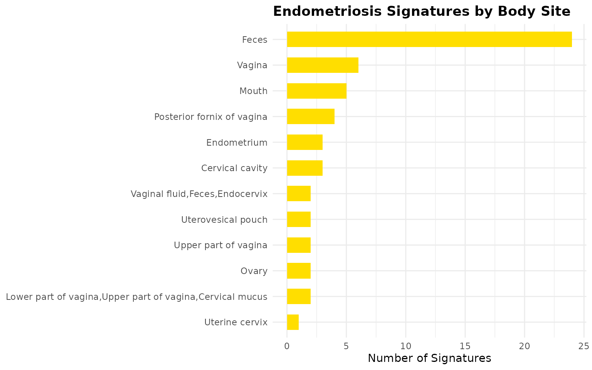
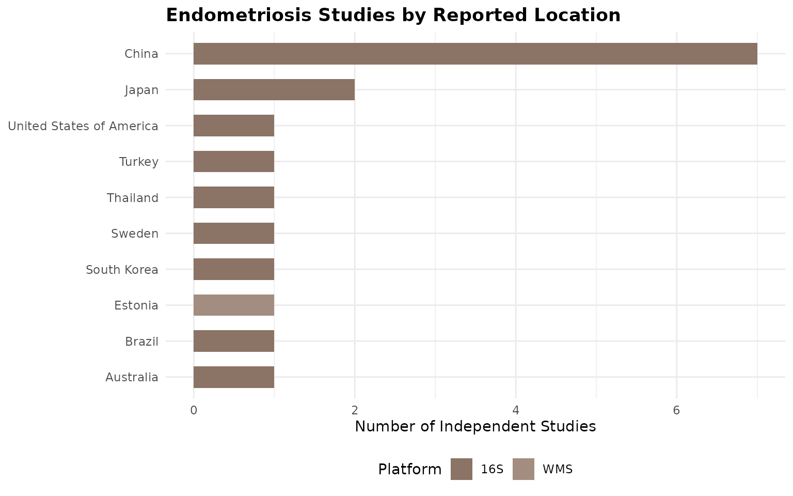
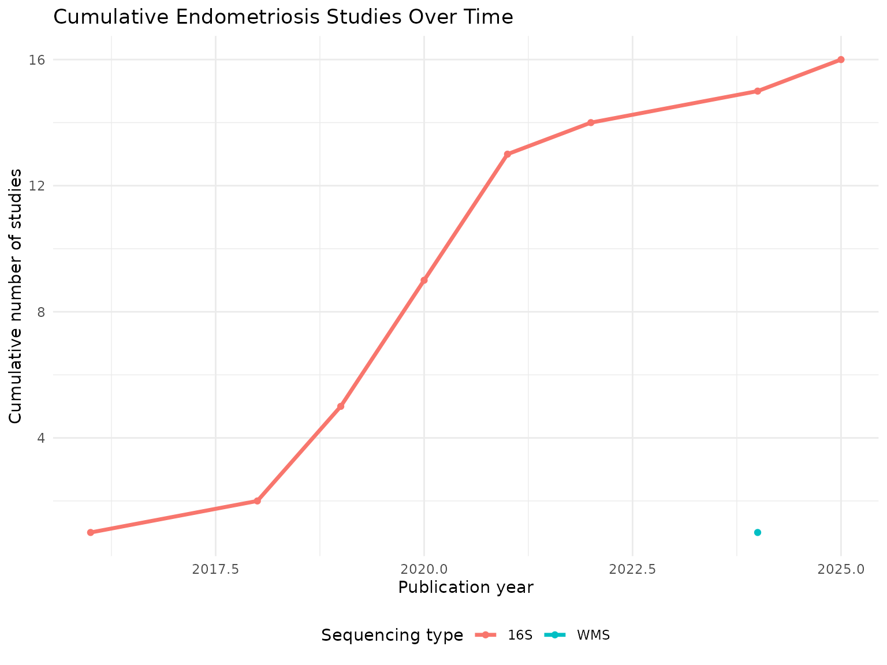
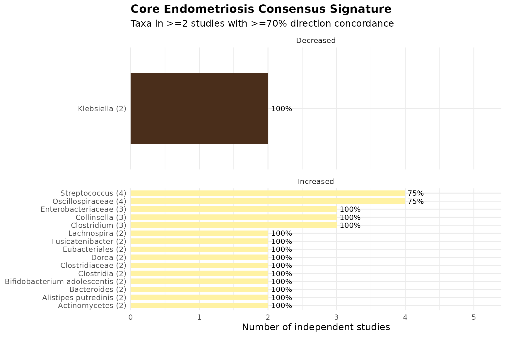
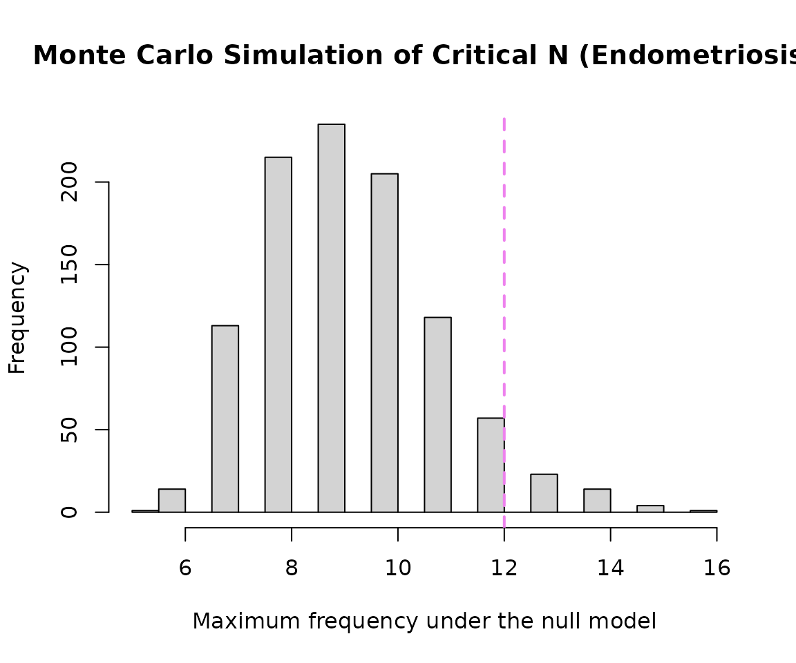
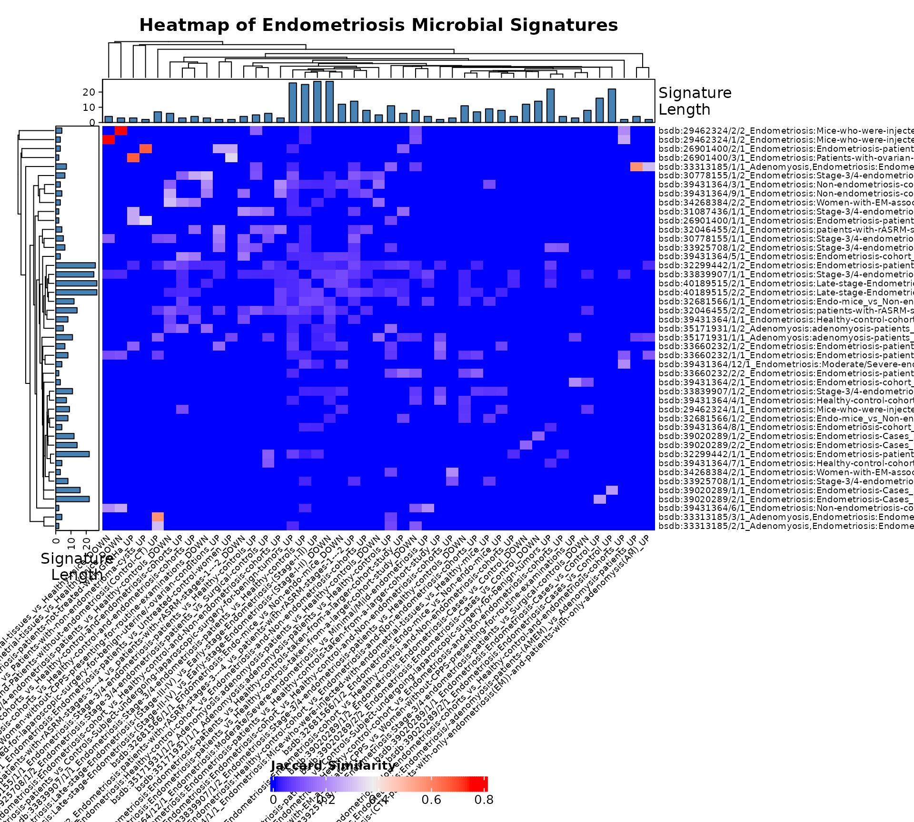

# Focused Sub-Analysis of Endometriosis Microbial Signatures

## Introduction

This vignette demonstrates a focused sub-analysis of microbial
signatures associated specifically with endometriosis (and the closely
related condition adenomyosis) using BugSigDB. This is the smallest of
the four sub-analyses by sample size in the General Women’s Health
dataset (42 signatures total across “Endometriosis”, “Adenomyosis”, and
“Adenomyosis,Endometriosis”), so thresholds and statistical power should
be interpreted with appropriate caution throughout.

## Download and Prepare Data

``` r

full.dat <- bugsigdbr::importBugSigDB(cache = FALSE)
```

``` r

ind1 <- lengths(full.dat[["MetaPhlAn taxon names"]]) > 0
ind2 <- lengths(full.dat[["NCBI Taxonomy IDs"]]) > 0
dat <- full.dat[ind1 & ind2, ]
```

## Select Endometriosis-Specific Signatures

``` r

endometriosis_terms <- c(
  "Endometriosis",
  "Adenomyosis",
  "Adenomyosis,Endometriosis"
)

endo_dat <- dat %>%
  filter(Condition %in% endometriosis_terms) %>%
  distinct()

nrow(endo_dat)
```

    ## [1] 56

``` r

endo_dat %>%
  count(Condition, sort = TRUE) %>%
  knitr::kable()
```

| Condition                 |   n |
|:--------------------------|----:|
| Endometriosis             |  51 |
| Adenomyosis,Endometriosis |   3 |
| Adenomyosis               |   2 |

## Study Characteristics

``` r

study.summary <- endo_dat %>%
  count(`Body site`, `Sequencing type`)

knitr::kable(study.summary)
```

| Body site | Sequencing type | n |
|:---|:---|---:|
| Cervical cavity | 16S | 3 |
| Endometrium | 16S | 3 |
| Feces | 16S | 20 |
| Feces | WMS | 4 |
| Lower part of vagina,Upper part of vagina,Cervical mucus | 16S | 2 |
| Mouth | 16S | 5 |
| Ovary | 16S | 2 |
| Posterior fornix of vagina | 16S | 4 |
| Upper part of vagina | 16S | 2 |
| Uterine cervix | 16S | 1 |
| Uterovesical pouch | 16S | 2 |
| Vagina | 16S | 6 |
| Vaginal fluid,Feces,Endocervix | 16S | 2 |

``` r

endo_dat %>%
  count(Year) %>%
  arrange(Year) %>%
  knitr::kable()
```

| Year |   n |
|-----:|----:|
| 2016 |   5 |
| 2018 |   4 |
| 2019 |   4 |
| 2020 |   9 |
| 2021 |  12 |
| 2022 |   2 |
| 2024 |  18 |
| 2025 |   2 |

``` r

endo_dat %>%
  count(`Body site`, sort = TRUE) %>%
  ggplot(aes(x = reorder(`Body site`, n), y = n)) +
  geom_col(fill = "#FFDE00", width = 0.6) +
  coord_flip() +
  labs(
    title = "Endometriosis Signatures by Body Site",
    x = NULL, y = "Number of Signatures"
  ) +
  theme_minimal(base_size = 11) +
  theme(plot.title = element_text(face = "bold"))
```



``` r

endo_dat %>%
  distinct(PMID, `Location of subjects`, `Sequencing type`) %>%
  filter(!is.na(`Location of subjects`)) %>%
  count(`Location of subjects`, `Sequencing type`) %>%
  ggplot(aes(x = reorder(`Location of subjects`, n), y = n, fill = `Sequencing type`)) +
  geom_col(width = 0.6) +
  coord_flip() +
  # Adds your pastel dark brown palette manually
  scale_fill_manual(values = c("#8B7365", "#A38D80", "#BCABA2")) + 
  labs(
    title = "Endometriosis Studies by Reported Location",
    x = NULL, y = "Number of Independent Studies", fill = "Platform"
  ) +
  theme_minimal(base_size = 11) +
  theme(plot.title = element_text(face = "bold"), legend.position = "bottom")
```



``` r

endo_dat %>%
  distinct(PMID, Year, `Sequencing type`) %>%
  filter(!is.na(Year)) %>%
  count(Year, `Sequencing type`) %>%
  group_by(`Sequencing type`) %>%
  arrange(Year) %>%
  mutate(cumulative_n = cumsum(n)) %>%
  ungroup() %>%
  ggplot(aes(x = Year, y = cumulative_n, color = `Sequencing type`)) +
  geom_line(linewidth = 1.2) +
  geom_point() +
  labs(
    title = "Cumulative Endometriosis Studies Over Time",
    x = "Publication year", y = "Cumulative number of studies", color = "Sequencing type"
  ) +
  theme_minimal(base_size = 11) +
  theme(legend.position = "bottom")
```



## Taxonomic Summary

``` r

taxa.table <- createTaxonTable(endo_dat)
knitr::kable(head(taxa.table, 20))
```

| Taxon Name | Taxonomic Level | total_signatures | increased_signatures | decreased_signatures | Binomial Test pval |
|:---|:---|---:|---:|---:|---:|
| Lactobacillus | genus | 9 | 6 | 3 | 0.51 |
| Streptococcus | genus | 6 | 5 | 1 | 0.22 |
| Bacteroidales | order | 6 | 2 | 4 | 0.69 |
| Prevotella | genus | 6 | 4 | 2 | 0.69 |
| Coriobacteriaceae | family | 5 | 4 | 1 | 0.37 |
| Megasphaera | genus | 5 | 2 | 3 | 1.00 |
| Bacteroides | genus | 5 | 3 | 2 | 1.00 |
| Enterococcus | genus | 4 | 4 | 0 | 0.12 |
| Oscillospira | genus | 4 | 4 | 0 | 0.12 |
| Blautia | genus | 4 | 3 | 1 | 0.63 |

## Split by Sequencing Type

``` r

endo.wms <- endo_dat %>% filter(`Sequencing type` == "WMS")
endo.16s <- endo_dat %>% filter(`Sequencing type` == "16S")

cat("WMS  - signatures:", nrow(endo.wms), "| studies:", n_distinct(endo.wms$PMID), "\n")
```

    ## WMS  - signatures: 4 | studies: 1

``` r

cat("16S  - signatures:", nrow(endo.16s), "| studies:", n_distinct(endo.16s$PMID), "\n")
```

    ## 16S  - signatures: 52 | studies: 16

## Long-Format Taxon Table

``` r

sigs.endo <- bugsigdbr::getSignatures(endo_dat, tax.id.type = "taxname")
sigs.all <- bugsigdbr::getSignatures(dat, tax.id.type = "taxname")

taxon.long <- purrr::map_dfr(seq_along(sigs.all), function(i) {
  taxa <- sigs.all[[i]]
  if (length(taxa) == 0) return(NULL)
  tibble::tibble(sig_id = i, taxon = taxa)
}) %>%
  left_join(
    dat %>%
      mutate(sig_id = row_number()) %>%
      select(sig_id, PMID, Condition, `Sequencing type`, `Abundance in Group 1`),
    by = "sig_id"
  ) %>%
  rename(direction = `Abundance in Group 1`)

nrow(taxon.long)
```

    ## [1] 58971

## Taxon Frequency Across Studies

``` r

taxon.freq <- taxon.long %>%
  filter(Condition %in% endometriosis_terms) %>%
  distinct(PMID, taxon, direction) %>%
  count(taxon, direction, name = "n_studies") %>%
  group_by(taxon) %>%
  mutate(total_studies = sum(n_studies)) %>%
  ungroup() %>%
  arrange(desc(total_studies))

n_distinct(taxon.freq$taxon)
```

    ## [1] 253

``` r

taxon.freq %>%
  distinct(taxon, total_studies) %>%
  slice_max(total_studies, n = 15) %>%
  knitr::kable()
```

| taxon                          | total_studies |
|:-------------------------------|--------------:|
| Oscillospiraceae               |             5 |
| Lactobacillus                  |             4 |
| Streptococcus                  |             4 |
| Bacteroides                    |             3 |
| Bifidobacterium                |             3 |
| Clostridium                    |             3 |
| Collinsella                    |             3 |
| Enterobacteriaceae             |             3 |
| Faecalibacterium               |             3 |
| Fusicatenibacter               |             3 |
| Lachnospiraceae                |             3 |
| Lactobacillaceae               |             3 |
| Mycobacteriales                |             3 |
| Actinomycetes                  |             2 |
| Actinomycetota                 |             2 |
| Alistipes putredinis           |             2 |
| Bacillota                      |             2 |
| Bacteroides thetaiotaomicron   |             2 |
| Bifidobacterium adolescentis   |             2 |
| Bilophila wadsworthia          |             2 |
| Blautia                        |             2 |
| Burkholderiales                |             2 |
| Clostridia                     |             2 |
| Clostridiaceae                 |             2 |
| Dorea                          |             2 |
| Eggerthella lenta              |             2 |
| Enterobacter                   |             2 |
| Enterocloster bolteae          |             2 |
| Enterocloster clostridioformis |             2 |
| Enterococcus                   |             2 |
| Eubacteriales                  |             2 |
| Flavonifractor plautii         |             2 |
| Gemmiger                       |             2 |
| Klebsiella                     |             2 |
| Lachnospira                    |             2 |
| Lawsonella                     |             2 |
| Moryella                       |             2 |
| Peptoniphilus                  |             2 |
| Peptostreptococcus             |             2 |
| Pseudomonadota                 |             2 |
| Roseburia                      |             2 |
| Rothia                         |             2 |
| Ruminiclostridium              |             2 |
| Serratia                       |             2 |
| Staphylococcaceae              |             2 |
| Subdoligranulum                |             2 |
| \[Clostridium\] scindens       |             2 |

## Core Consensus Signature

``` r

concordance <- taxon.long %>%
  filter(Condition %in% endometriosis_terms) %>%
  distinct(PMID, taxon, direction) %>%
  group_by(taxon) %>%
  summarise(
    n_studies       = n_distinct(PMID),
    n_increased     = sum(direction == "increased"),
    n_decreased     = sum(direction == "decreased"),
    concordance_pct = round(max(n_increased, n_decreased) / n_studies * 100, 1),
    majority_dir    = if_else(n_increased >= n_decreased, "increased", "decreased"),
    .groups = "drop"
  ) %>%
  arrange(desc(n_studies), desc(concordance_pct))

# Given the small sample size (42 signatures total), the standard >=3/>=75% threshold
# may return very few or zero rows. Loosen to >=2 studies / >=70% concordance if so
# (matching the Cervical Cancer approach), and state that explicitly below.
core.sig <- concordance %>%
  filter(n_studies >= 2, concordance_pct >= 70) %>%
  arrange(majority_dir, desc(n_studies))

nrow(core.sig)
```

    ## [1] 22

``` r

knitr::kable(core.sig)
```

| taxon | n_studies | n_increased | n_decreased | concordance_pct | majority_dir |
|:---|---:|---:|---:|---:|:---|
| Klebsiella | 2 | 0 | 2 | 100 | decreased |
| Oscillospiraceae | 4 | 3 | 2 | 75 | increased |
| Streptococcus | 4 | 3 | 1 | 75 | increased |
| Clostridium | 3 | 3 | 0 | 100 | increased |
| Collinsella | 3 | 3 | 0 | 100 | increased |
| Enterobacteriaceae | 3 | 3 | 0 | 100 | increased |
| Actinomycetes | 2 | 2 | 0 | 100 | increased |
| Alistipes putredinis | 2 | 2 | 0 | 100 | increased |
| Bacteroides | 2 | 2 | 1 | 100 | increased |
| Bifidobacterium adolescentis | 2 | 2 | 0 | 100 | increased |
| Clostridia | 2 | 2 | 0 | 100 | increased |
| Clostridiaceae | 2 | 2 | 0 | 100 | increased |
| Dorea | 2 | 2 | 0 | 100 | increased |
| Eubacteriales | 2 | 2 | 0 | 100 | increased |
| Fusicatenibacter | 2 | 2 | 1 | 100 | increased |
| Lachnospira | 2 | 2 | 0 | 100 | increased |
| Lachnospiraceae | 2 | 2 | 1 | 100 | increased |
| Moryella | 2 | 2 | 0 | 100 | increased |
| Mycobacteriales | 2 | 2 | 1 | 100 | increased |
| Peptostreptococcus | 2 | 2 | 0 | 100 | increased |
| Pseudomonadota | 2 | 2 | 0 | 100 | increased |
| Roseburia | 2 | 2 | 0 | 100 | increased |

## Core Signature Visualisation

``` r

if (nrow(core.sig) > 0) {
  core.sig %>%
    group_by(majority_dir) %>%
    slice_max(n_studies, n = 15, with_ties = FALSE) %>%
    ungroup() %>%
    mutate(
      direction_label = if_else(majority_dir == "increased", "Increased", "Decreased"),
      taxon_label = paste0(str_wrap(taxon, width = 28), " (", n_studies, ")")
    ) %>%
    ggplot(aes(x = reorder(taxon_label, n_studies), y = n_studies, fill = direction_label)) +
    geom_col(width = 0.7) +
    geom_text(aes(label = paste0(concordance_pct, "%")), hjust = -0.15, size = 3.3) +
    coord_flip(clip = "off") +
    facet_wrap(~direction_label, scales = "free_y", ncol = 1) +
    scale_fill_manual(values = c("Increased" = "#FFF2A3", "Decreased" = "#4A2E1B")) +
    scale_y_continuous(expand = expansion(mult = c(0, 0.35))) +
    labs(
      title = "Core Endometriosis Consensus Signature",
      subtitle = "Taxa in >=2 studies with >=70% direction concordance",
      x = NULL, y = "Number of independent studies", fill = NULL
    ) +
    theme_minimal(base_size = 12) +
    theme(legend.position = "none", plot.title = element_text(face = "bold"))
} else {
  cat("No taxa met the core-signature threshold at this sample size.")
}
```



## Taxon Enrichment Analysis

``` r

n.universe <- n_distinct(taxon.long %>% filter(Condition %in% endometriosis_terms) %>% pull(taxon))
n.sigs     <- length(sigs.endo)

enrichment.df <- taxon.freq %>%
  distinct(taxon, total_studies) %>%
  mutate(
    observed         = total_studies,
    expected         = n.sigs / n.universe,
    enrichment_ratio = observed / expected,
    log2_enrichment  = log2(enrichment_ratio),
    p_value = purrr::map_dbl(observed, ~ binom.test(
      x = .x, n = n.sigs, p = 1 / n.universe, alternative = "greater"
    )$p.value),
    p_adj = p.adjust(p_value, method = "BH")
  ) %>%
  arrange(p_adj, desc(log2_enrichment))

sum(enrichment.df$p_adj < 0.05)
```

    ## [1] 13

``` r

knitr::kable(head(enrichment.df, 15))
```

| taxon | total_studies | observed | expected | enrichment_ratio | log2_enrichment | p_value | p_adj |
|:---|---:|---:|---:|---:|---:|---:|---:|
| Oscillospiraceae | 5 | 5 | 0.2213439 | 22.589286 | 4.497567 | 0.0000031 | 0.0007882 |
| Lactobacillus | 4 | 4 | 0.2213439 | 18.071429 | 4.175639 | 0.0000761 | 0.0064158 |
| Streptococcus | 4 | 4 | 0.2213439 | 18.071429 | 4.175639 | 0.0000761 | 0.0064158 |
| Bacteroides | 3 | 3 | 0.2213439 | 13.553571 | 3.760601 | 0.0014637 | 0.0284859 |
| Bifidobacterium | 3 | 3 | 0.2213439 | 13.553571 | 3.760601 | 0.0014637 | 0.0284859 |
| Clostridium | 3 | 3 | 0.2213439 | 13.553571 | 3.760601 | 0.0014637 | 0.0284859 |
| Collinsella | 3 | 3 | 0.2213439 | 13.553571 | 3.760601 | 0.0014637 | 0.0284859 |
| Enterobacteriaceae | 3 | 3 | 0.2213439 | 13.553571 | 3.760601 | 0.0014637 | 0.0284859 |
| Faecalibacterium | 3 | 3 | 0.2213439 | 13.553571 | 3.760601 | 0.0014637 | 0.0284859 |
| Fusicatenibacter | 3 | 3 | 0.2213439 | 13.553571 | 3.760601 | 0.0014637 | 0.0284859 |
| Lachnospiraceae | 3 | 3 | 0.2213439 | 13.553571 | 3.760601 | 0.0014637 | 0.0284859 |
| Lactobacillaceae | 3 | 3 | 0.2213439 | 13.553571 | 3.760601 | 0.0014637 | 0.0284859 |
| Mycobacteriales | 3 | 3 | 0.2213439 | 13.553571 | 3.760601 | 0.0014637 | 0.0284859 |
| Actinomycetes | 2 | 2 | 0.2213439 | 9.035714 | 3.175639 | 0.0208905 | 0.1124530 |
| Actinomycetota | 2 | 2 | 0.2213439 | 9.035714 | 3.175639 | 0.0208905 | 0.1124530 |

## Monte Carlo Critical N

``` r

siglengths <- lengths(endo_dat$`MetaPhlAn taxon names`)

criticalN <- getCriticalN(
  relevant.sigs = endo_dat$`MetaPhlAn taxon names`,
  siglengths = siglengths
)

criticalN
```

    ## $critical_n
    ## 95% 
    ##  12 
    ## 
    ## $ci_lower
    ## 2.5% 
    ##   12 
    ## 
    ## $ci_upper
    ## 97.5% 
    ##    13 
    ## 
    ## $simulated_values
    ##    [1] 11  9 10 10  7 10  9 10  7  8 10  9  8  9  9  7  9 14 11 10  9 10  7 13
    ##   [25]  8  9 10 10  9 12 11 11  6  8 10 10  8  9  9 10 10  8 11  7  9 11  8  9
    ##   [49] 12 12 11  8 10  9 11 10  9  8  8 11  7 14  9  9  9  9  8  9  8 10  8 15
    ##   [73]  9 11 10 11 10 11  6 10  8  9  8  9  6 10  9  9 10 10 10  9 12 10 13  7
    ##   [97] 10  8  9 14  8  9 10  8 10  9 11 10 12  7  8  8  8  9 12 10  9  8 10  9
    ##  [121] 11  7  7  8  6  8 12  7  9  8  9  9  8 12  9  8  9  8  7  9  9  9 10 10
    ##  [145] 10  8  7  7  8  7  9 11 11  8 14  8  8  9 10  8  7  7  8  8  8  7  8  8
    ##  [169]  8 12  8 12 11  9  8  9 10  9  9  8  8  8 10  8  9 13 11 11  8  8 11 10
    ##  [193] 10  7  8 11 11  7  9 12 11  7  7  8 11 10 10  9  9  8  9 10  8 10  8  8
    ##  [217]  9 11  8  8  8  8 11  8  8 11 10 11  9  8 10  9  8 10  9  9  9  9 10  7
    ##  [241] 12  9  8 11  7  8  7 10 13 10  9 11  7  8  7 11  8  8 11 13 10 10  9 10
    ##  [265]  8  7  8 10 10  9 10 10 11  8 10  9 11 10  7 15 11  7 15  7  7 10 11 10
    ##  [289]  8  7  8  9 10  9  8 10  9 12  9  9 10  9 11 11  8 10  7  9 11  8 11 10
    ##  [313]  9 10  7  8  9 14 10 14  9 10  8 10  8  9  9  8 11 12  8  9  6  7  8  7
    ##  [337]  8 10 12 10 11 11  9  8  9  7  9  8  9  9  8 10  9  9 10  7 11  8 10 11
    ##  [361]  8  8  8 10  9 10 11 10 10 12 10 12  9 12 11 11  7  9  8  9  9  9  9  8
    ##  [385]  7 12  8 10 10  9 10 10 11 11  8 11  7  9 10  8 12 10  9 10 11  7  9  9
    ##  [409] 10  8 10 12  8  7 11  9  9  9 10  9  8  8 11  7 10  7  9  9 10  8 10 14
    ##  [433]  9 10 10 10 13 10 11  9 10 10  9  8 10 11 13 10 13 12  9 10  7  7 10 11
    ##  [457] 10  9  8  8  7 10 11  9 10  9 11 10  9 10  8  9  9 11  9  7 10  9  9 10
    ##  [481] 11  9  7 10  8  8 11 12 10  8  9  9 11  9 10 10  8  7  9 10 11  8  8 10
    ##  [505]  7 10 12  8 12  9 12  9 11 10  9  9 10  8  8  7 12  8  8 12 10 10 12  8
    ##  [529]  8 12  8 10 10  7  9 11  9  7  7  9  9  7  5 10 12  7 10 11  8  9 12  8
    ##  [553] 10 10 12  8  7  7  8 10  8 10 11 12 10  7 10  7 12 10 10  9  9  9 12 11
    ##  [577]  7 10 10  9 11 10  9 10 13 11 10  6 11  8 11 11  9 13 14  7  8  8 11 11
    ##  [601]  9  7 11  9 10  8 14 12 11  8  7  7  7  8 10  8 11  7 10 10 11 11 11 10
    ##  [625]  8 12  9 11  9  8 10 13 10  8  9  8 11 12  9 10  8 11 12  7  7  9  8  7
    ##  [649] 10  7  9  7  7 11  8 11  8  8  8  8  6 11  9 10  9  9  8  8  9  7 10  9
    ##  [673]  8 10  8  9 13 10  9 10  8  6  7  8 14  7  9 13  7  9 10  8  8 10 11  7
    ##  [697] 10  9 10 11  8  7 11  8  9  8 12  8  7  8 10  9 10  9 13  9  9  9  8  8
    ##  [721] 13  9 11 12  8  9  8 10 10  8 11 12  8  7 12  8  9  9 13  9  8 10  9  9
    ##  [745] 11 11  8 12 10  8 10  9  8 11 10 10  8 10 10  6  7  9 12 12  9  8  7 13
    ##  [769]  9 13 10  8  9  9 12  9  7  6  9  8  9 10  8 13 11  8  9 10 13  9  8  8
    ##  [793]  9  9 10 11  9  9 10  8 13  8  9  8  8  9  9  8  7  9  9  9  7  8 13  9
    ##  [817] 10 14 10 10  8  9  9  7 10  8 10  8 10  8 10  9  8  7 11  8  7 11  7  8
    ##  [841] 11  7 11  9  9 11  9  8  9  9  6  9  9  8  7  8 12 12  8  9  7 10  8  9
    ##  [865]  9 10  7  8  8 10 12 11  7  8  9  7  9  9 12  9  8 10  8  9  9 12  8 11
    ##  [889]  8  9 11  8 10  8  7 11 10  7 14  8 14 10  7 10  8 10 10  9  7  9 11  9
    ##  [913]  9  9  9  9 11 10 12  8  9 10  9  7  8 10 11  8  9  7 10  7  8 10 10 12
    ##  [937]  7  9 14  9  9 10  8  8  9 15 10 11  6 10 11  9 12  7 11  8  9  9  9 10
    ##  [961]  9  9  9 10 10 10 13 12  8  8  8  9  7 16 10  9 11  9 11  9 11  7 11  9
    ##  [985]  8  7  7 10 10  6 10 11  8  6  9  9  8  7  8 10
    ## 
    ## $alpha
    ## [1] 0.05
    ## 
    ## $quantile_label
    ## [1] "95th percentile"

``` r

hist(
  criticalN$simulated_values,
  breaks = 30,
  main = "Monte Carlo Simulation of Critical N (Endometriosis)",
  xlab = "Maximum frequency under the null model"
)

abline(v = criticalN$critical_n, col = "violet", lwd = 2, lty = 2)
```



## Cross-Condition Taxa Overlap Analysis

``` r

endo_taxa <- taxon.long %>%
  filter(Condition %in% endometriosis_terms) %>%
  distinct(taxon) %>%
  pull(taxon)

shared_taxa_counts <- taxon.long %>%
  filter(taxon %in% endo_taxa) %>%
  group_by(taxon) %>%
  summarise(
    total_womens_health_studies = n_distinct(PMID),
    distinct_conditions_linked = n_distinct(Condition),
    top_other_conditions = paste(
      head(setdiff(unique(Condition), endometriosis_terms), 3),
      collapse = ", "
    ),
    .groups = "drop"
  ) %>%
  arrange(desc(distinct_conditions_linked))

shared_taxa_counts %>%
  slice_max(distinct_conditions_linked, n = 20, with_ties = FALSE) %>%
  knitr::kable(
    caption = "Top Endometriosis-Associated Taxa and Their Links to Other Conditions",
    col.names = c("Taxon Name", "Total WH Studies", "Total Distinct Conditions", "Other Conditions it Often Appears In")
  )
```

| Taxon Name | Total WH Studies | Total Distinct Conditions | Other Conditions it Often Appears In |
|:---|---:|---:|:---|
| Streptococcus | 347 | 214 | Granulomatosis with Polyangiitis, Diet, Autism |
| Prevotella | 354 | 211 | Illness severity status, Antimicrobial agent, Obesity |
| Lactobacillus | 335 | 201 | Antimicrobial agent, Oxygen, Illness severity status |
| Bacteroides | 345 | 199 | Autism, Autoimmune disease, Obesity |
| Lachnospiraceae | 331 | 199 | Autoimmune disease, Smoking behavior, Irritable bowel syndrome |
| Bacillota | 313 | 190 | Type II diabetes mellitus, Autism, Autoimmune disease |
| Faecalibacterium | 278 | 183 | Obesity, Autoimmune disease, Irritable bowel syndrome |
| Oscillospiraceae | 273 | 183 | Autoimmune disease, Smoking behavior, Colorectal carcinoma |
| Bifidobacterium | 275 | 177 | Food allergy, Irritable bowel syndrome, Autism |
| Clostridium | 258 | 175 | Irritable bowel syndrome, Autism, Autoimmune disease |
| Actinomycetota | 265 | 171 | Autism, Ethnic group,Place of residence measurement, Ulcerative colitis |
| Pseudomonadota | 241 | 166 | Autism, Autoimmune disease, Ethnic group,Place of residence measurement |
| Roseburia | 228 | 165 | Autoimmune disease, Smoking behavior, Irritable bowel syndrome |
| Blautia | 246 | 164 | Autoimmune disease, Irritable bowel syndrome, Colorectal cancer |
| Veillonella | 241 | 161 | Obesity, Antimicrobial agent, Oxygen |
| Bacteroidota | 247 | 158 | Autism, Autoimmune disease, Irritable bowel syndrome |
| Eubacteriales | 219 | 156 | Autoimmune disease, Colorectal carcinoma, Psoriasis |
| Enterobacteriaceae | 213 | 155 | Autoimmune disease, Irritable bowel syndrome, Sampling site |
| Haemophilus | 208 | 153 | Illness severity status, Diet, Autoimmune disease |
| Clostridia | 188 | 140 | Type II diabetes mellitus, Autoimmune disease, Colorectal carcinoma |

Top Endometriosis-Associated Taxa and Their Links to Other Conditions
{.table}

## Signature Similarity and Heatmap

``` r

allsigs <- bugsigdbr::getSignatures(endo_dat, tax.id.type = "taxname")
allsigs <- allsigs[sapply(allsigs, length) > 1]

if (length(allsigs) > 1) {
  jmat <- BugSigDBStats::calcJaccardSimilarity(allsigs)
  siglengths <- sapply(allsigs, length)

  ha <- HeatmapAnnotation(
    `Signature\nLength` = anno_barplot(siglengths, gp = gpar(fill = "#4682B4"), height = unit(1.2, "cm"))
  )
  hr <- rowAnnotation(
    `Signature\nLength` = anno_barplot(siglengths, gp = gpar(fill = "#4682B4"), width = unit(1.2, "cm"))
  )

  hm <- Heatmap(
    jmat,
    top_annotation = ha,
    left_annotation = hr,
    row_names_gp = gpar(fontsize = 7),
    column_names_gp = gpar(fontsize = 7),
    column_names_rot = 45,
    column_title = "Heatmap of Endometriosis Microbial Signatures",
    column_title_gp = gpar(fontsize = 14, fontface = "bold"),
    heatmap_legend_param = list(title = "Jaccard Similarity", direction = "horizontal", legend_width = unit(6, "cm"))
  )

  draw(hm, heatmap_legend_side = "bottom", padding = unit(c(5, 5, 5, 10), "mm"))

  png(filename = "Endometriosis_heatmap.png", width = 10, height = 9, units = "in", res = 300)
  draw(hm, heatmap_legend_side = "bottom", padding = unit(c(5, 5, 5, 10), "mm"))
  dev.off()
} else {
  cat("Fewer than 2 multi-taxon signatures available - heatmap not generated.")
}
```



    ## agg_png 
    ##       2

Note: with only 42 total signatures for this sub-analysis, the heatmap
is small enough that row/column labels are kept visible (unlike
General/Breast Cancer, which had to hide labels given hundreds of
signatures) - adjust `row_names_gp`/`column_names_gp` font size further
if labels still overlap once you see the actual output.

## Dendrogram

``` r

if (exists("jmat") && nrow(jmat) > 1) {
  hc <- hclust(as.dist(1 - jmat))
  dend <- as.dendrogram(hc)

  par(mar = c(5, 2, 4, 10))

  plot(
    dend,
    horiz = TRUE,
    main = "Hierarchical Cluster Map of Endometriosis Microbial Signatures",
    xlab = "Distance (1 - Jaccard similarity)",
    cex.main = 1.2
  )
}
```


