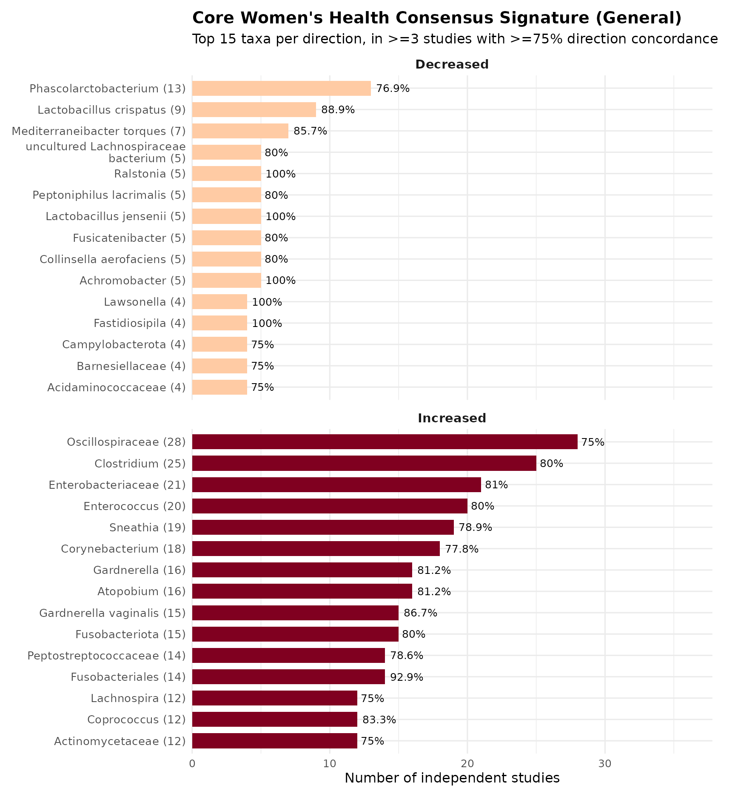
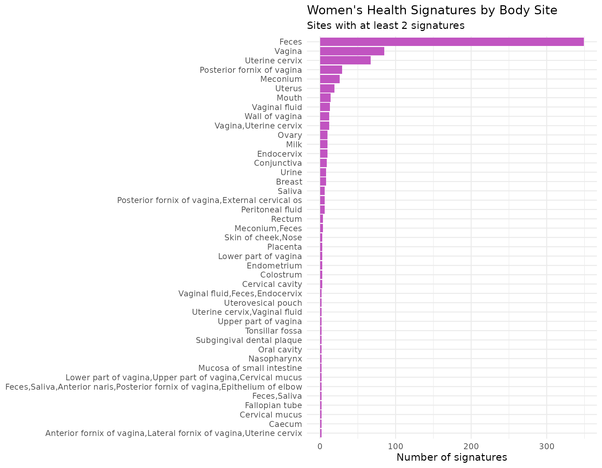
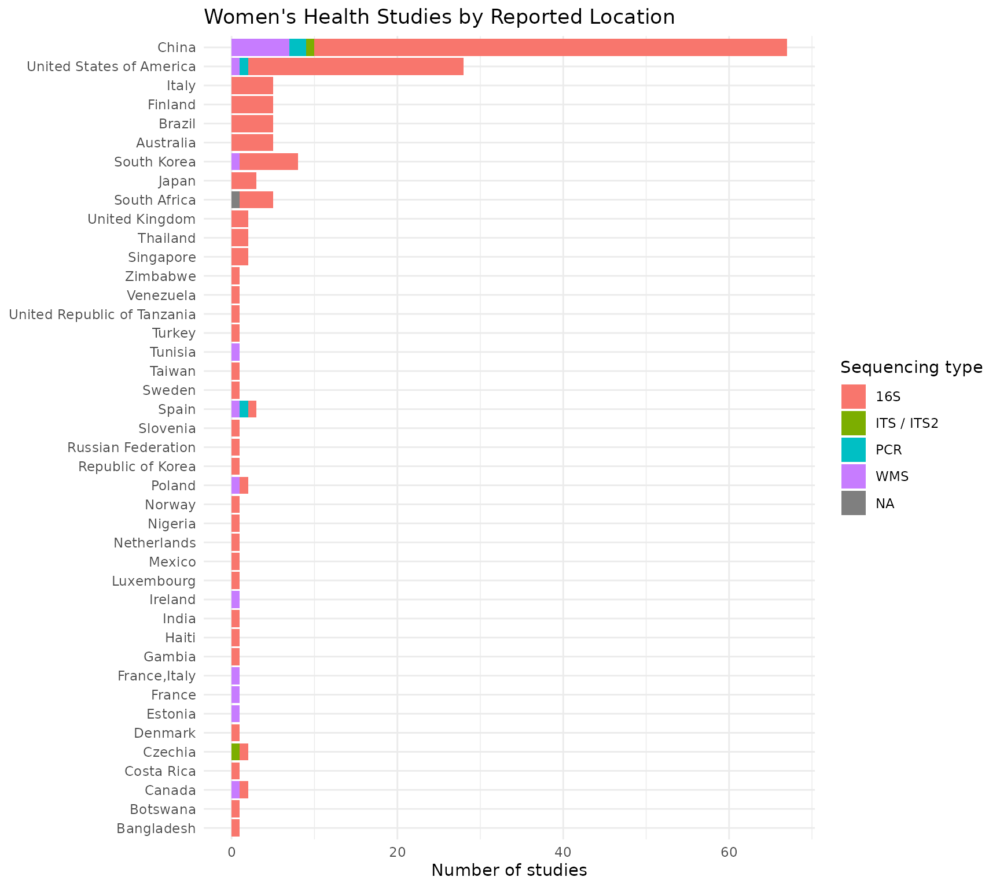
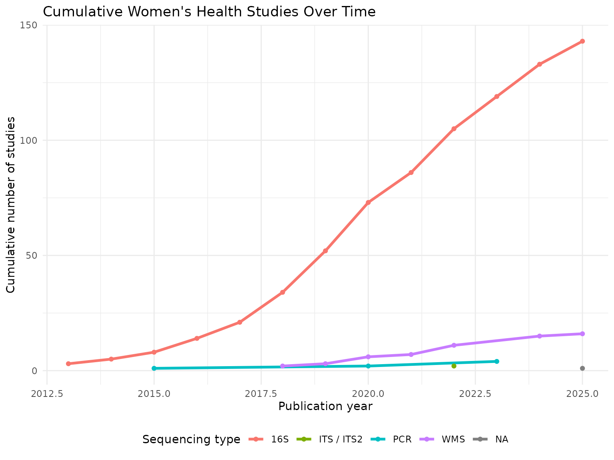
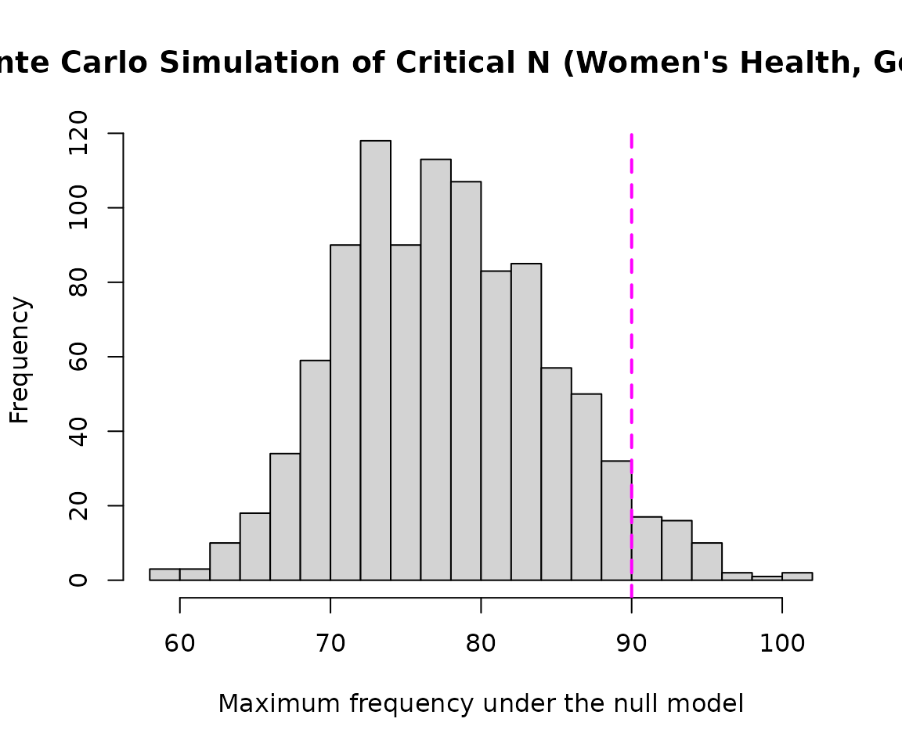
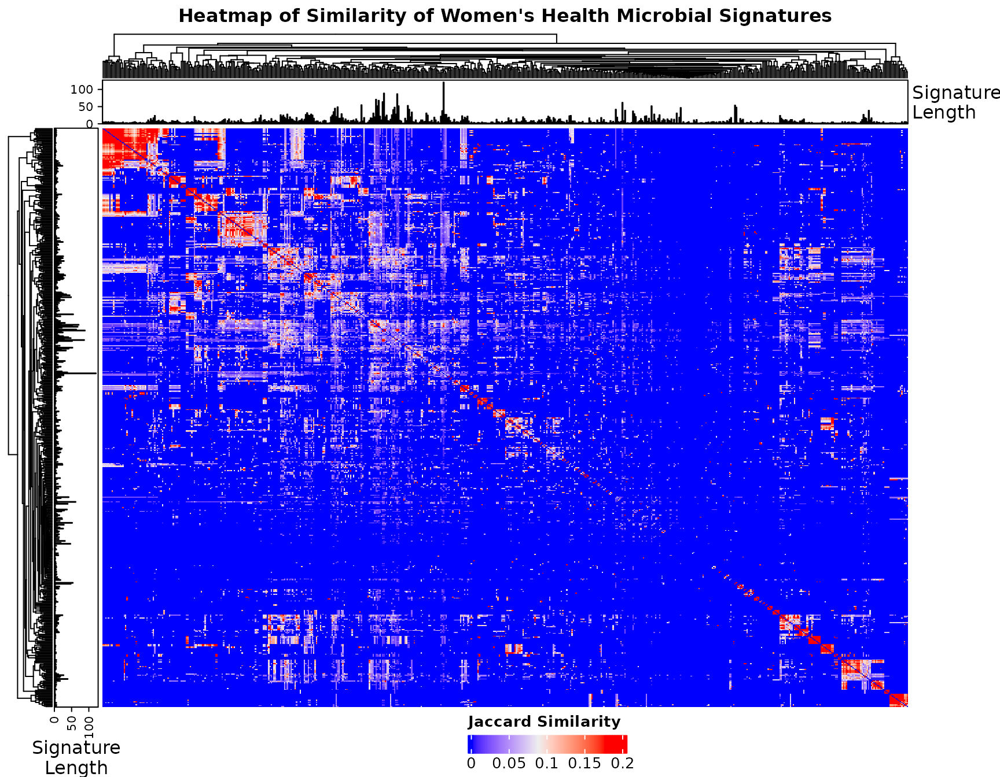

# Exploratory Analysis of Women's Health Microbial Signatures

## Introduction

This vignette demonstrates an exploratory analysis of microbial
signatures associated with women’s health conditions using data obtained
from BugSigDB and functions provided by the bugSigSimple package. This
is the **General** analysis — a broad landscape view across many
women’s-health-related conditions (breast cancer, cervical cancer,
endometriosis, pregnancy/maternal-child topics, and other
reproductive/gynecological conditions). Four focused sub-analyses
(Cervical Cancer, Breast Cancer, Endometriosis, and
Pregnancy/Maternal-Child) build on this General analysis with
condition-specific rigor.

## Analysis objectives

1.  Downloading the data from BugSigDB
2.  Filtering the data to select women’s-health-related signatures and
    remove duplicates
3.  Description of the studies (body site, sequencing platform,
    publication year)
4.  Description of the taxa
5.  Core consensus signature and basic statistical tests
6.  Monte Carlo simulation to calculate critical N
7.  Heatmaps and dendrograms

## Environment note

**Before running this vignette**, confirm your Bioconductor
infrastructure loads cleanly. If
[`library(S4Vectors)`](https://bioconductor.org/packages/S4Vectors) (or
any of its dependents) fails with an error like *“package could not be
loaded”* or *“reached elapsed time limit”*, reinstall it fresh in an
otherwise-idle R session before proceeding:

``` r

remove.packages("S4Vectors")
BiocManager::install("S4Vectors", update = FALSE, force = TRUE)
# Restart R (Session > Restart R) before continuing
```

## Making sure packages are installed

``` r

if (!require("BiocManager", quietly = TRUE))
    install.packages("BiocManager")
BiocManager::install(c("devtools", "tidyverse", "kableExtra"))
BiocManager::install(c("waldronlab/bugSigSimple", "waldronlab/BugSigDBStats", "waldronlab/bugsigdbr"))
```

## Download BugSigDB data

``` r

full.dat <- bugsigdbr::importBugSigDB(cache = FALSE)
```

``` r

dim(full.dat)
```

    ## [1] 7425   51

## Remove empty signatures

``` r

ind1 <- lengths(full.dat[["MetaPhlAn taxon names"]]) > 0
ind2 <- lengths(full.dat[["NCBI Taxonomy IDs"]]) > 0

dat <- full.dat[ind1 & ind2, ]

dim(dat)
```

    ## [1] 7425   51

## Select women’s-health-related signatures

``` r

womens_health_terms <- c(
  # Breast
  "Breast cancer", "Breast cancer stage", "Breast carcinoma", "HER2 Positive Breast Carcinoma",
  # Cervical
  "Cervical cancer", "Cervical cerclage", "Cervical glandular intraepithelial neoplasia",
  "Cervical glandular intraepithelial neoplasia,Cervical cancer",
  "Cervical glandular intraepithelial neoplasia,Human papilloma virus infection",
  "Cervix erosion", "Human papilloma virus infection", "Human papilloma virus infection,Age",
  "Human papilloma virus infection,Cervical cancer",
  "Human papilloma virus infection,Cervical glandular intraepithelial neoplasia",
  "Chlamydophila infectious disease,Human papilloma virus infection",
  # Endometriosis
  "Endometriosis", "Adenomyosis", "Adenomyosis,Endometriosis",
  # Pregnancy / maternal-child
  "Pregnancy", "Gestational age", "Gestational diabetes", "Vaginal microbiome measurement",
  "Premature birth", "Spontaneous preterm birth", "Preterm premature rupture of the membranes",
  "Birth weight", "Birth measurement", "HIV mother to child transmission",
  "Neonatal death", "Neonatal jaundice", "Postnatal growth retardation",
  "Necrotizing enterocolitis", "Breastfeeding duration", "Breastfeeding duration,Transport",
  "Maternal milk", "Cesarean section", "Delivery method",
  # Broader women's health
  "Ovarian cancer", "Polycystic ovary syndrome", "Menopause", "Postmenopausal",
  "Postmenopausal osteoporosis", "Acquired primary ovarian failure", "Endometrial cancer",
  "Bacterial vaginosis", "Vaginitis", "Vulvovaginitis", "Vulvovaginal candidiasis",
  "Gonorrhea", "Chlamydia trachomatis", "Chlamydia trachomatis infectious disease",
  "Genital neoplasm, femaale", "Age at menarche", "Hormone replacement therapy", "Parous","Rosacea", "Ehlers-Danlos syndrome"
)


womens_health_dat <- dat %>%
  filter(Condition %in% womens_health_terms)

dim(womens_health_dat)
```

    ## [1] 758  51

``` r

womens_health_dat %>%
  count(Condition, sort = TRUE) %>%
  knitr::kable()
```

| Condition | n |
|:---|---:|
| Polycystic ovary syndrome | 137 |
| Human papilloma virus infection | 81 |
| Gestational diabetes | 71 |
| Endometriosis | 51 |
| Cervical glandular intraepithelial neoplasia | 50 |
| Ovarian cancer | 45 |
| Breast cancer | 33 |
| Cesarean section | 29 |
| Breastfeeding duration | 22 |
| Cervical cancer | 22 |
| Delivery method | 21 |
| Bacterial vaginosis | 17 |
| Pregnancy | 17 |
| HIV mother to child transmission | 15 |
| Chlamydia trachomatis | 13 |
| Birth measurement | 11 |
| Endometrial cancer | 11 |
| Premature birth | 11 |
| Spontaneous preterm birth | 10 |
| Breast carcinoma | 6 |
| Cervical glandular intraepithelial neoplasia,Human papilloma virus infection | 6 |
| Chlamydia trachomatis infectious disease | 6 |
| Menopause | 6 |
| Postnatal growth retardation | 5 |
| Vulvovaginitis | 5 |
| Gestational age | 4 |
| Hormone replacement therapy | 4 |
| Neonatal jaundice | 4 |
| Preterm premature rupture of the membranes | 4 |
| Adenomyosis,Endometriosis | 3 |
| Gonorrhea | 3 |
| Necrotizing enterocolitis | 3 |
| Rosacea | 3 |
| Adenomyosis | 2 |
| Age at menarche | 2 |
| Breast cancer stage | 2 |
| Breastfeeding duration,Transport | 2 |
| Cervical glandular intraepithelial neoplasia,Cervical cancer | 2 |
| Cervix erosion | 2 |
| Chlamydophila infectious disease,Human papilloma virus infection | 2 |
| HER2 Positive Breast Carcinoma | 2 |
| Human papilloma virus infection,Cervical cancer | 2 |
| Maternal milk | 2 |
| Postmenopausal osteoporosis | 2 |
| Vaginitis | 2 |
| Vulvovaginal candidiasis | 2 |
| Birth weight | 1 |
| Parous | 1 |
| Postmenopausal | 1 |

Unlike the other Summer Projects analysis, no single body site captures
the relevant evidence here — vaginal, cervical, breast, and fecal
samples are all legitimately relevant to different women’s-health
conditions. No body-site restriction is applied in the General analysis;
body site distribution is instead described below as part of the study
characteristics.

One study (conjunctival trachoma, caused by *Chlamydia trachomatis*) is
retained as a legitimate — if biologically atypical — result of the
`Chlamydia trachomatis` filter term, and is noted here as a minor caveat
rather than excluded.

## Remove duplicate signatures

``` r

womens_health_dat <- womens_health_dat %>%
  distinct()

nrow(womens_health_dat)
```

    ## [1] 758

No exact duplicate records were found in this signature set.

## Study characteristics

``` r

study.summary <- womens_health_dat %>%
  count(`Body site`, `Sequencing type`)

knitr::kable(study.summary)
```

| Body site | Sequencing type | n |
|:---|:---|---:|
| Anterior fornix of vagina,Lateral fornix of vagina,Uterine cervix | 16S | 2 |
| Breast | 16S | 8 |
| Caecum | 16S | 2 |
| Cervical cavity | 16S | 3 |
| Cervical mucus | 16S | 2 |
| Colostrum | 16S | 3 |
| Conjunctiva | 16S | 9 |
| Endocervix | 16S | 10 |
| Endometrium | 16S | 3 |
| Fallopian tube | 16S | 2 |
| Feces | 16S | 292 |
| Feces | ITS / ITS2 | 9 |
| Feces | PCR | 5 |
| Feces | WMS | 43 |
| Feces,Saliva | 16S | 2 |
| Feces,Saliva,Anterior naris,Posterior fornix of vagina,Epithelium of elbow | 16S | 2 |
| Lower part of vagina | 16S | 3 |
| Lower part of vagina,Upper part of vagina,Cervical mucus | 16S | 2 |
| Meconium | 16S | 24 |
| Meconium | WMS | 2 |
| Meconium,Feces | 16S | 4 |
| Milk | 16S | 10 |
| Mouth | 16S | 14 |
| Mucosa of small intestine | 16S | 2 |
| Nasopharynx | WMS | 2 |
| Omentum | 16S | 1 |
| Oral cavity | 16S | 2 |
| Ovary | 16S | 8 |
| Ovary | PCR | 2 |
| Peritoneal fluid | 16S | 6 |
| Placenta | 16S | 3 |
| Posterior fornix of vagina | 16S | 29 |
| Posterior fornix of vagina,External cervical os | WMS | 6 |
| Rectum | 16S | 4 |
| Saliva | 16S | 6 |
| Skin of cheek,Nose | 16S | 3 |
| Subgingival dental plaque | 16S | 2 |
| Tonsillar fossa | 16S | 2 |
| Upper part of vagina | 16S | 2 |
| Urine | 16S | 6 |
| Urine | WMS | 2 |
| Uterine cervix | 16S | 63 |
| Uterine cervix | WMS | 4 |
| Uterine cervix,Vaginal fluid | 16S | 2 |
| Uterovesical pouch | 16S | 2 |
| Uterus | 16S | 19 |
| Vagina | 16S | 81 |
| Vagina | WMS | 4 |
| Vagina,Uterine cervix | 16S | 12 |
| Vaginal fluid | 16S | 9 |
| Vaginal fluid | PCR | 2 |
| Vaginal fluid | WMS | 2 |
| Vaginal fluid,Feces,Endocervix | 16S | 2 |
| Wall of vagina | NA | 12 |

``` r

womens_health_dat %>%
  count(Year) %>%
  arrange(Year) %>%
  knitr::kable()
```

| Year |   n |
|-----:|----:|
| 2013 |   9 |
| 2014 |  12 |
| 2015 |  11 |
| 2016 |  22 |
| 2017 |  25 |
| 2018 |  93 |
| 2019 |  72 |
| 2020 |  89 |
| 2021 |  51 |
| 2022 | 107 |
| 2023 |  87 |
| 2024 |  99 |
| 2025 |  77 |
|   NA |   4 |

Body site distribution spans fecal samples (largely gestational
diabetes, PCOS, and breast cancer studies), reproductive-tract sites
(vagina, cervix, endometrium - largely bacterial vaginosis, HPV, and
cervical cancer studies), and smaller categories including meconium
(mother-to-child transmission studies) and breast/milk tissue.
Sequencing type is heavily 16S-dominated (528 of 579 signatures), with a
much smaller WMS subset (44) - a real limitation to note when
interpreting the WMS vs. 16S concordance check below, which will be
comparatively underpowered relative to the CRC analysis’s more balanced
platform split. Publication years span 2010-2024, with the bulk of
studies from 2018-2022; the apparent taper in 2023-2024 most likely
reflects BugSigDB curation lag rather than a genuine decline in research
activity.

## Taxonomic summary

``` r

taxa.table <- createTaxonTable(womens_health_dat)

head(taxa.table)
```

    ## # A tibble: 6 × 6
    ##   `Taxon Name`  `Taxonomic Level` total_signatures increased_signatures
    ##   <chr>         <chr>                        <int>                <int>
    ## 1 Lactobacillus genus                           88                   42
    ## 2 Bacteroides   genus                           71                   43
    ## 3 Bacillota     phylum                          63                   26
    ## 4 Prevotella    genus                           60                   35
    ## 5 Streptococcus genus                           55                   28
    ## 6 Dialister     genus                           54                   29
    ## # ℹ 2 more variables: decreased_signatures <int>, `Binomial Test pval` <dbl>

``` r

knitr::kable(head(taxa.table, 20))
```

| Taxon Name | Taxonomic Level | total_signatures | increased_signatures | decreased_signatures | Binomial Test pval |
|:---|:---|---:|---:|---:|---:|
| Lactobacillus | genus | 88 | 42 | 46 | 0.7500 |
| Bacteroides | genus | 71 | 43 | 28 | 0.0960 |
| Bacillota | phylum | 63 | 26 | 37 | 0.2100 |
| Prevotella | genus | 60 | 35 | 25 | 0.2500 |
| Streptococcus | genus | 55 | 28 | 27 | 1.0000 |
| Dialister | genus | 54 | 29 | 25 | 0.6800 |
| Actinomycetota | phylum | 46 | 30 | 16 | 0.0540 |
| Bifidobacterium | genus | 43 | 30 | 13 | 0.0140 |
| Faecalibacterium | genus | 42 | 22 | 20 | 0.8800 |
| Blautia | genus | 41 | 30 | 11 | 0.0043 |

## Split by sequencing type

``` r

wh.wms <- womens_health_dat %>% filter(`Sequencing type` == "WMS")
wh.16s <- womens_health_dat %>% filter(`Sequencing type` == "16S")

cat("WMS  - signatures:", nrow(wh.wms), "| studies:", n_distinct(wh.wms$PMID), "\n")
```

    ## WMS  - signatures: 65 | studies: 16

``` r

cat("16S  - signatures:", nrow(wh.16s), "| studies:", n_distinct(wh.16s$PMID), "\n")
```

    ## 16S  - signatures: 663 | studies: 144

## Long-format taxon table

``` r

sigs.womens_health <- bugsigdbr::getSignatures(womens_health_dat, tax.id.type = "taxname")

taxon.long <- purrr::map_dfr(seq_along(sigs.womens_health), function(i) {
  taxa <- sigs.womens_health[[i]]
  if (length(taxa) == 0) return(NULL)
  tibble::tibble(sig_id = i, taxon = taxa)
}) %>%
  left_join(
    womens_health_dat %>%
      mutate(sig_id = row_number()) %>%
      select(sig_id, PMID, Condition, `Sequencing type`, `Abundance in Group 1`),
    by = "sig_id"
  ) %>%
  rename(direction = `Abundance in Group 1`)

nrow(taxon.long)
```

    ## [1] 6096

## Taxon frequency across studies

``` r

taxon.freq <- taxon.long %>%
  distinct(PMID, taxon, direction) %>%
  count(taxon, direction, name = "n_studies") %>%
  group_by(taxon) %>%
  mutate(total_studies = sum(n_studies)) %>%
  ungroup() %>%
  arrange(desc(total_studies))

n_distinct(taxon.freq$taxon)
```

    ## [1] 1685

``` r

taxon.freq %>%
  distinct(taxon, total_studies) %>%
  slice_max(total_studies, n = 15) %>%
  knitr::kable()
```

| taxon            | total_studies |
|:-----------------|--------------:|
| Lactobacillus    |            63 |
| Bacillota        |            46 |
| Bacteroides      |            45 |
| Prevotella       |            41 |
| Streptococcus    |            40 |
| Actinomycetota   |            34 |
| Eubacteriales    |            34 |
| Lachnospiraceae  |            32 |
| Bacteroidota     |            31 |
| Clostridia       |            31 |
| Dialister        |            31 |
| Oscillospiraceae |            30 |
| Bacteroidales    |            29 |
| Bifidobacterium  |            29 |
| Lactobacillaceae |            28 |

Given that General pools many biologically distinct conditions together
(vaginal dysbiosis, gut dysbiosis in metabolic conditions, breast tissue
changes), the most frequent taxa are expected to reflect a mix of
vaginal-health organisms (e.g. *Lactobacillus*, *Gardnerella*,
*Prevotella*) and gut-health organisms (e.g. *Bacteroides*,
*Faecalibacterium*) rather than a single coherent signature - this
heterogeneity is itself part of the motivation for the four focused
sub-analyses.

## Core consensus signature

``` r

concordance <- taxon.long %>%
  distinct(PMID, taxon, direction) %>%
  group_by(taxon) %>%
  summarise(
    n_studies       = n_distinct(PMID),
    n_increased     = sum(direction == "increased"),
    n_decreased     = sum(direction == "decreased"),
    concordance_pct = round(max(n_increased, n_decreased) / n_studies * 100, 1),
    majority_dir    = if_else(n_increased >= n_decreased, "increased", "decreased"),
    .groups = "drop"
  ) %>%
  arrange(desc(n_studies), desc(concordance_pct))

core.sig <- concordance %>%
  filter(n_studies >= 3, concordance_pct >= 75) %>%
  arrange(majority_dir, desc(n_studies))

nrow(core.sig)
```

    ## [1] 139

``` r

knitr::kable(core.sig)
```

| taxon | n_studies | n_increased | n_decreased | concordance_pct | majority_dir |
|:---|---:|---:|---:|---:|:---|
| Phascolarctobacterium | 13 | 4 | 10 | 76.9 | decreased |
| Lactobacillus crispatus | 9 | 1 | 8 | 88.9 | decreased |
| Mediterraneibacter torques | 7 | 4 | 6 | 85.7 | decreased |
| Achromobacter | 5 | 2 | 5 | 100.0 | decreased |
| Lactobacillus jensenii | 5 | 0 | 5 | 100.0 | decreased |
| Ralstonia | 5 | 0 | 5 | 100.0 | decreased |
| Collinsella aerofaciens | 5 | 1 | 4 | 80.0 | decreased |
| Fusicatenibacter | 5 | 3 | 4 | 80.0 | decreased |
| Peptoniphilus lacrimalis | 5 | 1 | 4 | 80.0 | decreased |
| uncultured Lachnospiraceae bacterium | 5 | 1 | 4 | 80.0 | decreased |
| Fastidiosipila | 4 | 0 | 4 | 100.0 | decreased |
| Lawsonella | 4 | 0 | 4 | 100.0 | decreased |
| Acidaminococcaceae | 4 | 1 | 3 | 75.0 | decreased |
| Barnesiellaceae | 4 | 1 | 3 | 75.0 | decreased |
| Campylobacterota | 4 | 2 | 3 | 75.0 | decreased |
| Eisenbergiella | 4 | 2 | 3 | 75.0 | decreased |
| Lachnospiraceae bacterium NK4A136 | 4 | 1 | 3 | 75.0 | decreased |
| Leptotrichia | 4 | 1 | 3 | 75.0 | decreased |
| Limosilactobacillus vaginalis | 4 | 1 | 3 | 75.0 | decreased |
| Mycobacterium | 4 | 1 | 3 | 75.0 | decreased |
| Paracoccaceae | 4 | 2 | 3 | 75.0 | decreased |
| Ruminococcus gauvreauii | 4 | 1 | 3 | 75.0 | decreased |
| uncultured Oscillospiraceae bacterium | 4 | 1 | 3 | 75.0 | decreased |
| Alistipes shahii | 3 | 1 | 3 | 100.0 | decreased |
| Asteroleplasma | 3 | 0 | 3 | 100.0 | decreased |
| Bradyrhizobium | 3 | 0 | 3 | 100.0 | decreased |
| Flavobacteriaceae | 3 | 0 | 3 | 100.0 | decreased |
| Halomonas | 3 | 0 | 3 | 100.0 | decreased |
| Ralstonia pickettii | 3 | 0 | 3 | 100.0 | decreased |
| Staphylococcus aureus | 3 | 0 | 3 | 100.0 | decreased |
| Streptococcus anginosus | 3 | 1 | 3 | 100.0 | decreased |
| \[Clostridium\] innocuum | 3 | 0 | 3 | 100.0 | decreased |
| \[Eubacterium\] siraeum | 3 | 0 | 3 | 100.0 | decreased |
| Oscillospiraceae | 28 | 21 | 9 | 75.0 | increased |
| Clostridium | 25 | 20 | 7 | 80.0 | increased |
| Enterobacteriaceae | 21 | 17 | 4 | 81.0 | increased |
| Enterococcus | 20 | 16 | 5 | 80.0 | increased |
| Sneathia | 19 | 15 | 5 | 78.9 | increased |
| Corynebacterium | 18 | 14 | 8 | 77.8 | increased |
| Atopobium | 16 | 13 | 4 | 81.2 | increased |
| Gardnerella | 16 | 13 | 8 | 81.2 | increased |
| Gardnerella vaginalis | 15 | 13 | 2 | 86.7 | increased |
| Fusobacteriota | 15 | 12 | 3 | 80.0 | increased |
| Fusobacteriales | 14 | 13 | 1 | 92.9 | increased |
| Peptostreptococcaceae | 14 | 11 | 4 | 78.6 | increased |
| Coprococcus | 12 | 10 | 4 | 83.3 | increased |
| Actinomycetaceae | 12 | 9 | 3 | 75.0 | increased |
| Lachnospira | 12 | 9 | 5 | 75.0 | increased |
| Prevotella amnii | 11 | 10 | 1 | 90.9 | increased |
| Parvimonas | 10 | 10 | 1 | 100.0 | increased |
| Hoylesella timonensis | 10 | 9 | 2 | 90.0 | increased |
| Parasutterella | 10 | 9 | 2 | 90.0 | increased |
| Akkermansia | 10 | 8 | 4 | 80.0 | increased |
| Aerococcaceae | 9 | 8 | 1 | 88.9 | increased |
| Fannyhessea vaginae | 9 | 8 | 1 | 88.9 | increased |
| Fusobacteriia | 9 | 7 | 2 | 77.8 | increased |
| Lachnoclostridium | 9 | 7 | 5 | 77.8 | increased |
| Lachnospira eligens | 9 | 7 | 2 | 77.8 | increased |
| Aerococcus | 8 | 8 | 1 | 100.0 | increased |
| Paraprevotella | 8 | 7 | 1 | 87.5 | increased |
| Burkholderiaceae | 8 | 6 | 3 | 75.0 | increased |
| Comamonadaceae | 8 | 6 | 2 | 75.0 | increased |
| Ureaplasma | 8 | 6 | 2 | 75.0 | increased |
| Acidaminococcus | 7 | 6 | 2 | 85.7 | increased |
| Bacillaceae | 7 | 6 | 1 | 85.7 | increased |
| Betaproteobacteria | 7 | 6 | 2 | 85.7 | increased |
| Enhydrobacter | 7 | 6 | 1 | 85.7 | increased |
| Mobiluncus | 7 | 6 | 2 | 85.7 | increased |
| Alloscardovia | 6 | 5 | 1 | 83.3 | increased |
| Dialister micraerophilus | 6 | 5 | 1 | 83.3 | increased |
| Eubacterium | 6 | 5 | 1 | 83.3 | increased |
| Peptococcus | 6 | 5 | 2 | 83.3 | increased |
| Prevotella bivia | 6 | 5 | 1 | 83.3 | increased |
| Sneathia sanguinegens | 6 | 5 | 1 | 83.3 | increased |
| Staphylococcaceae | 6 | 5 | 1 | 83.3 | increased |
| Acidovorax | 5 | 5 | 0 | 100.0 | increased |
| Aerococcus christensenii | 5 | 5 | 0 | 100.0 | increased |
| Flavonifractor | 5 | 5 | 1 | 100.0 | increased |
| Fusobacterium nucleatum | 5 | 5 | 2 | 100.0 | increased |
| Peptostreptococcus anaerobius | 5 | 5 | 1 | 100.0 | increased |
| Anaerococcus tetradius | 5 | 4 | 1 | 80.0 | increased |
| Faecalitalea | 5 | 4 | 1 | 80.0 | increased |
| Gemelliphila asaccharolytica | 5 | 4 | 1 | 80.0 | increased |
| Granulicatella | 5 | 4 | 1 | 80.0 | increased |
| Hoylesella buccalis | 5 | 4 | 4 | 80.0 | increased |
| Intestinimonas | 5 | 4 | 2 | 80.0 | increased |
| Prevotella corporis | 5 | 4 | 1 | 80.0 | increased |
| Romboutsia | 5 | 4 | 2 | 80.0 | increased |
| Ruminiclostridium | 5 | 4 | 2 | 80.0 | increased |
| Bacteroides uniformis | 4 | 4 | 1 | 100.0 | increased |
| Dialister invisus | 4 | 4 | 0 | 100.0 | increased |
| Moraxella | 4 | 4 | 0 | 100.0 | increased |
| Moryella | 4 | 4 | 1 | 100.0 | increased |
| Mycoplasma | 4 | 4 | 0 | 100.0 | increased |
| Odoribacter splanchnicus | 4 | 4 | 0 | 100.0 | increased |
| Phocaeicola plebeius | 4 | 4 | 0 | 100.0 | increased |
| Actinomycetes | 4 | 3 | 1 | 75.0 | increased |
| Agathobacter rectalis | 4 | 3 | 2 | 75.0 | increased |
| Anaerotruncus | 4 | 3 | 1 | 75.0 | increased |
| Arcanobacterium | 4 | 3 | 1 | 75.0 | increased |
| Arthrobacter | 4 | 3 | 1 | 75.0 | increased |
| Azotobacter group | 4 | 3 | 2 | 75.0 | increased |
| Campylobacter ureolyticus | 4 | 3 | 1 | 75.0 | increased |
| Coprococcus eutactus | 4 | 3 | 1 | 75.0 | increased |
| Facklamia | 4 | 3 | 2 | 75.0 | increased |
| Holdemania | 4 | 3 | 1 | 75.0 | increased |
| Hungatella | 4 | 3 | 2 | 75.0 | increased |
| Lysobacteraceae | 4 | 3 | 1 | 75.0 | increased |
| Mycobacteriales | 4 | 3 | 2 | 75.0 | increased |
| Olsenella | 4 | 3 | 2 | 75.0 | increased |
| Oxalobacteraceae | 4 | 3 | 1 | 75.0 | increased |
| Parabacteroides merdae | 4 | 3 | 1 | 75.0 | increased |
| Paracoccus | 4 | 3 | 2 | 75.0 | increased |
| Peptoniphilus harei | 4 | 3 | 2 | 75.0 | increased |
| Rikenella | 4 | 3 | 2 | 75.0 | increased |
| Roseburia inulinivorans | 4 | 3 | 1 | 75.0 | increased |
| Sneathia vaginalis | 4 | 3 | 1 | 75.0 | increased |
| Stenotrophomonas | 4 | 3 | 2 | 75.0 | increased |
| Tissierellaceae | 4 | 3 | 2 | 75.0 | increased |
| Ureaplasma parvum | 4 | 3 | 1 | 75.0 | increased |
| Agathobacter | 3 | 3 | 2 | 100.0 | increased |
| Bacteroides finegoldii | 3 | 3 | 0 | 100.0 | increased |
| Brevibacterium | 3 | 3 | 0 | 100.0 | increased |
| Caldimonas | 3 | 3 | 0 | 100.0 | increased |
| Corynebacteriaceae | 3 | 3 | 2 | 100.0 | increased |
| Hallella bergensis | 3 | 3 | 1 | 100.0 | increased |
| Mitsuokella | 3 | 3 | 2 | 100.0 | increased |
| Morganella | 3 | 3 | 0 | 100.0 | increased |
| Parabacteroides johnsonii | 3 | 3 | 0 | 100.0 | increased |
| Parvimonas micra | 3 | 3 | 0 | 100.0 | increased |
| Pasteurella | 3 | 3 | 0 | 100.0 | increased |
| Phocaeicola coprocola | 3 | 3 | 0 | 100.0 | increased |
| Proteus mirabilis | 3 | 3 | 0 | 100.0 | increased |
| Pseudomonas sp. | 3 | 3 | 1 | 100.0 | increased |
| Streptococcus mitis | 3 | 3 | 0 | 100.0 | increased |
| Streptococcus pneumoniae | 3 | 3 | 0 | 100.0 | increased |
| Sutterellaceae | 3 | 3 | 0 | 100.0 | increased |
| Veillonella montpellierensis | 3 | 3 | 0 | 100.0 | increased |
| uncultured bacterium | 3 | 3 | 3 | 100.0 | increased |

``` r

core.sig %>%
  group_by(majority_dir) %>%
  slice_max(n_studies, n = 15, with_ties = FALSE) %>%
  ungroup() %>%
  mutate(
    direction_label = if_else(majority_dir == "increased",
                               "Increased", "Decreased"),
    taxon_label = paste0(str_wrap(taxon, width = 28), " (", n_studies, ")")
  ) %>%
  ggplot(aes(x = reorder(taxon_label, n_studies), y = n_studies, fill = direction_label)) +
  geom_col(width = 0.7) +
  geom_text(aes(label = paste0(concordance_pct, "%")), hjust = -0.15, size = 3.3) +
  coord_flip(clip = "off") +
  facet_wrap(~direction_label, scales = "free_y", ncol = 1) +
  scale_fill_manual(values = c("Increased" = "#800020", "Decreased" = "#FFCBA4")) +
  scale_y_continuous(expand = expansion(mult = c(0, 0.35))) +
  labs(
    title = "Core Women's Health Consensus Signature (General)",
    subtitle = "Top 15 taxa per direction, in >=3 studies with >=75% direction concordance",
    x = NULL, y = "Number of independent studies", fill = NULL
  ) +
  theme_minimal(base_size = 12) +
  theme(
    legend.position = "none",
    plot.title = element_text(face = "bold"),
    axis.text.y = element_text(size = 10, lineheight = 0.9),
    strip.text = element_text(size = 11, face = "bold"),
    plot.margin = margin(t = 10, r = 20, b = 10, l = 10)
  )
```



``` r

knitr::kable(core.sig)
```

| taxon | n_studies | n_increased | n_decreased | concordance_pct | majority_dir |
|:---|---:|---:|---:|---:|:---|
| Phascolarctobacterium | 13 | 4 | 10 | 76.9 | decreased |
| Lactobacillus crispatus | 9 | 1 | 8 | 88.9 | decreased |
| Mediterraneibacter torques | 7 | 4 | 6 | 85.7 | decreased |
| Achromobacter | 5 | 2 | 5 | 100.0 | decreased |
| Lactobacillus jensenii | 5 | 0 | 5 | 100.0 | decreased |
| Ralstonia | 5 | 0 | 5 | 100.0 | decreased |
| Collinsella aerofaciens | 5 | 1 | 4 | 80.0 | decreased |
| Fusicatenibacter | 5 | 3 | 4 | 80.0 | decreased |
| Peptoniphilus lacrimalis | 5 | 1 | 4 | 80.0 | decreased |
| uncultured Lachnospiraceae bacterium | 5 | 1 | 4 | 80.0 | decreased |
| Fastidiosipila | 4 | 0 | 4 | 100.0 | decreased |
| Lawsonella | 4 | 0 | 4 | 100.0 | decreased |
| Acidaminococcaceae | 4 | 1 | 3 | 75.0 | decreased |
| Barnesiellaceae | 4 | 1 | 3 | 75.0 | decreased |
| Campylobacterota | 4 | 2 | 3 | 75.0 | decreased |
| Eisenbergiella | 4 | 2 | 3 | 75.0 | decreased |
| Lachnospiraceae bacterium NK4A136 | 4 | 1 | 3 | 75.0 | decreased |
| Leptotrichia | 4 | 1 | 3 | 75.0 | decreased |
| Limosilactobacillus vaginalis | 4 | 1 | 3 | 75.0 | decreased |
| Mycobacterium | 4 | 1 | 3 | 75.0 | decreased |
| Paracoccaceae | 4 | 2 | 3 | 75.0 | decreased |
| Ruminococcus gauvreauii | 4 | 1 | 3 | 75.0 | decreased |
| uncultured Oscillospiraceae bacterium | 4 | 1 | 3 | 75.0 | decreased |
| Alistipes shahii | 3 | 1 | 3 | 100.0 | decreased |
| Asteroleplasma | 3 | 0 | 3 | 100.0 | decreased |
| Bradyrhizobium | 3 | 0 | 3 | 100.0 | decreased |
| Flavobacteriaceae | 3 | 0 | 3 | 100.0 | decreased |
| Halomonas | 3 | 0 | 3 | 100.0 | decreased |
| Ralstonia pickettii | 3 | 0 | 3 | 100.0 | decreased |
| Staphylococcus aureus | 3 | 0 | 3 | 100.0 | decreased |
| Streptococcus anginosus | 3 | 1 | 3 | 100.0 | decreased |
| \[Clostridium\] innocuum | 3 | 0 | 3 | 100.0 | decreased |
| \[Eubacterium\] siraeum | 3 | 0 | 3 | 100.0 | decreased |
| Oscillospiraceae | 28 | 21 | 9 | 75.0 | increased |
| Clostridium | 25 | 20 | 7 | 80.0 | increased |
| Enterobacteriaceae | 21 | 17 | 4 | 81.0 | increased |
| Enterococcus | 20 | 16 | 5 | 80.0 | increased |
| Sneathia | 19 | 15 | 5 | 78.9 | increased |
| Corynebacterium | 18 | 14 | 8 | 77.8 | increased |
| Atopobium | 16 | 13 | 4 | 81.2 | increased |
| Gardnerella | 16 | 13 | 8 | 81.2 | increased |
| Gardnerella vaginalis | 15 | 13 | 2 | 86.7 | increased |
| Fusobacteriota | 15 | 12 | 3 | 80.0 | increased |
| Fusobacteriales | 14 | 13 | 1 | 92.9 | increased |
| Peptostreptococcaceae | 14 | 11 | 4 | 78.6 | increased |
| Coprococcus | 12 | 10 | 4 | 83.3 | increased |
| Actinomycetaceae | 12 | 9 | 3 | 75.0 | increased |
| Lachnospira | 12 | 9 | 5 | 75.0 | increased |
| Prevotella amnii | 11 | 10 | 1 | 90.9 | increased |
| Parvimonas | 10 | 10 | 1 | 100.0 | increased |
| Hoylesella timonensis | 10 | 9 | 2 | 90.0 | increased |
| Parasutterella | 10 | 9 | 2 | 90.0 | increased |
| Akkermansia | 10 | 8 | 4 | 80.0 | increased |
| Aerococcaceae | 9 | 8 | 1 | 88.9 | increased |
| Fannyhessea vaginae | 9 | 8 | 1 | 88.9 | increased |
| Fusobacteriia | 9 | 7 | 2 | 77.8 | increased |
| Lachnoclostridium | 9 | 7 | 5 | 77.8 | increased |
| Lachnospira eligens | 9 | 7 | 2 | 77.8 | increased |
| Aerococcus | 8 | 8 | 1 | 100.0 | increased |
| Paraprevotella | 8 | 7 | 1 | 87.5 | increased |
| Burkholderiaceae | 8 | 6 | 3 | 75.0 | increased |
| Comamonadaceae | 8 | 6 | 2 | 75.0 | increased |
| Ureaplasma | 8 | 6 | 2 | 75.0 | increased |
| Acidaminococcus | 7 | 6 | 2 | 85.7 | increased |
| Bacillaceae | 7 | 6 | 1 | 85.7 | increased |
| Betaproteobacteria | 7 | 6 | 2 | 85.7 | increased |
| Enhydrobacter | 7 | 6 | 1 | 85.7 | increased |
| Mobiluncus | 7 | 6 | 2 | 85.7 | increased |
| Alloscardovia | 6 | 5 | 1 | 83.3 | increased |
| Dialister micraerophilus | 6 | 5 | 1 | 83.3 | increased |
| Eubacterium | 6 | 5 | 1 | 83.3 | increased |
| Peptococcus | 6 | 5 | 2 | 83.3 | increased |
| Prevotella bivia | 6 | 5 | 1 | 83.3 | increased |
| Sneathia sanguinegens | 6 | 5 | 1 | 83.3 | increased |
| Staphylococcaceae | 6 | 5 | 1 | 83.3 | increased |
| Acidovorax | 5 | 5 | 0 | 100.0 | increased |
| Aerococcus christensenii | 5 | 5 | 0 | 100.0 | increased |
| Flavonifractor | 5 | 5 | 1 | 100.0 | increased |
| Fusobacterium nucleatum | 5 | 5 | 2 | 100.0 | increased |
| Peptostreptococcus anaerobius | 5 | 5 | 1 | 100.0 | increased |
| Anaerococcus tetradius | 5 | 4 | 1 | 80.0 | increased |
| Faecalitalea | 5 | 4 | 1 | 80.0 | increased |
| Gemelliphila asaccharolytica | 5 | 4 | 1 | 80.0 | increased |
| Granulicatella | 5 | 4 | 1 | 80.0 | increased |
| Hoylesella buccalis | 5 | 4 | 4 | 80.0 | increased |
| Intestinimonas | 5 | 4 | 2 | 80.0 | increased |
| Prevotella corporis | 5 | 4 | 1 | 80.0 | increased |
| Romboutsia | 5 | 4 | 2 | 80.0 | increased |
| Ruminiclostridium | 5 | 4 | 2 | 80.0 | increased |
| Bacteroides uniformis | 4 | 4 | 1 | 100.0 | increased |
| Dialister invisus | 4 | 4 | 0 | 100.0 | increased |
| Moraxella | 4 | 4 | 0 | 100.0 | increased |
| Moryella | 4 | 4 | 1 | 100.0 | increased |
| Mycoplasma | 4 | 4 | 0 | 100.0 | increased |
| Odoribacter splanchnicus | 4 | 4 | 0 | 100.0 | increased |
| Phocaeicola plebeius | 4 | 4 | 0 | 100.0 | increased |
| Actinomycetes | 4 | 3 | 1 | 75.0 | increased |
| Agathobacter rectalis | 4 | 3 | 2 | 75.0 | increased |
| Anaerotruncus | 4 | 3 | 1 | 75.0 | increased |
| Arcanobacterium | 4 | 3 | 1 | 75.0 | increased |
| Arthrobacter | 4 | 3 | 1 | 75.0 | increased |
| Azotobacter group | 4 | 3 | 2 | 75.0 | increased |
| Campylobacter ureolyticus | 4 | 3 | 1 | 75.0 | increased |
| Coprococcus eutactus | 4 | 3 | 1 | 75.0 | increased |
| Facklamia | 4 | 3 | 2 | 75.0 | increased |
| Holdemania | 4 | 3 | 1 | 75.0 | increased |
| Hungatella | 4 | 3 | 2 | 75.0 | increased |
| Lysobacteraceae | 4 | 3 | 1 | 75.0 | increased |
| Mycobacteriales | 4 | 3 | 2 | 75.0 | increased |
| Olsenella | 4 | 3 | 2 | 75.0 | increased |
| Oxalobacteraceae | 4 | 3 | 1 | 75.0 | increased |
| Parabacteroides merdae | 4 | 3 | 1 | 75.0 | increased |
| Paracoccus | 4 | 3 | 2 | 75.0 | increased |
| Peptoniphilus harei | 4 | 3 | 2 | 75.0 | increased |
| Rikenella | 4 | 3 | 2 | 75.0 | increased |
| Roseburia inulinivorans | 4 | 3 | 1 | 75.0 | increased |
| Sneathia vaginalis | 4 | 3 | 1 | 75.0 | increased |
| Stenotrophomonas | 4 | 3 | 2 | 75.0 | increased |
| Tissierellaceae | 4 | 3 | 2 | 75.0 | increased |
| Ureaplasma parvum | 4 | 3 | 1 | 75.0 | increased |
| Agathobacter | 3 | 3 | 2 | 100.0 | increased |
| Bacteroides finegoldii | 3 | 3 | 0 | 100.0 | increased |
| Brevibacterium | 3 | 3 | 0 | 100.0 | increased |
| Caldimonas | 3 | 3 | 0 | 100.0 | increased |
| Corynebacteriaceae | 3 | 3 | 2 | 100.0 | increased |
| Hallella bergensis | 3 | 3 | 1 | 100.0 | increased |
| Mitsuokella | 3 | 3 | 2 | 100.0 | increased |
| Morganella | 3 | 3 | 0 | 100.0 | increased |
| Parabacteroides johnsonii | 3 | 3 | 0 | 100.0 | increased |
| Parvimonas micra | 3 | 3 | 0 | 100.0 | increased |
| Pasteurella | 3 | 3 | 0 | 100.0 | increased |
| Phocaeicola coprocola | 3 | 3 | 0 | 100.0 | increased |
| Proteus mirabilis | 3 | 3 | 0 | 100.0 | increased |
| Pseudomonas sp. | 3 | 3 | 1 | 100.0 | increased |
| Streptococcus mitis | 3 | 3 | 0 | 100.0 | increased |
| Streptococcus pneumoniae | 3 | 3 | 0 | 100.0 | increased |
| Sutterellaceae | 3 | 3 | 0 | 100.0 | increased |
| Veillonella montpellierensis | 3 | 3 | 0 | 100.0 | increased |
| uncultured bacterium | 3 | 3 | 3 | 100.0 | increased |

``` r

womens_health_dat %>%
  count(`Body site`, sort = TRUE) %>%
  filter(n >= 2) %>%
  ggplot(aes(x = reorder(`Body site`, n), y = n)) +
  geom_col(fill = "#C154C1") +
  coord_flip() +
  labs(
    title = "Women's Health Signatures by Body Site",
    subtitle = "Sites with at least 2 signatures",
    x = NULL, y = "Number of signatures"
  ) +
  theme_minimal(base_size = 11)
```



## WMS vs 16S concordance

``` r

dir.by.platform <- taxon.long %>%
  filter(`Sequencing type` %in% c("WMS", "16S")) %>%
  distinct(PMID, taxon, direction, `Sequencing type`) %>%
  count(taxon, `Sequencing type`, direction, name = "n_studies") %>%
  group_by(taxon, `Sequencing type`) %>%
  slice_max(n_studies, n = 1, with_ties = FALSE) %>%
  ungroup() %>%
  select(taxon, `Sequencing type`, majority_dir = direction)

platform.compare <- dir.by.platform %>%
  pivot_wider(names_from = `Sequencing type`, values_from = majority_dir) %>%
  filter(!is.na(WMS), !is.na(`16S`)) %>%
  rename(dir_WMS = WMS, dir_16S = `16S`) %>%
  mutate(agree = dir_WMS == dir_16S)

nrow(platform.compare)
```

    ## [1] 240

``` r

sum(platform.compare$agree)
```

    ## [1] 107

``` r

round(100 * mean(platform.compare$agree), 1)
```

    ## [1] 44.6

``` r

knitr::kable(platform.compare)
```

| taxon                                    | dir_16S   | dir_WMS   | agree |
|:-----------------------------------------|:----------|:----------|:------|
| Acidimicrobiia                           | decreased | decreased | TRUE  |
| Acinetobacter baumannii                  | decreased | increased | FALSE |
| Acinetobacter radioresistens             | decreased | increased | FALSE |
| Actinomyces oris                         | increased | increased | TRUE  |
| Actinomycetales                          | increased | decreased | FALSE |
| Actinomycetes                            | increased | decreased | FALSE |
| Actinomycetota                           | increased | decreased | FALSE |
| Aerococcus christensenii                 | increased | increased | TRUE  |
| Agathobacter rectalis                    | increased | decreased | FALSE |
| Akkermansia muciniphila                  | decreased | increased | FALSE |
| Alistipes                                | decreased | decreased | TRUE  |
| Alistipes communis                       | decreased | increased | FALSE |
| Alistipes indistinctus                   | decreased | decreased | TRUE  |
| Alistipes onderdonkii                    | decreased | decreased | TRUE  |
| Alistipes putredinis                     | decreased | increased | FALSE |
| Alistipes shahii                         | decreased | decreased | TRUE  |
| Allocoprococcus comes                    | decreased | decreased | TRUE  |
| Alloprevotella                           | decreased | decreased | TRUE  |
| Alloscardovia                            | increased | decreased | FALSE |
| Alloscardovia omnicolens                 | increased | decreased | FALSE |
| Alphaproteobacteria                      | decreased | decreased | TRUE  |
| Anaerobutyricum hallii                   | increased | decreased | FALSE |
| Anaerococcus obesiensis                  | decreased | decreased | TRUE  |
| Anaerococcus tetradius                   | increased | increased | TRUE  |
| Anaerococcus vaginalis                   | decreased | decreased | TRUE  |
| Atopobium deltae                         | increased | increased | TRUE  |
| Bacillaceae                              | increased | increased | TRUE  |
| Bacillales                               | increased | increased | TRUE  |
| Bacilli                                  | decreased | increased | FALSE |
| Bacillota                                | decreased | decreased | TRUE  |
| Bacillus                                 | increased | increased | TRUE  |
| Bacteroidaceae                           | increased | decreased | FALSE |
| Bacteroidales                            | increased | decreased | FALSE |
| Bacteroides                              | increased | decreased | FALSE |
| Bacteroides cellulosilyticus             | decreased | increased | FALSE |
| Bacteroides eggerthii                    | increased | decreased | FALSE |
| Bacteroides finegoldii                   | increased | increased | TRUE  |
| Bacteroides fragilis                     | decreased | increased | FALSE |
| Bacteroides ovatus                       | decreased | increased | FALSE |
| Bacteroides stercoris                    | increased | decreased | FALSE |
| Bacteroides thetaiotaomicron             | decreased | increased | FALSE |
| Bacteroides uniformis                    | decreased | increased | FALSE |
| Bacteroidia                              | increased | decreased | FALSE |
| Bacteroidota                             | increased | decreased | FALSE |
| Barnesiella                              | increased | decreased | FALSE |
| Barnesiella intestinihominis             | increased | decreased | FALSE |
| Beijerinckiaceae                         | increased | increased | TRUE  |
| Betaproteobacteria                       | increased | decreased | FALSE |
| Bifidobacteriaceae                       | increased | decreased | FALSE |
| Bifidobacteriales                        | increased | decreased | FALSE |
| Bifidobacterium                          | increased | decreased | FALSE |
| Bifidobacterium adolescentis             | decreased | decreased | TRUE  |
| Bifidobacterium catenulatum              | decreased | decreased | TRUE  |
| Bifidobacterium dentium                  | decreased | decreased | TRUE  |
| Bifidobacterium longum                   | increased | decreased | FALSE |
| Bilophila                                | decreased | increased | FALSE |
| Bilophila wadsworthia                    | decreased | increased | FALSE |
| Blautia obeum                            | decreased | decreased | TRUE  |
| Blautia pseudococcoides                  | increased | increased | TRUE  |
| Burkholderiaceae                         | increased | decreased | FALSE |
| Burkholderiales                          | increased | decreased | FALSE |
| Butyricicoccus                           | increased | decreased | FALSE |
| Campylobacterota                         | decreased | decreased | TRUE  |
| Candida albicans                         | decreased | increased | FALSE |
| Chlamydia trachomatis                    | increased | increased | TRUE  |
| Christensenellaceae                      | decreased | decreased | TRUE  |
| Citrobacter                              | increased | increased | TRUE  |
| Clostridia                               | increased | decreased | FALSE |
| Clostridiaceae                           | increased | decreased | FALSE |
| Clostridium                              | increased | decreased | FALSE |
| Clostridium perfringens                  | decreased | increased | FALSE |
| Collinsella aerofaciens                  | decreased | decreased | TRUE  |
| Comamonadaceae                           | increased | decreased | FALSE |
| Comamonas                                | decreased | decreased | TRUE  |
| Coprococcus eutactus                     | increased | decreased | FALSE |
| Coriobacteriales                         | increased | decreased | FALSE |
| Coriobacteriia                           | decreased | decreased | TRUE  |
| Cronobacter                              | decreased | increased | FALSE |
| Cutibacterium acnes                      | increased | decreased | FALSE |
| Deinococci                               | decreased | increased | FALSE |
| Deinococcota                             | decreased | increased | FALSE |
| Desulfovibrio                            | increased | decreased | FALSE |
| Dialister                                | increased | decreased | FALSE |
| Dialister invisus                        | increased | increased | TRUE  |
| Dialister micraerophilus                 | increased | increased | TRUE  |
| Dorea                                    | increased | increased | TRUE  |
| Dorea longicatena                        | decreased | decreased | TRUE  |
| Eggerthella                              | increased | decreased | FALSE |
| Eggerthella lenta                        | decreased | decreased | TRUE  |
| Enterobacter                             | decreased | increased | FALSE |
| Enterobacterales                         | increased | decreased | FALSE |
| Enterobacteriaceae                       | increased | increased | TRUE  |
| Escherichia                              | increased | increased | TRUE  |
| Escherichia coli                         | decreased | increased | FALSE |
| Escherichia/Shigella sp.                 | decreased | decreased | TRUE  |
| Eubacteriaceae                           | increased | increased | TRUE  |
| Eubacteriales                            | increased | decreased | FALSE |
| Eubacterium                              | increased | increased | TRUE  |
| Eubacterium coprostanoligenes            | increased | decreased | FALSE |
| Faecalibacterium                         | increased | increased | TRUE  |
| Faecalibacterium prausnitzii             | decreased | increased | FALSE |
| Faecalicatena fissicatena                | increased | decreased | FALSE |
| Fannyhessea vaginae                      | increased | increased | TRUE  |
| Fastidiosipila                           | decreased | decreased | TRUE  |
| Finegoldia magna                         | increased | decreased | FALSE |
| Flavobacteriaceae                        | decreased | decreased | TRUE  |
| Flavobacteriales                         | increased | decreased | FALSE |
| Flavobacteriia                           | decreased | decreased | TRUE  |
| Fusobacterium                            | increased | increased | TRUE  |
| Fusobacterium nucleatum                  | increased | increased | TRUE  |
| Fusobacterium varium                     | increased | increased | TRUE  |
| Gammaproteobacteria                      | increased | decreased | FALSE |
| Gardnerella                              | increased | decreased | FALSE |
| Gardnerella vaginalis                    | increased | decreased | FALSE |
| Gemelliphila asaccharolytica             | increased | decreased | FALSE |
| Helicobacter                             | increased | decreased | FALSE |
| Helicobacteraceae                        | decreased | decreased | TRUE  |
| Holdemanella biformis                    | decreased | decreased | TRUE  |
| Hoylesella buccalis                      | increased | decreased | FALSE |
| Hoylesella timonensis                    | increased | increased | TRUE  |
| Hungatella                               | decreased | increased | FALSE |
| Klebsiella                               | increased | decreased | FALSE |
| Lachnoanaerobaculum                      | decreased | increased | FALSE |
| Lachnospira                              | increased | increased | TRUE  |
| Lachnospira eligens                      | increased | decreased | FALSE |
| Lachnospiraceae                          | increased | decreased | FALSE |
| Lachnospiraceae bacterium 10-1           | increased | decreased | FALSE |
| Lachnospiraceae bacterium oral taxon 500 | increased | decreased | FALSE |
| Lachnospirales                           | increased | decreased | FALSE |
| Lactobacillales                          | decreased | increased | FALSE |
| Lactobacillus                            | decreased | decreased | TRUE  |
| Lactobacillus crispatus                  | decreased | decreased | TRUE  |
| Lactobacillus gasseri                    | decreased | decreased | TRUE  |
| Lactobacillus johnsonii                  | increased | decreased | FALSE |
| Lactococcus                              | decreased | increased | FALSE |
| Lactococcus lactis                       | decreased | increased | FALSE |
| Leptotrichiaceae                         | increased | decreased | FALSE |
| Leyella stercorea                        | increased | decreased | FALSE |
| Limosilactobacillus vaginalis            | decreased | decreased | TRUE  |
| Lysobacteraceae                          | increased | increased | TRUE  |
| Lysobacterales                           | decreased | increased | FALSE |
| Marvinbryantia                           | decreased | decreased | TRUE  |
| Mediterraneibacter gnavus                | increased | increased | TRUE  |
| Mediterraneibacter torques               | decreased | decreased | TRUE  |
| Megasphaera                              | increased | decreased | FALSE |
| Methanobrevibacter                       | decreased | decreased | TRUE  |
| Methylobacterium                         | decreased | increased | FALSE |
| Mitsuokella                              | decreased | increased | FALSE |
| Mobiluncus curtisii                      | decreased | increased | FALSE |
| Moraxella                                | increased | increased | TRUE  |
| Moraxellaceae                            | increased | decreased | FALSE |
| Morganella                               | increased | increased | TRUE  |
| Muribaculaceae                           | increased | decreased | FALSE |
| Odoribacter                              | increased | increased | TRUE  |
| Odoribacter splanchnicus                 | increased | increased | TRUE  |
| Olsenella                                | increased | decreased | FALSE |
| Oscillibacter                            | increased | decreased | FALSE |
| Oscillospiraceae                         | increased | decreased | FALSE |
| Parabacteroides                          | increased | increased | TRUE  |
| Parabacteroides distasonis               | increased | decreased | FALSE |
| Parabacteroides johnsonii                | increased | increased | TRUE  |
| Parabacteroides merdae                   | decreased | increased | FALSE |
| Paraprevotella                           | increased | increased | TRUE  |
| Parasutterella excrementihominis         | increased | increased | TRUE  |
| Parvimonas micra                         | increased | increased | TRUE  |
| Peptoniphilus harei                      | increased | decreased | FALSE |
| Peptoniphilus lacrimalis                 | decreased | decreased | TRUE  |
| Peptoniphilus sp.                        | increased | decreased | FALSE |
| Peptostreptococcaceae                    | increased | decreased | FALSE |
| Peptostreptococcus anaerobius            | increased | increased | TRUE  |
| Phascolarctobacterium                    | decreased | increased | FALSE |
| Phascolarctobacterium sp. CAG:266        | decreased | increased | FALSE |
| Phascolarctobacterium succinatutens      | decreased | decreased | TRUE  |
| Phocaeicola coprocola                    | increased | increased | TRUE  |
| Phocaeicola coprophilus                  | decreased | increased | FALSE |
| Phocaeicola plebeius                     | increased | increased | TRUE  |
| Phocaeicola vulgatus                     | decreased | increased | FALSE |
| Porphyromonadaceae                       | increased | decreased | FALSE |
| Porphyromonas bennonis                   | increased | decreased | FALSE |
| Porphyromonas uenonis                    | increased | decreased | FALSE |
| Prevotella amnii                         | increased | increased | TRUE  |
| Prevotella bivia                         | increased | increased | TRUE  |
| Prevotella corporis                      | increased | increased | TRUE  |
| Prevotella disiens                       | decreased | increased | FALSE |
| Prevotella histicola                     | increased | increased | TRUE  |
| Prevotella melaninogenica                | decreased | increased | FALSE |
| Prevotellaceae                           | increased | decreased | FALSE |
| Propionibacteriaceae                     | decreased | decreased | TRUE  |
| Propionibacterium                        | increased | decreased | FALSE |
| Proteus                                  | increased | increased | TRUE  |
| Proteus mirabilis                        | increased | increased | TRUE  |
| Pseudocoprococcus catus                  | increased | decreased | FALSE |
| Pseudomonadaceae                         | decreased | decreased | TRUE  |
| Pseudomonadales                          | decreased | decreased | TRUE  |
| Pseudomonadota                           | increased | decreased | FALSE |
| Pseudomonas                              | increased | decreased | FALSE |
| Pseudomonas azotoformans                 | decreased | decreased | TRUE  |
| Psychrobacter                            | increased | decreased | FALSE |
| Ralstonia                                | decreased | decreased | TRUE  |
| Ralstonia pickettii                      | decreased | decreased | TRUE  |
| Rhodospirillales                         | decreased | decreased | TRUE  |
| Rikenellaceae                            | decreased | decreased | TRUE  |
| Romboutsia ilealis                       | increased | increased | TRUE  |
| Roseburia                                | increased | decreased | FALSE |
| Roseburia inulinivorans                  | increased | decreased | FALSE |
| Ruminococcus                             | increased | decreased | FALSE |
| Ruminococcus champanellensis             | increased | decreased | FALSE |
| Ruminococcus gauvreauii                  | decreased | decreased | TRUE  |
| Saccharomyces cerevisiae                 | decreased | increased | FALSE |
| Salmonella                               | decreased | increased | FALSE |
| Salmonella enterica                      | increased | increased | TRUE  |
| Schaalia odontolytica                    | increased | decreased | FALSE |
| Schaalia turicensis                      | decreased | increased | FALSE |
| Segatella copri                          | decreased | increased | FALSE |
| Shigella                                 | decreased | decreased | TRUE  |
| Sinorhizobium meliloti                   | increased | decreased | FALSE |
| Sneathia                                 | increased | decreased | FALSE |
| Sneathia sanguinegens                    | increased | decreased | FALSE |
| Sneathia vaginalis                       | increased | increased | TRUE  |
| Staphylococcus                           | increased | decreased | FALSE |
| Staphylococcus aureus                    | decreased | decreased | TRUE  |
| Stenotrophomonas                         | decreased | increased | FALSE |
| Streptococcus anginosus                  | decreased | decreased | TRUE  |
| Streptococcus infantis                   | decreased | increased | FALSE |
| Streptococcus mitis                      | increased | increased | TRUE  |
| Streptococcus oralis                     | increased | increased | TRUE  |
| Streptococcus pneumoniae                 | increased | increased | TRUE  |
| Synergistaceae                           | increased | decreased | FALSE |
| Synergistales                            | increased | decreased | FALSE |
| Synergistia                              | increased | decreased | FALSE |
| Synergistota                             | increased | decreased | FALSE |
| Tannerella                               | increased | decreased | FALSE |
| Tannerellaceae                           | increased | decreased | FALSE |
| Turicibacter                             | increased | increased | TRUE  |
| Tyzzerella                               | decreased | decreased | TRUE  |
| Umbribacter vaginalis                    | decreased | increased | FALSE |
| Veillonella montpellierensis             | increased | increased | TRUE  |
| Wolbachia                                | increased | increased | TRUE  |
| \[Eubacterium\] siraeum                  | decreased | decreased | TRUE  |
| uncultured Bacteroides sp.               | decreased | decreased | TRUE  |

Note the much smaller WMS sample here (44 signatures total, vs. hundreds
of 16S) compared to the CRC analysis - this comparison is real but less
statistically powered than its CRC counterpart, and should be presented
with that caveat.

## Taxon enrichment analysis

``` r

n.universe <- n_distinct(taxon.long$taxon)
n.sigs     <- length(sigs.womens_health)

enrichment.df <- taxon.freq %>%
  distinct(taxon, total_studies) %>%
  mutate(
    observed         = total_studies,
    expected         = n.sigs / n.universe,
    enrichment_ratio = observed / expected,
    log2_enrichment  = log2(enrichment_ratio),
    p_value = purrr::map_dbl(observed, ~ binom.test(
      x = .x, n = n.sigs, p = 1 / n.universe, alternative = "greater"
    )$p.value),
    p_adj = p.adjust(p_value, method = "BH")
  ) %>%
  arrange(p_adj, desc(log2_enrichment))

sum(enrichment.df$p_adj < 0.05)
```

    ## [1] 405

``` r

knitr::kable(head(enrichment.df, 15))
```

| taxon | total_studies | observed | expected | enrichment_ratio | log2_enrichment | p_value | p_adj |
|:---|---:|---:|---:|---:|---:|---:|---:|
| Lactobacillus | 63 | 63 | 0.4474777 | 140.78912 | 7.137392 | 0 | 0 |
| Bacillota | 46 | 46 | 0.4474777 | 102.79841 | 6.683674 | 0 | 0 |
| Bacteroides | 45 | 45 | 0.4474777 | 100.56366 | 6.651965 | 0 | 0 |
| Prevotella | 41 | 41 | 0.4474777 | 91.62467 | 6.517664 | 0 | 0 |
| Streptococcus | 40 | 40 | 0.4474777 | 89.38992 | 6.482040 | 0 | 0 |
| Actinomycetota | 34 | 34 | 0.4474777 | 75.98143 | 6.247575 | 0 | 0 |
| Eubacteriales | 34 | 34 | 0.4474777 | 75.98143 | 6.247575 | 0 | 0 |
| Lachnospiraceae | 32 | 32 | 0.4474777 | 71.51194 | 6.160112 | 0 | 0 |
| Bacteroidota | 31 | 31 | 0.4474777 | 69.27719 | 6.114308 | 0 | 0 |
| Clostridia | 31 | 31 | 0.4474777 | 69.27719 | 6.114308 | 0 | 0 |
| Dialister | 31 | 31 | 0.4474777 | 69.27719 | 6.114308 | 0 | 0 |
| Oscillospiraceae | 30 | 30 | 0.4474777 | 67.04244 | 6.067003 | 0 | 0 |
| Bacteroidales | 29 | 29 | 0.4474777 | 64.80769 | 6.018093 | 0 | 0 |
| Bifidobacterium | 29 | 29 | 0.4474777 | 64.80769 | 6.018093 | 0 | 0 |
| Lactobacillaceae | 28 | 28 | 0.4474777 | 62.57294 | 5.967467 | 0 | 0 |

``` r

womens_health_dat %>%
  distinct(PMID, `Location of subjects`, `Sequencing type`) %>%
  count(`Location of subjects`, `Sequencing type`) %>%
  ggplot(aes(x = reorder(`Location of subjects`, n), y = n, fill = `Sequencing type`)) +
  geom_col() +
  coord_flip() +
  labs(
    title = "Women's Health Studies by Reported Location",
    x = NULL, y = "Number of studies"
  ) +
  theme_minimal(base_size = 11)
```



``` r

womens_health_dat %>%
  distinct(PMID, Year, `Sequencing type`) %>%
  count(Year, `Sequencing type`) %>%
  filter(!is.na(Year)) %>%
  group_by(`Sequencing type`) %>%
  arrange(Year) %>%
  mutate(cumulative_n = cumsum(n)) %>%
  ungroup() %>%
  ggplot(aes(x = Year, y = cumulative_n, color = `Sequencing type`)) +
  geom_line(linewidth = 1.2) +
  geom_point() +
  labs(
    title = "Cumulative Women's Health Studies Over Time",
    x = "Publication year", y = "Cumulative number of studies", color = "Sequencing type"
  ) +
  theme_minimal(base_size = 11) +
  theme(legend.position = "bottom")
```



## Monte Carlo critical N

``` r

siglengths <- lengths(womens_health_dat$`MetaPhlAn taxon names`)

criticalN <- getCriticalN(
  relevant.sigs = womens_health_dat$`MetaPhlAn taxon names`,
  siglengths = siglengths
)

criticalN
```

    ## $critical_n
    ## 95% 
    ##  90 
    ## 
    ## $ci_lower
    ##  2.5% 
    ## 89.05 
    ## 
    ## $ci_upper
    ## 97.5% 
    ##    92 
    ## 
    ## $simulated_values
    ##    [1]  68  83  77  82  85  81  76  66  74  88  67  80  63  77  78  73  91  74
    ##   [19]  76  69  75  81  77  90  88  94  69  81  88  88  74  83  82  89  70  78
    ##   [37]  74  86  89  90  93  71  92  73  80  78  83  86  78  68  79  97  89  72
    ##   [55]  77  64  67  76  91  80  79  69  87  71  79  88  89  76  78  72  71  81
    ##   [73]  83  85  77  80  79  83  73  85  84  86  72  84  76  70  63  89  79  75
    ##   [91]  83  86  75  88  79  89  73  62  82  96  70  88  86  73  77  70  70  78
    ##  [109]  73  79  74  82  80  79  70  67  93  94  83  83  74  82  86  73  73  70
    ##  [127]  80  84  90  86  71  73  82  72  80  70  85  73  72  77  72  82  76  74
    ##  [145]  74  77  77  76  79  75  82  88  86  82  74  74  87  81  78  85  83  75
    ##  [163]  85  68  78  71  71  72  73  75  81  87  90  83  74  71  88  78  71  80
    ##  [181]  63  72  76  77  79  80  81  75  87  74  69  78  64  80  80 101  83  76
    ##  [199]  79  74  76  73  80  72  79  78  85  72  69  73  72  84  74  72  73  74
    ##  [217]  77  79  94  78  82  82  84  81  77  82  70  76  79  80  72  78  68  71
    ##  [235]  87  78  74  83  83  86  74  59  73  82  82  66  94  93  74  80  61  75
    ##  [253]  79  74  89  72  83  81  80  82  83  82  80  73  65  74  70  73  75  69
    ##  [271]  77  71  77  77  83  60  79  77  74  62  84  90  79  68  73  86  70  82
    ##  [289]  95  94  94  80  74  83  80  86  71  70  74  76  77  81  72  75  79  85
    ##  [307]  79  84  83  83  87  89  79  83  64  84  86  80  76  75  82  69  82  78
    ##  [325]  72  76  77  70  72  78  68  75  81  80  73  85  84  76  82  82  68  72
    ##  [343]  73  77  77  82  77  72  85  84  74  85  70  70  74  78  87  86  78  66
    ##  [361]  60  83  79  85  73  74  65  66  80  75  71 100  92  82  79  75  73  74
    ##  [379]  71  90  84  78  77  80  66  82  85  72  82  79  71  75  77  83  95  78
    ##  [397]  75  70  69  71  74  71  87  80  68  81  92  80  82  83  74  83  69  79
    ##  [415]  76  72  75  68  66  76  77  75  81  73  84  96  72  74  82  74  73  83
    ##  [433]  70  64  74  70  69  96  78  76  77  77  88  74  75  87  82  82  90  76
    ##  [451]  87  79  91  77  94  87  82  75  83  78  79  80  73  76  83  84  67  85
    ##  [469]  86  90  82  73  93  68  83  66  87  84  76  73  71  77  72  74  76  81
    ##  [487]  88  77  71  78  78  77  79  72  74  79  69  84  87  77  80  73  79  73
    ##  [505]  76  87  74  79  74  77  73  89  83  73  86  83  73  78  77  69  75  72
    ##  [523]  72  77  75  75  85  78  76  78  73  73  73  74  81  80  79  87  80  74
    ##  [541]  67  78  82  86  73  68  92  87  78  72  70  71  79  81  72  82  95  86
    ##  [559]  76  77  74  72  81  86  71  85  76  79  84  78  76  88  71  80  80  77
    ##  [577]  86  83  80  91  73  76  73  82  75  70  77  70  78  75  78  90  69  83
    ##  [595]  82  80  93  87  84  73  78  91  81  71  67  77  77  95  72  77  78  83
    ##  [613]  89  75  78  76  75  78  81  77  76  69  70  75  92  87  80  73  80  95
    ##  [631]  85  80  83  86  69  88  84  72  88  84  63  74  88  71  67  85  76  83
    ##  [649]  74  77  80  75  73  89  76  76  72  71  70  78  82  80  73  80  70  90
    ##  [667]  78  86  82  81  84  87  78  79  70  70  83  70  92  80  84  73  73  95
    ##  [685]  75  80  65  80  84  84  83  72  68  78  81  79  69  76  82  74  68  72
    ##  [703]  90  78  77  75  74  81  90  82  67  75  69  93  78  77  90  69  72  96
    ##  [721]  68  73  81  78  78  79  87  72  65  70  89  78  74  80  73  77  68  86
    ##  [739]  69  87  80  70  76  82  84  75  73  87  73  88  65  85  73  73  74  85
    ##  [757]  68  83  84  69  72  86  69  86  82  85  88  85  98  70  87  68  69  69
    ##  [775]  84  84  83  90  79  79  78  71  71  83  83  81  88  73  83  84  81  79
    ##  [793]  75  77  73  83  92  80  63  69  76  69  73  79  71  76  69  80  73  76
    ##  [811]  71  80  72  87  80  86  79  68  79  76  80  84  72  78  67  86  77  93
    ##  [829]  78  90  82  81  72  87  71  76  81  71  66  83  72  72  89  81  83  73
    ##  [847]  74  67  84  71  87  85  82  76  91  75  67  72  71  72  79  66  76  72
    ##  [865]  84  84 102  77  78  78  74  81  71  92  90  82  78  80  77  91  81  82
    ##  [883]  78  83  76  65  85  72  84  74  74  92  76  71  79  73  92  75  72  79
    ##  [901]  68  79  80  78  84  67  82  75  76  90  68  75  88  77  75  90  87  72
    ##  [919]  73  85  77  77  83  85  86  70  74  84  66  76  89  81  76  66  76  85
    ##  [937]  93  69  82  72  82  74  85  85  73  78  79  82  80  73  76  74  72  72
    ##  [955]  64  71  78  87  82  74  65  72  77  80  83  88  88  80  73  87  78  74
    ##  [973]  82  71  80  85  69  68  79  79  79  84  79  81  78  73  80  75  68  80
    ##  [991]  83  78  73  72  73  78  75  71  93  77
    ## 
    ## $alpha
    ## [1] 0.05
    ## 
    ## $quantile_label
    ## [1] "95th percentile"

``` r

hist(
  criticalN$simulated_values,
  breaks = 30,
  main = "Monte Carlo Simulation of Critical N (Women's Health, General)",
  xlab = "Maximum frequency under the null model"
)

abline(
  v = criticalN$critical_n,
  col = "#FF00FF",
  lwd = 2,
  lty = 2
)
```



## Signature similarity

``` r

allsigs <- bugsigdbr::getSignatures(womens_health_dat, tax.id.type = "taxname")

allsigs <- allsigs[sapply(allsigs, length) > 1]

length(allsigs)
```

    ## [1] 608

``` r

mydists <- BugSigDBStats::calcPairwiseOverlaps(allsigs)

dim(mydists)
```

    ## [1] 26496     8

``` r

jmat <- BugSigDBStats::calcJaccardSimilarity(allsigs)

row_labels <- sub("^bsdb:", "PMID", sub("_.*$", "", rownames(jmat)))
col_labels <- sub("^bsdb:", "PMID", sub("_.*$", "", colnames(jmat)))
```

## Heatmap

``` r

library(grid)
library(ComplexHeatmap)

siglengths <- sapply(allsigs, length)

# Set standard, crisp base font sizes
ha <- HeatmapAnnotation(
  `Signature\nLength` = anno_barplot(siglengths, gp = gpar(fill = "steelblue"))
)

hr <- rowAnnotation(
  `Signature\nLength` = anno_barplot(siglengths, gp = gpar(fill = "steelblue"))
)

hm <- Heatmap(
  jmat,
  top_annotation = ha,
  left_annotation = hr,
  show_row_names = FALSE,
  show_column_names = FALSE,
  column_title = "Heatmap of Similarity of Women's Health Microbial Signatures",
  column_title_gp = gpar(fontsize = 12, fontface = "bold"),
  heatmap_legend_param = list(title = "Jaccard Similarity", direction = "horizontal")
)

# Draw cleanly directly to your HTML page output
draw(hm, heatmap_legend_side = "bottom")
```



``` r

# Force turn off any weird existing devices
dev.off() 
```

    ## null device 
    ##           1

``` r

# Open clean canvas with safe, static dimensions
png(
  filename = "WomensHealth_heatmap.png",
  width = 12,
  height = 10,
  units = "in",
  res = 300
)

# Draw the heatmap inside the device
draw(
  hm,
  heatmap_legend_side = "bottom",
  annotation_legend_side = "right",
  padding = unit(c(2, 2, 2, 10), "mm")
)

# Crucial: turn off the device to save the file cleanly
dev.off()
```

    ## pdf 
    ##   2

Given the heterogeneity already observed in the taxon frequency table
(vaginal-health taxa vs. gut-health taxa), this heatmap is expected to
reveal distinct clusters of studies rather than one homogeneous
signature - likely separating along body-site/condition lines
(vaginal/cervical studies vs. fecal/metabolic studies) rather than a
single unified women’s-health signature. This heterogeneity is the core
rationale for the four focused sub-analyses that follow this General
analysis.

## Dendrogram

``` r

hc <- hclust(as.dist(1 - jmat))
dend <- as.dendrogram(hc)

# Standard margin structure
par(mar = c(4, 1, 3, 1))

plot(
  dend,
  horiz = TRUE,
  leaflab = "none",
  main = "Hierarchical Cluster Map of Women's Health Microbial Signatures",
  xlab = "Distance (1 - Jaccard similarity)",
  cex.main = 1.1
)
```


11}

\`\`\`

## Discussion

This exploratory analysis identified 758 women’s-health-related
microbial signatures curated in BugSigDB, spanning breast cancer,
cervical cancer, endometriosis, pregnancy/maternal-child topics, and
broader gynecological conditions (PCOS, menopause, bacterial vaginosis,
and related infections).

Key observations from this General analysis:

- A **formal core-signature threshold** (\>=3 independent studies,
  \>=75% directional concordance) identified 139 taxa with consistent
  evidence across the whole women’s-health evidence base.
- The most frequently reported taxa split cleanly into two biologically
  distinct clusters: **vaginal-health organisms** (*Lactobacillus*,
  *Gardnerella*, *Prevotella*, *Sneathia*, *Megasphaera*, *Dialister*)
  associated largely with bacterial vaginosis, HPV, and cervical cancer
  studies, and **gut-health organisms** (*Bacteroides*,
  *Faecalibacterium*, *Blautia*) associated largely with gestational
  diabetes, PCOS, and breast cancer studies.
- **WMS vs. 16S concordance** is reported, but is comparatively
  underpowered relative to the CRC analysis given the strong 16S skew
  (528 vs. 44 signatures) in this dataset.
- **Body site distribution** confirms that, unlike CRC, no single body
  site captures the relevant evidence - vaginal, cervical, fecal, and
  breast tissue samples are all legitimately part of the women’s-health
  evidence base.
- One study (conjunctival trachoma) was retained as a legitimate but
  biologically atypical result of the `Chlamydia trachomatis` filter
  term - a minor caveat rather than an error.
- BugSigDB currently has **no dedicated postpartum category** and only
  one study with a clean postpartum-specific comparison (maternal
  vs. infant samples at 6 weeks postpartum) - too sparse for formal
  statistical treatment, and mentioned here only as a gap in the current
  evidence base.

The biological heterogeneity uncovered here - two largely distinct
microbial communities (vaginal vs. gut) responding to different
conditions - is the central motivation for the four focused sub-analyses
(Cervical Cancer, Breast Cancer, Endometriosis, and
Pregnancy/Maternal-Child) that follow, each of which applies this same
rigor within a single, biologically coherent condition.
