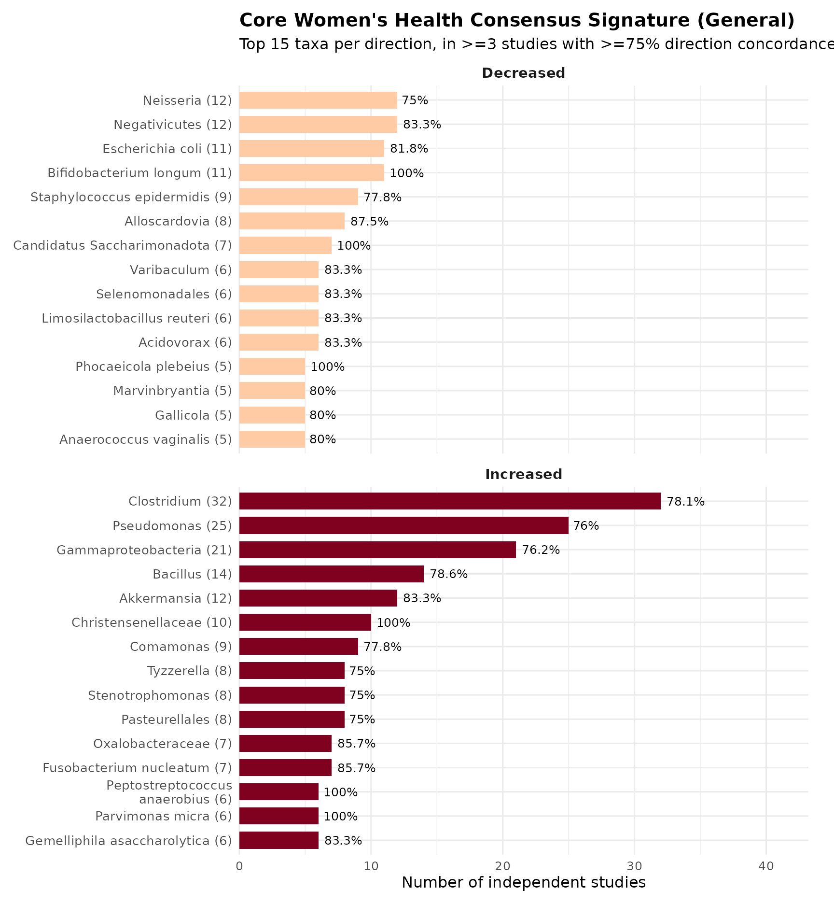
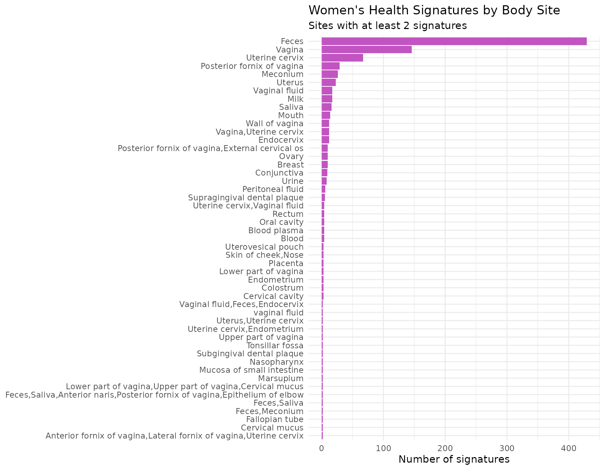
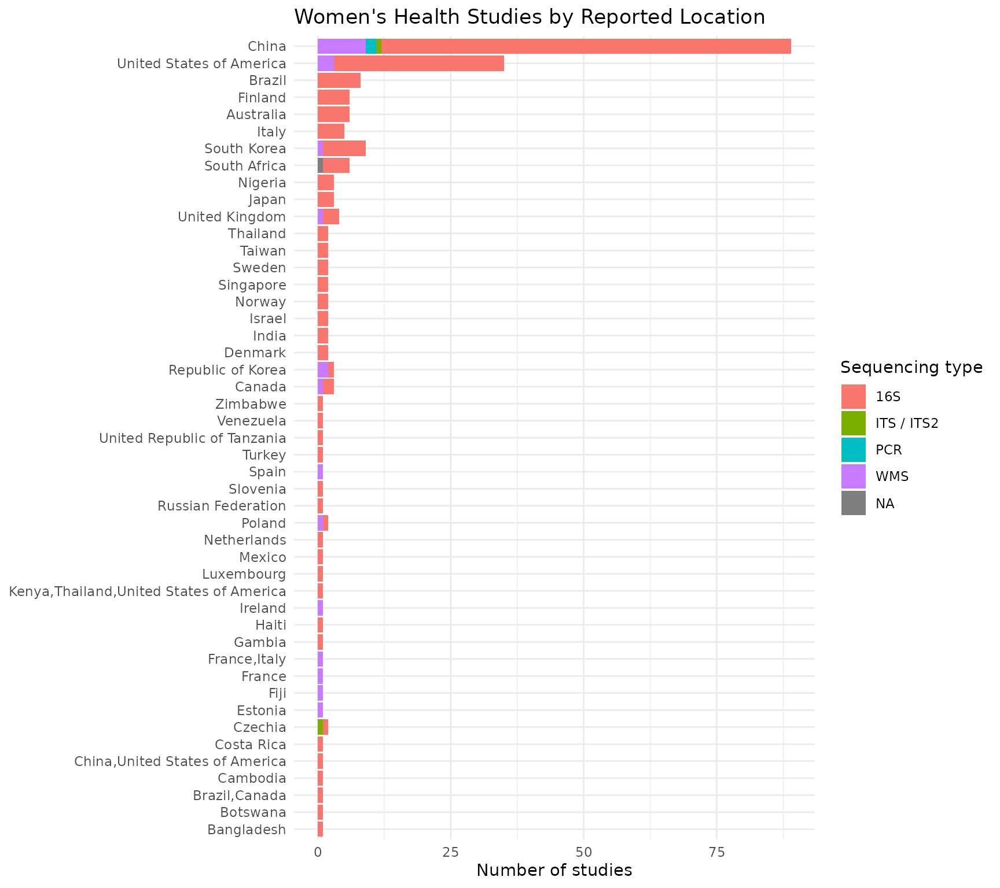
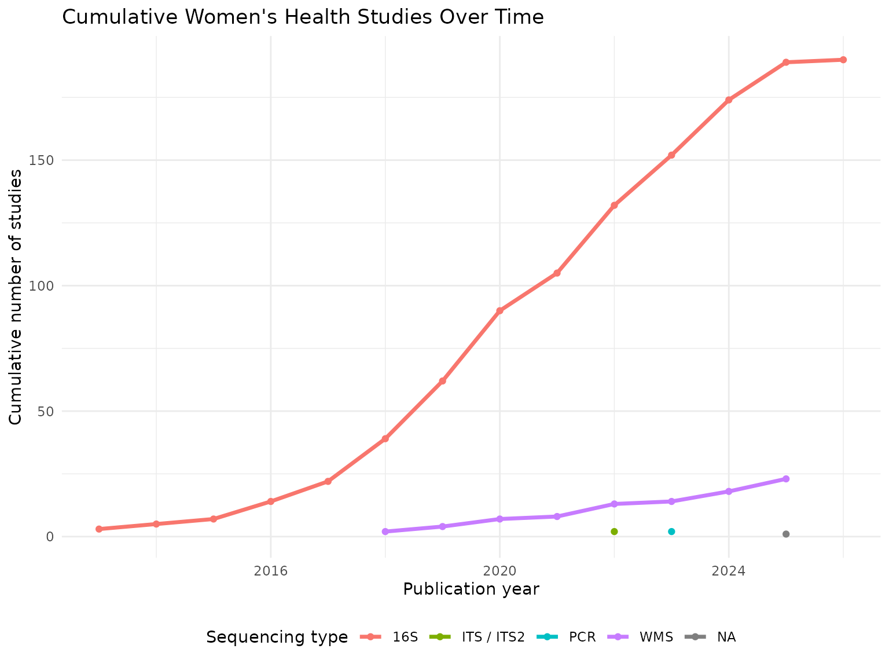
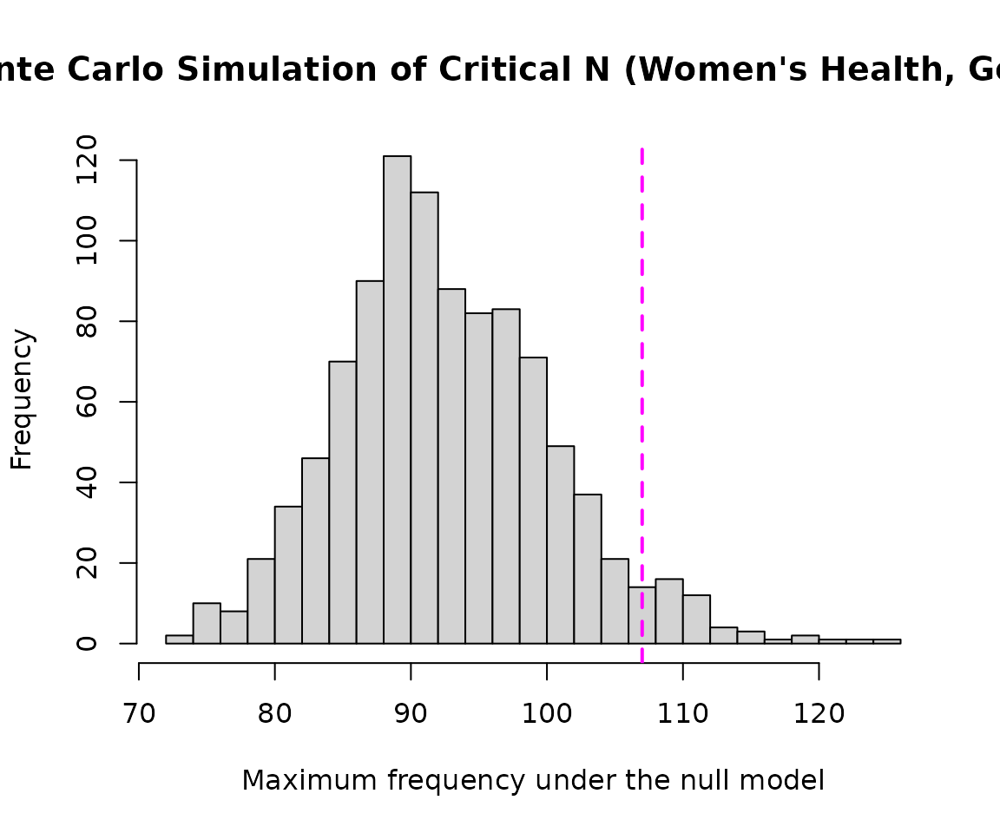
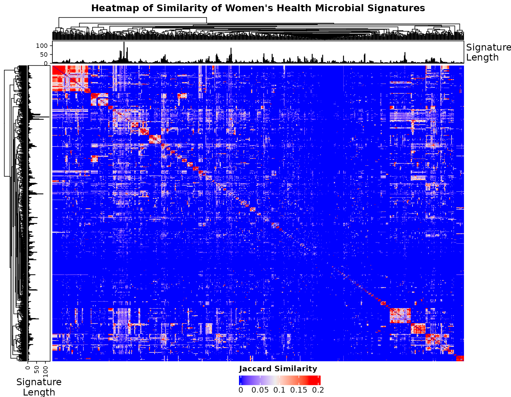

# Exploratory Analysis of Women's Health Microbial Signatures

## Introduction

This vignette demonstrates an exploratory analysis of microbial
signatures associated with women’s health conditions using data obtained
from BugSigDB and functions provided by the bugSigSimple package. This
is the **General** analysis — a broad landscape view across many
women’s-health-related conditions (breast cancer, cervical cancer,
endometriosis, pregnancy/maternal-child topics, and other
reproductive/gynecological conditions). Four focused sub-analyses
(Cervical Cancer, Breast Cancer, Endometriosis, and
Pregnancy/Maternal-Child) build on this General analysis with
condition-specific rigor.

## Analysis objectives

1.  Downloading the data from BugSigDB
2.  Filtering the data to select women’s-health-related signatures and
    remove duplicates
3.  Description of the studies (body site, sequencing platform,
    publication year)
4.  Description of the taxa
5.  Core consensus signature and basic statistical tests
6.  Monte Carlo simulation to calculate critical N
7.  Heatmaps and dendrograms

## Environment note

**Before running this vignette**, confirm your Bioconductor
infrastructure loads cleanly. If
[`library(S4Vectors)`](https://bioconductor.org/packages/S4Vectors) (or
any of its dependents) fails with an error like *“package could not be
loaded”* or *“reached elapsed time limit”*, reinstall it fresh in an
otherwise-idle R session before proceeding:

``` r

remove.packages("S4Vectors")
BiocManager::install("S4Vectors", update = FALSE, force = TRUE)
# Restart R (Session > Restart R) before continuing
```

## Making sure packages are installed

``` r

if (!require("BiocManager", quietly = TRUE))
    install.packages("BiocManager")
BiocManager::install(c("devtools", "tidyverse", "kableExtra"))
BiocManager::install(c("waldronlab/bugSigSimple", "waldronlab/BugSigDBStats", "waldronlab/bugsigdbr"))
```

## Download BugSigDB data

``` r

full.dat <- bugsigdbr::importBugSigDB(cache = FALSE)
```

``` r

dim(full.dat)
```

    ## [1] 12086    57

## Remove empty signatures

``` r

ind1 <- lengths(full.dat[["MetaPhlAn taxon names"]]) > 0
ind2 <- lengths(full.dat[["NCBI Taxonomy IDs"]]) > 0

dat <- full.dat[ind1 & ind2, ]

dim(dat)
```

    ## [1] 12086    57

## Select women’s-health-related signatures

``` r

womens_health_terms <- c(
  # Breast
  "Breast cancer", "Breast cancer stage", "Breast carcinoma", "HER2 Positive Breast Carcinoma",
  # Cervical
  "Cervical cancer", "Cervical cerclage", "Cervical glandular intraepithelial neoplasia",
  "Cervical glandular intraepithelial neoplasia,Cervical cancer",
  "Cervical glandular intraepithelial neoplasia,Human papilloma virus infection",
  "Cervix erosion", "Human papilloma virus infection", "Human papilloma virus infection,Age",
  "Human papilloma virus infection,Cervical cancer",
  "Human papilloma virus infection,Cervical glandular intraepithelial neoplasia",
  "Chlamydophila infectious disease,Human papilloma virus infection",
  # Endometriosis
  "Endometriosis", "Adenomyosis", "Adenomyosis,Endometriosis",
  # Pregnancy / maternal-child
  "Pregnancy", "Gestational age", "Gestational diabetes", "Vaginal microbiome measurement",
  "Premature birth", "Spontaneous preterm birth", "Preterm premature rupture of the membranes",
  "Birth weight", "Birth measurement", "HIV mother to child transmission",
  "Neonatal death", "Neonatal jaundice", "Postnatal growth retardation",
  "Necrotizing enterocolitis", "Breastfeeding duration", "Breastfeeding duration,Transport",
  "Maternal milk", "Cesarean section", "Delivery method",
  # Broader women's health
  "Ovarian cancer", "Polycystic ovary syndrome", "Menopause", "Postmenopausal",
  "Postmenopausal osteoporosis", "Acquired primary ovarian failure", "Endometrial cancer",
  "Bacterial vaginosis", "Vaginitis", "Vulvovaginitis", "Vulvovaginal candidiasis",
  "Gonorrhea", "Chlamydia trachomatis", "Chlamydia trachomatis infectious disease",
  "Genital neoplasm, femaale", "Age at menarche", "Hormone replacement therapy", "Parous","Rosacea", "Ehlers-Danlos syndrome"
)


womens_health_dat <- dat %>%
  filter(Condition %in% womens_health_terms)

dim(womens_health_dat)
```

    ## [1] 956  57

``` r

womens_health_dat %>%
  count(Condition, sort = TRUE) %>%
  knitr::kable()
```

| Condition | n |
|:---|---:|
| Polycystic ovary syndrome | 168 |
| Gestational diabetes | 103 |
| Human papilloma virus infection | 93 |
| Endometriosis | 63 |
| Pregnancy | 51 |
| Cervical glandular intraepithelial neoplasia | 50 |
| Ovarian cancer | 46 |
| Breast cancer | 37 |
| Cesarean section | 33 |
| Breastfeeding duration | 32 |
| Cervical cancer | 29 |
| Endometrial cancer | 26 |
| Bacterial vaginosis | 23 |
| Maternal milk | 22 |
| Spontaneous preterm birth | 22 |
| HIV mother to child transmission | 18 |
| Chlamydia trachomatis | 17 |
| Premature birth | 15 |
| Birth measurement | 9 |
| Breast carcinoma | 6 |
| Cervical glandular intraepithelial neoplasia,Human papilloma virus infection | 6 |
| Chlamydia trachomatis infectious disease | 6 |
| Hormone replacement therapy | 6 |
| Menopause | 6 |
| Gestational age | 5 |
| Postnatal growth retardation | 5 |
| Rosacea | 5 |
| Vulvovaginitis | 5 |
| Necrotizing enterocolitis | 4 |
| Neonatal jaundice | 4 |
| Preterm premature rupture of the membranes | 4 |
| Adenomyosis,Endometriosis | 3 |
| Gonorrhea | 3 |
| Adenomyosis | 2 |
| Age at menarche | 2 |
| Breast cancer stage | 2 |
| Breastfeeding duration,Transport | 2 |
| Cervical cerclage | 2 |
| Cervical glandular intraepithelial neoplasia,Cervical cancer | 2 |
| Cervix erosion | 2 |
| Chlamydophila infectious disease,Human papilloma virus infection | 2 |
| HER2 Positive Breast Carcinoma | 2 |
| Human papilloma virus infection,Cervical cancer | 2 |
| Neonatal death | 2 |
| Postmenopausal osteoporosis | 2 |
| Vaginitis | 2 |
| Vulvovaginal candidiasis | 2 |
| Birth weight | 1 |
| Parous | 1 |
| Postmenopausal | 1 |

Unlike the other Summer Projects analysis, no single body site captures
the relevant evidence here — vaginal, cervical, breast, and fecal
samples are all legitimately relevant to different women’s-health
conditions. No body-site restriction is applied in the General analysis;
body site distribution is instead described below as part of the study
characteristics.

One study (conjunctival trachoma, caused by *Chlamydia trachomatis*) is
retained as a legitimate — if biologically atypical — result of the
`Chlamydia trachomatis` filter term, and is noted here as a minor caveat
rather than excluded.

## Remove duplicate signatures

``` r

womens_health_dat <- womens_health_dat %>%
  distinct()

nrow(womens_health_dat)
```

    ## [1] 956

No exact duplicate records were found in this signature set.

## Study characteristics

``` r

study.summary <- womens_health_dat %>%
  count(`Body site`, `Sequencing type`)

knitr::kable(study.summary)
```

| Body site | Sequencing type | n |
|:---|:---|---:|
| Anterior fornix of vagina,Lateral fornix of vagina,Uterine cervix | 16S | 2 |
| Blood | 16S | 4 |
| Blood plasma | 16S | 4 |
| Breast | 16S | 10 |
| Caecum | 16S | 1 |
| Cervical cavity | 16S | 3 |
| Cervical mucus | 16S | 2 |
| Colostrum | 16S | 3 |
| Conjunctiva | 16S | 9 |
| Endocervix | 16S | 10 |
| Endocervix | WMS | 2 |
| Endometrium | 16S | 3 |
| Fallopian tube | 16S | 2 |
| Feces | 16S | 365 |
| Feces | ITS / ITS2 | 9 |
| Feces | PCR | 4 |
| Feces | WMS | 51 |
| Feces,Meconium | 16S | 2 |
| Feces,Saliva | 16S | 2 |
| Feces,Saliva,Anterior naris,Posterior fornix of vagina,Epithelium of elbow | 16S | 2 |
| Lower part of vagina | 16S | 3 |
| Lower part of vagina,Upper part of vagina,Cervical mucus | 16S | 2 |
| Mammary gland | 16S | 1 |
| Marsupium | 16S | 2 |
| Meconium | 16S | 24 |
| Meconium | WMS | 2 |
| Milk | 16S | 15 |
| Milk | WMS | 2 |
| Mouth | 16S | 14 |
| Mucosa of small intestine | 16S | 2 |
| Nasopharynx | WMS | 2 |
| Omentum | 16S | 1 |
| Oral cavity | 16S | 4 |
| Ovary | 16S | 8 |
| Ovary | PCR | 2 |
| Peritoneal fluid | 16S | 6 |
| Placenta | 16S | 3 |
| Posterior fornix of vagina | 16S | 29 |
| Posterior fornix of vagina,External cervical os | WMS | 10 |
| Rectum | 16S | 4 |
| Saliva | 16S | 16 |
| Skin of cheek,Nose | 16S | 3 |
| Subgingival dental plaque | 16S | 2 |
| Supragingival dental plaque | 16S | 5 |
| Tonsillar fossa | 16S | 2 |
| Upper part of vagina | 16S | 2 |
| Urine | 16S | 6 |
| Urine | WMS | 2 |
| Uterine cervix | 16S | 63 |
| Uterine cervix | WMS | 4 |
| Uterine cervix,Endometrium | 16S | 2 |
| Uterine cervix,Vaginal fluid | 16S | 4 |
| Uterovesical pouch | 16S | 3 |
| Uterus | 16S | 23 |
| Uterus,Uterine cervix | 16S | 2 |
| Vagina | 16S | 115 |
| Vagina | WMS | 31 |
| Vagina,Uterine cervix | 16S | 12 |
| Vaginal fluid | 16S | 15 |
| Vaginal fluid | WMS | 2 |
| Vaginal fluid,Feces,Endocervix | 16S | 2 |
| Wall of vagina | NA | 12 |
| vaginal fluid | 16S | 2 |

``` r

womens_health_dat %>%
  count(Year) %>%
  arrange(Year) %>%
  knitr::kable()
```

| Year |   n |
|-----:|----:|
| 2013 |   9 |
| 2014 |  12 |
| 2015 |   4 |
| 2016 |  23 |
| 2017 |  26 |
| 2018 | 106 |
| 2019 | 101 |
| 2020 | 133 |
| 2021 |  57 |
| 2022 | 146 |
| 2023 |  99 |
| 2024 | 120 |
| 2025 | 113 |
| 2026 |   3 |
|   NA |   4 |

Body site distribution spans fecal samples (largely gestational
diabetes, PCOS, and breast cancer studies), reproductive-tract sites
(vagina, cervix, endometrium - largely bacterial vaginosis, HPV, and
cervical cancer studies), and smaller categories including meconium
(mother-to-child transmission studies) and breast/milk tissue.
Sequencing type is heavily 16S-dominated (528 of 579 signatures), with a
much smaller WMS subset (44) - a real limitation to note when
interpreting the WMS vs. 16S concordance check below, which will be
comparatively underpowered relative to the CRC analysis’s more balanced
platform split. Publication years span 2010-2024, with the bulk of
studies from 2018-2022; the apparent taper in 2023-2024 most likely
reflects BugSigDB curation lag rather than a genuine decline in research
activity.

## Taxonomic summary

``` r

taxa.table <- createTaxonTable(womens_health_dat)

head(taxa.table)
```

    ## # A tibble: 6 × 6
    ##   `Taxon Name`    `Taxonomic Level` total_signatures increased_signatures
    ##   <chr>           <chr>                        <int>                <int>
    ## 1 Lactobacillus   genus                          104                   48
    ## 2 Bacteroides     genus                           85                   47
    ## 3 Streptococcus   genus                           75                   40
    ## 4 Prevotella      genus                           75                   42
    ## 5 Bacillota       phylum                          72                   29
    ## 6 Bifidobacterium genus                           63                   47
    ## # ℹ 2 more variables: decreased_signatures <int>, `Binomial Test pval` <dbl>

``` r

knitr::kable(head(taxa.table, 20))
```

| Taxon Name | Taxonomic Level | total_signatures | increased_signatures | decreased_signatures | Binomial Test pval |
|:---|:---|---:|---:|---:|---:|
| Lactobacillus | genus | 104 | 48 | 56 | 0.49000 |
| Bacteroides | genus | 85 | 47 | 38 | 0.39000 |
| Streptococcus | genus | 75 | 40 | 35 | 0.64000 |
| Prevotella | genus | 75 | 42 | 33 | 0.36000 |
| Bacillota | phylum | 72 | 29 | 43 | 0.12000 |
| Bifidobacterium | genus | 63 | 47 | 16 | 0.00012 |
| Actinomycetota | phylum | 56 | 36 | 20 | 0.04400 |
| Dialister | genus | 56 | 31 | 25 | 0.50000 |
| Faecalibacterium | genus | 53 | 29 | 24 | 0.58000 |
| Megasphaera | genus | 52 | 35 | 17 | 0.01800 |

## Split by sequencing type

``` r

wh.wms <- womens_health_dat %>% filter(`Sequencing type` == "WMS")
wh.16s <- womens_health_dat %>% filter(`Sequencing type` == "16S")

cat("WMS  - signatures:", nrow(wh.wms), "| studies:", n_distinct(wh.wms$PMID), "\n")
```

    ## WMS  - signatures: 108 | studies: 23

``` r

cat("16S  - signatures:", nrow(wh.16s), "| studies:", n_distinct(wh.16s$PMID), "\n")
```

    ## 16S  - signatures: 821 | studies: 191

## Long-format taxon table

``` r

sigs.womens_health <- bugsigdbr::getSignatures(womens_health_dat, tax.id.type = "taxname")

taxon.long <- purrr::map_dfr(seq_along(sigs.womens_health), function(i) {
  taxa <- sigs.womens_health[[i]]
  if (length(taxa) == 0) return(NULL)
  tibble::tibble(sig_id = i, taxon = taxa)
}) %>%
  left_join(
    womens_health_dat %>%
      mutate(sig_id = row_number()) %>%
      select(sig_id, PMID, Condition, `Sequencing type`, `Abundance in Group 1`),
    by = "sig_id"
  ) %>%
  rename(direction = `Abundance in Group 1`)

nrow(taxon.long)
```

    ## [1] 7374

## Taxon frequency across studies

``` r

taxon.freq <- taxon.long %>%
  distinct(PMID, taxon, direction) %>%
  count(taxon, direction, name = "n_studies") %>%
  group_by(taxon) %>%
  mutate(total_studies = sum(n_studies)) %>%
  ungroup() %>%
  arrange(desc(total_studies))

n_distinct(taxon.freq$taxon)
```

    ## [1] 1843

``` r

taxon.freq %>%
  distinct(taxon, total_studies) %>%
  slice_max(total_studies, n = 15) %>%
  knitr::kable()
```

| taxon            | total_studies |
|:-----------------|--------------:|
| Lactobacillus    |            77 |
| Bacteroides      |            58 |
| Streptococcus    |            56 |
| Bacillota        |            55 |
| Prevotella       |            52 |
| Bifidobacterium  |            50 |
| Actinomycetota   |            47 |
| Eubacteriales    |            44 |
| Bacteroidales    |            41 |
| Bacteroidota     |            41 |
| Oscillospiraceae |            41 |
| Clostridia       |            40 |
| Lachnospiraceae  |            40 |
| Pseudomonadota   |            39 |
| Megasphaera      |            38 |

Given that General pools many biologically distinct conditions together
(vaginal dysbiosis, gut dysbiosis in metabolic conditions, breast tissue
changes), the most frequent taxa are expected to reflect a mix of
vaginal-health organisms (e.g. *Lactobacillus*, *Gardnerella*,
*Prevotella*) and gut-health organisms (e.g. *Bacteroides*,
*Faecalibacterium*) rather than a single coherent signature - this
heterogeneity is itself part of the motivation for the four focused
sub-analyses.

## Core consensus signature

``` r

concordance <- taxon.long %>%
  distinct(PMID, taxon, direction) %>%
  group_by(taxon) %>%
  summarise(
    n_studies       = n_distinct(PMID),
    n_increased     = sum(direction == "increased"),
    n_decreased     = sum(direction == "decreased"),
    concordance_pct = round(max(n_increased, n_decreased) / n_studies * 100, 1),
    majority_dir    = if_else(n_increased >= n_decreased, "increased", "decreased"),
    .groups = "drop"
  ) %>%
  arrange(desc(n_studies), desc(concordance_pct))

core.sig <- concordance %>%
  filter(n_studies >= 3, concordance_pct >= 75) %>%
  arrange(majority_dir, desc(n_studies))

nrow(core.sig)
```

    ## [1] 150

``` r

knitr::kable(core.sig)
```

| taxon | n_studies | n_increased | n_decreased | concordance_pct | majority_dir |
|:---|---:|---:|---:|---:|:---|
| Negativicutes | 12 | 3 | 10 | 83.3 | decreased |
| Neisseria | 12 | 4 | 9 | 75.0 | decreased |
| Bifidobacterium longum | 11 | 1 | 11 | 100.0 | decreased |
| Escherichia coli | 11 | 2 | 9 | 81.8 | decreased |
| Staphylococcus epidermidis | 9 | 2 | 7 | 77.8 | decreased |
| Alloscardovia | 8 | 1 | 7 | 87.5 | decreased |
| Candidatus Saccharimonadota | 7 | 1 | 7 | 100.0 | decreased |
| Acidovorax | 6 | 1 | 5 | 83.3 | decreased |
| Limosilactobacillus reuteri | 6 | 1 | 5 | 83.3 | decreased |
| Selenomonadales | 6 | 2 | 5 | 83.3 | decreased |
| Varibaculum | 6 | 2 | 5 | 83.3 | decreased |
| Phocaeicola plebeius | 5 | 0 | 5 | 100.0 | decreased |
| Anaerococcus vaginalis | 5 | 1 | 4 | 80.0 | decreased |
| Gallicola | 5 | 1 | 4 | 80.0 | decreased |
| Marvinbryantia | 5 | 1 | 4 | 80.0 | decreased |
| Parabacteroides merdae | 5 | 1 | 4 | 80.0 | decreased |
| Parahaemophilus parainfluenzae | 5 | 1 | 4 | 80.0 | decreased |
| Peptoniphilus duerdenii | 5 | 2 | 4 | 80.0 | decreased |
| Phyllobacterium | 5 | 2 | 4 | 80.0 | decreased |
| Rhizobiaceae | 5 | 2 | 4 | 80.0 | decreased |
| Candidatus Altimarinota | 4 | 1 | 4 | 100.0 | decreased |
| Corynebacterium sp. | 4 | 1 | 4 | 100.0 | decreased |
| Lawsonella | 4 | 0 | 4 | 100.0 | decreased |
| Alistipes communis | 4 | 2 | 3 | 75.0 | decreased |
| Alistipes indistinctus | 4 | 1 | 3 | 75.0 | decreased |
| Allobaculum | 4 | 1 | 3 | 75.0 | decreased |
| Arthrobacter | 4 | 2 | 3 | 75.0 | decreased |
| Bacteroides fragilis | 4 | 1 | 3 | 75.0 | decreased |
| Bifidobacterium adolescentis | 4 | 1 | 3 | 75.0 | decreased |
| Bifidobacterium longum subsp. longum | 4 | 1 | 3 | 75.0 | decreased |
| Gemmiger | 4 | 1 | 3 | 75.0 | decreased |
| Hungatella | 4 | 2 | 3 | 75.0 | decreased |
| Leptotrichia wadei | 4 | 1 | 3 | 75.0 | decreased |
| Mobiluncus curtisii | 4 | 2 | 3 | 75.0 | decreased |
| Odoribacter splanchnicus | 4 | 1 | 3 | 75.0 | decreased |
| Paracoccaceae | 4 | 2 | 3 | 75.0 | decreased |
| Prevotella disiens | 4 | 2 | 3 | 75.0 | decreased |
| Propionibacteriaceae | 4 | 1 | 3 | 75.0 | decreased |
| Schaalia turicensis | 4 | 2 | 3 | 75.0 | decreased |
| Wolbachia | 4 | 1 | 3 | 75.0 | decreased |
| Aedoeadaptatus coxii | 3 | 0 | 3 | 100.0 | decreased |
| Alloscardovia omnicolens | 3 | 0 | 3 | 100.0 | decreased |
| Anaerococcus lactolyticus | 3 | 1 | 3 | 100.0 | decreased |
| Bacteroides finegoldii | 3 | 0 | 3 | 100.0 | decreased |
| Bacteroides stercoris | 3 | 0 | 3 | 100.0 | decreased |
| Brachybacterium | 3 | 0 | 3 | 100.0 | decreased |
| Candidatus Neoarthromitus | 3 | 0 | 3 | 100.0 | decreased |
| Candidatus Parcubacteria | 3 | 0 | 3 | 100.0 | decreased |
| Corynebacterium aurimucosum | 3 | 0 | 3 | 100.0 | decreased |
| Enterococcaceae bacterium RF39 | 3 | 1 | 3 | 100.0 | decreased |
| Fenollaria massiliensis | 3 | 1 | 3 | 100.0 | decreased |
| Hallella colorans | 3 | 0 | 3 | 100.0 | decreased |
| Mobiluncus mulieris | 3 | 1 | 3 | 100.0 | decreased |
| Muribaculaceae bacterium | 3 | 0 | 3 | 100.0 | decreased |
| Muribaculaceae bacterium Isolate-110 (HZI) | 3 | 0 | 3 | 100.0 | decreased |
| Saccharomyces | 3 | 0 | 3 | 100.0 | decreased |
| Scardovia wiggsiae | 3 | 0 | 3 | 100.0 | decreased |
| Serratia | 3 | 0 | 3 | 100.0 | decreased |
| Streptococcus anginosus | 3 | 1 | 3 | 100.0 | decreased |
| Winkia neuii | 3 | 0 | 3 | 100.0 | decreased |
| Clostridium | 32 | 25 | 10 | 78.1 | increased |
| Pseudomonas | 25 | 19 | 7 | 76.0 | increased |
| Gammaproteobacteria | 21 | 16 | 8 | 76.2 | increased |
| Bacillus | 14 | 11 | 3 | 78.6 | increased |
| Akkermansia | 12 | 10 | 5 | 83.3 | increased |
| Christensenellaceae | 10 | 10 | 0 | 100.0 | increased |
| Comamonas | 9 | 7 | 3 | 77.8 | increased |
| Pasteurellales | 8 | 6 | 2 | 75.0 | increased |
| Stenotrophomonas | 8 | 6 | 3 | 75.0 | increased |
| Tyzzerella | 8 | 6 | 3 | 75.0 | increased |
| Fusobacterium nucleatum | 7 | 6 | 2 | 85.7 | increased |
| Oxalobacteraceae | 7 | 6 | 1 | 85.7 | increased |
| Parvimonas micra | 6 | 6 | 0 | 100.0 | increased |
| Peptostreptococcus anaerobius | 6 | 6 | 1 | 100.0 | increased |
| Gemelliphila asaccharolytica | 6 | 5 | 1 | 83.3 | increased |
| Lysobacteraceae | 6 | 5 | 2 | 83.3 | increased |
| Mageeibacillus indolicus | 6 | 5 | 1 | 83.3 | increased |
| Ruminiclostridium | 6 | 5 | 2 | 83.3 | increased |
| Agathobacter | 5 | 5 | 1 | 100.0 | increased |
| Faecalitalea | 5 | 5 | 0 | 100.0 | increased |
| Intestinibacter bartlettii | 5 | 5 | 0 | 100.0 | increased |
| Adlercreutzia | 5 | 4 | 1 | 80.0 | increased |
| Bacteroides caccae | 5 | 4 | 1 | 80.0 | increased |
| Bacteroides eggerthii | 5 | 4 | 1 | 80.0 | increased |
| Chitinophagaceae | 5 | 4 | 1 | 80.0 | increased |
| Chlamydia trachomatis | 5 | 4 | 1 | 80.0 | increased |
| Chryseobacterium | 5 | 4 | 1 | 80.0 | increased |
| Ezakiella | 5 | 4 | 2 | 80.0 | increased |
| Intestinimonas | 5 | 4 | 2 | 80.0 | increased |
| Limosilactobacillus vaginalis | 5 | 4 | 1 | 80.0 | increased |
| Nocardioidaceae | 5 | 4 | 2 | 80.0 | increased |
| Olsenella | 5 | 4 | 1 | 80.0 | increased |
| Paracoccus | 5 | 4 | 2 | 80.0 | increased |
| Thermus | 5 | 4 | 1 | 80.0 | increased |
| Corynebacteriaceae | 4 | 4 | 1 | 100.0 | increased |
| Dialister invisus | 4 | 4 | 1 | 100.0 | increased |
| Eisenbergiella | 4 | 4 | 1 | 100.0 | increased |
| Lachnospiraceae bacterium NK4A136 | 4 | 4 | 1 | 100.0 | increased |
| Lactobacillus paragasseri | 4 | 4 | 0 | 100.0 | increased |
| Roseateles | 4 | 4 | 1 | 100.0 | increased |
| Thermodesulfobacteriota | 4 | 4 | 1 | 100.0 | increased |
| Veillonella montpellierensis | 4 | 4 | 0 | 100.0 | increased |
| Acidaminococcaceae | 4 | 3 | 1 | 75.0 | increased |
| Agathobacter rectalis | 4 | 3 | 2 | 75.0 | increased |
| Anaerotruncus | 4 | 3 | 1 | 75.0 | increased |
| Azotobacter group | 4 | 3 | 1 | 75.0 | increased |
| Bacteroides thetaiotaomicron | 4 | 3 | 1 | 75.0 | increased |
| Barnesiellaceae | 4 | 3 | 1 | 75.0 | increased |
| Bifidobacterium longum subsp. infantis | 4 | 3 | 2 | 75.0 | increased |
| Bilophila wadsworthia | 4 | 3 | 1 | 75.0 | increased |
| Burkholderia | 4 | 3 | 2 | 75.0 | increased |
| Butyrivibrio | 4 | 3 | 1 | 75.0 | increased |
| Campylobacterota | 4 | 3 | 2 | 75.0 | increased |
| Candida albicans | 4 | 3 | 1 | 75.0 | increased |
| Caulobacterales | 4 | 3 | 1 | 75.0 | increased |
| Deinococcota | 4 | 3 | 1 | 75.0 | increased |
| Delftia | 4 | 3 | 2 | 75.0 | increased |
| Eubacterium ventriosum | 4 | 3 | 1 | 75.0 | increased |
| Hallella bergensis | 4 | 3 | 2 | 75.0 | increased |
| Holdemania | 4 | 3 | 1 | 75.0 | increased |
| Metamycoplasma hominis | 4 | 3 | 1 | 75.0 | increased |
| Moraxella | 4 | 3 | 1 | 75.0 | increased |
| Mycobacteriales | 4 | 3 | 2 | 75.0 | increased |
| Mycoplasmataceae | 4 | 3 | 1 | 75.0 | increased |
| Rikenella | 4 | 3 | 2 | 75.0 | increased |
| Ruminococcus gauvreauii | 4 | 3 | 1 | 75.0 | increased |
| Sarcina | 4 | 3 | 1 | 75.0 | increased |
| Sediminibacterium | 4 | 3 | 1 | 75.0 | increased |
| Slackia | 4 | 3 | 1 | 75.0 | increased |
| Tissierellaceae | 4 | 3 | 2 | 75.0 | increased |
| uncultured bacterium | 4 | 3 | 3 | 75.0 | increased |
| Abiotrophia | 3 | 3 | 0 | 100.0 | increased |
| Aspergillus | 3 | 3 | 0 | 100.0 | increased |
| Clostridium sp. CAG:352 | 3 | 3 | 0 | 100.0 | increased |
| Defluviitaleaceae | 3 | 3 | 0 | 100.0 | increased |
| Eggerthella lenta | 3 | 3 | 0 | 100.0 | increased |
| Fusobacterium ulcerans | 3 | 3 | 0 | 100.0 | increased |
| Hyphomicrobium | 3 | 3 | 0 | 100.0 | increased |
| Lizanozyma thasaensis | 3 | 3 | 1 | 100.0 | increased |
| Massilia | 3 | 3 | 0 | 100.0 | increased |
| Mesorhizobium | 3 | 3 | 0 | 100.0 | increased |
| Muribaculum | 3 | 3 | 0 | 100.0 | increased |
| Nocardioides | 3 | 3 | 0 | 100.0 | increased |
| Pseudomonas sp. | 3 | 3 | 1 | 100.0 | increased |
| Rhodospirillales | 3 | 3 | 0 | 100.0 | increased |
| Ruminococcus callidus | 3 | 3 | 0 | 100.0 | increased |
| Succinivibrio | 3 | 3 | 0 | 100.0 | increased |
| Veillonella parvula | 3 | 3 | 0 | 100.0 | increased |
| \[Clostridium\] innocuum | 3 | 3 | 1 | 100.0 | increased |
| uncultured Bacteroides sp. | 3 | 3 | 0 | 100.0 | increased |

``` r

core.sig %>%
  group_by(majority_dir) %>%
  slice_max(n_studies, n = 15, with_ties = FALSE) %>%
  ungroup() %>%
  mutate(
    direction_label = if_else(majority_dir == "increased",
                               "Increased", "Decreased"),
    taxon_label = paste0(str_wrap(taxon, width = 28), " (", n_studies, ")")
  ) %>%
  ggplot(aes(x = reorder(taxon_label, n_studies), y = n_studies, fill = direction_label)) +
  geom_col(width = 0.7) +
  geom_text(aes(label = paste0(concordance_pct, "%")), hjust = -0.15, size = 3.3) +
  coord_flip(clip = "off") +
  facet_wrap(~direction_label, scales = "free_y", ncol = 1) +
  scale_fill_manual(values = c("Increased" = "#800020", "Decreased" = "#FFCBA4")) +
  scale_y_continuous(expand = expansion(mult = c(0, 0.35))) +
  labs(
    title = "Core Women's Health Consensus Signature (General)",
    subtitle = "Top 15 taxa per direction, in >=3 studies with >=75% direction concordance",
    x = NULL, y = "Number of independent studies", fill = NULL
  ) +
  theme_minimal(base_size = 12) +
  theme(
    legend.position = "none",
    plot.title = element_text(face = "bold"),
    axis.text.y = element_text(size = 10, lineheight = 0.9),
    strip.text = element_text(size = 11, face = "bold"),
    plot.margin = margin(t = 10, r = 20, b = 10, l = 10)
  )
```



``` r

knitr::kable(core.sig)
```

| taxon | n_studies | n_increased | n_decreased | concordance_pct | majority_dir |
|:---|---:|---:|---:|---:|:---|
| Negativicutes | 12 | 3 | 10 | 83.3 | decreased |
| Neisseria | 12 | 4 | 9 | 75.0 | decreased |
| Bifidobacterium longum | 11 | 1 | 11 | 100.0 | decreased |
| Escherichia coli | 11 | 2 | 9 | 81.8 | decreased |
| Staphylococcus epidermidis | 9 | 2 | 7 | 77.8 | decreased |
| Alloscardovia | 8 | 1 | 7 | 87.5 | decreased |
| Candidatus Saccharimonadota | 7 | 1 | 7 | 100.0 | decreased |
| Acidovorax | 6 | 1 | 5 | 83.3 | decreased |
| Limosilactobacillus reuteri | 6 | 1 | 5 | 83.3 | decreased |
| Selenomonadales | 6 | 2 | 5 | 83.3 | decreased |
| Varibaculum | 6 | 2 | 5 | 83.3 | decreased |
| Phocaeicola plebeius | 5 | 0 | 5 | 100.0 | decreased |
| Anaerococcus vaginalis | 5 | 1 | 4 | 80.0 | decreased |
| Gallicola | 5 | 1 | 4 | 80.0 | decreased |
| Marvinbryantia | 5 | 1 | 4 | 80.0 | decreased |
| Parabacteroides merdae | 5 | 1 | 4 | 80.0 | decreased |
| Parahaemophilus parainfluenzae | 5 | 1 | 4 | 80.0 | decreased |
| Peptoniphilus duerdenii | 5 | 2 | 4 | 80.0 | decreased |
| Phyllobacterium | 5 | 2 | 4 | 80.0 | decreased |
| Rhizobiaceae | 5 | 2 | 4 | 80.0 | decreased |
| Candidatus Altimarinota | 4 | 1 | 4 | 100.0 | decreased |
| Corynebacterium sp. | 4 | 1 | 4 | 100.0 | decreased |
| Lawsonella | 4 | 0 | 4 | 100.0 | decreased |
| Alistipes communis | 4 | 2 | 3 | 75.0 | decreased |
| Alistipes indistinctus | 4 | 1 | 3 | 75.0 | decreased |
| Allobaculum | 4 | 1 | 3 | 75.0 | decreased |
| Arthrobacter | 4 | 2 | 3 | 75.0 | decreased |
| Bacteroides fragilis | 4 | 1 | 3 | 75.0 | decreased |
| Bifidobacterium adolescentis | 4 | 1 | 3 | 75.0 | decreased |
| Bifidobacterium longum subsp. longum | 4 | 1 | 3 | 75.0 | decreased |
| Gemmiger | 4 | 1 | 3 | 75.0 | decreased |
| Hungatella | 4 | 2 | 3 | 75.0 | decreased |
| Leptotrichia wadei | 4 | 1 | 3 | 75.0 | decreased |
| Mobiluncus curtisii | 4 | 2 | 3 | 75.0 | decreased |
| Odoribacter splanchnicus | 4 | 1 | 3 | 75.0 | decreased |
| Paracoccaceae | 4 | 2 | 3 | 75.0 | decreased |
| Prevotella disiens | 4 | 2 | 3 | 75.0 | decreased |
| Propionibacteriaceae | 4 | 1 | 3 | 75.0 | decreased |
| Schaalia turicensis | 4 | 2 | 3 | 75.0 | decreased |
| Wolbachia | 4 | 1 | 3 | 75.0 | decreased |
| Aedoeadaptatus coxii | 3 | 0 | 3 | 100.0 | decreased |
| Alloscardovia omnicolens | 3 | 0 | 3 | 100.0 | decreased |
| Anaerococcus lactolyticus | 3 | 1 | 3 | 100.0 | decreased |
| Bacteroides finegoldii | 3 | 0 | 3 | 100.0 | decreased |
| Bacteroides stercoris | 3 | 0 | 3 | 100.0 | decreased |
| Brachybacterium | 3 | 0 | 3 | 100.0 | decreased |
| Candidatus Neoarthromitus | 3 | 0 | 3 | 100.0 | decreased |
| Candidatus Parcubacteria | 3 | 0 | 3 | 100.0 | decreased |
| Corynebacterium aurimucosum | 3 | 0 | 3 | 100.0 | decreased |
| Enterococcaceae bacterium RF39 | 3 | 1 | 3 | 100.0 | decreased |
| Fenollaria massiliensis | 3 | 1 | 3 | 100.0 | decreased |
| Hallella colorans | 3 | 0 | 3 | 100.0 | decreased |
| Mobiluncus mulieris | 3 | 1 | 3 | 100.0 | decreased |
| Muribaculaceae bacterium | 3 | 0 | 3 | 100.0 | decreased |
| Muribaculaceae bacterium Isolate-110 (HZI) | 3 | 0 | 3 | 100.0 | decreased |
| Saccharomyces | 3 | 0 | 3 | 100.0 | decreased |
| Scardovia wiggsiae | 3 | 0 | 3 | 100.0 | decreased |
| Serratia | 3 | 0 | 3 | 100.0 | decreased |
| Streptococcus anginosus | 3 | 1 | 3 | 100.0 | decreased |
| Winkia neuii | 3 | 0 | 3 | 100.0 | decreased |
| Clostridium | 32 | 25 | 10 | 78.1 | increased |
| Pseudomonas | 25 | 19 | 7 | 76.0 | increased |
| Gammaproteobacteria | 21 | 16 | 8 | 76.2 | increased |
| Bacillus | 14 | 11 | 3 | 78.6 | increased |
| Akkermansia | 12 | 10 | 5 | 83.3 | increased |
| Christensenellaceae | 10 | 10 | 0 | 100.0 | increased |
| Comamonas | 9 | 7 | 3 | 77.8 | increased |
| Pasteurellales | 8 | 6 | 2 | 75.0 | increased |
| Stenotrophomonas | 8 | 6 | 3 | 75.0 | increased |
| Tyzzerella | 8 | 6 | 3 | 75.0 | increased |
| Fusobacterium nucleatum | 7 | 6 | 2 | 85.7 | increased |
| Oxalobacteraceae | 7 | 6 | 1 | 85.7 | increased |
| Parvimonas micra | 6 | 6 | 0 | 100.0 | increased |
| Peptostreptococcus anaerobius | 6 | 6 | 1 | 100.0 | increased |
| Gemelliphila asaccharolytica | 6 | 5 | 1 | 83.3 | increased |
| Lysobacteraceae | 6 | 5 | 2 | 83.3 | increased |
| Mageeibacillus indolicus | 6 | 5 | 1 | 83.3 | increased |
| Ruminiclostridium | 6 | 5 | 2 | 83.3 | increased |
| Agathobacter | 5 | 5 | 1 | 100.0 | increased |
| Faecalitalea | 5 | 5 | 0 | 100.0 | increased |
| Intestinibacter bartlettii | 5 | 5 | 0 | 100.0 | increased |
| Adlercreutzia | 5 | 4 | 1 | 80.0 | increased |
| Bacteroides caccae | 5 | 4 | 1 | 80.0 | increased |
| Bacteroides eggerthii | 5 | 4 | 1 | 80.0 | increased |
| Chitinophagaceae | 5 | 4 | 1 | 80.0 | increased |
| Chlamydia trachomatis | 5 | 4 | 1 | 80.0 | increased |
| Chryseobacterium | 5 | 4 | 1 | 80.0 | increased |
| Ezakiella | 5 | 4 | 2 | 80.0 | increased |
| Intestinimonas | 5 | 4 | 2 | 80.0 | increased |
| Limosilactobacillus vaginalis | 5 | 4 | 1 | 80.0 | increased |
| Nocardioidaceae | 5 | 4 | 2 | 80.0 | increased |
| Olsenella | 5 | 4 | 1 | 80.0 | increased |
| Paracoccus | 5 | 4 | 2 | 80.0 | increased |
| Thermus | 5 | 4 | 1 | 80.0 | increased |
| Corynebacteriaceae | 4 | 4 | 1 | 100.0 | increased |
| Dialister invisus | 4 | 4 | 1 | 100.0 | increased |
| Eisenbergiella | 4 | 4 | 1 | 100.0 | increased |
| Lachnospiraceae bacterium NK4A136 | 4 | 4 | 1 | 100.0 | increased |
| Lactobacillus paragasseri | 4 | 4 | 0 | 100.0 | increased |
| Roseateles | 4 | 4 | 1 | 100.0 | increased |
| Thermodesulfobacteriota | 4 | 4 | 1 | 100.0 | increased |
| Veillonella montpellierensis | 4 | 4 | 0 | 100.0 | increased |
| Acidaminococcaceae | 4 | 3 | 1 | 75.0 | increased |
| Agathobacter rectalis | 4 | 3 | 2 | 75.0 | increased |
| Anaerotruncus | 4 | 3 | 1 | 75.0 | increased |
| Azotobacter group | 4 | 3 | 1 | 75.0 | increased |
| Bacteroides thetaiotaomicron | 4 | 3 | 1 | 75.0 | increased |
| Barnesiellaceae | 4 | 3 | 1 | 75.0 | increased |
| Bifidobacterium longum subsp. infantis | 4 | 3 | 2 | 75.0 | increased |
| Bilophila wadsworthia | 4 | 3 | 1 | 75.0 | increased |
| Burkholderia | 4 | 3 | 2 | 75.0 | increased |
| Butyrivibrio | 4 | 3 | 1 | 75.0 | increased |
| Campylobacterota | 4 | 3 | 2 | 75.0 | increased |
| Candida albicans | 4 | 3 | 1 | 75.0 | increased |
| Caulobacterales | 4 | 3 | 1 | 75.0 | increased |
| Deinococcota | 4 | 3 | 1 | 75.0 | increased |
| Delftia | 4 | 3 | 2 | 75.0 | increased |
| Eubacterium ventriosum | 4 | 3 | 1 | 75.0 | increased |
| Hallella bergensis | 4 | 3 | 2 | 75.0 | increased |
| Holdemania | 4 | 3 | 1 | 75.0 | increased |
| Metamycoplasma hominis | 4 | 3 | 1 | 75.0 | increased |
| Moraxella | 4 | 3 | 1 | 75.0 | increased |
| Mycobacteriales | 4 | 3 | 2 | 75.0 | increased |
| Mycoplasmataceae | 4 | 3 | 1 | 75.0 | increased |
| Rikenella | 4 | 3 | 2 | 75.0 | increased |
| Ruminococcus gauvreauii | 4 | 3 | 1 | 75.0 | increased |
| Sarcina | 4 | 3 | 1 | 75.0 | increased |
| Sediminibacterium | 4 | 3 | 1 | 75.0 | increased |
| Slackia | 4 | 3 | 1 | 75.0 | increased |
| Tissierellaceae | 4 | 3 | 2 | 75.0 | increased |
| uncultured bacterium | 4 | 3 | 3 | 75.0 | increased |
| Abiotrophia | 3 | 3 | 0 | 100.0 | increased |
| Aspergillus | 3 | 3 | 0 | 100.0 | increased |
| Clostridium sp. CAG:352 | 3 | 3 | 0 | 100.0 | increased |
| Defluviitaleaceae | 3 | 3 | 0 | 100.0 | increased |
| Eggerthella lenta | 3 | 3 | 0 | 100.0 | increased |
| Fusobacterium ulcerans | 3 | 3 | 0 | 100.0 | increased |
| Hyphomicrobium | 3 | 3 | 0 | 100.0 | increased |
| Lizanozyma thasaensis | 3 | 3 | 1 | 100.0 | increased |
| Massilia | 3 | 3 | 0 | 100.0 | increased |
| Mesorhizobium | 3 | 3 | 0 | 100.0 | increased |
| Muribaculum | 3 | 3 | 0 | 100.0 | increased |
| Nocardioides | 3 | 3 | 0 | 100.0 | increased |
| Pseudomonas sp. | 3 | 3 | 1 | 100.0 | increased |
| Rhodospirillales | 3 | 3 | 0 | 100.0 | increased |
| Ruminococcus callidus | 3 | 3 | 0 | 100.0 | increased |
| Succinivibrio | 3 | 3 | 0 | 100.0 | increased |
| Veillonella parvula | 3 | 3 | 0 | 100.0 | increased |
| \[Clostridium\] innocuum | 3 | 3 | 1 | 100.0 | increased |
| uncultured Bacteroides sp. | 3 | 3 | 0 | 100.0 | increased |

``` r

womens_health_dat %>%
  count(`Body site`, sort = TRUE) %>%
  filter(n >= 2) %>%
  ggplot(aes(x = reorder(`Body site`, n), y = n)) +
  geom_col(fill = "#C154C1") +
  coord_flip() +
  labs(
    title = "Women's Health Signatures by Body Site",
    subtitle = "Sites with at least 2 signatures",
    x = NULL, y = "Number of signatures"
  ) +
  theme_minimal(base_size = 11)
```



## WMS vs 16S concordance

``` r

dir.by.platform <- taxon.long %>%
  filter(`Sequencing type` %in% c("WMS", "16S")) %>%
  distinct(PMID, taxon, direction, `Sequencing type`) %>%
  count(taxon, `Sequencing type`, direction, name = "n_studies") %>%
  group_by(taxon, `Sequencing type`) %>%
  slice_max(n_studies, n = 1, with_ties = FALSE) %>%
  ungroup() %>%
  select(taxon, `Sequencing type`, majority_dir = direction)

platform.compare <- dir.by.platform %>%
  pivot_wider(names_from = `Sequencing type`, values_from = majority_dir) %>%
  filter(!is.na(WMS), !is.na(`16S`)) %>%
  rename(dir_WMS = WMS, dir_16S = `16S`) %>%
  mutate(agree = dir_WMS == dir_16S)

nrow(platform.compare)
```

    ## [1] 343

``` r

sum(platform.compare$agree)
```

    ## [1] 185

``` r

round(100 * mean(platform.compare$agree), 1)
```

    ## [1] 53.9

``` r

knitr::kable(platform.compare)
```

| taxon                                         | dir_16S   | dir_WMS   | agree |
|:----------------------------------------------|:----------|:----------|:------|
| Acidaminococcaceae                            | increased | increased | TRUE  |
| Acidaminococcus                               | decreased | decreased | TRUE  |
| Acidimicrobiia                                | increased | increased | TRUE  |
| Acidovorax                                    | decreased | decreased | TRUE  |
| Acinetobacter                                 | increased | decreased | FALSE |
| Actinomyces                                   | decreased | decreased | TRUE  |
| Actinomyces graevenitzii                      | decreased | decreased | TRUE  |
| Actinomycetaceae                              | decreased | decreased | TRUE  |
| Actinomycetales                               | decreased | decreased | TRUE  |
| Actinomycetes                                 | decreased | decreased | TRUE  |
| Actinomycetota                                | decreased | decreased | TRUE  |
| Actinotignum schaalii                         | decreased | decreased | TRUE  |
| Adlercreutzia                                 | increased | increased | TRUE  |
| Aerococcus                                    | increased | decreased | FALSE |
| Aeromonadales                                 | increased | decreased | FALSE |
| Aeromonas                                     | decreased | decreased | TRUE  |
| Agathobacter                                  | increased | increased | TRUE  |
| Agathobacter rectalis                         | decreased | increased | FALSE |
| Aggregatibacter                               | decreased | decreased | TRUE  |
| Alistipes                                     | increased | increased | TRUE  |
| Alistipes muris                               | increased | decreased | FALSE |
| Alkaliphilus                                  | decreased | decreased | TRUE  |
| Allobaculum                                   | decreased | decreased | TRUE  |
| Allofournierella                              | increased | increased | TRUE  |
| Alloprevotella                                | decreased | decreased | TRUE  |
| Alloscardovia                                 | decreased | decreased | TRUE  |
| Alloscardovia omnicolens                      | decreased | decreased | TRUE  |
| Alphaproteobacteria                           | decreased | increased | FALSE |
| Amedibacterium intestinale                    | increased | decreased | FALSE |
| Anaerococcus                                  | decreased | increased | FALSE |
| Anaerococcus hydrogenalis                     | decreased | decreased | TRUE  |
| Anaerococcus lactolyticus                     | decreased | decreased | TRUE  |
| Anaerococcus obesiensis                       | decreased | decreased | TRUE  |
| Anaerococcus prevotii                         | decreased | decreased | TRUE  |
| Anaerococcus tetradius                        | increased | decreased | FALSE |
| Anaerococcus vaginalis                        | decreased | decreased | TRUE  |
| Anaerostipes                                  | increased | decreased | FALSE |
| Anaerotruncus                                 | increased | increased | TRUE  |
| Arcanobacterium sp.                           | increased | decreased | FALSE |
| Arthrobacter                                  | increased | decreased | FALSE |
| Atopobium                                     | increased | decreased | FALSE |
| Atopostipes                                   | decreased | decreased | TRUE  |
| Bacillaceae                                   | decreased | decreased | TRUE  |
| Bacilli                                       | decreased | increased | FALSE |
| Bacillota                                     | decreased | decreased | TRUE  |
| Bacillus                                      | increased | increased | TRUE  |
| Bacteroidaceae                                | increased | increased | TRUE  |
| Bacteroidales                                 | decreased | increased | FALSE |
| Bacteroides                                   | decreased | increased | FALSE |
| Bacteroides acidifaciens                      | decreased | increased | FALSE |
| Bacteroides caccae                            | increased | increased | TRUE  |
| Bacteroides eggerthii                         | increased | increased | TRUE  |
| Bacteroides ovatus                            | decreased | increased | FALSE |
| Bacteroidia                                   | decreased | increased | FALSE |
| Bacteroidota                                  | increased | increased | TRUE  |
| Barnesiella                                   | increased | decreased | FALSE |
| Beijerinckiaceae                              | decreased | decreased | TRUE  |
| Betaproteobacteria                            | decreased | decreased | TRUE  |
| Bifidobacteriaceae                            | increased | increased | TRUE  |
| Bifidobacteriales                             | decreased | increased | FALSE |
| Bifidobacterium                               | increased | increased | TRUE  |
| Bifidobacterium bifidum                       | decreased | increased | FALSE |
| Bifidobacterium breve                         | increased | decreased | FALSE |
| Bifidobacterium longum                        | decreased | decreased | TRUE  |
| Bifidobacterium longum subsp. infantis        | increased | decreased | FALSE |
| Bilophila                                     | decreased | decreased | TRUE  |
| Bilophila wadsworthia                         | increased | increased | TRUE  |
| Blautia                                       | increased | increased | TRUE  |
| Brachybacterium                               | decreased | decreased | TRUE  |
| Bradyrhizobium                                | decreased | decreased | TRUE  |
| Brevibacterium                                | increased | decreased | FALSE |
| Burkholderiaceae                              | decreased | decreased | TRUE  |
| Burkholderiales                               | increased | decreased | FALSE |
| Butyricicoccus                                | increased | increased | TRUE  |
| Butyricimonas                                 | increased | decreased | FALSE |
| Caloramator mitchellensis                     | decreased | increased | FALSE |
| Campylobacter                                 | decreased | increased | FALSE |
| Campylobacterota                              | increased | decreased | FALSE |
| Candidatus Tariuqbacterales                   | increased | decreased | FALSE |
| Carnobacteriaceae                             | increased | increased | TRUE  |
| Caryophanales                                 | decreased | increased | FALSE |
| Catenibacterium                               | decreased | increased | FALSE |
| Christensenellaceae                           | increased | increased | TRUE  |
| Clostridia                                    | decreased | decreased | TRUE  |
| Clostridium                                   | increased | increased | TRUE  |
| Clostridium perfringens                       | decreased | increased | FALSE |
| Clostridium sp. CAG:307                       | decreased | decreased | TRUE  |
| Clostridium sp. CAG:352                       | increased | increased | TRUE  |
| Collinsella                                   | increased | decreased | FALSE |
| Collinsella aerofaciens                       | decreased | increased | FALSE |
| Comamonadaceae                                | decreased | decreased | TRUE  |
| Comamonas                                     | increased | decreased | FALSE |
| Coprobacillus                                 | decreased | decreased | TRUE  |
| Coprobacter                                   | increased | decreased | FALSE |
| Coprococcus                                   | increased | decreased | FALSE |
| Coriobacteriales                              | increased | increased | TRUE  |
| Corynebacterium                               | increased | increased | TRUE  |
| Corynebacterium amycolatum                    | decreased | decreased | TRUE  |
| Corynebacterium aurimucosum                   | decreased | decreased | TRUE  |
| Corynebacterium jeikeium                      | decreased | decreased | TRUE  |
| Corynebacterium pseudogenitalium              | decreased | decreased | TRUE  |
| Corynebacterium sp.                           | decreased | decreased | TRUE  |
| Corynebacterium striatum                      | increased | decreased | FALSE |
| Cutibacterium                                 | increased | decreased | FALSE |
| Cutibacterium acnes                           | increased | decreased | FALSE |
| Cutibacterium avidum                          | increased | decreased | FALSE |
| Cyanobacteriota                               | decreased | increased | FALSE |
| Defluviitaleaceae                             | increased | increased | TRUE  |
| Deinococci                                    | decreased | increased | FALSE |
| Deinococcota                                  | decreased | increased | FALSE |
| Deltaproteobacteria                           | decreased | decreased | TRUE  |
| Desulfovibrio                                 | increased | decreased | FALSE |
| Desulfovibrionaceae                           | increased | decreased | FALSE |
| Desulfovibrionales                            | increased | decreased | FALSE |
| Dialister                                     | decreased | increased | FALSE |
| Dietzia                                       | increased | decreased | FALSE |
| Dorea                                         | increased | increased | TRUE  |
| Dorea formicigenerans                         | decreased | decreased | TRUE  |
| Eggerthella                                   | increased | decreased | FALSE |
| Eggerthellaceae                               | increased | decreased | FALSE |
| Enterobacter                                  | increased | increased | TRUE  |
| Enterococcus                                  | decreased | increased | FALSE |
| Enterococcus faecalis                         | decreased | decreased | TRUE  |
| Erysipelotrichaceae                           | increased | decreased | FALSE |
| Erysipelotrichales                            | decreased | decreased | TRUE  |
| Erysipelotrichia                              | increased | decreased | FALSE |
| Escherichia                                   | decreased | decreased | TRUE  |
| Escherichia coli                              | decreased | decreased | TRUE  |
| Escherichia/Shigella sp.                      | increased | increased | TRUE  |
| Ethanoligenens                                | decreased | decreased | TRUE  |
| Eubacteriaceae                                | increased | increased | TRUE  |
| Eubacteriales                                 | decreased | decreased | TRUE  |
| Eubacterium                                   | increased | increased | TRUE  |
| Eubacterium coprostanoligenes                 | increased | decreased | FALSE |
| Eubacterium ventriosum                        | increased | decreased | FALSE |
| Eubacterium xylanophilum                      | increased | increased | TRUE  |
| Facklamia                                     | decreased | decreased | TRUE  |
| Facklamia hominis                             | decreased | decreased | TRUE  |
| Faecalibacterium                              | decreased | increased | FALSE |
| Faecalibacterium prausnitzii                  | decreased | increased | FALSE |
| Fannyhessea vaginae                           | increased | decreased | FALSE |
| Fastidiosipila                                | increased | decreased | FALSE |
| Faucicola osloensis                           | increased | increased | TRUE  |
| Finegoldia                                    | increased | decreased | FALSE |
| Finegoldia magna                              | decreased | decreased | TRUE  |
| Fusicatenibacter                              | decreased | decreased | TRUE  |
| Fusobacteriaceae                              | decreased | decreased | TRUE  |
| Fusobacteriales                               | increased | decreased | FALSE |
| Fusobacteriia                                 | decreased | decreased | TRUE  |
| Fusobacteriota                                | increased | decreased | FALSE |
| Fusobacterium                                 | increased | decreased | FALSE |
| Fusobacterium mortiferum                      | increased | decreased | FALSE |
| Fusobacterium nucleatum                       | increased | increased | TRUE  |
| Fusobacterium ulcerans                        | increased | increased | TRUE  |
| Fusobacterium varium                          | decreased | decreased | TRUE  |
| Gammaproteobacteria                           | increased | decreased | FALSE |
| Gardnerella                                   | increased | decreased | FALSE |
| Gardnerella vaginalis                         | increased | decreased | FALSE |
| Gemella                                       | increased | increased | TRUE  |
| Gemelliphila asaccharolytica                  | increased | decreased | FALSE |
| Gemmiger                                      | decreased | decreased | TRUE  |
| Gemmiger formicilis                           | increased | decreased | FALSE |
| Gleimia europaea                              | decreased | decreased | TRUE  |
| Granulicatella                                | increased | increased | TRUE  |
| Haemophilus                                   | increased | increased | TRUE  |
| Hallella bergensis                            | increased | decreased | FALSE |
| Hallella multisaccharivorax                   | decreased | decreased | TRUE  |
| Halomonas                                     | decreased | increased | FALSE |
| Helicobacter                                  | increased | decreased | FALSE |
| Helicobacteraceae                             | increased | decreased | FALSE |
| Herbaspirillum sp.                            | decreased | increased | FALSE |
| Howardella                                    | decreased | decreased | TRUE  |
| Hoylesella timonensis                         | increased | decreased | FALSE |
| Hungatella                                    | decreased | decreased | TRUE  |
| Hungatella hathewayi                          | decreased | increased | FALSE |
| Hydrogenophilaceae                            | decreased | decreased | TRUE  |
| Hydrogenophilales                             | decreased | decreased | TRUE  |
| Hydrogenophilus                               | decreased | decreased | TRUE  |
| Intestinibacter bartlettii                    | increased | increased | TRUE  |
| Isobaculum                                    | decreased | increased | FALSE |
| Jeotgalicoccus                                | decreased | decreased | TRUE  |
| Klebsiella                                    | increased | increased | TRUE  |
| Lachnoclostridium                             | increased | increased | TRUE  |
| Lachnospira                                   | decreased | increased | FALSE |
| Lachnospira eligens                           | increased | decreased | FALSE |
| Lachnospiraceae                               | increased | decreased | FALSE |
| Lachnospirales                                | decreased | increased | FALSE |
| Lactobacillaceae                              | decreased | increased | FALSE |
| Lactobacillales                               | decreased | increased | FALSE |
| Lactobacillus                                 | increased | increased | TRUE  |
| Lactobacillus crispatus                       | increased | increased | TRUE  |
| Lactobacillus gasseri                         | increased | increased | TRUE  |
| Lactobacillus helveticus                      | decreased | decreased | TRUE  |
| Lactobacillus iners                           | increased | decreased | FALSE |
| Lactobacillus paragasseri                     | increased | increased | TRUE  |
| Lactococcus                                   | increased | decreased | FALSE |
| Lactococcus lactis                            | increased | decreased | FALSE |
| Lawsonella                                    | decreased | decreased | TRUE  |
| Lepagella muris                               | decreased | increased | FALSE |
| Leptotrichia hofstadii                        | decreased | decreased | TRUE  |
| Leptotrichiaceae                              | increased | decreased | FALSE |
| Limosilactobacillus fermentum                 | decreased | decreased | TRUE  |
| Limosilactobacillus oris                      | decreased | decreased | TRUE  |
| Limosilactobacillus vaginalis                 | increased | increased | TRUE  |
| Lysobacteraceae                               | increased | increased | TRUE  |
| Lysobacterales                                | decreased | increased | FALSE |
| Mageeibacillus indolicus                      | increased | increased | TRUE  |
| Mediterraneibacter gnavus                     | decreased | increased | FALSE |
| Mediterraneibacter torques                    | decreased | increased | FALSE |
| Megamonas                                     | increased | decreased | FALSE |
| Megasphaera                                   | decreased | decreased | TRUE  |
| Mesorhizobium                                 | increased | increased | TRUE  |
| Methylobacterium                              | increased | decreased | FALSE |
| Micrococcaceae                                | increased | decreased | FALSE |
| Mobiluncus curtisii                           | decreased | decreased | TRUE  |
| Mobiluncus mulieris                           | decreased | decreased | TRUE  |
| Mollicutes                                    | decreased | decreased | TRUE  |
| Moraxella                                     | increased | increased | TRUE  |
| Moryella                                      | decreased | increased | FALSE |
| Muribaculaceae                                | increased | increased | TRUE  |
| Muribaculaceae bacterium Isolate-037 (Harlan) | decreased | increased | FALSE |
| Mycobacterium                                 | decreased | increased | FALSE |
| Mycobacterium sp. 852013-50091_SCH5140682     | decreased | increased | FALSE |
| Mycoplasma                                    | increased | decreased | FALSE |
| Mycoplasmatota                                | decreased | increased | FALSE |
| Negativicoccus                                | increased | decreased | FALSE |
| Negativicutes                                 | decreased | decreased | TRUE  |
| Odoribacter                                   | increased | decreased | FALSE |
| Oscillospiraceae                              | decreased | decreased | TRUE  |
| Oxalobacter                                   | increased | increased | TRUE  |
| Parabacteroides                               | decreased | increased | FALSE |
| Parabacteroides johnsonii                     | increased | decreased | FALSE |
| Parabacteroides merdae                        | decreased | increased | FALSE |
| Parahaemophilus parainfluenzae                | decreased | decreased | TRUE  |
| Paraprevotella                                | increased | increased | TRUE  |
| Parasutterella                                | increased | decreased | FALSE |
| Parvimonas                                    | increased | increased | TRUE  |
| Parvimonas micra                              | increased | increased | TRUE  |
| Pasteurella                                   | increased | decreased | FALSE |
| Pasteurellaceae                               | increased | decreased | FALSE |
| Pasteurellales                                | increased | decreased | FALSE |
| Peptococcus                                   | decreased | decreased | TRUE  |
| Peptoniphilus                                 | decreased | decreased | TRUE  |
| Peptoniphilus duerdenii                       | decreased | decreased | TRUE  |
| Peptoniphilus harei                           | increased | decreased | FALSE |
| Peptoniphilus lacrimalis                      | decreased | decreased | TRUE  |
| Peptoniphilus sp.                             | increased | decreased | FALSE |
| Peptostreptococcaceae                         | increased | decreased | FALSE |
| Peptostreptococcus                            | increased | increased | TRUE  |
| Phascolarctobacterium                         | increased | decreased | FALSE |
| Phocaeicola vulgatus                          | decreased | increased | FALSE |
| Porphyromonas                                 | decreased | decreased | TRUE  |
| Porphyromonas somerae                         | decreased | decreased | TRUE  |
| Prevotella                                    | increased | decreased | FALSE |
| Prevotella amnii                              | increased | decreased | FALSE |
| Prevotella bivia                              | decreased | decreased | TRUE  |
| Prevotella disiens                            | decreased | decreased | TRUE  |
| Prevotella sp.                                | increased | decreased | FALSE |
| Prevotella sp. CAG:474                        | decreased | decreased | TRUE  |
| Prevotellaceae                                | increased | increased | TRUE  |
| Propionibacteriaceae                          | decreased | decreased | TRUE  |
| Propionibacterium                             | decreased | decreased | TRUE  |
| Propionimicrobium lymphophilum                | decreased | decreased | TRUE  |
| Proteus                                       | decreased | increased | FALSE |
| Pseudoleptotrichia goodfellowii               | increased | decreased | FALSE |
| Pseudomonadales                               | increased | decreased | FALSE |
| Pseudomonadota                                | increased | increased | TRUE  |
| Pseudomonas                                   | increased | decreased | FALSE |
| Pseudomonas sp.                               | increased | decreased | FALSE |
| Pseudothermotoga                              | decreased | decreased | TRUE  |
| Psychrobacter                                 | decreased | decreased | TRUE  |
| Rhodococcus                                   | decreased | increased | FALSE |
| Rhodospirillales                              | increased | increased | TRUE  |
| Rikenella                                     | decreased | increased | FALSE |
| Rikenellaceae                                 | decreased | decreased | TRUE  |
| Romboutsia timonensis                         | decreased | decreased | TRUE  |
| Roseburia                                     | decreased | increased | FALSE |
| Roseburia inulinivorans                       | decreased | increased | FALSE |
| Rothia                                        | decreased | decreased | TRUE  |
| Rubellimicrobium                              | increased | decreased | FALSE |
| Rubrobacter                                   | decreased | decreased | TRUE  |
| Ruminiclostridium                             | increased | increased | TRUE  |
| Ruminococcaceae bacterium UCG-005             | increased | increased | TRUE  |
| Ruminococcus                                  | increased | decreased | FALSE |
| Ruminococcus bromii                           | decreased | decreased | TRUE  |
| Ruminococcus sp. CAG:254                      | decreased | decreased | TRUE  |
| Sarcina                                       | increased | increased | TRUE  |
| Schaalia turicensis                           | decreased | decreased | TRUE  |
| Segatella oulorum                             | decreased | decreased | TRUE  |
| Selenomonadales                               | decreased | decreased | TRUE  |
| Shewanella                                    | decreased | increased | FALSE |
| Shuttleworthella                              | increased | increased | TRUE  |
| Slackia                                       | increased | decreased | FALSE |
| Sneathia                                      | increased | decreased | FALSE |
| Sneathia sanguinegens                         | increased | decreased | FALSE |
| Sporosarcina                                  | decreased | decreased | TRUE  |
| Staphylococcaceae                             | increased | decreased | FALSE |
| Staphylococcales                              | increased | decreased | FALSE |
| Staphylococcus                                | increased | increased | TRUE  |
| Staphylococcus aureus                         | decreased | decreased | TRUE  |
| Staphylococcus epidermidis                    | decreased | decreased | TRUE  |
| Staphylococcus simulans                       | increased | decreased | FALSE |
| Stenotrophomonas                              | increased | decreased | FALSE |
| Stenotrophomonas maltophilia                  | decreased | increased | FALSE |
| Streptobacillus                               | decreased | decreased | TRUE  |
| Streptococcaceae                              | decreased | increased | FALSE |
| Streptococcus                                 | decreased | increased | FALSE |
| Streptococcus agalactiae                      | decreased | increased | FALSE |
| Streptococcus dysgalactiae                    | increased | decreased | FALSE |
| Streptococcus mitis                           | decreased | decreased | TRUE  |
| Streptococcus oralis                          | decreased | decreased | TRUE  |
| Streptococcus parasanguinis                   | increased | increased | TRUE  |
| Streptococcus pneumoniae                      | decreased | decreased | TRUE  |
| Streptococcus pseudopneumoniae                | decreased | decreased | TRUE  |
| Streptococcus pseudoporcinus                  | increased | decreased | FALSE |
| Streptococcus thermophilus                    | decreased | increased | FALSE |
| Subdoligranulum                               | increased | decreased | FALSE |
| Sutterella                                    | decreased | decreased | TRUE  |
| Sutterellaceae                                | increased | decreased | FALSE |
| Tannerella forsythia                          | decreased | decreased | TRUE  |
| Thermus                                       | increased | decreased | FALSE |
| Thomasclavelia                                | decreased | decreased | TRUE  |
| Treponema                                     | decreased | increased | FALSE |
| Trichomonas vaginalis                         | decreased | decreased | TRUE  |
| Tritrichomonas foetus                         | decreased | decreased | TRUE  |
| Turicibacter                                  | increased | decreased | FALSE |
| Turicibacteraceae                             | increased | decreased | FALSE |
| Tyzzerella                                    | increased | decreased | FALSE |
| Ureaplasma                                    | decreased | increased | FALSE |
| Ureaplasma parvum                             | decreased | decreased | TRUE  |
| Ureaplasma urealyticum                        | decreased | decreased | TRUE  |
| Vagococcus                                    | increased | decreased | FALSE |
| Veillonella                                   | increased | decreased | FALSE |
| Veillonella parvula                           | increased | increased | TRUE  |
| Veillonellaceae                               | decreased | decreased | TRUE  |
| Victivallaceae                                | decreased | decreased | TRUE  |
| Victivallis                                   | increased | decreased | FALSE |
| Winkia neuii                                  | decreased | decreased | TRUE  |
| Wolbachia                                     | decreased | decreased | TRUE  |
| \[Clostridium\] innocuum                      | increased | increased | TRUE  |
| \[Clostridium\] symbiosum                     | increased | increased | TRUE  |
| uncultured Bacteroides sp.                    | increased | increased | TRUE  |
| uncultured Lachnospiraceae bacterium          | decreased | increased | FALSE |

Note the much smaller WMS sample here (44 signatures total, vs. hundreds
of 16S) compared to the CRC analysis - this comparison is real but less
statistically powered than its CRC counterpart, and should be presented
with that caveat.

## Taxon enrichment analysis

``` r

n.universe <- n_distinct(taxon.long$taxon)
n.sigs     <- length(sigs.womens_health)

enrichment.df <- taxon.freq %>%
  distinct(taxon, total_studies) %>%
  mutate(
    observed         = total_studies,
    expected         = n.sigs / n.universe,
    enrichment_ratio = observed / expected,
    log2_enrichment  = log2(enrichment_ratio),
    p_value = purrr::map_dbl(observed, ~ binom.test(
      x = .x, n = n.sigs, p = 1 / n.universe, alternative = "greater"
    )$p.value),
    p_adj = p.adjust(p_value, method = "BH")
  ) %>%
  arrange(p_adj, desc(log2_enrichment))

sum(enrichment.df$p_adj < 0.05)
```

    ## [1] 383

``` r

knitr::kable(head(enrichment.df, 15))
```

| taxon | total_studies | observed | expected | enrichment_ratio | log2_enrichment | p_value | p_adj |
|:---|---:|---:|---:|---:|---:|---:|---:|
| Lactobacillus | 77 | 77 | 0.5127509 | 150.17037 | 7.230456 | 0 | 0 |
| Bacteroides | 58 | 58 | 0.5127509 | 113.11534 | 6.821651 | 0 | 0 |
| Streptococcus | 56 | 56 | 0.5127509 | 109.21481 | 6.771025 | 0 | 0 |
| Bacillota | 55 | 55 | 0.5127509 | 107.26455 | 6.745030 | 0 | 0 |
| Prevotella | 52 | 52 | 0.5127509 | 101.41376 | 6.664110 | 0 | 0 |
| Bifidobacterium | 50 | 50 | 0.5127509 | 97.51323 | 6.607526 | 0 | 0 |
| Actinomycetota | 47 | 47 | 0.5127509 | 91.66243 | 6.518259 | 0 | 0 |
| Eubacteriales | 44 | 44 | 0.5127509 | 85.81164 | 6.423101 | 0 | 0 |
| Bacteroidales | 41 | 41 | 0.5127509 | 79.96085 | 6.321222 | 0 | 0 |
| Bacteroidota | 41 | 41 | 0.5127509 | 79.96085 | 6.321222 | 0 | 0 |
| Oscillospiraceae | 41 | 41 | 0.5127509 | 79.96085 | 6.321222 | 0 | 0 |
| Clostridia | 40 | 40 | 0.5127509 | 78.01058 | 6.285598 | 0 | 0 |
| Lachnospiraceae | 40 | 40 | 0.5127509 | 78.01058 | 6.285598 | 0 | 0 |
| Pseudomonadota | 39 | 39 | 0.5127509 | 76.06032 | 6.249072 | 0 | 0 |
| Megasphaera | 38 | 38 | 0.5127509 | 74.11005 | 6.211597 | 0 | 0 |

``` r

womens_health_dat %>%
  distinct(PMID, `Location of subjects`, `Sequencing type`) %>%
  count(`Location of subjects`, `Sequencing type`) %>%
  ggplot(aes(x = reorder(`Location of subjects`, n), y = n, fill = `Sequencing type`)) +
  geom_col() +
  coord_flip() +
  labs(
    title = "Women's Health Studies by Reported Location",
    x = NULL, y = "Number of studies"
  ) +
  theme_minimal(base_size = 11)
```



``` r

womens_health_dat %>%
  distinct(PMID, Year, `Sequencing type`) %>%
  count(Year, `Sequencing type`) %>%
  filter(!is.na(Year)) %>%
  group_by(`Sequencing type`) %>%
  arrange(Year) %>%
  mutate(cumulative_n = cumsum(n)) %>%
  ungroup() %>%
  ggplot(aes(x = Year, y = cumulative_n, color = `Sequencing type`)) +
  geom_line(linewidth = 1.2) +
  geom_point() +
  labs(
    title = "Cumulative Women's Health Studies Over Time",
    x = "Publication year", y = "Cumulative number of studies", color = "Sequencing type"
  ) +
  theme_minimal(base_size = 11) +
  theme(legend.position = "bottom")
```



## Monte Carlo critical N

``` r

siglengths <- lengths(womens_health_dat$`MetaPhlAn taxon names`)

criticalN <- getCriticalN(
  relevant.sigs = womens_health_dat$`MetaPhlAn taxon names`,
  siglengths = siglengths
)

criticalN
```

    ## $critical_n
    ## 95% 
    ## 107 
    ## 
    ## $ci_lower
    ## 2.5% 
    ##  106 
    ## 
    ## $ci_upper
    ## 97.5% 
    ##   109 
    ## 
    ## $simulated_values
    ##    [1]  81  92  94  99 102  79  88  88  90  91  84  83  90 107  95  88  84  98
    ##   [19]  98 108 104 104  87  99 101 100 102 106  92  87  87 108 103 105  81 113
    ##   [37]  80  88  95 107  92  96 112  97  90  81  92  91  99  88  92  94  89 106
    ##   [55] 115  86  87  89  96  91 102  96  95 101  91  96 111  96  94  88  87  79
    ##   [73] 102  85  89  97  88  99  99  89  75  90 102  99  99  86  86  80  96  89
    ##   [91]  99  93  94  97  85  88 111  90 119  84  92 103  92  85  96  95 101  87
    ##  [109]  95  96  91  88  98  90  90  93  97  95  89  95  98  90  87  95  96 102
    ##  [127] 104  90  94 106  90  92  94  97  88  81  92  86  93  91  89  86 104  92
    ##  [145]  90  89 100  84  91  85  99  94  96  97  97  87  95  95  81  96  92 110
    ##  [163] 103  96  84  95  76 100  96  83  96  83  91  89  88  85  85  85  89  83
    ##  [181] 107 102  96  99  99  93  98  79  99  96  87  85  83  89  97  86  98  99
    ##  [199]  90  76  89  93  84  96 110  88  75  88  90  91  99  96  94  92  93  98
    ##  [217]  91  78  82  88  81  96  85  86  91  89  92  75 101  85  91  96 105  90
    ##  [235]  80  98  93  97 119 113  91  97  90  87  98  87  86  89  88 100  90  85
    ##  [253] 101  92 100 100 101 109  95  91  90  98  95  91  98  92  89  94  82  94
    ##  [271]  95  87  90  87 100  92  95  98  88  96 101  78  93  84  94  98  89  97
    ##  [289]  95  92  97  86  87  97  94 108  87  81  91  99 109  84  91  85  87  82
    ##  [307] 100 126  91  88  93  84  92 105 101  83 102  81  90  97 101  88  86  88
    ##  [325]  97  94 104  83  84  79 100  82  96  94  83 105 104  99 101  91  81  93
    ##  [343]  86  87  94  78  90  85  90  87  99 106  93  88 102  87  90  85  75  89
    ##  [361]  88  97  89  96  88 102  93  85 102  92 107  93 104  99 103 105 100  91
    ##  [379]  99  86  98  90  95  99  98  86  97 110  88  92 100  91  80  98 101  99
    ##  [397]  81  91  84  88  95 107  97  81  91  90  94  89  95  89  78 112  91  98
    ##  [415]  91  83  91 104  87 104  94  93 102  91  90 111  98  87  90  90  98  80
    ##  [433]  96  91  98  91  94  91  85  89  97  92  97  89 110  83  92  92 100  81
    ##  [451]  83 108  97  89  86  79  92  92  92 102 110  92  89  84  88 100  85  89
    ##  [469]  98 112  94  93 103  91  89 100  88  93 101  84  94  88  94  87  86  96
    ##  [487]  89  81 106  89  95  95 104  97  95  92 106  89  90  88  98 100  96  92
    ##  [505]  87 101 109  86 101  92  94  92  93  88  79 107  98 104  85 111  97  90
    ##  [523]  97 105  84  89  95 103  91  91  93  96  88 105  93 101  89  94  83 104
    ##  [541]  95  92  92  79 111  89  99  88  90  93 105  94  91  92 103  97  94  81
    ##  [559]  88  83 100  94  95  94  93 101  92  85  92 104 105  81  90  90  89  83
    ##  [577]  95  93  90  88 100  91  91  86  91 100  97  86  96 108  89 103  86  93
    ##  [595] 111  79  87  92  89  89  89  83  86 104  91  91  89  94  89  98  94  97
    ##  [613]  84  88  99 100  86  97  95  94  96  95  88  89  92  92  99  91  86  87
    ##  [631]  94 102 109 104 122  90 109  79  91  94 100  94 115  85  96  89  84  97
    ##  [649] 103 102  92 100 102  96  97  89  97  90  98  81  78  89  75  88  92  86
    ##  [667]  85  96  96  80  94  91 100  90  95  90  94  87  99  98  93  90  97 105
    ##  [685]  92 104  90  99  94  82  83 104  79  91  91  85 102  96  88  90  86  90
    ##  [703] 102  92 104  99 101  79  87  79 103  88  94  89 100 124  92  90  91  89
    ##  [721]  90  93 113  99  96  91  93  92  89  95  93  85  89  97  99  82 109  88
    ##  [739]  93  90 100  87  89  88  82  86  87  93  88 100  96 104  82  97  90  89
    ##  [757] 111  97  81  96  88  83 107 103  90  92 103  86 103  95  86  84  87 103
    ##  [775]  84  99  92  93  93 100  87  98  91  99  83 100  83  89  82  87  94  95
    ##  [793]  96  86  94  89  98  94  99  87  85  95  97  82  94  90  83  75 101  89
    ##  [811]  95  89  98  89  86  90  82  96  95 107  81  97  92  86  99  93  86 100
    ##  [829]  89  81 110  92  86  92 104  98 101  98  93  97  83 101  94  93  83  84
    ##  [847]  99  91  90  98  95  84  91  92 101  89  99  88  98  89  90  72 109  90
    ##  [865]  77  85  93  88  87  98  93 106  85  93  89  88  94  96 107 106  85  93
    ##  [883]  82  89  84  80  85  86  92 111  92 106 101  88  85  88  76  81  79 101
    ##  [901]  87  81  97  97  92  95  94  89 101  99 102 101 100  86  86  88  92  86
    ##  [919]  90  87  88  90  91  78 102  80  92  75  87  87  99  87 112  96  89  94
    ##  [937] 100 101  98 101  90 103  98  89  85  88  89  86  99  95  85 114  92  98
    ##  [955]  97  89 106  97  85  96  89  82  85  94  99 117  90  97  91  93  92  78
    ##  [973] 110  83  98 102  91 101 106  93  98  97 103  93  91 109  84 109 116  99
    ##  [991]  73  95 100  96  90  91 104  88  93  84
    ## 
    ## $alpha
    ## [1] 0.05
    ## 
    ## $quantile_label
    ## [1] "95th percentile"

``` r

hist(
  criticalN$simulated_values,
  breaks = 30,
  main = "Monte Carlo Simulation of Critical N (Women's Health, General)",
  xlab = "Maximum frequency under the null model"
)

abline(
  v = criticalN$critical_n,
  col = "#FF00FF",
  lwd = 2,
  lty = 2
)
```



## Signature similarity

``` r

allsigs <- bugsigdbr::getSignatures(womens_health_dat, tax.id.type = "taxname")

allsigs <- allsigs[sapply(allsigs, length) > 1]

length(allsigs)
```

    ## [1] 750

``` r

mydists <- BugSigDBStats::calcPairwiseOverlaps(allsigs)

dim(mydists)
```

    ## [1] 39809     8

``` r

jmat <- BugSigDBStats::calcJaccardSimilarity(allsigs)

row_labels <- sub("^bsdb:", "PMID", sub("_.*$", "", rownames(jmat)))
col_labels <- sub("^bsdb:", "PMID", sub("_.*$", "", colnames(jmat)))
```

## Heatmap

``` r

library(grid)
library(ComplexHeatmap)

siglengths <- sapply(allsigs, length)

# Set standard, crisp base font sizes
ha <- HeatmapAnnotation(
  `Signature\nLength` = anno_barplot(siglengths, gp = gpar(fill = "steelblue"))
)

hr <- rowAnnotation(
  `Signature\nLength` = anno_barplot(siglengths, gp = gpar(fill = "steelblue"))
)

hm <- Heatmap(
  jmat,
  top_annotation = ha,
  left_annotation = hr,
  show_row_names = FALSE,
  show_column_names = FALSE,
  column_title = "Heatmap of Similarity of Women's Health Microbial Signatures",
  column_title_gp = gpar(fontsize = 12, fontface = "bold"),
  heatmap_legend_param = list(title = "Jaccard Similarity", direction = "horizontal")
)

# Draw cleanly directly to your HTML page output
draw(hm, heatmap_legend_side = "bottom")
```



``` r

# Force turn off any weird existing devices
dev.off() 
```

    ## null device 
    ##           1

``` r

# Open clean canvas with safe, static dimensions
png(
  filename = "WomensHealth_heatmap.png",
  width = 12,
  height = 10,
  units = "in",
  res = 300
)

# Draw the heatmap inside the device
draw(
  hm,
  heatmap_legend_side = "bottom",
  annotation_legend_side = "right",
  padding = unit(c(2, 2, 2, 10), "mm")
)

# Crucial: turn off the device to save the file cleanly
dev.off()
```

    ## pdf 
    ##   2

Given the heterogeneity already observed in the taxon frequency table
(vaginal-health taxa vs. gut-health taxa), this heatmap is expected to
reveal distinct clusters of studies rather than one homogeneous
signature - likely separating along body-site/condition lines
(vaginal/cervical studies vs. fecal/metabolic studies) rather than a
single unified women’s-health signature. This heterogeneity is the core
rationale for the four focused sub-analyses that follow this General
analysis.

## Dendrogram

``` r

hc <- hclust(as.dist(1 - jmat))
dend <- as.dendrogram(hc)

# Standard margin structure
par(mar = c(4, 1, 3, 1))

plot(
  dend,
  horiz = TRUE,
  leaflab = "none",
  main = "Hierarchical Cluster Map of Women's Health Microbial Signatures",
  xlab = "Distance (1 - Jaccard similarity)",
  cex.main = 1.1
)
```


11}

\`\`\`

## Discussion

This exploratory analysis identified 956 women’s-health-related
microbial signatures curated in BugSigDB, spanning breast cancer,
cervical cancer, endometriosis, pregnancy/maternal-child topics, and
broader gynecological conditions (PCOS, menopause, bacterial vaginosis,
and related infections).

Key observations from this General analysis:

- A **formal core-signature threshold** (\>=3 independent studies,
  \>=75% directional concordance) identified 150 taxa with consistent
  evidence across the whole women’s-health evidence base.
- The most frequently reported taxa split cleanly into two biologically
  distinct clusters: **vaginal-health organisms** (*Lactobacillus*,
  *Gardnerella*, *Prevotella*, *Sneathia*, *Megasphaera*, *Dialister*)
  associated largely with bacterial vaginosis, HPV, and cervical cancer
  studies, and **gut-health organisms** (*Bacteroides*,
  *Faecalibacterium*, *Blautia*) associated largely with gestational
  diabetes, PCOS, and breast cancer studies.
- **WMS vs. 16S concordance** is reported, but is comparatively
  underpowered relative to the CRC analysis given the strong 16S skew
  (528 vs. 44 signatures) in this dataset.
- **Body site distribution** confirms that, unlike CRC, no single body
  site captures the relevant evidence - vaginal, cervical, fecal, and
  breast tissue samples are all legitimately part of the women’s-health
  evidence base.
- One study (conjunctival trachoma) was retained as a legitimate but
  biologically atypical result of the `Chlamydia trachomatis` filter
  term - a minor caveat rather than an error.
- BugSigDB currently has **no dedicated postpartum category** and only
  one study with a clean postpartum-specific comparison (maternal
  vs. infant samples at 6 weeks postpartum) - too sparse for formal
  statistical treatment, and mentioned here only as a gap in the current
  evidence base.

The biological heterogeneity uncovered here - two largely distinct
microbial communities (vaginal vs. gut) responding to different
conditions - is the central motivation for the four focused sub-analyses
(Cervical Cancer, Breast Cancer, Endometriosis, and
Pregnancy/Maternal-Child) that follow, each of which applies this same
rigor within a single, biologically coherent condition.
