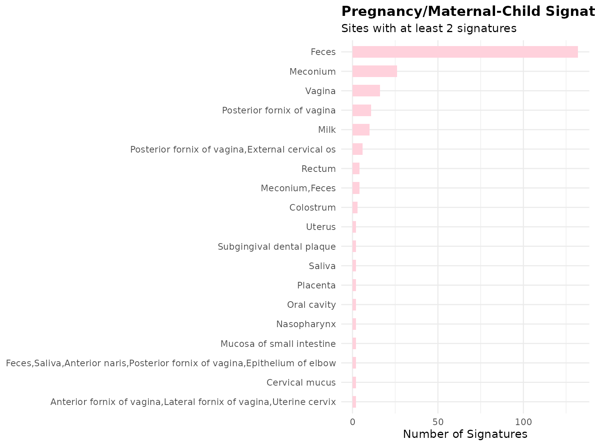
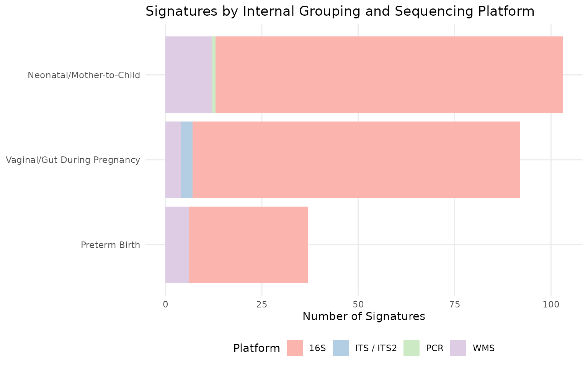
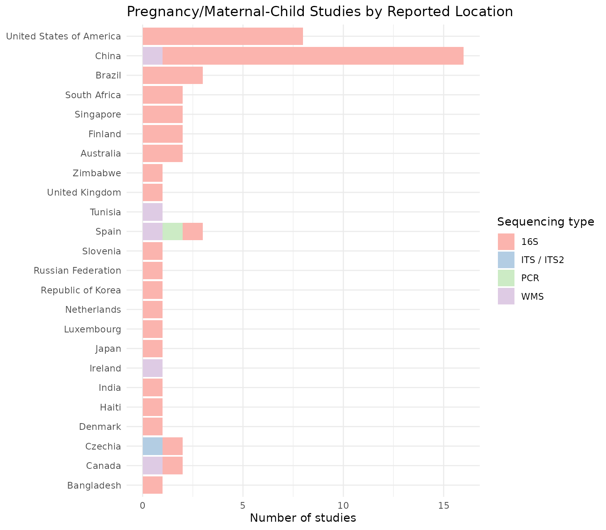
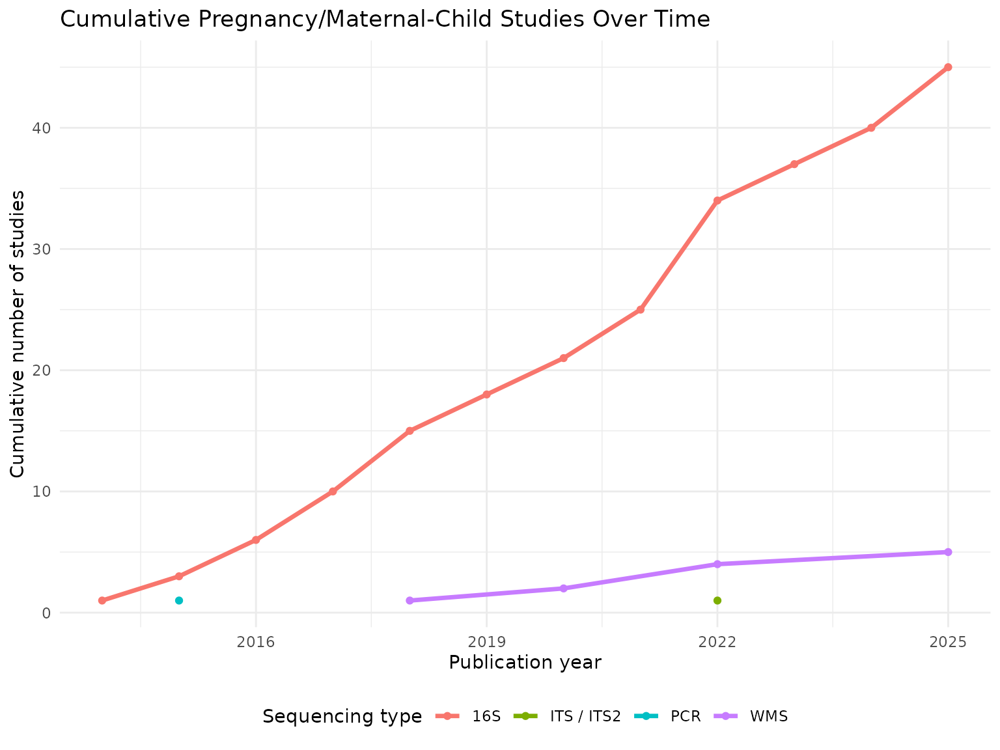
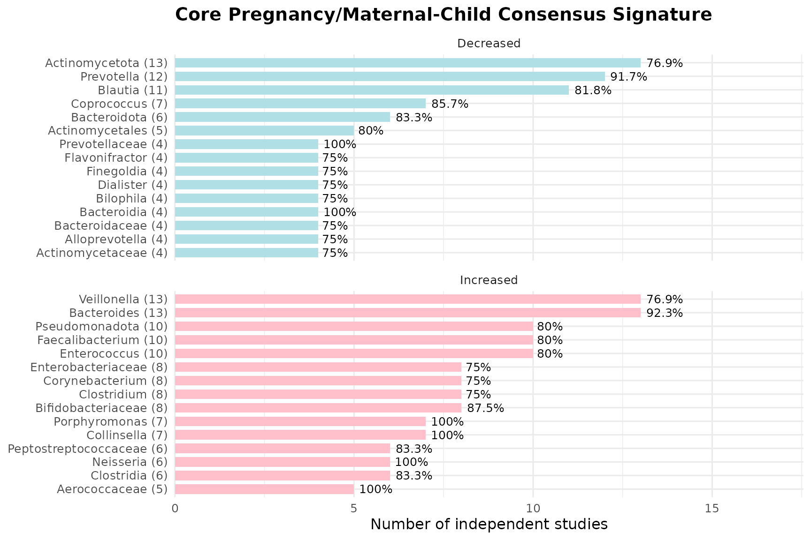
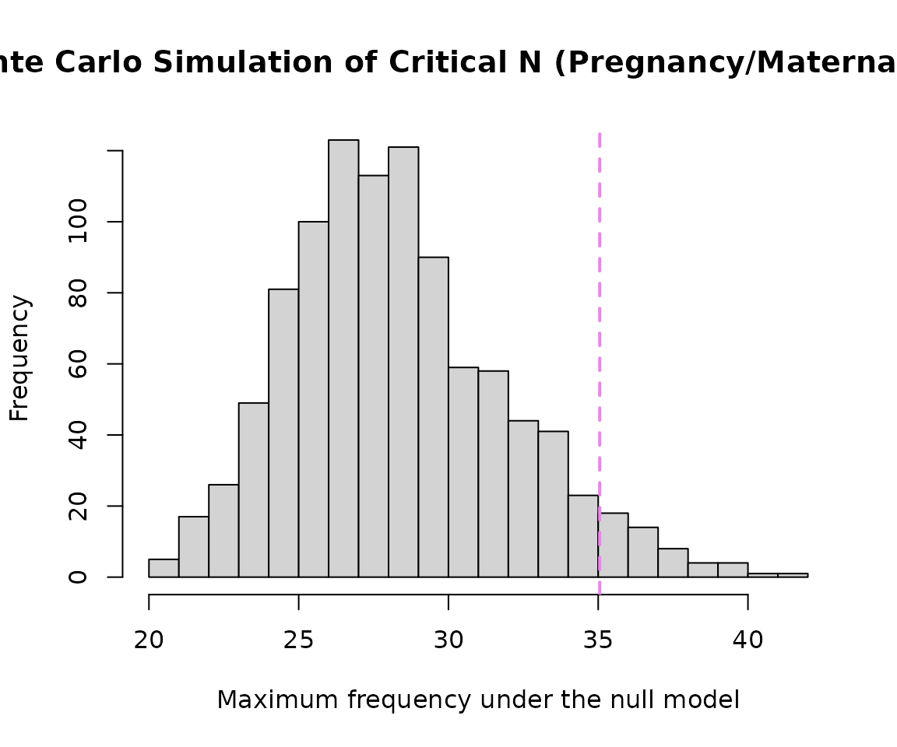
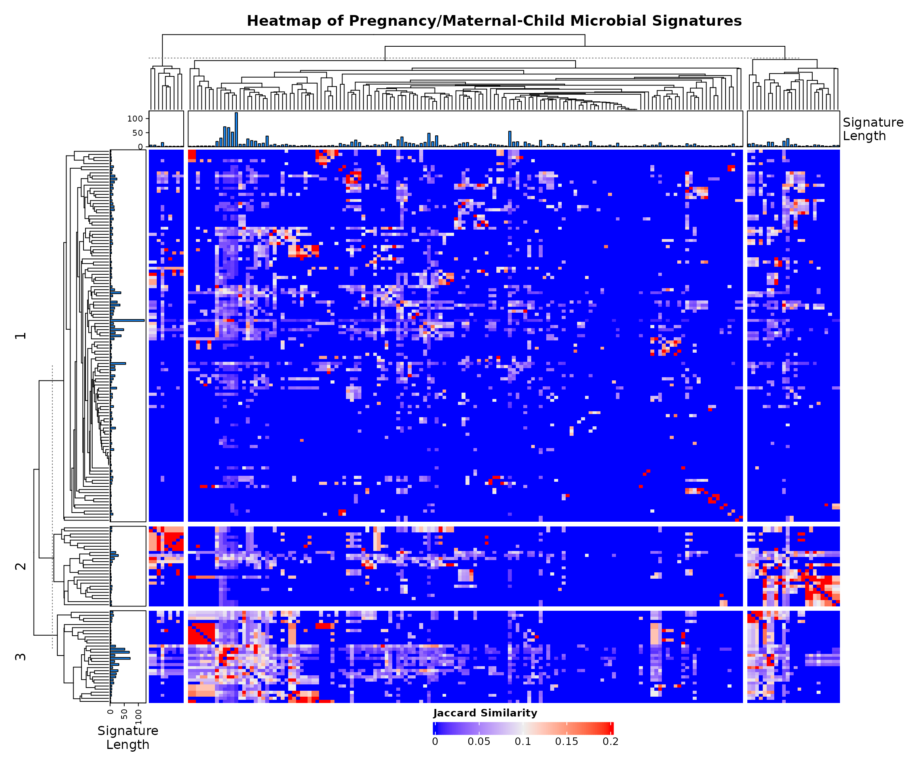

# Focused Sub-Analysis of Pregnancy & Maternal-Child Microbial Signatures

## Introduction

This vignette focuses on pregnancy and maternal-child microbiome
signatures curated in BugSigDB, spanning three internal groupings: (1)
vaginal/gut microbiome changes during pregnancy itself, (2) preterm
birth-associated signatures, and (3) neonatal/infant gut microbiome
signatures reflecting mother-to-child transmission. A fourth topic,
**postpartum** microbiome changes, is deliberately **not** included as a
formal sub-grouping here: BugSigDB currently has no dedicated postpartum
condition term, and a keyword search across study titles/keywords/group
names turned up only a single clean postpartum-specific comparison
(Study 617: maternal vs. infant samples at 6 weeks postpartum) - too
sparse for formal statistical treatment. It is mentioned only as a
single case-study example in the Discussion section below.

## Download and Prepare Data

``` r

full.dat <- bugsigdbr::importBugSigDB(cache = FALSE)
```

``` r

ind1 <- lengths(full.dat[["MetaPhlAn taxon names"]]) > 0
ind2 <- lengths(full.dat[["NCBI Taxonomy IDs"]]) > 0
dat <- full.dat[ind1 & ind2, ]
```

## Select Pregnancy/Maternal-Child Signatures

``` r

pregnancy_vaginal_gut_terms <- c(
  "Pregnancy", "Gestational age", "Gestational diabetes", "Vaginal microbiome measurement"
)

preterm_birth_terms <- c(
  "Premature birth", "Spontaneous preterm birth", "Preterm premature rupture of the membranes",
  "Birth weight", "Birth measurement"
)

neonatal_mother_child_terms <- c(
  "HIV mother to child transmission", "Neonatal death", "Neonatal jaundice",
  "Postnatal growth retardation", "Necrotizing enterocolitis", "Breastfeeding duration",
  "Breastfeeding duration,Transport", "Maternal milk", "Cesarean section", "Delivery method"
)

pregnancy_terms <- c(
  pregnancy_vaginal_gut_terms, preterm_birth_terms, neonatal_mother_child_terms
)

pregnancy_dat <- dat %>%
  filter(Condition %in% pregnancy_terms) %>%
  distinct()

nrow(pregnancy_dat)
```

    ## [1] 232

``` r

pregnancy_dat %>%
  count(Condition, sort = TRUE) %>%
  knitr::kable()
```

| Condition                                  |   n |
|:-------------------------------------------|----:|
| Gestational diabetes                       |  71 |
| Cesarean section                           |  29 |
| Breastfeeding duration                     |  22 |
| Delivery method                            |  21 |
| Pregnancy                                  |  17 |
| HIV mother to child transmission           |  15 |
| Birth measurement                          |  11 |
| Premature birth                            |  11 |
| Spontaneous preterm birth                  |  10 |
| Postnatal growth retardation               |   5 |
| Gestational age                            |   4 |
| Neonatal jaundice                          |   4 |
| Preterm premature rupture of the membranes |   4 |
| Necrotizing enterocolitis                  |   3 |
| Breastfeeding duration,Transport           |   2 |
| Maternal milk                              |   2 |
| Birth weight                               |   1 |

### Breakdown by Internal Grouping

``` r

pregnancy_dat <- pregnancy_dat %>%
  mutate(
    subgroup = case_when(
      Condition %in% pregnancy_vaginal_gut_terms   ~ "Vaginal/Gut During Pregnancy",
      Condition %in% preterm_birth_terms           ~ "Preterm Birth",
      Condition %in% neonatal_mother_child_terms   ~ "Neonatal/Mother-to-Child",
      TRUE ~ "Other"
    )
  )

pregnancy_dat %>%
  count(subgroup, sort = TRUE) %>%
  knitr::kable(caption = "Signatures per Internal Grouping")
```

| subgroup                     |   n |
|:-----------------------------|----:|
| Neonatal/Mother-to-Child     | 103 |
| Vaginal/Gut During Pregnancy |  92 |
| Preterm Birth                |  37 |

Signatures per Internal Grouping {.table}

## Study Characteristics

``` r

study.summary <- pregnancy_dat %>%
  count(`Body site`, `Sequencing type`)

knitr::kable(study.summary)
```

| Body site | Sequencing type | n |
|:---|:---|---:|
| Anterior fornix of vagina,Lateral fornix of vagina,Uterine cervix | 16S | 2 |
| Cervical mucus | 16S | 2 |
| Colostrum | 16S | 3 |
| Feces | 16S | 120 |
| Feces | ITS / ITS2 | 3 |
| Feces | PCR | 1 |
| Feces | WMS | 8 |
| Feces,Saliva,Anterior naris,Posterior fornix of vagina,Epithelium of elbow | 16S | 2 |
| Meconium | 16S | 24 |
| Meconium | WMS | 2 |
| Meconium,Feces | 16S | 4 |
| Milk | 16S | 10 |
| Mucosa of small intestine | 16S | 2 |
| Nasopharynx | WMS | 2 |
| Oral cavity | 16S | 2 |
| Placenta | 16S | 2 |
| Posterior fornix of vagina | 16S | 11 |
| Posterior fornix of vagina,External cervical os | WMS | 6 |
| Rectum | 16S | 4 |
| Saliva | 16S | 2 |
| Subgingival dental plaque | 16S | 2 |
| Uterus | 16S | 2 |
| Vagina | 16S | 12 |
| Vagina | WMS | 4 |

``` r

pregnancy_dat %>%
  count(Year) %>%
  arrange(Year) %>%
  knitr::kable()
```

| Year |   n |
|-----:|----:|
| 2014 |   3 |
| 2015 |   9 |
| 2016 |   9 |
| 2017 |  17 |
| 2018 |  44 |
| 2019 |   8 |
| 2020 |  16 |
| 2021 |  10 |
| 2022 |  58 |
| 2023 |   9 |
| 2024 |  22 |
| 2025 |  27 |

``` r

pregnancy_dat %>%
  count(`Body site`, sort = TRUE) %>%
  filter(n >= 2) %>%
  ggplot(aes(x = reorder(`Body site`, n), y = n)) +
  geom_col(fill = "#FFD1DC", width = 0.6) +
  coord_flip() +
  labs(
    title = "Pregnancy/Maternal-Child Signatures by Body Site",
    subtitle = "Sites with at least 2 signatures",
    x = NULL, y = "Number of Signatures"
  ) +
  theme_minimal(base_size = 11) +
  theme(plot.title = element_text(face = "bold"))
```



``` r

pregnancy_dat %>%
  count(subgroup, `Sequencing type`) %>%
  ggplot(aes(x = reorder(subgroup, n), y = n, fill = `Sequencing type`)) +
  geom_col() +
  coord_flip() +
  # Palette sized to however many sequencing types are present
  scale_fill_brewer(palette = "Pastel1") +
  labs(
    title = "Signatures by Internal Grouping and Sequencing Platform",
    x = NULL, y = "Number of Signatures", fill = "Platform"
  ) +
  theme_minimal(base_size = 11) +
  theme(
    legend.position = "bottom",
    panel.grid.minor = element_blank()
  )
```



``` r

pregnancy_dat %>% 
  distinct(PMID, `Location of subjects`, `Sequencing type`) %>% 
  filter(!is.na(`Location of subjects`)) %>% 
  count(`Location of subjects`, `Sequencing type`) %>% 
  ggplot(aes(x = reorder(`Location of subjects`, n), y = n, fill = `Sequencing type`)) + 
  geom_col() + 
  coord_flip() + 
  # Palette sized to however many sequencing types are present
  scale_fill_brewer(palette = "Pastel1") +
  labs(
    title = "Pregnancy/Maternal-Child Studies by Reported Location", 
    x = NULL, 
    y = "Number of studies"
  ) + 
  theme_minimal(base_size = 11)
```



``` r

pregnancy_dat %>%
  distinct(PMID, Year, `Sequencing type`) %>%
  filter(!is.na(Year)) %>%
  count(Year, `Sequencing type`) %>%
  group_by(`Sequencing type`) %>%
  arrange(Year) %>%
  mutate(cumulative_n = cumsum(n)) %>%
  ungroup() %>%
  ggplot(aes(x = Year, y = cumulative_n, color = `Sequencing type`)) +
  geom_line(linewidth = 1.2) +
  geom_point() +
  labs(
    title = "Cumulative Pregnancy/Maternal-Child Studies Over Time",
    x = "Publication year", y = "Cumulative number of studies", color = "Sequencing type"
  ) +
  theme_minimal(base_size = 11) +
  theme(legend.position = "bottom")
```



## Taxonomic Summary

``` r

taxa.table <- createTaxonTable(pregnancy_dat)
knitr::kable(head(taxa.table, 20))
```

| Taxon Name | Taxonomic Level | total_signatures | increased_signatures | decreased_signatures | Binomial Test pval |
|:---|:---|---:|---:|---:|---:|
| Bacteroides | genus | 33 | 19 | 14 | 0.4900 |
| Lactobacillus | genus | 26 | 15 | 11 | 0.5600 |
| Faecalibacterium | genus | 22 | 11 | 11 | 1.0000 |
| Veillonella | genus | 22 | 10 | 12 | 0.8300 |
| Staphylococcus | genus | 21 | 11 | 10 | 1.0000 |
| Streptococcus | genus | 21 | 9 | 12 | 0.6600 |
| Bifidobacterium | genus | 19 | 16 | 3 | 0.0044 |
| Bacillota | phylum | 18 | 13 | 5 | 0.0960 |
| Blautia | genus | 18 | 13 | 5 | 0.0960 |
| Prevotella | genus | 18 | 7 | 11 | 0.4800 |

## Split by Sequencing Type

``` r

preg.wms <- pregnancy_dat %>% filter(`Sequencing type` == "WMS")
preg.16s <- pregnancy_dat %>% filter(`Sequencing type` == "16S")

cat("WMS  - signatures:", nrow(preg.wms), "| studies:", n_distinct(preg.wms$PMID), "\n")
```

    ## WMS  - signatures: 22 | studies: 5

``` r

cat("16S  - signatures:", nrow(preg.16s), "| studies:", n_distinct(preg.16s$PMID), "\n")
```

    ## 16S  - signatures: 206 | studies: 45

## Long-Format Taxon Table

``` r

sigs.pregnancy <- bugsigdbr::getSignatures(pregnancy_dat, tax.id.type = "taxname")
sigs.all <- bugsigdbr::getSignatures(dat, tax.id.type = "taxname")

taxon.long <- purrr::map_dfr(seq_along(sigs.all), function(i) {
  taxa <- sigs.all[[i]]
  if (length(taxa) == 0) return(NULL)
  tibble::tibble(sig_id = i, taxon = taxa)
}) %>%
  left_join(
    dat %>%
      mutate(sig_id = row_number()) %>%
      select(sig_id, PMID, Condition, `Sequencing type`, `Abundance in Group 1`),
    by = "sig_id"
  ) %>%
  rename(direction = `Abundance in Group 1`)

nrow(taxon.long)
```

    ## [1] 58971

## Taxon Frequency Across Studies

``` r

taxon.freq <- taxon.long %>%
  filter(Condition %in% pregnancy_terms) %>%
  distinct(PMID, taxon, direction) %>%
  count(taxon, direction, name = "n_studies") %>%
  group_by(taxon) %>%
  mutate(total_studies = sum(n_studies)) %>%
  ungroup() %>%
  arrange(desc(total_studies))

n_distinct(taxon.freq$taxon)
```

    ## [1] 793

``` r

taxon.freq %>%
  distinct(taxon, total_studies) %>%
  slice_max(total_studies, n = 15) %>%
  knitr::kable()
```

| taxon               | total_studies |
|:--------------------|--------------:|
| Bacillota           |            17 |
| Bacteroides         |            17 |
| Veillonella         |            17 |
| Prevotella          |            16 |
| Streptococcus       |            16 |
| Actinomycetota      |            15 |
| Bifidobacterium     |            15 |
| Lactobacillus       |            15 |
| Blautia             |            14 |
| Lachnospiraceae     |            13 |
| Oscillospiraceae    |            13 |
| Erysipelotrichaceae |            12 |
| Faecalibacterium    |            12 |
| Haemophilus         |            12 |
| Eubacteriales       |            11 |
| Ruminococcus        |            11 |

## Core Consensus Signature

``` r

concordance <- taxon.long %>%
  filter(Condition %in% pregnancy_terms) %>%
  distinct(PMID, taxon, direction) %>%
  group_by(taxon) %>%
  summarise(
    n_studies       = n_distinct(PMID),
    n_increased     = sum(direction == "increased"),
    n_decreased     = sum(direction == "decreased"),
    concordance_pct = round(max(n_increased, n_decreased) / n_studies * 100, 1),
    majority_dir    = if_else(n_increased >= n_decreased, "increased", "decreased"),
    .groups = "drop"
  ) %>%
  arrange(desc(n_studies), desc(concordance_pct))

# Standard threshold; loosen to >=2/>=70% (as done for Cervical Cancer) if this
# returns very few/zero rows, and note that deviation in the Discussion section.
core.sig <- concordance %>%
  filter(n_studies >= 3, concordance_pct >= 75) %>%
  arrange(majority_dir, desc(n_studies))

nrow(core.sig)
```

    ## [1] 65

``` r

knitr::kable(core.sig)
```

| taxon | n_studies | n_increased | n_decreased | concordance_pct | majority_dir |
|:---|---:|---:|---:|---:|:---|
| Actinomycetota | 13 | 5 | 10 | 76.9 | decreased |
| Prevotella | 12 | 5 | 11 | 91.7 | decreased |
| Blautia | 11 | 5 | 9 | 81.8 | decreased |
| Coprococcus | 7 | 3 | 6 | 85.7 | decreased |
| Bacteroidota | 6 | 2 | 5 | 83.3 | decreased |
| Actinomycetales | 5 | 1 | 4 | 80.0 | decreased |
| Bacteroidia | 4 | 0 | 4 | 100.0 | decreased |
| Prevotellaceae | 4 | 0 | 4 | 100.0 | decreased |
| Actinomycetaceae | 4 | 1 | 3 | 75.0 | decreased |
| Alloprevotella | 4 | 2 | 3 | 75.0 | decreased |
| Bacteroidaceae | 4 | 2 | 3 | 75.0 | decreased |
| Bilophila | 4 | 1 | 3 | 75.0 | decreased |
| Dialister | 4 | 1 | 3 | 75.0 | decreased |
| Finegoldia | 4 | 2 | 3 | 75.0 | decreased |
| Flavonifractor | 4 | 2 | 3 | 75.0 | decreased |
| Odoribacter | 4 | 2 | 3 | 75.0 | decreased |
| Peptococcaceae | 4 | 1 | 3 | 75.0 | decreased |
| Sutterella | 4 | 2 | 3 | 75.0 | decreased |
| Anaerococcus | 3 | 0 | 3 | 100.0 | decreased |
| Bacteroidales | 3 | 0 | 3 | 100.0 | decreased |
| Butyricicoccus | 3 | 0 | 3 | 100.0 | decreased |
| Faecalibacterium prausnitzii | 3 | 1 | 3 | 100.0 | decreased |
| Lachnospira | 3 | 0 | 3 | 100.0 | decreased |
| Mogibacterium | 3 | 0 | 3 | 100.0 | decreased |
| Negativicutes | 3 | 1 | 3 | 100.0 | decreased |
| Phyllobacterium | 3 | 0 | 3 | 100.0 | decreased |
| Bacteroides | 13 | 12 | 5 | 92.3 | increased |
| Veillonella | 13 | 10 | 7 | 76.9 | increased |
| Enterococcus | 10 | 8 | 2 | 80.0 | increased |
| Faecalibacterium | 10 | 8 | 4 | 80.0 | increased |
| Pseudomonadota | 10 | 8 | 2 | 80.0 | increased |
| Bifidobacteriaceae | 8 | 7 | 3 | 87.5 | increased |
| Clostridium | 8 | 6 | 4 | 75.0 | increased |
| Corynebacterium | 8 | 6 | 3 | 75.0 | increased |
| Enterobacteriaceae | 8 | 6 | 2 | 75.0 | increased |
| Collinsella | 7 | 7 | 0 | 100.0 | increased |
| Porphyromonas | 7 | 7 | 1 | 100.0 | increased |
| Neisseria | 6 | 6 | 1 | 100.0 | increased |
| Clostridia | 6 | 5 | 3 | 83.3 | increased |
| Peptostreptococcaceae | 6 | 5 | 4 | 83.3 | increased |
| Aerococcaceae | 5 | 5 | 0 | 100.0 | increased |
| Eubacterium | 5 | 5 | 2 | 100.0 | increased |
| Coprobacillus | 5 | 4 | 1 | 80.0 | increased |
| Rothia | 5 | 4 | 1 | 80.0 | increased |
| Turicibacter | 5 | 4 | 1 | 80.0 | increased |
| Bifidobacteriales | 4 | 4 | 0 | 100.0 | increased |
| Holdemania | 4 | 4 | 0 | 100.0 | increased |
| Acidaminococcus | 4 | 3 | 2 | 75.0 | increased |
| Coriobacteriales | 4 | 3 | 1 | 75.0 | increased |
| Enterococcaceae | 4 | 3 | 1 | 75.0 | increased |
| Erysipelotrichales | 4 | 3 | 2 | 75.0 | increased |
| Lactobacillales | 4 | 3 | 1 | 75.0 | increased |
| Leptotrichia | 4 | 3 | 2 | 75.0 | increased |
| Propionibacteriaceae | 4 | 3 | 1 | 75.0 | increased |
| Selenomonas | 4 | 3 | 1 | 75.0 | increased |
| Butyrivibrio | 3 | 3 | 0 | 100.0 | increased |
| Christensenella | 3 | 3 | 1 | 100.0 | increased |
| Collinsella aerofaciens | 3 | 3 | 0 | 100.0 | increased |
| Corynebacteriaceae | 3 | 3 | 0 | 100.0 | increased |
| Enhydrobacter | 3 | 3 | 0 | 100.0 | increased |
| Leptotrichiaceae | 3 | 3 | 0 | 100.0 | increased |
| Micrococcaceae | 3 | 3 | 1 | 100.0 | increased |
| Moraxellaceae | 3 | 3 | 0 | 100.0 | increased |
| Phascolarctobacterium | 3 | 3 | 0 | 100.0 | increased |
| Staphylococcaceae | 3 | 3 | 0 | 100.0 | increased |

## Core Signature Visualisation

``` r

if (nrow(core.sig) > 0) {
  core.sig %>%
    group_by(majority_dir) %>%
    slice_max(n_studies, n = 15, with_ties = FALSE) %>%
    ungroup() %>%
    mutate(
      direction_label = if_else(majority_dir == "increased", "Increased", "Decreased"),
      taxon_label = paste0(str_wrap(taxon, width = 28), " (", n_studies, ")")
    ) %>%
    ggplot(aes(x = reorder(taxon_label, n_studies), y = n_studies, fill = direction_label)) +
    geom_col(width = 0.7) +
    geom_text(aes(label = paste0(concordance_pct, "%")), hjust = -0.15, size = 3.3) +
    coord_flip(clip = "off") +
    facet_wrap(~direction_label, scales = "free_y", ncol = 1) +
    scale_fill_manual(values = c("Increased" = "#FFC0CB", "Decreased" = "#B0E0E6")) +
    scale_y_continuous(expand = expansion(mult = c(0, 0.35))) +
    labs(
      title = "Core Pregnancy/Maternal-Child Consensus Signature",
      x = NULL, y = "Number of independent studies", fill = NULL
    ) +
    theme_minimal(base_size = 12) +
    theme(legend.position = "none", plot.title = element_text(face = "bold"))
} else {
  cat("No taxa met the core-signature threshold at this sample size.")
}
```



## WMS vs 16S Concordance

``` r

dir.by.platform <- taxon.long %>%
  filter(Condition %in% pregnancy_terms) %>%
  filter(`Sequencing type` %in% c("WMS", "16S")) %>%
  distinct(PMID, taxon, direction, `Sequencing type`) %>%
  count(taxon, `Sequencing type`, direction, name = "n_studies") %>%
  group_by(taxon, `Sequencing type`) %>%
  slice_max(n_studies, n = 1, with_ties = FALSE) %>%
  ungroup() %>%
  select(taxon, `Sequencing type`, majority_dir = direction)

platform.compare <- dir.by.platform %>%
  pivot_wider(names_from = `Sequencing type`, values_from = majority_dir) %>%
  filter(!is.na(WMS), !is.na(`16S`)) %>%
  rename(dir_WMS = WMS, dir_16S = `16S`) %>%
  mutate(agree = dir_WMS == dir_16S)

nrow(platform.compare)
```

    ## [1] 59

``` r

if (nrow(platform.compare) > 0) {
  sum(platform.compare$agree)
  round(100 * mean(platform.compare$agree), 1)
  knitr::kable(platform.compare)
} else {
  cat("No taxa reported by both WMS and 16S in this pregnancy dataset.")
}
```

| taxon                        | dir_16S   | dir_WMS   | agree |
|:-----------------------------|:----------|:----------|:------|
| Abiotrophia defectiva        | increased | increased | TRUE  |
| Actinomyces                  | decreased | decreased | TRUE  |
| Actinomyces graevenitzii     | decreased | decreased | TRUE  |
| Actinomyces naeslundii       | decreased | increased | FALSE |
| Actinomyces oris             | increased | increased | TRUE  |
| Actinomycetaceae             | decreased | decreased | TRUE  |
| Alloprevotella               | decreased | decreased | TRUE  |
| Anaerotruncus                | decreased | increased | FALSE |
| Bacillota                    | decreased | decreased | TRUE  |
| Bacteroidales                | decreased | decreased | TRUE  |
| Bacteroidia                  | decreased | decreased | TRUE  |
| Bacteroidota                 | decreased | decreased | TRUE  |
| Bifidobacterium              | increased | decreased | FALSE |
| Bifidobacterium longum       | increased | decreased | FALSE |
| Blautia                      | decreased | decreased | TRUE  |
| Blautia wexlerae             | decreased | decreased | TRUE  |
| Butyricimonas                | decreased | increased | FALSE |
| Candida                      | decreased | decreased | TRUE  |
| Clostridiaceae               | increased | decreased | FALSE |
| Collinsella                  | increased | increased | TRUE  |
| Collinsella aerofaciens      | increased | increased | TRUE  |
| Coprococcus                  | decreased | decreased | TRUE  |
| Desulfovibrio                | increased | increased | TRUE  |
| Dorea                        | decreased | decreased | TRUE  |
| Enterobacter                 | decreased | increased | FALSE |
| Enterobacteriaceae           | increased | increased | TRUE  |
| Enterococcus                 | increased | increased | TRUE  |
| Erwinia                      | increased | increased | TRUE  |
| Erysipelotrichaceae          | decreased | decreased | TRUE  |
| Escherichia                  | decreased | increased | FALSE |
| Eubacterium                  | increased | decreased | FALSE |
| Faecalibacterium             | increased | decreased | FALSE |
| Faecalibacterium prausnitzii | decreased | decreased | TRUE  |
| Gemella haemolysans          | decreased | increased | FALSE |
| Klebsiella                   | decreased | increased | FALSE |
| Lachnospira                  | decreased | decreased | TRUE  |
| Lachnospiraceae              | decreased | decreased | TRUE  |
| Lactobacillaceae             | decreased | decreased | TRUE  |
| Lactobacillus                | increased | decreased | FALSE |
| Lautropia mirabilis          | increased | increased | TRUE  |
| Leptotrichia sp.             | decreased | increased | FALSE |
| Odoribacter                  | decreased | decreased | TRUE  |
| Oscillospiraceae             | increased | decreased | FALSE |
| Parabacteroides              | increased | increased | TRUE  |
| Parabacteroides johnsonii    | increased | decreased | FALSE |
| Peptococcaceae               | decreased | decreased | TRUE  |
| Peptostreptococcaceae        | increased | decreased | FALSE |
| Prevotella histicola         | increased | decreased | FALSE |
| Prevotella pallens           | decreased | decreased | TRUE  |
| Pseudobutyrivibrio           | increased | decreased | FALSE |
| Pseudomonadota               | increased | increased | TRUE  |
| Roseburia                    | decreased | decreased | TRUE  |
| Rothia aeria                 | decreased | increased | FALSE |
| Rothia dentocariosa          | decreased | increased | FALSE |
| Ruminococcus bromii          | decreased | decreased | TRUE  |
| Serratia                     | decreased | increased | FALSE |
| Solobacterium moorei         | decreased | decreased | TRUE  |
| Streptococcus sanguinis      | decreased | increased | FALSE |
| Veillonella parvula          | decreased | increased | FALSE |

## Taxon Enrichment Analysis

``` r

n.universe <- n_distinct(taxon.long %>% filter(Condition %in% pregnancy_terms) %>% pull(taxon))
n.sigs     <- length(sigs.pregnancy)

enrichment.df <- taxon.freq %>%
  distinct(taxon, total_studies) %>%
  mutate(
    observed         = total_studies,
    expected         = n.sigs / n.universe,
    enrichment_ratio = observed / expected,
    log2_enrichment  = log2(enrichment_ratio),
    p_value = purrr::map_dbl(observed, ~ binom.test(
      x = .x, n = n.sigs, p = 1 / n.universe, alternative = "greater"
    )$p.value),
    p_adj = p.adjust(p_value, method = "BH")
  ) %>%
  arrange(p_adj, desc(log2_enrichment))

sum(enrichment.df$p_adj < 0.05)
```

    ## [1] 160

``` r

knitr::kable(head(enrichment.df, 15))
```

| taxon | total_studies | observed | expected | enrichment_ratio | log2_enrichment | p_value | p_adj |
|:---|---:|---:|---:|---:|---:|---:|---:|
| Bacillota | 17 | 17 | 0.2887768 | 58.86900 | 5.879436 | 0 | 0 |
| Bacteroides | 17 | 17 | 0.2887768 | 58.86900 | 5.879436 | 0 | 0 |
| Veillonella | 17 | 17 | 0.2887768 | 58.86900 | 5.879436 | 0 | 0 |
| Prevotella | 16 | 16 | 0.2887768 | 55.40611 | 5.791973 | 0 | 0 |
| Streptococcus | 16 | 16 | 0.2887768 | 55.40611 | 5.791973 | 0 | 0 |
| Actinomycetota | 15 | 15 | 0.2887768 | 51.94323 | 5.698864 | 0 | 0 |
| Bifidobacterium | 15 | 15 | 0.2887768 | 51.94323 | 5.698864 | 0 | 0 |
| Lactobacillus | 15 | 15 | 0.2887768 | 51.94323 | 5.698864 | 0 | 0 |
| Blautia | 14 | 14 | 0.2887768 | 48.48035 | 5.599328 | 0 | 0 |
| Lachnospiraceae | 13 | 13 | 0.2887768 | 45.01747 | 5.492413 | 0 | 0 |
| Oscillospiraceae | 13 | 13 | 0.2887768 | 45.01747 | 5.492413 | 0 | 0 |
| Erysipelotrichaceae | 12 | 12 | 0.2887768 | 41.55459 | 5.376936 | 0 | 0 |
| Faecalibacterium | 12 | 12 | 0.2887768 | 41.55459 | 5.376936 | 0 | 0 |
| Haemophilus | 12 | 12 | 0.2887768 | 41.55459 | 5.376936 | 0 | 0 |
| Eubacteriales | 11 | 11 | 0.2887768 | 38.09170 | 5.251405 | 0 | 0 |

## Monte Carlo Critical N

``` r

siglengths <- lengths(pregnancy_dat$`MetaPhlAn taxon names`)

criticalN <- getCriticalN(
  relevant.sigs = pregnancy_dat$`MetaPhlAn taxon names`,
  siglengths = siglengths
)

criticalN
```

    ## $critical_n
    ##   95% 
    ## 35.05 
    ## 
    ## $ci_lower
    ## 2.5% 
    ##   35 
    ## 
    ## $ci_upper
    ## 97.5% 
    ##    36 
    ## 
    ## $simulated_values
    ##    [1] 29 28 24 32 28 27 37 24 28 31 28 31 30 30 27 37 33 25 31 35 28 27 29 29
    ##   [25] 27 23 31 31 28 28 29 26 23 35 26 28 29 30 28 29 34 34 24 25 26 29 27 26
    ##   [49] 27 31 27 29 33 25 27 35 34 30 32 34 34 35 27 25 26 27 26 27 24 32 28 30
    ##   [73] 26 28 42 22 29 30 30 26 31 40 28 33 34 30 27 36 28 27 27 27 29 28 29 34
    ##   [97] 29 39 25 32 29 29 28 34 26 26 32 27 26 24 31 29 26 29 37 28 26 30 25 29
    ##  [121] 26 23 31 26 26 31 24 30 33 27 34 31 33 24 28 36 33 31 27 30 25 26 29 27
    ##  [145] 33 31 32 32 23 31 26 29 27 26 25 35 24 30 37 29 32 31 28 26 32 29 31 38
    ##  [169] 25 30 26 30 24 32 37 35 25 31 38 32 25 28 27 29 27 23 26 22 25 31 26 29
    ##  [193] 28 31 28 27 29 32 24 36 29 26 27 26 35 29 27 33 26 26 25 32 34 32 32 25
    ##  [217] 25 22 30 29 26 35 29 34 34 29 33 31 31 23 26 30 26 28 27 29 27 27 29 33
    ##  [241] 28 23 24 26 35 30 33 32 37 26 35 27 30 31 26 33 32 27 29 32 31 29 32 37
    ##  [265] 27 29 29 27 28 25 29 39 36 29 27 26 30 30 36 26 27 36 33 24 25 31 33 30
    ##  [289] 29 23 29 33 27 26 26 27 27 25 35 26 24 27 29 27 25 28 35 24 31 36 28 28
    ##  [313] 30 24 29 27 33 40 24 33 25 28 34 32 31 28 30 30 26 25 24 27 24 29 21 32
    ##  [337] 34 26 29 30 25 30 33 32 34 33 36 29 25 36 25 24 31 30 23 28 26 26 25 27
    ##  [361] 24 28 29 30 30 33 24 34 29 28 25 29 29 29 35 27 27 29 36 28 28 29 31 30
    ##  [385] 30 27 24 29 29 25 24 25 32 25 32 28 26 35 27 33 31 30 25 37 28 29 32 30
    ##  [409] 26 23 21 31 28 23 29 34 28 33 30 25 30 30 28 29 23 28 25 27 29 28 29 30
    ##  [433] 30 28 24 28 29 31 34 29 26 29 26 24 31 38 32 29 27 34 38 25 23 27 28 34
    ##  [457] 31 23 31 30 27 26 31 29 28 30 31 27 27 28 28 29 28 27 32 38 26 29 26 27
    ##  [481] 28 30 34 29 33 26 29 27 27 26 29 27 29 29 32 26 29 26 27 24 29 27 26 24
    ##  [505] 28 29 27 24 28 26 32 30 30 32 33 29 29 25 32 28 26 30 28 27 23 27 25 28
    ##  [529] 24 29 32 25 26 32 29 27 29 28 32 28 35 32 23 27 37 25 26 31 33 29 24 28
    ##  [553] 29 29 24 29 27 27 34 25 34 27 28 25 22 27 25 29 28 29 24 28 27 27 24 26
    ##  [577] 26 30 28 30 23 26 31 28 36 40 27 27 28 26 29 28 24 26 34 28 25 25 28 30
    ##  [601] 28 24 30 34 32 26 30 26 34 31 26 27 22 27 23 25 25 33 29 27 33 32 25 29
    ##  [625] 30 31 31 29 35 33 30 28 33 37 27 30 33 26 29 36 30 28 34 27 36 28 34 29
    ##  [649] 27 29 31 25 26 23 22 30 24 34 26 33 30 28 27 38 36 32 30 26 37 32 29 26
    ##  [673] 31 32 34 25 25 28 26 32 31 27 26 26 23 22 22 39 29 24 23 27 26 25 39 26
    ##  [697] 30 29 30 28 29 30 22 35 25 26 29 29 27 28 21 34 30 28 30 27 25 25 31 25
    ##  [721] 31 27 28 30 28 24 25 30 25 25 24 28 29 26 27 26 28 35 27 29 30 34 27 33
    ##  [745] 25 30 24 28 30 27 28 30 33 25 26 26 31 25 31 33 26 25 29 26 28 30 34 27
    ##  [769] 30 25 28 25 25 27 32 30 28 35 27 29 26 30 23 31 29 33 30 23 29 26 24 27
    ##  [793] 32 27 28 28 27 28 29 29 28 30 34 25 24 30 26 35 31 33 38 28 28 40 27 24
    ##  [817] 26 29 27 27 25 26 27 26 34 24 32 33 27 30 28 30 29 22 31 28 36 27 27 30
    ##  [841] 38 30 28 33 27 25 36 28 28 25 23 22 27 27 25 28 35 27 29 29 33 34 28 27
    ##  [865] 29 34 32 24 32 27 31 24 25 26 29 32 29 27 27 26 29 34 25 35 27 30 24 33
    ##  [889] 25 26 27 34 22 26 32 32 24 29 26 36 26 27 31 27 32 20 30 30 25 32 27 32
    ##  [913] 32 22 22 30 27 27 27 28 23 28 26 29 31 31 27 31 32 31 23 30 28 27 27 27
    ##  [937] 21 28 31 30 28 28 25 34 25 29 26 30 26 25 22 28 30 37 24 30 32 25 32 28
    ##  [961] 27 25 27 26 28 22 33 25 29 37 30 28 26 25 32 32 29 25 33 22 35 33 41 36
    ##  [985] 29 28 34 37 28 33 30 29 28 25 28 30 31 29 28 28
    ## 
    ## $alpha
    ## [1] 0.05
    ## 
    ## $quantile_label
    ## [1] "95th percentile"

``` r

hist(
  criticalN$simulated_values,
  breaks = 30,
  main = "Monte Carlo Simulation of Critical N (Pregnancy/Maternal-Child)",
  xlab = "Maximum frequency under the null model"
)

abline(v = criticalN$critical_n, col = "violet", lwd = 2, lty = 2)
```



## Cross-Condition Taxa Overlap Analysis

``` r

pregnancy_taxa <- taxon.long %>%
  filter(Condition %in% pregnancy_terms) %>%
  distinct(taxon) %>%
  pull(taxon)

shared_taxa_counts <- taxon.long %>%
  filter(taxon %in% pregnancy_taxa) %>%
  group_by(taxon) %>%
  summarise(
    total_womens_health_studies = n_distinct(PMID),
    distinct_conditions_linked = n_distinct(Condition),
    top_other_conditions = paste(
      head(setdiff(unique(Condition), pregnancy_terms), 3),
      collapse = ", "
    ),
    .groups = "drop"
  ) %>%
  arrange(desc(distinct_conditions_linked))

shared_taxa_counts %>%
  slice_max(distinct_conditions_linked, n = 20, with_ties = FALSE) %>%
  knitr::kable(
    caption = "Top Pregnancy-Associated Taxa and Their Links to Other Conditions",
    col.names = c("Taxon Name", "Total WH Studies", "Total Distinct Conditions", "Other Conditions it Often Appears In")
  )
```

| Taxon Name | Total WH Studies | Total Distinct Conditions | Other Conditions it Often Appears In |
|:---|---:|---:|:---|
| Streptococcus | 347 | 214 | Granulomatosis with Polyangiitis, Diet, Autism |
| Prevotella | 354 | 211 | Illness severity status, Antimicrobial agent, Obesity |
| Lactobacillus | 335 | 201 | Antimicrobial agent, Oxygen, Illness severity status |
| Bacteroides | 345 | 199 | Autism, Autoimmune disease, Obesity |
| Lachnospiraceae | 331 | 199 | Autoimmune disease, Smoking behavior, Irritable bowel syndrome |
| Bacillota | 313 | 190 | Type II diabetes mellitus, Autism, Autoimmune disease |
| Faecalibacterium | 278 | 183 | Obesity, Autoimmune disease, Irritable bowel syndrome |
| Oscillospiraceae | 273 | 183 | Autoimmune disease, Smoking behavior, Colorectal carcinoma |
| Bifidobacterium | 275 | 177 | Food allergy, Irritable bowel syndrome, Autism |
| Clostridium | 258 | 175 | Irritable bowel syndrome, Autism, Autoimmune disease |
| Actinomycetota | 265 | 171 | Autism, Ethnic group,Place of residence measurement, Ulcerative colitis |
| Pseudomonadota | 241 | 166 | Autism, Autoimmune disease, Ethnic group,Place of residence measurement |
| Roseburia | 228 | 165 | Autoimmune disease, Smoking behavior, Irritable bowel syndrome |
| Blautia | 246 | 164 | Autoimmune disease, Irritable bowel syndrome, Colorectal cancer |
| Veillonella | 241 | 161 | Obesity, Antimicrobial agent, Oxygen |
| Bacteroidota | 247 | 158 | Autism, Autoimmune disease, Irritable bowel syndrome |
| Eubacteriales | 219 | 156 | Autoimmune disease, Colorectal carcinoma, Psoriasis |
| Enterobacteriaceae | 213 | 155 | Autoimmune disease, Irritable bowel syndrome, Sampling site |
| Haemophilus | 208 | 153 | Illness severity status, Diet, Autoimmune disease |
| Alistipes | 198 | 148 | Autoimmune disease, Irritable bowel syndrome, Colorectal cancer |

Top Pregnancy-Associated Taxa and Their Links to Other Conditions
{.table}

## Signature Similarity and Heatmap

``` r

allsigs <- bugsigdbr::getSignatures(pregnancy_dat, tax.id.type = "taxname")
allsigs <- allsigs[sapply(allsigs, length) > 1]

if (length(allsigs) > 1) {
  jmat <- BugSigDBStats::calcJaccardSimilarity(allsigs)
  siglengths <- sapply(allsigs, length)

  ha <- HeatmapAnnotation(
    `Signature\nLength` = anno_barplot(siglengths, gp = gpar(fill = "#1E90FF"), height = unit(1.2, "cm"))
  )
  hr <- rowAnnotation(
    `Signature\nLength` = anno_barplot(siglengths, gp = gpar(fill = "#1E90FF"), width = unit(1.2, "cm"))
  )

  hm <- Heatmap(
    jmat,
    top_annotation = ha,
    left_annotation = hr,
    show_row_names = FALSE,
    show_column_names = FALSE,
    row_km = 3,
    column_km = 3,
    row_gap = unit(1.5, "mm"),
    column_gap = unit(1.5, "mm"),
    row_dend_width = unit(2.5, "cm"),
    column_dend_height = unit(2.5, "cm"),
    column_title = "Heatmap of Pregnancy/Maternal-Child Microbial Signatures",
    column_title_gp = gpar(fontsize = 14, fontface = "bold"),
    heatmap_legend_param = list(title = "Jaccard Similarity", direction = "horizontal", legend_width = unit(6, "cm"))
  )

  draw(hm, heatmap_legend_side = "bottom", padding = unit(c(5, 5, 5, 5), "mm"))

  png(filename = "Pregnancy_heatmap.png", width = 12, height = 10, units = "in", res = 300)
  draw(hm, heatmap_legend_side = "bottom", padding = unit(c(5, 5, 5, 5), "mm"))
  dev.off()
}
```



    ## agg_png 
    ##       2

## Dendrogram

``` r

if (exists("jmat") && nrow(jmat) > 1) {
  hc <- hclust(as.dist(1 - jmat))
  dend <- as.dendrogram(hc)

  par(mar = c(5, 2, 4, 2))

  plot(
    dend,
    horiz = TRUE,
    leaflab = "none",
    main = "Hierarchical Cluster Map of Pregnancy/Maternal-Child Microbial Signatures",
    xlab = "Distance (1 - Jaccard similarity)",
    cex.main = 1.3,
    lwd = 0.8
  )
}
```


