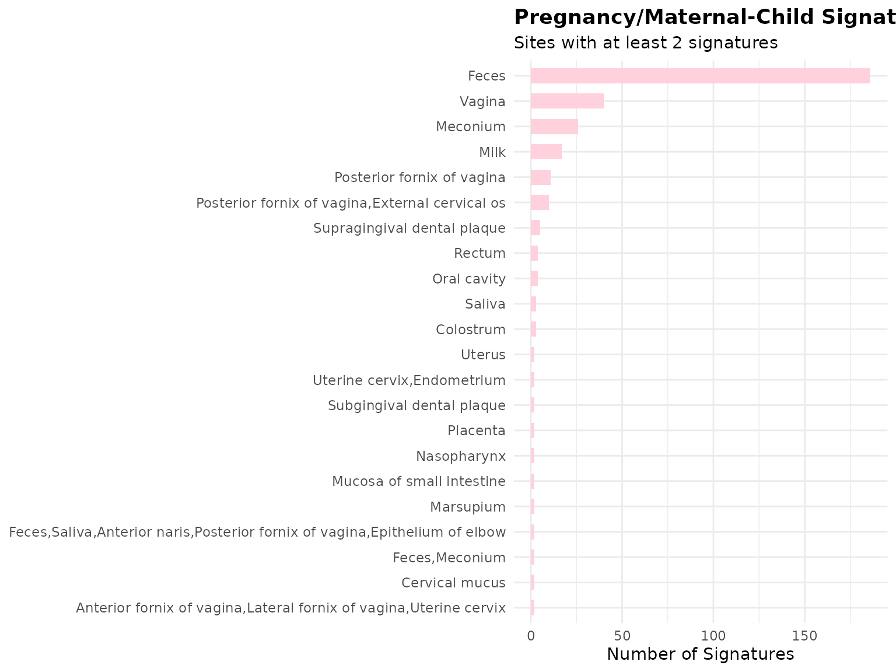
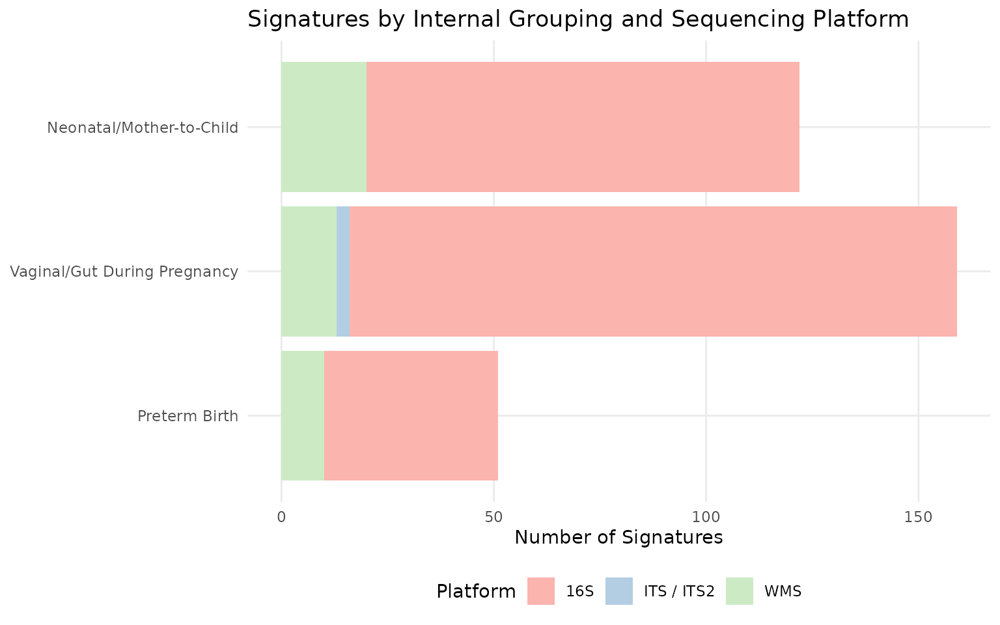
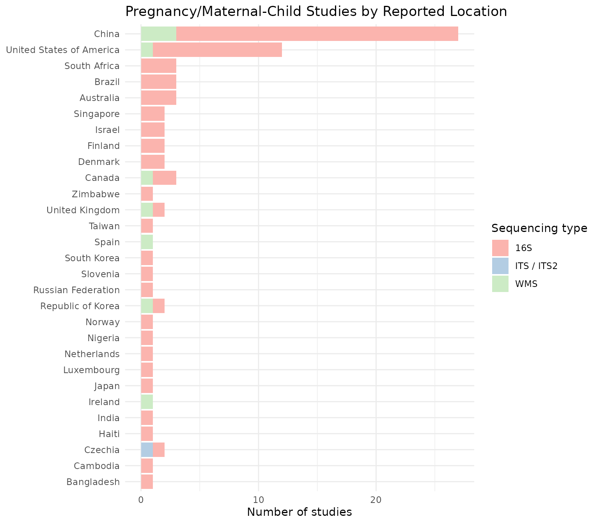
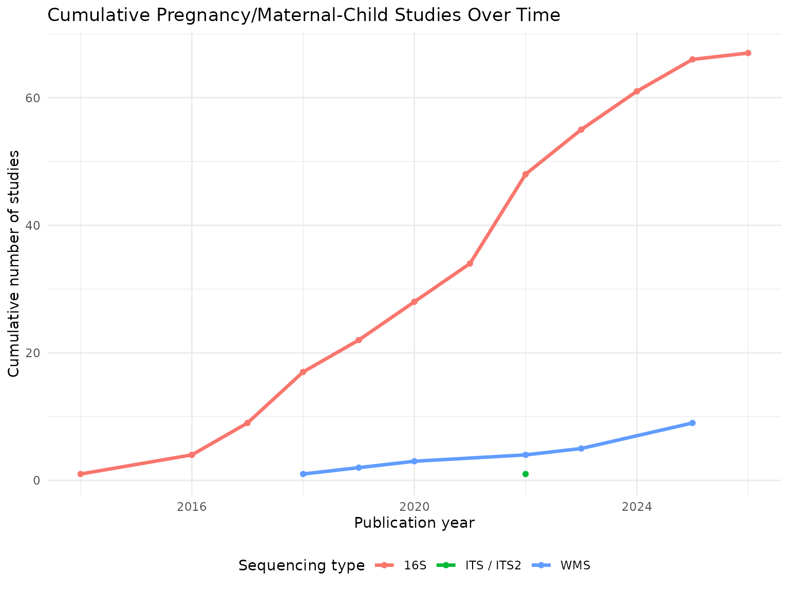
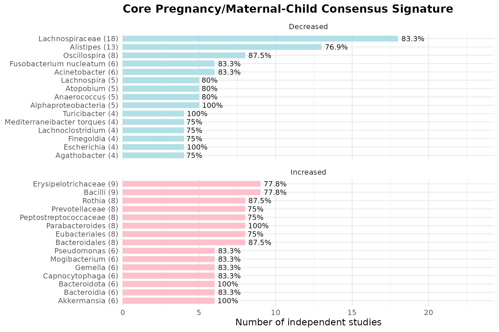
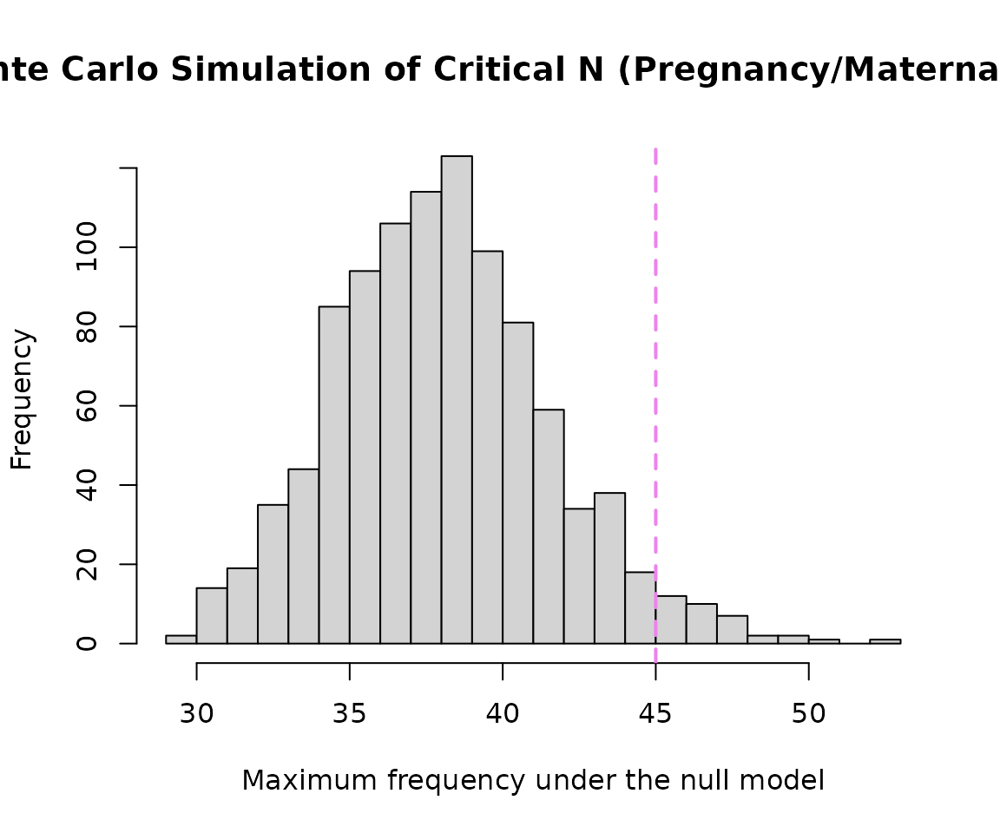
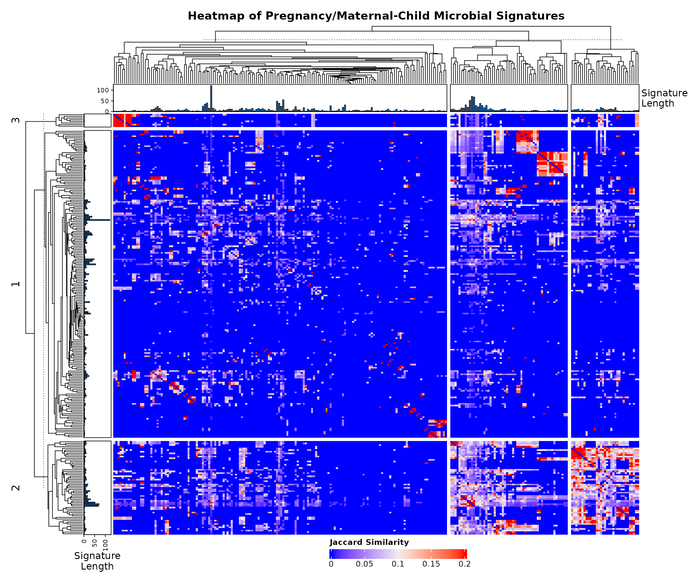

# Focused Sub-Analysis of Pregnancy & Maternal-Child Microbial Signatures

## Introduction

This vignette focuses on pregnancy and maternal-child microbiome
signatures curated in BugSigDB, spanning three internal groupings: (1)
vaginal/gut microbiome changes during pregnancy itself, (2) preterm
birth-associated signatures, and (3) neonatal/infant gut microbiome
signatures reflecting mother-to-child transmission. A fourth topic,
**postpartum** microbiome changes, is deliberately **not** included as a
formal sub-grouping here: BugSigDB currently has no dedicated postpartum
condition term, and a keyword search across study titles/keywords/group
names turned up only a single clean postpartum-specific comparison
(Study 617: maternal vs. infant samples at 6 weeks postpartum) - too
sparse for formal statistical treatment. It is mentioned only as a
single case-study example in the Discussion section below.

## Download and Prepare Data

``` r

full.dat <- bugsigdbr::importBugSigDB(cache = FALSE)
```

``` r

ind1 <- lengths(full.dat[["MetaPhlAn taxon names"]]) > 0
ind2 <- lengths(full.dat[["NCBI Taxonomy IDs"]]) > 0
dat <- full.dat[ind1 & ind2, ]
```

## Select Pregnancy/Maternal-Child Signatures

``` r

pregnancy_vaginal_gut_terms <- c(
  "Pregnancy", "Gestational age", "Gestational diabetes", "Vaginal microbiome measurement"
)

preterm_birth_terms <- c(
  "Premature birth", "Spontaneous preterm birth", "Preterm premature rupture of the membranes",
  "Birth weight", "Birth measurement"
)

neonatal_mother_child_terms <- c(
  "HIV mother to child transmission", "Neonatal death", "Neonatal jaundice",
  "Postnatal growth retardation", "Necrotizing enterocolitis", "Breastfeeding duration",
  "Breastfeeding duration,Transport", "Maternal milk", "Cesarean section", "Delivery method"
)

pregnancy_terms <- c(
  pregnancy_vaginal_gut_terms, preterm_birth_terms, neonatal_mother_child_terms
)

pregnancy_dat <- dat %>%
  filter(Condition %in% pregnancy_terms) %>%
  distinct()

nrow(pregnancy_dat)
```

    ## [1] 332

``` r

pregnancy_dat %>%
  count(Condition, sort = TRUE) %>%
  knitr::kable()
```

| Condition                                  |   n |
|:-------------------------------------------|----:|
| Gestational diabetes                       | 103 |
| Pregnancy                                  |  51 |
| Cesarean section                           |  33 |
| Breastfeeding duration                     |  32 |
| Maternal milk                              |  22 |
| Spontaneous preterm birth                  |  22 |
| HIV mother to child transmission           |  18 |
| Premature birth                            |  15 |
| Birth measurement                          |   9 |
| Gestational age                            |   5 |
| Postnatal growth retardation               |   5 |
| Necrotizing enterocolitis                  |   4 |
| Neonatal jaundice                          |   4 |
| Preterm premature rupture of the membranes |   4 |
| Breastfeeding duration,Transport           |   2 |
| Neonatal death                             |   2 |
| Birth weight                               |   1 |

### Breakdown by Internal Grouping

``` r

pregnancy_dat <- pregnancy_dat %>%
  mutate(
    subgroup = case_when(
      Condition %in% pregnancy_vaginal_gut_terms   ~ "Vaginal/Gut During Pregnancy",
      Condition %in% preterm_birth_terms           ~ "Preterm Birth",
      Condition %in% neonatal_mother_child_terms   ~ "Neonatal/Mother-to-Child",
      TRUE ~ "Other"
    )
  )

pregnancy_dat %>%
  count(subgroup, sort = TRUE) %>%
  knitr::kable(caption = "Signatures per Internal Grouping")
```

| subgroup                     |   n |
|:-----------------------------|----:|
| Vaginal/Gut During Pregnancy | 159 |
| Neonatal/Mother-to-Child     | 122 |
| Preterm Birth                |  51 |

Signatures per Internal Grouping {.table}

## Study Characteristics

``` r

study.summary <- pregnancy_dat %>%
  count(`Body site`, `Sequencing type`)

knitr::kable(study.summary)
```

| Body site | Sequencing type | n |
|:---|:---|---:|
| Anterior fornix of vagina,Lateral fornix of vagina,Uterine cervix | 16S | 2 |
| Cervical mucus | 16S | 2 |
| Colostrum | 16S | 3 |
| Feces | 16S | 167 |
| Feces | ITS / ITS2 | 3 |
| Feces | WMS | 16 |
| Feces,Meconium | 16S | 2 |
| Feces,Saliva,Anterior naris,Posterior fornix of vagina,Epithelium of elbow | 16S | 2 |
| Mammary gland | 16S | 1 |
| Marsupium | 16S | 2 |
| Meconium | 16S | 24 |
| Meconium | WMS | 2 |
| Milk | 16S | 15 |
| Milk | WMS | 2 |
| Mucosa of small intestine | 16S | 2 |
| Nasopharynx | WMS | 2 |
| Oral cavity | 16S | 4 |
| Placenta | 16S | 2 |
| Posterior fornix of vagina | 16S | 11 |
| Posterior fornix of vagina,External cervical os | WMS | 10 |
| Rectum | 16S | 4 |
| Saliva | 16S | 3 |
| Subgingival dental plaque | 16S | 2 |
| Supragingival dental plaque | 16S | 5 |
| Uterine cervix,Endometrium | 16S | 2 |
| Uterus | 16S | 2 |
| Vagina | 16S | 29 |
| Vagina | WMS | 11 |

``` r

pregnancy_dat %>%
  count(Year) %>%
  arrange(Year) %>%
  knitr::kable()
```

| Year |   n |
|-----:|----:|
| 2014 |   3 |
| 2016 |   8 |
| 2017 |  18 |
| 2018 |  56 |
| 2019 |  27 |
| 2020 |  45 |
| 2021 |  16 |
| 2022 |  63 |
| 2023 |  17 |
| 2024 |  30 |
| 2025 |  46 |
| 2026 |   3 |

``` r

pregnancy_dat %>%
  count(`Body site`, sort = TRUE) %>%
  filter(n >= 2) %>%
  ggplot(aes(x = reorder(`Body site`, n), y = n)) +
  geom_col(fill = "#FFD1DC", width = 0.6) +
  coord_flip() +
  labs(
    title = "Pregnancy/Maternal-Child Signatures by Body Site",
    subtitle = "Sites with at least 2 signatures",
    x = NULL, y = "Number of Signatures"
  ) +
  theme_minimal(base_size = 11) +
  theme(plot.title = element_text(face = "bold"))
```



``` r

pregnancy_dat %>%
  count(subgroup, `Sequencing type`) %>%
  ggplot(aes(x = reorder(subgroup, n), y = n, fill = `Sequencing type`)) +
  geom_col() +
  coord_flip() +
  # Palette sized to however many sequencing types are present
  scale_fill_brewer(palette = "Pastel1") +
  labs(
    title = "Signatures by Internal Grouping and Sequencing Platform",
    x = NULL, y = "Number of Signatures", fill = "Platform"
  ) +
  theme_minimal(base_size = 11) +
  theme(
    legend.position = "bottom",
    panel.grid.minor = element_blank()
  )
```



``` r

pregnancy_dat %>% 
  distinct(PMID, `Location of subjects`, `Sequencing type`) %>% 
  filter(!is.na(`Location of subjects`)) %>% 
  count(`Location of subjects`, `Sequencing type`) %>% 
  ggplot(aes(x = reorder(`Location of subjects`, n), y = n, fill = `Sequencing type`)) + 
  geom_col() + 
  coord_flip() + 
  # Palette sized to however many sequencing types are present
  scale_fill_brewer(palette = "Pastel1") +
  labs(
    title = "Pregnancy/Maternal-Child Studies by Reported Location", 
    x = NULL, 
    y = "Number of studies"
  ) + 
  theme_minimal(base_size = 11)
```



``` r

pregnancy_dat %>%
  distinct(PMID, Year, `Sequencing type`) %>%
  filter(!is.na(Year)) %>%
  count(Year, `Sequencing type`) %>%
  group_by(`Sequencing type`) %>%
  arrange(Year) %>%
  mutate(cumulative_n = cumsum(n)) %>%
  ungroup() %>%
  ggplot(aes(x = Year, y = cumulative_n, color = `Sequencing type`)) +
  geom_line(linewidth = 1.2) +
  geom_point() +
  labs(
    title = "Cumulative Pregnancy/Maternal-Child Studies Over Time",
    x = "Publication year", y = "Cumulative number of studies", color = "Sequencing type"
  ) +
  theme_minimal(base_size = 11) +
  theme(legend.position = "bottom")
```



## Taxonomic Summary

``` r

taxa.table <- createTaxonTable(pregnancy_dat)
knitr::kable(head(taxa.table, 20))
```

| Taxon Name | Taxonomic Level | total_signatures | increased_signatures | decreased_signatures | Binomial Test pval |
|:---|:---|---:|---:|---:|---:|
| Bacteroides | genus | 41 | 19 | 22 | 7.6e-01 |
| Streptococcus | genus | 37 | 19 | 18 | 1.0e+00 |
| Veillonella | genus | 37 | 13 | 24 | 9.9e-02 |
| Bifidobacterium | genus | 33 | 28 | 5 | 6.6e-05 |
| Lactobacillus | genus | 33 | 18 | 15 | 7.3e-01 |
| Faecalibacterium | genus | 31 | 17 | 14 | 7.2e-01 |
| Staphylococcus | genus | 28 | 15 | 13 | 8.5e-01 |
| Prevotella | genus | 28 | 11 | 17 | 3.4e-01 |
| Blautia | genus | 23 | 17 | 6 | 3.5e-02 |
| Bacillota | phylum | 21 | 14 | 7 | 1.9e-01 |

## Split by Sequencing Type

``` r

preg.wms <- pregnancy_dat %>% filter(`Sequencing type` == "WMS")
preg.16s <- pregnancy_dat %>% filter(`Sequencing type` == "16S")

cat("WMS  - signatures:", nrow(preg.wms), "| studies:", n_distinct(preg.wms$PMID), "\n")
```

    ## WMS  - signatures: 43 | studies: 9

``` r

cat("16S  - signatures:", nrow(preg.16s), "| studies:", n_distinct(preg.16s$PMID), "\n")
```

    ## 16S  - signatures: 286 | studies: 67

## Long-Format Taxon Table

``` r

sigs.pregnancy <- bugsigdbr::getSignatures(pregnancy_dat, tax.id.type = "taxname")
sigs.all <- bugsigdbr::getSignatures(dat, tax.id.type = "taxname")

taxon.long <- purrr::map_dfr(seq_along(sigs.all), function(i) {
  taxa <- sigs.all[[i]]
  if (length(taxa) == 0) return(NULL)
  tibble::tibble(sig_id = i, taxon = taxa)
}) %>%
  left_join(
    dat %>%
      mutate(sig_id = row_number()) %>%
      select(sig_id, PMID, Condition, `Sequencing type`, `Abundance in Group 1`),
    by = "sig_id"
  ) %>%
  rename(direction = `Abundance in Group 1`)

nrow(taxon.long)
```

    ## [1] 96257

## Taxon Frequency Across Studies

``` r

taxon.freq <- taxon.long %>%
  filter(Condition %in% pregnancy_terms) %>%
  distinct(PMID, taxon, direction) %>%
  count(taxon, direction, name = "n_studies") %>%
  group_by(taxon) %>%
  mutate(total_studies = sum(n_studies)) %>%
  ungroup() %>%
  arrange(desc(total_studies))

n_distinct(taxon.freq$taxon)
```

    ## [1] 1005

``` r

taxon.freq %>%
  distinct(taxon, total_studies) %>%
  slice_max(total_studies, n = 15) %>%
  knitr::kable()
```

| taxon            | total_studies |
|:-----------------|--------------:|
| Streptococcus    |            30 |
| Bacteroides      |            26 |
| Prevotella       |            25 |
| Lachnospiraceae  |            23 |
| Blautia          |            19 |
| Clostridium      |            19 |
| Lactobacillus    |            19 |
| Bifidobacterium  |            18 |
| Faecalibacterium |            18 |
| Roseburia        |            16 |
| Staphylococcus   |            16 |
| Actinomycetota   |            15 |
| Bacillota        |            15 |
| Haemophilus      |            15 |
| Ruminococcus     |            15 |

## Core Consensus Signature

``` r

concordance <- taxon.long %>%
  filter(Condition %in% pregnancy_terms) %>%
  distinct(PMID, taxon, direction) %>%
  group_by(taxon) %>%
  summarise(
    n_studies       = n_distinct(PMID),
    n_increased     = sum(direction == "increased"),
    n_decreased     = sum(direction == "decreased"),
    concordance_pct = round(max(n_increased, n_decreased) / n_studies * 100, 1),
    majority_dir    = if_else(n_increased >= n_decreased, "increased", "decreased"),
    .groups = "drop"
  ) %>%
  arrange(desc(n_studies), desc(concordance_pct))

# Standard threshold; loosen to >=2/>=70% (as done for Cervical Cancer) if this
# returns very few/zero rows, and note that deviation in the Discussion section.
core.sig <- concordance %>%
  filter(n_studies >= 3, concordance_pct >= 75) %>%
  arrange(majority_dir, desc(n_studies))

nrow(core.sig)
```

    ## [1] 93

``` r

knitr::kable(core.sig)
```

| taxon | n_studies | n_increased | n_decreased | concordance_pct | majority_dir |
|:---|---:|---:|---:|---:|:---|
| Lachnospiraceae | 18 | 8 | 15 | 83.3 | decreased |
| Alistipes | 13 | 4 | 10 | 76.9 | decreased |
| Oscillospira | 8 | 2 | 7 | 87.5 | decreased |
| Acinetobacter | 6 | 3 | 5 | 83.3 | decreased |
| Fusobacterium nucleatum | 6 | 2 | 5 | 83.3 | decreased |
| Alphaproteobacteria | 5 | 2 | 5 | 100.0 | decreased |
| Anaerococcus | 5 | 1 | 4 | 80.0 | decreased |
| Atopobium | 5 | 2 | 4 | 80.0 | decreased |
| Lachnospira | 5 | 2 | 4 | 80.0 | decreased |
| Escherichia | 4 | 1 | 4 | 100.0 | decreased |
| Turicibacter | 4 | 0 | 4 | 100.0 | decreased |
| Agathobacter | 4 | 2 | 3 | 75.0 | decreased |
| Finegoldia | 4 | 1 | 3 | 75.0 | decreased |
| Lachnoclostridium | 4 | 1 | 3 | 75.0 | decreased |
| Mediterraneibacter torques | 4 | 1 | 3 | 75.0 | decreased |
| Romboutsia | 4 | 2 | 3 | 75.0 | decreased |
| Shigella | 4 | 2 | 3 | 75.0 | decreased |
| Sphingomonadales | 4 | 2 | 3 | 75.0 | decreased |
| Bifidobacteriales | 3 | 0 | 3 | 100.0 | decreased |
| Bradyrhizobium | 3 | 2 | 3 | 100.0 | decreased |
| Methanobacteriaceae | 3 | 0 | 3 | 100.0 | decreased |
| Methanobacteriales | 3 | 0 | 3 | 100.0 | decreased |
| Methanobrevibacter | 3 | 0 | 3 | 100.0 | decreased |
| Rhodococcus | 3 | 1 | 3 | 100.0 | decreased |
| Schaalia odontolytica | 3 | 1 | 3 | 100.0 | decreased |
| Sutterella wadsworthensis | 3 | 1 | 3 | 100.0 | decreased |
| Bacilli | 9 | 7 | 2 | 77.8 | increased |
| Erysipelotrichaceae | 9 | 7 | 3 | 77.8 | increased |
| Parabacteroides | 8 | 8 | 1 | 100.0 | increased |
| Bacteroidales | 8 | 7 | 2 | 87.5 | increased |
| Rothia | 8 | 7 | 3 | 87.5 | increased |
| Eubacteriales | 8 | 6 | 5 | 75.0 | increased |
| Peptostreptococcaceae | 8 | 6 | 3 | 75.0 | increased |
| Prevotellaceae | 8 | 6 | 4 | 75.0 | increased |
| Akkermansia | 6 | 6 | 2 | 100.0 | increased |
| Bacteroidota | 6 | 6 | 3 | 100.0 | increased |
| Bacteroidia | 6 | 5 | 2 | 83.3 | increased |
| Capnocytophaga | 6 | 5 | 5 | 83.3 | increased |
| Gemella | 6 | 5 | 2 | 83.3 | increased |
| Mogibacterium | 6 | 5 | 3 | 83.3 | increased |
| Pseudomonas | 6 | 5 | 2 | 83.3 | increased |
| Actinomycetaceae | 5 | 5 | 1 | 100.0 | increased |
| Eggerthella | 5 | 4 | 1 | 80.0 | increased |
| Fusobacteriales | 5 | 4 | 1 | 80.0 | increased |
| Granulicatella adiacens | 5 | 4 | 3 | 80.0 | increased |
| Leptotrichia | 5 | 4 | 2 | 80.0 | increased |
| Leptotrichiaceae | 5 | 4 | 1 | 80.0 | increased |
| Parasutterella | 5 | 4 | 1 | 80.0 | increased |
| Selenomonadales | 5 | 4 | 1 | 80.0 | increased |
| Aggregatibacter segnis | 4 | 4 | 1 | 100.0 | increased |
| Burkholderiaceae | 4 | 4 | 3 | 100.0 | increased |
| Erysipelotrichales | 4 | 4 | 0 | 100.0 | increased |
| Mycoplasmatota | 4 | 4 | 1 | 100.0 | increased |
| Negativicutes | 4 | 4 | 0 | 100.0 | increased |
| Parahaemophilus parainfluenzae | 4 | 4 | 0 | 100.0 | increased |
| Aggregatibacter | 4 | 3 | 1 | 75.0 | increased |
| Bacteroides caccae | 4 | 3 | 1 | 75.0 | increased |
| Bacteroides thetaiotaomicron | 4 | 3 | 1 | 75.0 | increased |
| Bacteroides uniformis | 4 | 3 | 1 | 75.0 | increased |
| Bulleidia | 4 | 3 | 1 | 75.0 | increased |
| Campylobacter | 4 | 3 | 2 | 75.0 | increased |
| Cardiobacterium | 4 | 3 | 2 | 75.0 | increased |
| Citrobacter | 4 | 3 | 2 | 75.0 | increased |
| Collinsella aerofaciens | 4 | 3 | 1 | 75.0 | increased |
| Enterobacterales | 4 | 3 | 1 | 75.0 | increased |
| Gardnerella | 4 | 3 | 2 | 75.0 | increased |
| Holdemania | 4 | 3 | 1 | 75.0 | increased |
| Odoribacter | 4 | 3 | 1 | 75.0 | increased |
| Olsenella | 4 | 3 | 1 | 75.0 | increased |
| Pasteurellales | 4 | 3 | 1 | 75.0 | increased |
| Peptostreptococcus | 4 | 3 | 1 | 75.0 | increased |
| Phocaeicola vulgatus | 4 | 3 | 1 | 75.0 | increased |
| Selenomonas | 4 | 3 | 2 | 75.0 | increased |
| Sneathia | 4 | 3 | 1 | 75.0 | increased |
| Stenotrophomonas | 4 | 3 | 3 | 75.0 | increased |
| Veillonella dispar | 4 | 3 | 3 | 75.0 | increased |
| Veillonella parvula | 4 | 3 | 2 | 75.0 | increased |
| Verrucomicrobiota | 4 | 3 | 2 | 75.0 | increased |
| Acidaminococcaceae | 3 | 3 | 0 | 100.0 | increased |
| Actinobacillus | 3 | 3 | 0 | 100.0 | increased |
| Actinomycetales | 3 | 3 | 0 | 100.0 | increased |
| Betaproteobacteria | 3 | 3 | 0 | 100.0 | increased |
| Burkholderiales | 3 | 3 | 1 | 100.0 | increased |
| Campylobacter showae | 3 | 3 | 0 | 100.0 | increased |
| Eikenella corrodens | 3 | 3 | 1 | 100.0 | increased |
| Erysipelotrichia | 3 | 3 | 0 | 100.0 | increased |
| Flavobacteriaceae | 3 | 3 | 1 | 100.0 | increased |
| Fusobacteriia | 3 | 3 | 0 | 100.0 | increased |
| Gemella morbillorum | 3 | 3 | 1 | 100.0 | increased |
| Halomonas | 3 | 3 | 2 | 100.0 | increased |
| Rothia mucilaginosa | 3 | 3 | 0 | 100.0 | increased |
| Solobacterium | 3 | 3 | 0 | 100.0 | increased |
| Streptococcus cristatus | 3 | 3 | 2 | 100.0 | increased |

## Core Signature Visualisation

``` r

if (nrow(core.sig) > 0) {
  core.sig %>%
    group_by(majority_dir) %>%
    slice_max(n_studies, n = 15, with_ties = FALSE) %>%
    ungroup() %>%
    mutate(
      direction_label = if_else(majority_dir == "increased", "Increased", "Decreased"),
      taxon_label = paste0(str_wrap(taxon, width = 28), " (", n_studies, ")")
    ) %>%
    ggplot(aes(x = reorder(taxon_label, n_studies), y = n_studies, fill = direction_label)) +
    geom_col(width = 0.7) +
    geom_text(aes(label = paste0(concordance_pct, "%")), hjust = -0.15, size = 3.3) +
    coord_flip(clip = "off") +
    facet_wrap(~direction_label, scales = "free_y", ncol = 1) +
    scale_fill_manual(values = c("Increased" = "#FFC0CB", "Decreased" = "#B0E0E6")) +
    scale_y_continuous(expand = expansion(mult = c(0, 0.35))) +
    labs(
      title = "Core Pregnancy/Maternal-Child Consensus Signature",
      x = NULL, y = "Number of independent studies", fill = NULL
    ) +
    theme_minimal(base_size = 12) +
    theme(legend.position = "none", plot.title = element_text(face = "bold"))
} else {
  cat("No taxa met the core-signature threshold at this sample size.")
}
```



## WMS vs 16S Concordance

``` r

dir.by.platform <- taxon.long %>%
  filter(Condition %in% pregnancy_terms) %>%
  filter(`Sequencing type` %in% c("WMS", "16S")) %>%
  distinct(PMID, taxon, direction, `Sequencing type`) %>%
  count(taxon, `Sequencing type`, direction, name = "n_studies") %>%
  group_by(taxon, `Sequencing type`) %>%
  slice_max(n_studies, n = 1, with_ties = FALSE) %>%
  ungroup() %>%
  select(taxon, `Sequencing type`, majority_dir = direction)

platform.compare <- dir.by.platform %>%
  pivot_wider(names_from = `Sequencing type`, values_from = majority_dir) %>%
  filter(!is.na(WMS), !is.na(`16S`)) %>%
  rename(dir_WMS = WMS, dir_16S = `16S`) %>%
  mutate(agree = dir_WMS == dir_16S)

nrow(platform.compare)
```

    ## [1] 169

``` r

if (nrow(platform.compare) > 0) {
  sum(platform.compare$agree)
  round(100 * mean(platform.compare$agree), 1)
  knitr::kable(platform.compare)
} else {
  cat("No taxa reported by both WMS and 16S in this pregnancy dataset.")
}
```

| taxon                         | dir_16S   | dir_WMS   | agree |
|:------------------------------|:----------|:----------|:------|
| Acidaminococcaceae            | increased | increased | TRUE  |
| Acidaminococcales             | increased | increased | TRUE  |
| Acidimicrobiia                | increased | decreased | FALSE |
| Actinomyces                   | increased | decreased | FALSE |
| Actinomyces graevenitzii      | decreased | decreased | TRUE  |
| Actinomycetaceae              | increased | increased | TRUE  |
| Actinomycetota                | increased | decreased | FALSE |
| Aeromonadales                 | increased | decreased | FALSE |
| Aggregatibacter               | increased | decreased | FALSE |
| Akkermansia                   | increased | increased | TRUE  |
| Akkermansia muciniphila       | decreased | increased | FALSE |
| Akkermansiaceae               | decreased | increased | FALSE |
| Alistipes                     | decreased | increased | FALSE |
| Allobaculum                   | decreased | increased | FALSE |
| Alphaproteobacteria           | decreased | decreased | TRUE  |
| Anaerococcus murdochii        | decreased | decreased | TRUE  |
| Anaerostipes                  | decreased | increased | FALSE |
| Atopobium                     | decreased | decreased | TRUE  |
| Azotobacter group             | increased | decreased | FALSE |
| Bacillus                      | decreased | increased | FALSE |
| Bacteroides                   | decreased | increased | FALSE |
| Bacteroides caccae            | increased | increased | TRUE  |
| Bacteroides intestinalis      | decreased | decreased | TRUE  |
| Bacteroides thetaiotaomicron  | increased | increased | TRUE  |
| Bacteroides uniformis         | increased | increased | TRUE  |
| Bacteroidota                  | increased | increased | TRUE  |
| Barnesiella                   | decreased | increased | FALSE |
| Betaproteobacteria            | increased | increased | TRUE  |
| Bifidobacteriaceae            | decreased | increased | FALSE |
| Bifidobacterium               | decreased | decreased | TRUE  |
| Bifidobacterium adolescentis  | increased | increased | TRUE  |
| Bifidobacterium bifidum       | decreased | increased | FALSE |
| Bifidobacterium dentium       | decreased | decreased | TRUE  |
| Bifidobacterium longum        | decreased | increased | FALSE |
| Bilophila                     | decreased | increased | FALSE |
| Blautia                       | increased | decreased | FALSE |
| Blautia faecis                | decreased | decreased | TRUE  |
| Burkholderiaceae              | increased | decreased | FALSE |
| Burkholderiales               | increased | increased | TRUE  |
| Butyricicoccus                | decreased | increased | FALSE |
| Butyricimonas                 | decreased | increased | FALSE |
| Campylobacterales             | decreased | increased | FALSE |
| Capnocytophaga                | decreased | decreased | TRUE  |
| Capnocytophaga gingivalis     | decreased | decreased | TRUE  |
| Capnocytophaga sputigena      | increased | decreased | FALSE |
| Cardiobacterium               | increased | decreased | FALSE |
| Carnobacteriaceae             | decreased | decreased | TRUE  |
| Caryophanaceae                | increased | decreased | FALSE |
| Cloacibacterium               | increased | decreased | FALSE |
| Clostridia                    | decreased | increased | FALSE |
| Clostridium                   | increased | increased | TRUE  |
| Collinsella                   | decreased | decreased | TRUE  |
| Collinsella aerofaciens       | increased | increased | TRUE  |
| Comamonadaceae                | increased | increased | TRUE  |
| Coprococcus                   | increased | increased | TRUE  |
| Coriobacteriaceae             | increased | decreased | FALSE |
| Corynebacterium               | decreased | decreased | TRUE  |
| Dialister                     | decreased | increased | FALSE |
| Dialister invisus             | decreased | increased | FALSE |
| Enterococcus                  | decreased | decreased | TRUE  |
| Enterococcus faecalis         | decreased | decreased | TRUE  |
| Enterococcus faecium          | decreased | decreased | TRUE  |
| Epsilonproteobacteria         | increased | increased | TRUE  |
| Erysipelotrichaceae           | increased | increased | TRUE  |
| Erysipelotrichales            | increased | increased | TRUE  |
| Erysipelotrichia              | increased | increased | TRUE  |
| Escherichia/Shigella sp.      | increased | decreased | FALSE |
| Ethanoligenens                | decreased | increased | FALSE |
| Eubacteriales                 | decreased | increased | FALSE |
| Faecalibacterium              | decreased | increased | FALSE |
| Faecalibacterium prausnitzii  | decreased | decreased | TRUE  |
| Flavobacteriaceae             | increased | decreased | FALSE |
| Fusicatenibacter              | decreased | increased | FALSE |
| Fusobacteriales               | increased | increased | TRUE  |
| Fusobacteriia                 | increased | increased | TRUE  |
| Fusobacteriota                | decreased | increased | FALSE |
| Fusobacterium                 | increased | decreased | FALSE |
| Gammaproteobacteria           | increased | decreased | FALSE |
| Gemella                       | increased | decreased | FALSE |
| Granulicatella                | increased | decreased | FALSE |
| Granulicatella adiacens       | increased | decreased | FALSE |
| Granulicatella elegans        | decreased | decreased | TRUE  |
| Haemophilus                   | increased | decreased | FALSE |
| Helicobacter                  | decreased | decreased | TRUE  |
| Helicobacteraceae             | decreased | decreased | TRUE  |
| Kingella                      | decreased | decreased | TRUE  |
| Kingella denitrificans        | increased | decreased | FALSE |
| Klebsiella                    | decreased | decreased | TRUE  |
| Lachnospiraceae               | decreased | decreased | TRUE  |
| Lactobacillaceae              | increased | decreased | FALSE |
| Lactobacillales               | decreased | increased | FALSE |
| Lactobacillus                 | increased | decreased | FALSE |
| Lactobacillus crispatus       | decreased | increased | FALSE |
| Lactobacillus gasseri         | decreased | increased | FALSE |
| Lancefieldella parvula        | decreased | decreased | TRUE  |
| Lautropia                     | increased | decreased | FALSE |
| Leptotrichiaceae              | increased | increased | TRUE  |
| Limosilactobacillus fermentum | decreased | increased | FALSE |
| Limosilactobacillus reuteri   | increased | increased | TRUE  |
| Megasphaera                   | increased | decreased | FALSE |
| Metamycoplasma salivarium     | decreased | decreased | TRUE  |
| Methanobacteriota             | decreased | increased | FALSE |
| Morganella morganii           | decreased | decreased | TRUE  |
| Mucispirillum                 | increased | increased | TRUE  |
| Mycoplasma                    | increased | increased | TRUE  |
| Mycoplasmataceae              | increased | increased | TRUE  |
| Mycoplasmatota                | increased | increased | TRUE  |
| Neisseria                     | increased | decreased | FALSE |
| Neisseria subflava            | decreased | decreased | TRUE  |
| Neisseriaceae                 | decreased | decreased | TRUE  |
| Oscillibacter                 | decreased | increased | FALSE |
| Oscillospiraceae              | decreased | increased | FALSE |
| Oxalobacter formigenes        | increased | decreased | FALSE |
| Parabacteroides               | increased | increased | TRUE  |
| Parabacteroides distasonis    | decreased | increased | FALSE |
| Paraprevotella                | decreased | decreased | TRUE  |
| Parasutterella                | increased | increased | TRUE  |
| Pasteurellaceae               | increased | decreased | FALSE |
| Pasteurellales                | increased | increased | TRUE  |
| Peptoniphilus                 | decreased | decreased | TRUE  |
| Peptostreptococcaceae         | increased | increased | TRUE  |
| Peptostreptococcus            | increased | increased | TRUE  |
| Phascolarctobacterium         | decreased | increased | FALSE |
| Phocaeicola dorei             | increased | increased | TRUE  |
| Phocaeicola vulgatus          | decreased | increased | FALSE |
| Porphyromonadaceae            | increased | decreased | FALSE |
| Porphyromonas endodontalis    | decreased | decreased | TRUE  |
| Prevotella                    | increased | decreased | FALSE |
| Prevotella corporis           | decreased | decreased | TRUE  |
| Prevotellaceae                | increased | decreased | FALSE |
| Pseudomonadales               | increased | decreased | FALSE |
| Pseudomonadota                | increased | decreased | FALSE |
| Rikenella                     | increased | increased | TRUE  |
| Rikenellaceae                 | decreased | increased | FALSE |
| Roseburia                     | decreased | increased | FALSE |
| Roseburia faecis              | increased | increased | TRUE  |
| Roseburia intestinalis        | decreased | decreased | TRUE  |
| Roseburia inulinivorans       | decreased | increased | FALSE |
| Rothia                        | increased | increased | TRUE  |
| Rothia mucilaginosa           | increased | increased | TRUE  |
| Ruminococcus                  | decreased | increased | FALSE |
| Saccharofermentans            | increased | increased | TRUE  |
| Schaalia odontolytica         | decreased | decreased | TRUE  |
| Sneathia                      | increased | increased | TRUE  |
| Sphingomonadaceae             | decreased | decreased | TRUE  |
| Sphingomonadales              | decreased | decreased | TRUE  |
| Sphingomonas                  | increased | decreased | FALSE |
| Staphylococcus                | increased | increased | TRUE  |
| Streptococcus                 | decreased | decreased | TRUE  |
| Streptococcus cristatus       | increased | decreased | FALSE |
| Streptococcus gwangjuensis    | increased | decreased | FALSE |
| Streptococcus intermedius     | decreased | decreased | TRUE  |
| Streptococcus parasanguinis   | decreased | decreased | TRUE  |
| Streptococcus pyogenes        | increased | decreased | FALSE |
| Streptococcus salivarius      | increased | decreased | FALSE |
| Streptococcus sanguinis       | increased | decreased | FALSE |
| Streptococcus thermophilus    | increased | decreased | FALSE |
| Succinivibrio                 | increased | decreased | FALSE |
| Succinivibrionaceae           | increased | decreased | FALSE |
| Sutterella                    | decreased | increased | FALSE |
| Thomasclavelia cocleata       | decreased | increased | FALSE |
| Treponema denticola           | decreased | decreased | TRUE  |
| Veillonella                   | decreased | decreased | TRUE  |
| Veillonella parvula           | increased | decreased | FALSE |
| Verrucomicrobiales            | decreased | increased | FALSE |
| Verrucomicrobiia              | decreased | increased | FALSE |
| Verrucomicrobiota             | decreased | increased | FALSE |
| \[Clostridium\] viride        | increased | decreased | FALSE |
| \[Eubacterium\] infirmum      | increased | decreased | FALSE |

## Taxon Enrichment Analysis

``` r

n.universe <- n_distinct(taxon.long %>% filter(Condition %in% pregnancy_terms) %>% pull(taxon))
n.sigs     <- length(sigs.pregnancy)

enrichment.df <- taxon.freq %>%
  distinct(taxon, total_studies) %>%
  mutate(
    observed         = total_studies,
    expected         = n.sigs / n.universe,
    enrichment_ratio = observed / expected,
    log2_enrichment  = log2(enrichment_ratio),
    p_value = purrr::map_dbl(observed, ~ binom.test(
      x = .x, n = n.sigs, p = 1 / n.universe, alternative = "greater"
    )$p.value),
    p_adj = p.adjust(p_value, method = "BH")
  ) %>%
  arrange(p_adj, desc(log2_enrichment))

sum(enrichment.df$p_adj < 0.05)
```

    ## [1] 270

``` r

knitr::kable(head(enrichment.df, 15))
```

| taxon | total_studies | observed | expected | enrichment_ratio | log2_enrichment | p_value | p_adj |
|:---|---:|---:|---:|---:|---:|---:|---:|
| Streptococcus | 30 | 30 | 0.3293532 | 91.08761 | 6.509183 | 0 | 0 |
| Bacteroides | 26 | 26 | 0.3293532 | 78.94260 | 6.302732 | 0 | 0 |
| Prevotella | 25 | 25 | 0.3293532 | 75.90634 | 6.246149 | 0 | 0 |
| Lachnospiraceae | 23 | 23 | 0.3293532 | 69.83384 | 6.125854 | 0 | 0 |
| Blautia | 19 | 19 | 0.3293532 | 57.68882 | 5.850220 | 0 | 0 |
| Clostridium | 19 | 19 | 0.3293532 | 57.68882 | 5.850220 | 0 | 0 |
| Lactobacillus | 19 | 19 | 0.3293532 | 57.68882 | 5.850220 | 0 | 0 |
| Bifidobacterium | 18 | 18 | 0.3293532 | 54.65257 | 5.772217 | 0 | 0 |
| Faecalibacterium | 18 | 18 | 0.3293532 | 54.65257 | 5.772217 | 0 | 0 |
| Roseburia | 16 | 16 | 0.3293532 | 48.58006 | 5.602292 | 0 | 0 |
| Staphylococcus | 16 | 16 | 0.3293532 | 48.58006 | 5.602292 | 0 | 0 |
| Actinomycetota | 15 | 15 | 0.3293532 | 45.54381 | 5.509183 | 0 | 0 |
| Bacillota | 15 | 15 | 0.3293532 | 45.54381 | 5.509183 | 0 | 0 |
| Haemophilus | 15 | 15 | 0.3293532 | 45.54381 | 5.509183 | 0 | 0 |
| Ruminococcus | 15 | 15 | 0.3293532 | 45.54381 | 5.509183 | 0 | 0 |

## Monte Carlo Critical N

``` r

siglengths <- lengths(pregnancy_dat$`MetaPhlAn taxon names`)

criticalN <- getCriticalN(
  relevant.sigs = pregnancy_dat$`MetaPhlAn taxon names`,
  siglengths = siglengths
)

criticalN
```

    ## $critical_n
    ## 95% 
    ##  45 
    ## 
    ## $ci_lower
    ## 2.5% 
    ##   44 
    ## 
    ## $ci_upper
    ## 97.5% 
    ##    45 
    ## 
    ## $simulated_values
    ##    [1] 38 35 36 35 37 33 40 37 37 35 39 39 44 33 39 35 34 42 30 37 41 39 33 37
    ##   [25] 42 42 34 37 43 39 39 42 36 40 42 45 35 35 34 35 36 41 49 37 35 38 47 34
    ##   [49] 31 41 38 37 40 40 39 40 46 33 38 36 41 50 37 39 40 41 42 38 36 38 35 41
    ##   [73] 44 46 39 38 43 41 39 41 39 39 37 45 38 37 44 37 33 33 41 38 39 42 40 35
    ##   [97] 39 45 39 43 44 39 46 41 38 48 33 35 37 42 40 39 32 42 39 35 37 37 43 40
    ##  [121] 40 37 43 40 38 43 39 47 43 39 41 44 42 36 39 42 39 35 35 41 38 34 34 35
    ##  [145] 33 34 39 40 40 41 37 42 38 36 43 37 39 41 37 39 42 42 36 36 34 35 40 40
    ##  [169] 41 46 41 44 37 37 35 35 41 35 32 38 34 39 37 40 32 40 36 44 39 43 39 43
    ##  [193] 41 34 43 37 35 36 42 37 38 38 40 41 32 37 47 40 40 40 37 38 38 48 38 44
    ##  [217] 44 36 35 32 37 37 37 36 39 36 42 33 39 38 33 36 35 38 42 38 39 34 39 35
    ##  [241] 46 38 35 34 41 39 38 38 38 33 29 41 33 32 41 41 42 41 40 40 39 42 45 35
    ##  [265] 41 34 36 45 48 37 35 40 31 41 38 41 41 34 38 38 38 38 44 42 42 38 45 35
    ##  [289] 45 41 36 46 37 32 37 35 35 36 40 38 37 43 42 40 40 38 47 40 38 39 35 34
    ##  [313] 38 31 39 35 45 34 40 40 35 38 37 35 41 34 38 41 41 33 43 45 38 38 42 35
    ##  [337] 40 44 32 39 37 45 34 35 41 41 38 36 39 36 38 35 46 37 40 40 33 42 43 35
    ##  [361] 44 36 39 37 39 44 38 38 33 39 34 44 36 41 38 36 40 41 32 42 37 39 34 44
    ##  [385] 39 41 40 34 38 37 45 42 41 39 39 40 39 37 36 36 38 36 36 42 36 41 39 39
    ##  [409] 40 36 40 36 39 37 37 40 42 37 41 34 35 35 40 40 35 36 36 35 39 31 36 41
    ##  [433] 34 36 38 34 38 38 38 37 36 44 40 53 40 33 39 40 37 36 41 34 38 39 37 39
    ##  [457] 35 39 40 38 36 37 38 38 37 39 35 34 43 33 41 36 43 40 40 38 42 40 39 40
    ##  [481] 41 40 40 35 40 41 33 44 39 36 39 32 39 44 41 35 31 32 44 37 38 37 39 44
    ##  [505] 39 39 39 40 36 40 36 38 40 39 45 38 40 39 34 38 41 47 35 31 41 44 41 38
    ##  [529] 35 37 40 40 35 45 39 36 43 38 37 41 38 38 40 35 43 37 35 35 36 35 40 39
    ##  [553] 35 34 40 36 38 41 32 43 34 48 41 39 40 38 40 41 36 40 46 36 36 38 36 44
    ##  [577] 35 36 38 32 37 38 40 37 35 34 38 41 40 41 39 44 36 38 42 39 38 37 36 37
    ##  [601] 42 41 33 45 37 39 44 36 41 36 44 37 43 40 42 32 39 37 37 39 33 34 37 33
    ##  [625] 36 37 39 38 37 36 40 35 41 36 48 38 42 44 39 44 38 37 39 36 41 31 38 40
    ##  [649] 36 38 39 46 39 39 37 40 41 35 37 40 42 42 39 39 40 39 35 41 43 47 37 38
    ##  [673] 38 40 35 42 33 36 39 37 44 38 37 40 33 41 34 37 40 38 35 42 31 35 34 39
    ##  [697] 38 34 33 34 37 34 39 39 46 36 42 42 37 32 36 39 35 36 40 44 38 37 38 31
    ##  [721] 33 33 51 33 39 40 39 35 41 38 37 34 40 36 43 44 38 35 45 41 36 35 37 43
    ##  [745] 46 49 36 46 44 40 47 36 36 39 43 50 35 38 39 42 33 38 35 42 42 42 42 36
    ##  [769] 45 38 39 41 36 35 38 36 37 38 37 39 37 36 36 34 32 40 42 41 42 39 36 33
    ##  [793] 44 42 38 39 37 39 41 40 40 36 41 43 33 40 41 36 38 34 32 42 35 38 39 39
    ##  [817] 39 40 41 35 41 37 35 43 38 42 35 37 38 37 37 44 36 43 34 36 37 41 44 35
    ##  [841] 36 39 36 37 40 33 40 42 40 40 35 36 36 43 38 37 38 37 37 36 37 37 44 37
    ##  [865] 39 41 36 39 41 34 43 39 37 42 43 38 40 35 39 39 40 36 37 42 36 42 35 43
    ##  [889] 37 40 35 39 31 39 32 35 41 43 39 37 39 37 41 41 37 35 40 31 44 38 36 33
    ##  [913] 36 35 37 39 35 45 40 41 39 42 40 36 41 39 36 36 35 37 35 41 45 32 40 37
    ##  [937] 42 39 40 33 40 43 38 33 38 31 38 31 38 31 47 36 38 34 41 39 39 48 44 39
    ##  [961] 38 48 34 39 37 39 36 38 42 42 38 39 35 40 35 38 44 47 38 37 37 47 38 36
    ##  [985] 38 34 39 37 42 36 39 40 43 39 38 42 37 33 39 38
    ## 
    ## $alpha
    ## [1] 0.05
    ## 
    ## $quantile_label
    ## [1] "95th percentile"

``` r

hist(
  criticalN$simulated_values,
  breaks = 30,
  main = "Monte Carlo Simulation of Critical N (Pregnancy/Maternal-Child)",
  xlab = "Maximum frequency under the null model"
)

abline(v = criticalN$critical_n, col = "violet", lwd = 2, lty = 2)
```



## Cross-Condition Taxa Overlap Analysis

``` r

pregnancy_taxa <- taxon.long %>%
  filter(Condition %in% pregnancy_terms) %>%
  distinct(taxon) %>%
  pull(taxon)

shared_taxa_counts <- taxon.long %>%
  filter(taxon %in% pregnancy_taxa) %>%
  group_by(taxon) %>%
  summarise(
    total_womens_health_studies = n_distinct(PMID),
    distinct_conditions_linked = n_distinct(Condition),
    top_other_conditions = paste(
      head(setdiff(unique(Condition), pregnancy_terms), 3),
      collapse = ", "
    ),
    .groups = "drop"
  ) %>%
  arrange(desc(distinct_conditions_linked))

shared_taxa_counts %>%
  slice_max(distinct_conditions_linked, n = 20, with_ties = FALSE) %>%
  knitr::kable(
    caption = "Top Pregnancy-Associated Taxa and Their Links to Other Conditions",
    col.names = c("Taxon Name", "Total WH Studies", "Total Distinct Conditions", "Other Conditions it Often Appears In")
  )
```

| Taxon Name | Total WH Studies | Total Distinct Conditions | Other Conditions it Often Appears In |
|:---|---:|---:|:---|
| Streptococcus | 557 | 334 | COVID-19, Health study participation, Diet |
| Bacteroides | 548 | 321 | Health study participation, Irritable bowel syndrome, Autism |
| Prevotella | 542 | 320 | COVID-19, Health study participation, Illness severity status |
| Lachnospiraceae | 508 | 302 | Type II diabetes mellitus, Autoimmune disease, Smoking behavior |
| Oscillospiraceae | 447 | 300 | Autism, Autoimmune disease, Obesity |
| Bacillota | 468 | 296 | Parkinson’s disease, Irritable bowel syndrome, Type II diabetes mellitus |
| Faecalibacterium | 411 | 287 | Health study participation, Autism, Autoimmune disease |
| Lactobacillus | 485 | 284 | Health study participation, Antimicrobial agent, Oxygen |
| Bifidobacterium | 428 | 270 | Health study participation, Parkinson’s disease, Food allergy |
| Actinomycetota | 397 | 257 | Type II diabetes mellitus, Place of residence measurement,Ethnic group, Atopic eczema |
| Bacteroidota | 393 | 246 | Irritable bowel syndrome, Autism, Autoimmune disease |
| Pseudomonadota | 379 | 244 | Irritable bowel syndrome, Type II diabetes mellitus, Autism |
| Blautia | 395 | 243 | Health study participation, Autoimmune disease, Irritable bowel syndrome |
| Clostridium | 371 | 238 | Health study participation, Irritable bowel syndrome, Type II diabetes mellitus |
| Veillonella | 352 | 229 | COVID-19, Health study participation, Antimicrobial agent |
| Roseburia | 347 | 221 | Health study participation, Autoimmune disease, Smoking behavior |
| Ruminococcus | 346 | 219 | Health study participation, Type II diabetes mellitus, Autoimmune disease |
| Haemophilus | 311 | 209 | Health study participation, Illness severity status, Diet |
| Fusobacterium | 306 | 207 | Health study participation, Antimicrobial agent, Autism |
| Enterobacteriaceae | 312 | 206 | Type II diabetes mellitus, Autism, Smoking behavior |

Top Pregnancy-Associated Taxa and Their Links to Other Conditions
{.table}

## Signature Similarity and Heatmap

``` r

allsigs <- bugsigdbr::getSignatures(pregnancy_dat, tax.id.type = "taxname")
allsigs <- allsigs[sapply(allsigs, length) > 1]

if (length(allsigs) > 1) {
  jmat <- BugSigDBStats::calcJaccardSimilarity(allsigs)
  siglengths <- sapply(allsigs, length)

  ha <- HeatmapAnnotation(
    `Signature\nLength` = anno_barplot(siglengths, gp = gpar(fill = "#1E90FF"), height = unit(1.2, "cm"))
  )
  hr <- rowAnnotation(
    `Signature\nLength` = anno_barplot(siglengths, gp = gpar(fill = "#1E90FF"), width = unit(1.2, "cm"))
  )

  hm <- Heatmap(
    jmat,
    top_annotation = ha,
    left_annotation = hr,
    show_row_names = FALSE,
    show_column_names = FALSE,
    row_km = 3,
    column_km = 3,
    row_gap = unit(1.5, "mm"),
    column_gap = unit(1.5, "mm"),
    row_dend_width = unit(2.5, "cm"),
    column_dend_height = unit(2.5, "cm"),
    column_title = "Heatmap of Pregnancy/Maternal-Child Microbial Signatures",
    column_title_gp = gpar(fontsize = 14, fontface = "bold"),
    heatmap_legend_param = list(title = "Jaccard Similarity", direction = "horizontal", legend_width = unit(6, "cm"))
  )

  draw(hm, heatmap_legend_side = "bottom", padding = unit(c(5, 5, 5, 5), "mm"))

  png(filename = "Pregnancy_heatmap.png", width = 12, height = 10, units = "in", res = 300)
  draw(hm, heatmap_legend_side = "bottom", padding = unit(c(5, 5, 5, 5), "mm"))
  dev.off()
}
```



    ## agg_png 
    ##       2

## Dendrogram

``` r

if (exists("jmat") && nrow(jmat) > 1) {
  hc <- hclust(as.dist(1 - jmat))
  dend <- as.dendrogram(hc)

  par(mar = c(5, 2, 4, 2))

  plot(
    dend,
    horiz = TRUE,
    leaflab = "none",
    main = "Hierarchical Cluster Map of Pregnancy/Maternal-Child Microbial Signatures",
    xlab = "Distance (1 - Jaccard similarity)",
    cex.main = 1.3,
    lwd = 0.8
  )
}
```


