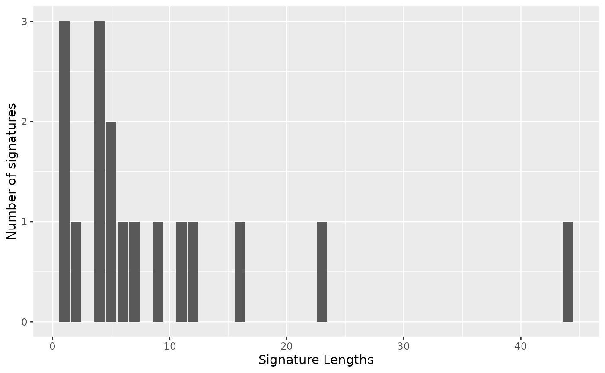
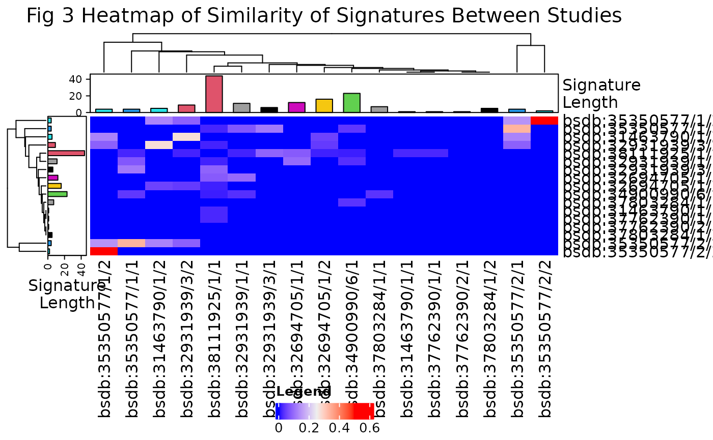
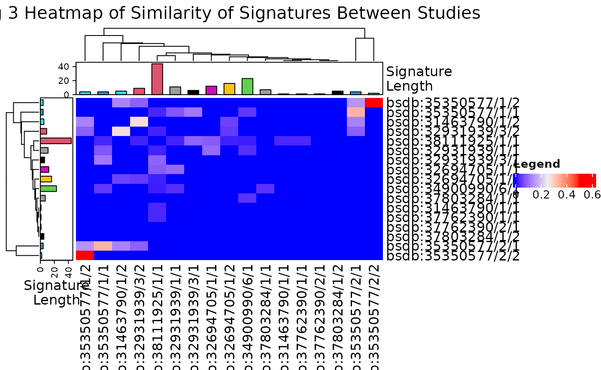
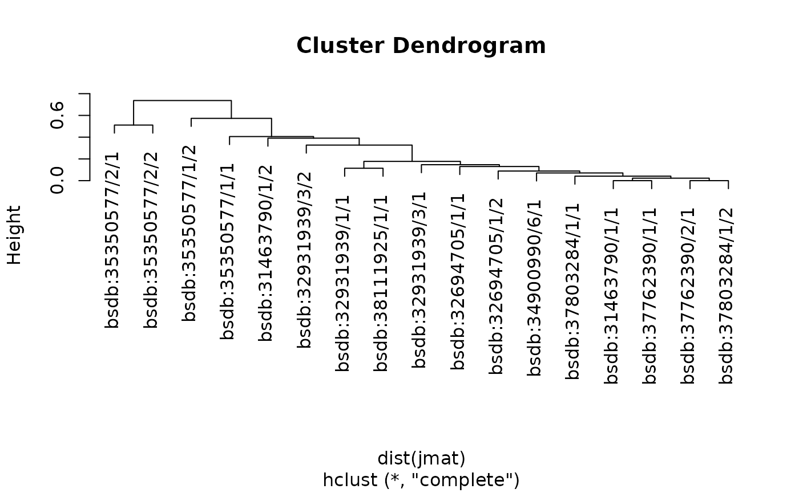

# Differential Abundance in the ocular microbiome in Dry Eye Disaease

``` r

if (!require("BiocManager", quietly = TRUE))
    install.packages("BiocManager")
BiocManager::install(c("devtools", "tidyverse", "kableExtra"))
BiocManager::install(c("waldronlab/BugSigDBStats", "waldronlab/bugsigdbr"))
```

``` r

suppressPackageStartupMessages({
  library(bugSigSimple)
  library(BugSigDBStats)
  library(bugsigdbr)
  library(tidyverse)
  library(stringr)
  library(kableExtra)
  library(dplyr)
  library(magrittr)
  library(boot)
})
```

use version=“devel” and cache = FALSE to take the latest version from
bugsigdb.org

``` r

dat <- bugsigdbr::importBugSigDB(version = "devel", cache = FALSE) 
```

``` r

dim(dat)
```

    ## [1] 17053    57

Examine the data pulled in to view variable names

``` r

names(dat)
```

    ##  [1] "BSDB ID"                    "Study"                     
    ##  [3] "Study design"               "PMID"                      
    ##  [5] "DOI"                        "URL"                       
    ##  [7] "Authors list"               "Title"                     
    ##  [9] "Journal"                    "Year"                      
    ## [11] "Keywords"                   "Curation method"           
    ## [13] "Curation protocol"          "submittedBy"               
    ## [15] "submissionDate"             "Review state"              
    ## [17] "Quality control tag"        "Experiment"                
    ## [19] "Location of subjects"       "Host species"              
    ## [21] "Body site"                  "UBERON ID"                 
    ## [23] "Condition"                  "EFO ID"                    
    ## [25] "Group 0 name"               "Group 1 name"              
    ## [27] "Group 1 definition"         "Group 0 sample size"       
    ## [29] "Group 1 sample size"        "Antibiotics exclusion"     
    ## [31] "Sequencing type"            "16S variable region"       
    ## [33] "Sequencing platform"        "Data transformation"       
    ## [35] "Statistical test"           "Significance threshold"    
    ## [37] "MHT correction"             "LDA Score above"           
    ## [39] "Matched on"                 "Confounders controlled for"
    ## [41] "Pielou"                     "Shannon"                   
    ## [43] "Chao1"                      "Simpson"                   
    ## [45] "Inverse Simpson"            "Richness"                  
    ## [47] "Signature page name"        "Source"                    
    ## [49] "Curated date"               "Curator"                   
    ## [51] "Revision editor"            "Description"               
    ## [53] "Abundance in Group 1"       "MetaPhlAn taxon names"     
    ## [55] "NCBI Taxonomy IDs"          "State"                     
    ## [57] "Reviewer"

Subset to include only PMID numbers of interest

``` r

included.pmid <-
  c(
    31463790,
    32931939,
    37586456, 
    37762390,
    34900990,
    37803284,
    35350577,
    37026303,
    32694705,
    38111925
  )
subset.dat <-
  dat[dat$PMID %in% included.pmid,] 
```

``` r

dim(subset.dat)
```

    ## [1] 56 57

Confirm all studies included

``` r

subset.dat %>%
  kbl() %>%
  kable_paper("hover", full_width = FALSE) %>%
  scroll_box(width = "100%", height = "400px")
```

[TABLE]

Examine group 0 names

``` r

unique(subset.dat$`Group 0 name`)
```

    ##  [1] "healthy controls"                      
    ##  [2] "Non-MGD"                               
    ##  [3] "Normal Control (NC)"                   
    ##  [4] "control"                               
    ##  [5] "female patients with dry eye disease"  
    ##  [6] "Healthy female"                        
    ##  [7] "Aqueous tear deficient (ATD) DED"      
    ##  [8] "Meibomian Gland Dysfunction (MGD) DED" 
    ##  [9] "Dry Eye -nonATD"                       
    ## [10] "Dry Eye -nonMGD"                       
    ## [11] "Non Sjogrens Syndrome Dry Eye (NSSDE)" 
    ## [12] "Healthy Control (HC)"                  
    ## [13] "Meibomian Gland Dysfunction"           
    ## [14] "Healthy Control"                       
    ## [15] "Control"                               
    ## [16] "Normal healthy (NDM) children"         
    ## [17] "Control and moderate-to-severe dry eye"
    ## [18] "control and mild dry eye"

Examine group 1 names

``` r

unique(subset.dat$`Group 1 name`)
```

    ##  [1] "Dry Eye"                                                         
    ##  [2] "MGD"                                                             
    ##  [3] "OGVHD"                                                           
    ##  [4] "ADDE"                                                            
    ##  [5] "male patients with dry eye disease"                              
    ##  [6] "Healthy male"                                                    
    ##  [7] "Meibomian Gland Dysfunction (MGD) DED"                           
    ##  [8] "Mixed DED"                                                       
    ##  [9] "Dry Eye- ATD"                                                    
    ## [10] "Dry Eye- MGD"                                                    
    ## [11] "Sjogrens Syndrome Dry Eye (SSDE)"                                
    ## [12] "Non Sjogrens Syndrome Dry Eye (NSSDE)"                           
    ## [13] "Sjogren's syndrome (SS) and non-Sjogren's syndrome (NSS) cohorts"
    ## [14] "Sjogren's syndrome (SS)"                                         
    ## [15] "Non-Sjogren's syndrome (NSS)"                                    
    ## [16] "Meibomian Gland Dysfunction + Lacrimal Dysfunction"              
    ## [17] "Meibomian Gland Dysfunction"                                     
    ## [18] "Diabetic children with Dry Eye Disease (DM-DE)"                  
    ## [19] "Mild and Moderate to Severe Dry Eye"                             
    ## [20] "Mild Dry Eye"                                                    
    ## [21] "Moderate-to-severe dry eye"

To omit the double comparison in Study 856 by removing the ANOSIM
analysis

``` r

subset.dat <- subset.dat %>%
  filter(`Statistical test` != "ANOSIM")

subset.dat %>%
  kbl() %>%
  kable_paper("hover", full_width = FALSE) %>%
  scroll_box(width = "100%", height = "400px")
```

[TABLE]

Final subset to include only those Group 0 names of interest (controls
with no DED) and only those Group 1 names of interest (some variation on
DED)

``` r

group0.controls <- c("Healthy Control", "Control", "control", "healthy controls",
                      "Normal Control (NC)", "Healthy control", "Healthy Controls",
                      "Normal healthy (NDM) children", "Healthy controls")
group1.ded <- c("Meibomian Gland Dysfunction + Lacrimal Dysfunction", "Meibomian Gland Dysfunction",
                "Dry Eye", "ADDE", "DED patients", "MGD", "Meibomian Gland Dysfunction (MGD)",
                "Meibomian Gland Dysfunction (MGD) DED", "Meibomian Gland Dysfunction (MGD) Groups",
                "Mixed DED", "Sjogrens Syndrome Dry Eye (SSDE)", "Non Sjogrens Syndrome Dry Eye (NSSDE)",
                "Dry Eye Disease patients", "Sjogren's patients with Dry Eye Disease",
                "Dry Eye Disease patients without Sjogrens", "Diabetic children with Dry Eye Disease (DM-DE)",
                "Mild Dry Eye", "Mild and Moderate to Severe Dry Eye")

subset.final <- subset.dat[subset.dat$`Group 0 name` %in% group0.controls &
                              subset.dat$`Group 1 name` %in% group1.ded, ]

subset.final %>%
  kbl() %>%
  kable_paper("hover", full_width = FALSE) %>%
  scroll_box(width = "100%", height = "400px")
```

[TABLE]

``` r

dim(subset.final)
```

    ## [1] 18 57

These are the studies included in the review

``` r

bugSigSimple::createStudyTable(subset.final)|> kableExtra::kbl()
```

| Study Identifier | MaxCases | MaxControls | Study design | Condition | N_signatures | PMID | DOI | URL |
|:---|---:|---:|:---|:---|---:|:---|:---|:---|
| AnderssonJ.\_2021 | 39 | 28 | case-control | Dry eye syndrome | 3 | 32931939 | <https://doi.org/10.1016/j.jtos.2020.09.003> | NA |
| ChenZ.\_2023 | 10 | 10 | case-control | Dry eye syndrome | 2 | 37803284 | <https://doi.org/10.1186/s12866-023-03013-6> | NA |
| LiZ.\_2019 | 35 | 54 | case-control | Dry eye syndrome | 2 | 31463790 | <https://doi.org/10.1007/s12275-019-9127-2> | NA |
| LiangQ.\_2021 | 47 | 48 | case-control | Dry eye syndrome | 1 | 34900990 | <https://doi.org/10.3389/fcell.2021.731867> | NA |
| SchlegelI.\_2023 | 10 | 10 | case-control | Dry eye syndrome | 2 | 37762390 | <https://doi.org/10.3390/ijms241814091> | NA |
| SongH.\_2022 | 36 | 39 | case-control | Dry eye syndrome | 4 | 35350577 | <https://doi.org/10.3389/fmed.2022.841112> | NA |
| WillisK.A.\_2020 | 36 | 36 | case-control | Dry eye syndrome | 2 | 32694705 | <https://doi.org/10.1038/s41598-020-68952-w> | NA |
| ZouX.R.\_2023 | 138 | 61 | case-control | Dry eye syndrome | 2 | 38111925 | <https://doi.org/10.18240/ijo.2023.12.10> | NA |

This table summarizes the results for the identified taxa.

``` r

install.packages("openxlsx")
```

``` r

# Load necessary packages
library(openxlsx)
library(knitr)

# Create and format the table
taxon_table <- bugSigSimple::createTaxonTable(subset.final, n = 2000)
styled_table <- kable_styling(kbl(taxon_table))

# Create a new workbook
wb <- createWorkbook()

# Add a worksheet
addWorksheet(wb, "Taxon Table")

# Write the data to the worksheet
writeData(wb, "Taxon Table", taxon_table)

# Save the workbook
saveWorkbook(wb, file.path(tempdir(), "TaxonTable.xlsx"), overwrite = TRUE)
```

``` r

install.packages("writexl")
```

``` r

install.packages("ontologyIndex")
```

``` r

efo<-getOntology("efo")
efo
```

    ## Ontology with 84814 terms
    ## 
    ## format-version: 1.2
    ## data-version: http://www.ebi.ac.uk/efo/releases/v3.95.0/efo.owl
    ## ontology: http://www.ebi.ac.uk/efo/efo.owl
    ## 
    ## Properties:
    ##  id: character
    ##  name: character
    ##  parents: list
    ##  children: list
    ##  ancestors: list
    ##  obsolete: logical
    ##  equivalent_to: list
    ## Roots:
    ##  efo:EFO_0000001 - experimental factor
    ##  efo:EFO_0000824 - relationship
    ##  RO:0000053 - bearer_of
    ##  RO:0000057 - has_participant
    ##  RO:0000056 - participates_in
    ##  RO:0002233 - has input
    ##  RO:0002323 - mereotopologically related to
    ##  RO:0002502 - depends on
    ##  located_in - located_in
    ##  location_of - location_of
    ##  ... 65 more

Top 1000 taxa decreased in relation to the control

``` r

mostfreqdec <- BugSigDBStats::getMostFrequentTaxa(subset.final, n=1000, direction = "DOWN")
mostfreqdec %>%
  kbl() %>%
  kable_paper("hover", full_width = FALSE) %>%
  scroll_box(height = "300px")
```

| Var1    | Freq |
|:--------|-----:|
| 1117    |    2 |
| 119045  |    2 |
| 1224    |    2 |
| 1386    |    2 |
| 1653    |    2 |
| 1716    |    2 |
| 286     |    2 |
| 118882  |    1 |
| 1268    |    1 |
| 1280    |    1 |
| 1298    |    1 |
| 1300    |    1 |
| 1301    |    1 |
| 1302    |    1 |
| 135621  |    1 |
| 135623  |    1 |
| 13687   |    1 |
| 149698  |    1 |
| 153622  |    1 |
| 1578    |    1 |
| 171549  |    1 |
| 171552  |    1 |
| 1737405 |    1 |
| 1739114 |    1 |
| 1743    |    1 |
| 1760    |    1 |
| 183710  |    1 |
| 186801  |    1 |
| 186803  |    1 |
| 186826  |    1 |
| 186828  |    1 |
| 189426  |    1 |
| 191     |    1 |
| 200643  |    1 |
| 2037    |    1 |
| 2070    |    1 |
| 209     |    1 |
| 212791  |    1 |
| 219181  |    1 |
| 237     |    1 |
| 261933  |    1 |
| 263370  |    1 |
| 265     |    1 |
| 267888  |    1 |
| 270     |    1 |
| 2747    |    1 |
| 2762318 |    1 |
| 29465   |    1 |
| 295418  |    1 |
| 31957   |    1 |
| 31977   |    1 |
| 32207   |    1 |
| 33882   |    1 |
| 33958   |    1 |
| 35493   |    1 |
| 357     |    1 |
| 36809   |    1 |
| 374     |    1 |
| 378548  |    1 |
| 37914   |    1 |
| 40323   |    1 |
| 407     |    1 |
| 434     |    1 |
| 45404   |    1 |
| 468     |    1 |
| 49546   |    1 |
| 504481  |    1 |
| 528     |    1 |
| 53246   |    1 |
| 561     |    1 |
| 563835  |    1 |
| 57739   |    1 |
| 59732   |    1 |
| 620     |    1 |
| 67575   |    1 |
| 72274   |    1 |
| 724     |    1 |
| 82115   |    1 |
| 838     |    1 |
| 84107   |    1 |
| 848     |    1 |
| 85007   |    1 |
| 85019   |    1 |
| 90964   |    1 |
| 91061   |    1 |
| 976     |    1 |

Top 1000 taxa increased in relation to the control

``` r

mostfreqinc <- BugSigDBStats::getMostFrequentTaxa(subset.final, n=1000, direction = "UP")
mostfreqinc %>%
  kbl() %>%
  kable_paper("hover", full_width = FALSE) %>%
  scroll_box(height = "300px")
```

| Var1    | Freq |
|:--------|-----:|
| 1224    |    2 |
| 1239    |    2 |
| 1485    |    2 |
| 1716    |    2 |
| 469     |    2 |
| 1186    |    1 |
| 1236    |    1 |
| 1280    |    1 |
| 1290    |    1 |
| 1301    |    1 |
| 1305    |    1 |
| 135621  |    1 |
| 1403934 |    1 |
| 147645  |    1 |
| 147802  |    1 |
| 1696    |    1 |
| 184869  |    1 |
| 1871047 |    1 |
| 2004644 |    1 |
| 200643  |    1 |
| 201174  |    1 |
| 2080419 |    1 |
| 212791  |    1 |
| 216851  |    1 |
| 262209  |    1 |
| 28449   |    1 |
| 286     |    1 |
| 28901   |    1 |
| 29466   |    1 |
| 317577  |    1 |
| 31957   |    1 |
| 33033   |    1 |
| 33958   |    1 |
| 357     |    1 |
| 38304   |    1 |
| 39948   |    1 |
| 40216   |    1 |
| 43675   |    1 |
| 43768   |    1 |
| 468     |    1 |
| 508215  |    1 |
| 536441  |    1 |
| 539813  |    1 |
| 57495   |    1 |
| 65551   |    1 |
| 672     |    1 |
| 70775   |    1 |
| 712633  |    1 |
| 724     |    1 |
| 73501   |    1 |
| 739     |    1 |
| 75385   |    1 |
| 76773   |    1 |
| 838     |    1 |
| 85019   |    1 |
| 851     |    1 |
| 91061   |    1 |

To obtain signatures

``` r

allsigs <- bugsigdbr::getSignatures(subset.final, tax.id.type = "taxname")
allsigs <- allsigs[sapply(allsigs, length) > 0] #require length > 0
dim(allsigs)
```

    ## NULL

To obtain signature lengths displayed in a bar graph and import to a
word document

``` r

# Install and load necessary packages

library(ggplot2)


# Create the bar graph
# Calculate the lengths of signatures
siglengths <- sapply(allsigs, length)

# Create a dataframe
siglengths.df <- data.frame(siglengths = siglengths)

# Plot the bar graph with Y-axis label
plot <- ggplot(siglengths.df, aes(x = siglengths)) +
  geom_bar() +
  labs(y = "Number of signatures", x = "Signature Lengths")

# Display the plot
print(plot)
```



``` r

# Save the plot to a file
ggsave(file.path(tempdir(), "bar_graph.png"), plot)
```

Table of signature lengths

``` r

as.data.frame(table(siglengths)) %>%
  kbl(col.names = c("Signature Length", "Frequency")) %>%
  kable_paper("hover", full_width = FALSE)
```

| Signature Length | Frequency |
|:-----------------|----------:|
| 1                |         3 |
| 2                |         1 |
| 4                |         3 |
| 5                |         2 |
| 6                |         1 |
| 7                |         1 |
| 9                |         1 |
| 11               |         1 |
| 12               |         1 |
| 16               |         1 |
| 23               |         1 |
| 44               |         1 |

Calculate pairwise overlap and obtain Jaccard value to determine
similarity of signatures

``` r

mydists <- BugSigDBStats::calcPairwiseOverlaps(allsigs)
dim(mydists)
```

    ## [1] 25  8

``` r

library(grid)
library(ComplexHeatmap)

jmat <- BugSigDBStats::calcJaccardSimilarity(allsigs)

# Truncate row names at the first underscore
rownames(jmat) <- sub("_.+$", "", rownames(jmat))

# Truncate column names at the first underscore
colnames(jmat) <- sub("_.+$", "", colnames(jmat))

# Check the truncated names
cat("Truncated row names: ", rownames(jmat), "\n")
```

    ## Truncated row names:  bsdb:31463790/1/1 bsdb:31463790/1/2 bsdb:32694705/1/1 bsdb:32694705/1/2 bsdb:32931939/1/1 bsdb:32931939/3/1 bsdb:32931939/3/2 bsdb:34900990/6/1 bsdb:35350577/1/1 bsdb:35350577/1/2 bsdb:35350577/2/1 bsdb:35350577/2/2 bsdb:37762390/1/1 bsdb:37762390/2/1 bsdb:37803284/1/1 bsdb:37803284/1/2 bsdb:38111925/1/1

``` r

cat("Truncated column names: ", colnames(jmat), "\n")
```

    ## Truncated column names:  bsdb:31463790/1/1 bsdb:31463790/1/2 bsdb:32694705/1/1 bsdb:32694705/1/2 bsdb:32931939/1/1 bsdb:32931939/3/1 bsdb:32931939/3/2 bsdb:34900990/6/1 bsdb:35350577/1/1 bsdb:35350577/1/2 bsdb:35350577/2/1 bsdb:35350577/2/2 bsdb:37762390/1/1 bsdb:37762390/2/1 bsdb:37803284/1/1 bsdb:37803284/1/2 bsdb:38111925/1/1

``` r

# Ensure row_labels and column_labels lengths match the matrix dimensions
row_labels <- rownames(jmat)
col_labels <- colnames(jmat)

# Verify that lengths match
cat("Length of row_labels: ", length(row_labels), "\n")
```

    ## Length of row_labels:  17

``` r

cat("Length of col_labels: ", length(col_labels), "\n")
```

    ## Length of col_labels:  17

``` r

# Create custom annotations with line breaks
ha <- HeatmapAnnotation(
  `Signature\nLength` = anno_barplot(siglengths, gp = gpar(fill = 4:13), 
                                      annotation_name_gp = gpar(fontsize = 10, lineheight = 0.8))
)
hr <- rowAnnotation(
  `Signature\nLength` = anno_barplot(siglengths, gp = gpar(fill = 4:13), 
                                      annotation_name_gp = gpar(fontsize = 10, lineheight = 0.8))
)

# Adjust heatmap dimensions and settings
hm <- Heatmap(
  jmat,
  top_annotation = ha, 
  left_annotation = hr,
  row_names_max_width = unit(10, "cm"),  # Adjusted width
  column_names_max_height = unit(3, "cm"),  # Adjusted height for column names
  row_labels = row_labels,
  column_labels = col_labels,
  column_title = "Fig 3 Heatmap of Similarity of Signatures Between Studies",  # Title of the heatmap
  column_title_gp = gpar(fontsize = 15),  # Adjust font size for title
  heatmap_legend_param = list(
    title = "Legend", 
    direction = "horizontal"  # Set legend direction to horizontal
  )  # Customizing legend
)

# Draw the heatmap
draw(hm, 
     heatmap_legend_side = "bottom", 
     annotation_legend_side = "right")
```



``` r

# Save the heatmap as an image
png(file.path(tempdir(), "heatmap.png"), width = 12, height = 8, units = "in", res = 300)
draw(hm, 
     heatmap_legend_side = "bottom", 
     annotation_legend_side = "right")
dev.off()
```

    ## agg_png 
    ##       2

``` r

library(InteractiveComplexHeatmap)
hm <- draw(hm)
```



``` r

htShiny(hm)
```

Shiny applications not supported in static R Markdown documents

``` r

library(ComplexHeatmap)
library(grid)

# Assuming jmat and other variables are already defined as before

# Perform hierarchical clustering
hc <- hclust(dist(jmat))
plot(hc)
```



``` r

# Save the cluster map as an image
png(file.path(tempdir(), "cluster_map.png"), width = 12, height = 8, units = "in", res = 300)
plot(hc, main = "Hierarchical Cluster Map of Signatures", xlab = "", sub = "", cex = 0.6)
dev.off()
```

    ## agg_png 
    ##       2

``` r

clusts <- sort(cutree(hc, h = 0.05))
lapply(unique(clusts), function(i) names(clusts)[clusts == i])
```

    ## [[1]]
    ## [1] "bsdb:31463790/1/1" "bsdb:37762390/1/1" "bsdb:37762390/2/1"
    ## [4] "bsdb:37803284/1/1" "bsdb:37803284/1/2"
    ## 
    ## [[2]]
    ## [1] "bsdb:31463790/1/2"
    ## 
    ## [[3]]
    ## [1] "bsdb:32694705/1/1"
    ## 
    ## [[4]]
    ## [1] "bsdb:32694705/1/2"
    ## 
    ## [[5]]
    ## [1] "bsdb:32931939/1/1"
    ## 
    ## [[6]]
    ## [1] "bsdb:32931939/3/1"
    ## 
    ## [[7]]
    ## [1] "bsdb:32931939/3/2"
    ## 
    ## [[8]]
    ## [1] "bsdb:34900990/6/1"
    ## 
    ## [[9]]
    ## [1] "bsdb:35350577/1/1"
    ## 
    ## [[10]]
    ## [1] "bsdb:35350577/1/2"
    ## 
    ## [[11]]
    ## [1] "bsdb:35350577/2/1"
    ## 
    ## [[12]]
    ## [1] "bsdb:35350577/2/2"
    ## 
    ## [[13]]
    ## [1] "bsdb:38111925/1/1"

``` r

#all taxon increased and decreased freq
#allfreqs <- bugSigSimple::createTaxonTable(subset.final, n = 500, format = "Full") %>% #could change number
#  mutate(delta = `Increased Signatures` - `Decreased Signatures`) %>%
#  arrange(delta)

allfreqs <- bugSigSimple::createTaxonTable(subset.final, n = 500, format = "Simple") %>%
  mutate(delta = increased_signatures - decreased_signatures) %>%
  arrange(delta)
  #arrange(I(decreased_signatures - increased_signatures))
#incfreqs <- filter(allfreqs, I(increased_signatures - decreased_signatures) > 0)
#decfreqs <- filter(allfreqs, I(increased_signatures - decreased_signatures) < 0)
incfreqs <- filter(allfreqs, delta > 0)
decfreqs <- filter(allfreqs, delta < 0)
kableExtra::kbl(allfreqs) %>%
  kable_paper("hover", full_width = FALSE)
```

| Taxon Name | Taxonomic Level | total_signatures | increased_signatures | decreased_signatures | Binomial Test pval | delta |
|:---|:---|---:|---:|---:|---:|---:|
| Corynebacteriaceae | family | 2 | 0 | 2 | 0.5 | -2 |
| Bacillus | genus | 2 | 0 | 2 | 0.5 | -2 |
| Cyanobacteriota | phylum | 2 | 0 | 2 | 0.5 | -2 |
| Methylobacteriaceae | family | 2 | 0 | 2 | 0.5 | -2 |
| Pseudomonas | genus | 3 | 1 | 2 | 1.0 | -1 |
| Actinomycetes | class | 1 | 0 | 1 | 1.0 | -1 |
| Actinomycetales | order | 1 | 0 | 1 | 1.0 | -1 |
| Microbacterium | genus | 1 | 0 | 1 | 1.0 | -1 |
| Micrococcaceae | family | 1 | 0 | 1 | 1.0 | -1 |
| Rothia | genus | 1 | 0 | 1 | 1.0 | -1 |
| Mycobacteriales | order | 1 | 0 | 1 | 1.0 | -1 |
| Dietzia | genus | 1 | 0 | 1 | 1.0 | -1 |
| Mycobacteroides abscessus | species | 1 | 0 | 1 | 1.0 | -1 |
| Propionibacterium | genus | 1 | 0 | 1 | 1.0 | -1 |
| Pseudonocardiaceae | family | 1 | 0 | 1 | 1.0 | -1 |
| Coriobacteriaceae | family | 1 | 0 | 1 | 1.0 | -1 |
| Paenibacillus odorifer | species | 1 | 0 | 1 | 1.0 | -1 |
| Staphylococcaceae | family | 1 | 0 | 1 | 1.0 | -1 |
| Lactobacillales | order | 1 | 0 | 1 | 1.0 | -1 |
| Carnobacteriaceae | family | 1 | 0 | 1 | 1.0 | -1 |
| Carnobacterium | genus | 1 | 0 | 1 | 1.0 | -1 |
| Lactobacillus | genus | 1 | 0 | 1 | 1.0 | -1 |
| Streptococcaceae | family | 1 | 0 | 1 | 1.0 | -1 |
| Streptococcus gordonii | species | 1 | 0 | 1 | 1.0 | -1 |
| Clostridia | class | 1 | 0 | 1 | 1.0 | -1 |
| Lachnospiraceae | family | 1 | 0 | 1 | 1.0 | -1 |
| Veillonellaceae | family | 1 | 0 | 1 | 1.0 | -1 |
| Veillonella | genus | 1 | 0 | 1 | 1.0 | -1 |
| Tissierellales | order | 1 | 0 | 1 | 1.0 | -1 |
| Fusobacterium | genus | 1 | 0 | 1 | 1.0 | -1 |
| Bacteroidota | phylum | 1 | 0 | 1 | 1.0 | -1 |
| Bacteroidales | order | 1 | 0 | 1 | 1.0 | -1 |
| Prevotellaceae | family | 1 | 0 | 1 | 1.0 | -1 |
| Chitinophagaceae | family | 1 | 0 | 1 | 1.0 | -1 |
| Sediminibacterium | genus | 1 | 0 | 1 | 1.0 | -1 |
| Flavobacteriaceae | family | 1 | 0 | 1 | 1.0 | -1 |
| Flavobacterium | genus | 1 | 0 | 1 | 1.0 | -1 |
| Weeksellaceae | family | 1 | 0 | 1 | 1.0 | -1 |
| Chryseobacterium | genus | 1 | 0 | 1 | 1.0 | -1 |
| Peredibacter | genus | 1 | 0 | 1 | 1.0 | -1 |
| Helicobacter | genus | 1 | 0 | 1 | 1.0 | -1 |
| Acetobacter | genus | 1 | 0 | 1 | 1.0 | -1 |
| Beijerinckiaceae | family | 1 | 0 | 1 | 1.0 | -1 |
| Brucellaceae | family | 1 | 0 | 1 | 1.0 | -1 |
| Ochrobactrum | genus | 1 | 0 | 1 | 1.0 | -1 |
| Methylobacterium | genus | 1 | 0 | 1 | 1.0 | -1 |
| Bradyrhizobium | genus | 1 | 0 | 1 | 1.0 | -1 |
| Pleomorphomonas | genus | 1 | 0 | 1 | 1.0 | -1 |
| Rhizobiaceae | family | 1 | 0 | 1 | 1.0 | -1 |
| Paracoccus | genus | 1 | 0 | 1 | 1.0 | -1 |
| Rubellimicrobium | genus | 1 | 0 | 1 | 1.0 | -1 |
| Azospirillum | genus | 1 | 0 | 1 | 1.0 | -1 |
| Novosphingobium nitrogenifigens | species | 1 | 0 | 1 | 1.0 | -1 |
| Novosphingobium sp. Fuku2-ISO-50 | species | 1 | 0 | 1 | 1.0 | -1 |
| Sphingomonas | genus | 1 | 0 | 1 | 1.0 | -1 |
| Ottowia | genus | 1 | 0 | 1 | 1.0 | -1 |
| Massilia | genus | 1 | 0 | 1 | 1.0 | -1 |
| Vogesella | genus | 1 | 0 | 1 | 1.0 | -1 |
| Pseudoalteromonadaceae | family | 1 | 0 | 1 | 1.0 | -1 |
| Pseudoalteromonas | genus | 1 | 0 | 1 | 1.0 | -1 |
| Rheinheimera | genus | 1 | 0 | 1 | 1.0 | -1 |
| Escherichia | genus | 1 | 0 | 1 | 1.0 | -1 |
| Shigella | genus | 1 | 0 | 1 | 1.0 | -1 |
| Stenotrophomonas | genus | 1 | 0 | 1 | 1.0 | -1 |
| Pseudomonadales | order | 1 | 0 | 1 | 1.0 | -1 |
| Vibrionales | order | 1 | 0 | 1 | 1.0 | -1 |
| Vibrio agarivorans | species | 1 | 0 | 1 | 1.0 | -1 |
| Deinococcaceae | family | 1 | 0 | 1 | 1.0 | -1 |
| Deinococcus | genus | 1 | 0 | 1 | 1.0 | -1 |
| Thermus | genus | 1 | 0 | 1 | 1.0 | -1 |
| Streptophyta | phylum | 1 | 0 | 1 | 1.0 | -1 |
| Corynebacterium | genus | 4 | 2 | 2 | 1.0 | 0 |
| Pseudomonadota | phylum | 4 | 2 | 2 | 1.0 | 0 |
| Brevibacteriaceae | family | 2 | 1 | 1 | 1.0 | 0 |
| Propionibacteriaceae | family | 2 | 1 | 1 | 1.0 | 0 |
| Bacilli | class | 2 | 1 | 1 | 1.0 | 0 |
| Staphylococcus aureus | species | 2 | 1 | 1 | 1.0 | 0 |
| Lactobacillaceae | family | 2 | 1 | 1 | 1.0 | 0 |
| Streptococcus | genus | 2 | 1 | 1 | 1.0 | 0 |
| Bacteroidia | class | 2 | 1 | 1 | 1.0 | 0 |
| Prevotella | genus | 2 | 1 | 1 | 1.0 | 0 |
| Agrobacterium | genus | 2 | 1 | 1 | 1.0 | 0 |
| Enhydrobacter | genus | 2 | 1 | 1 | 1.0 | 0 |
| Moraxellaceae | family | 2 | 1 | 1 | 1.0 | 0 |
| Haemophilus | genus | 2 | 1 | 1 | 1.0 | 0 |
| Pseudomonadaceae | family | 2 | 1 | 1 | 1.0 | 0 |
| Actinomycetota | phylum | 1 | 1 | 0 | 1.0 | 1 |
| Varibaculum | genus | 1 | 1 | 0 | 1.0 | 1 |
| Brevibacterium | genus | 1 | 1 | 0 | 1.0 | 1 |
| Dermacoccus | genus | 1 | 1 | 0 | 1.0 | 1 |
| Janibacter melonis | species | 1 | 1 | 0 | 1.0 | 1 |
| Rothia mucilaginosa | species | 1 | 1 | 0 | 1.0 | 1 |
| Corynebacterium matruchotii | species | 1 | 1 | 0 | 1.0 | 1 |
| Corynebacterium tuberculostearicum | species | 1 | 1 | 0 | 1.0 | 1 |
| Micropruina glycogenica | species | 1 | 1 | 0 | 1.0 | 1 |
| Staphylococcus hominis | species | 1 | 1 | 0 | 1.0 | 1 |
| Lactobacillus iners | species | 1 | 1 | 0 | 1.0 | 1 |
| Leuconostoc sp. DORA_2 | species | 1 | 1 | 0 | 1.0 | 1 |
| Streptococcus sanguinis | species | 1 | 1 | 0 | 1.0 | 1 |
| Streptococcus sp. oral taxon 431 | species | 1 | 1 | 0 | 1.0 | 1 |
| Faecalibacterium | genus | 1 | 1 | 0 | 1.0 | 1 |
| Dialister | genus | 1 | 1 | 0 | 1.0 | 1 |
| Veillonella parvula | species | 1 | 1 | 0 | 1.0 | 1 |
| Parvimonas micra | species | 1 | 1 | 0 | 1.0 | 1 |
| Calothrix | genus | 1 | 1 | 0 | 1.0 | 1 |
| Cordyceps militaris | species | 1 | 1 | 0 | 1.0 | 1 |
| Malassezia globosa | species | 1 | 1 | 0 | 1.0 | 1 |
| Fusobacterium nucleatum | species | 1 | 1 | 0 | 1.0 | 1 |
| Chryseobacterium sp. | species | 1 | 1 | 0 | 1.0 | 1 |
| Chryseobacterium taklimakanense | species | 1 | 1 | 0 | 1.0 | 1 |
| Paracoccus yeei | species | 1 | 1 | 0 | 1.0 | 1 |
| Neisseria subflava | species | 1 | 1 | 0 | 1.0 | 1 |
| Gammaproteobacteria | class | 1 | 1 | 0 | 1.0 | 1 |
| Enterobacter mori | species | 1 | 1 | 0 | 1.0 | 1 |
| Salmonella enterica | species | 1 | 1 | 0 | 1.0 | 1 |
| Acinetobacter radioresistens | species | 1 | 1 | 0 | 1.0 | 1 |
| Acinetobacter sp. WCHA45 | species | 1 | 1 | 0 | 1.0 | 1 |
| Aggregatibacter segnis | species | 1 | 1 | 0 | 1.0 | 1 |
| Pseudomonas plecoglossicida | species | 1 | 1 | 0 | 1.0 | 1 |
| Vibrio vulnificus | species | 1 | 1 | 0 | 1.0 | 1 |
| Deinococcus ficus | species | 1 | 1 | 0 | 1.0 | 1 |
| Deinococcus sp. NW-56 | species | 1 | 1 | 0 | 1.0 | 1 |
| Meiothermus | genus | 1 | 1 | 0 | 1.0 | 1 |
| Rothia | genus | 1 | 1 | 0 | 1.0 | 1 |
| Bacillota | phylum | 2 | 2 | 0 | 0.5 | 2 |
| Clostridium | genus | 2 | 2 | 0 | 0.5 | 2 |
| Acinetobacter | genus | 2 | 2 | 0 | 0.5 | 2 |

## Updated for issue \#29
