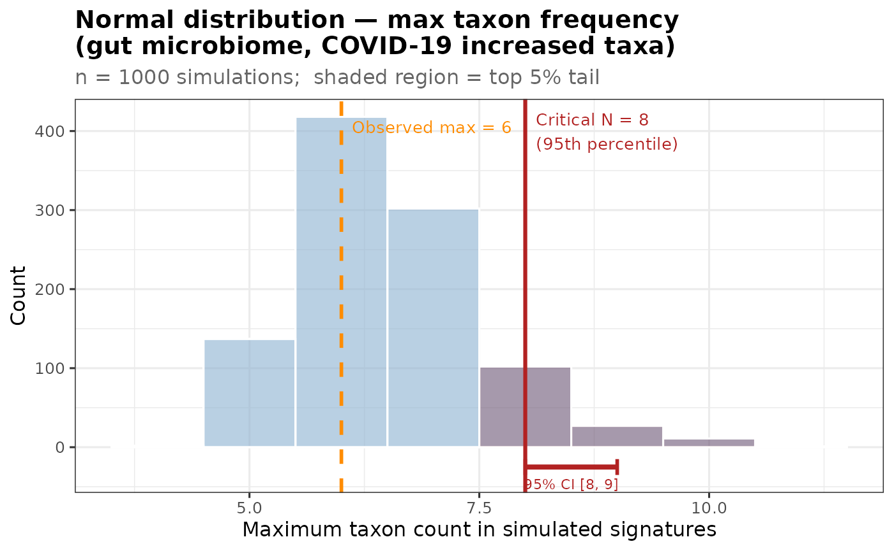
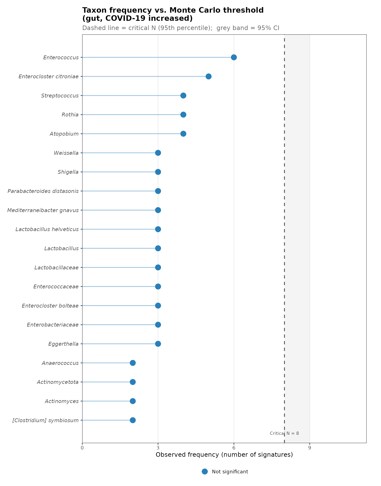
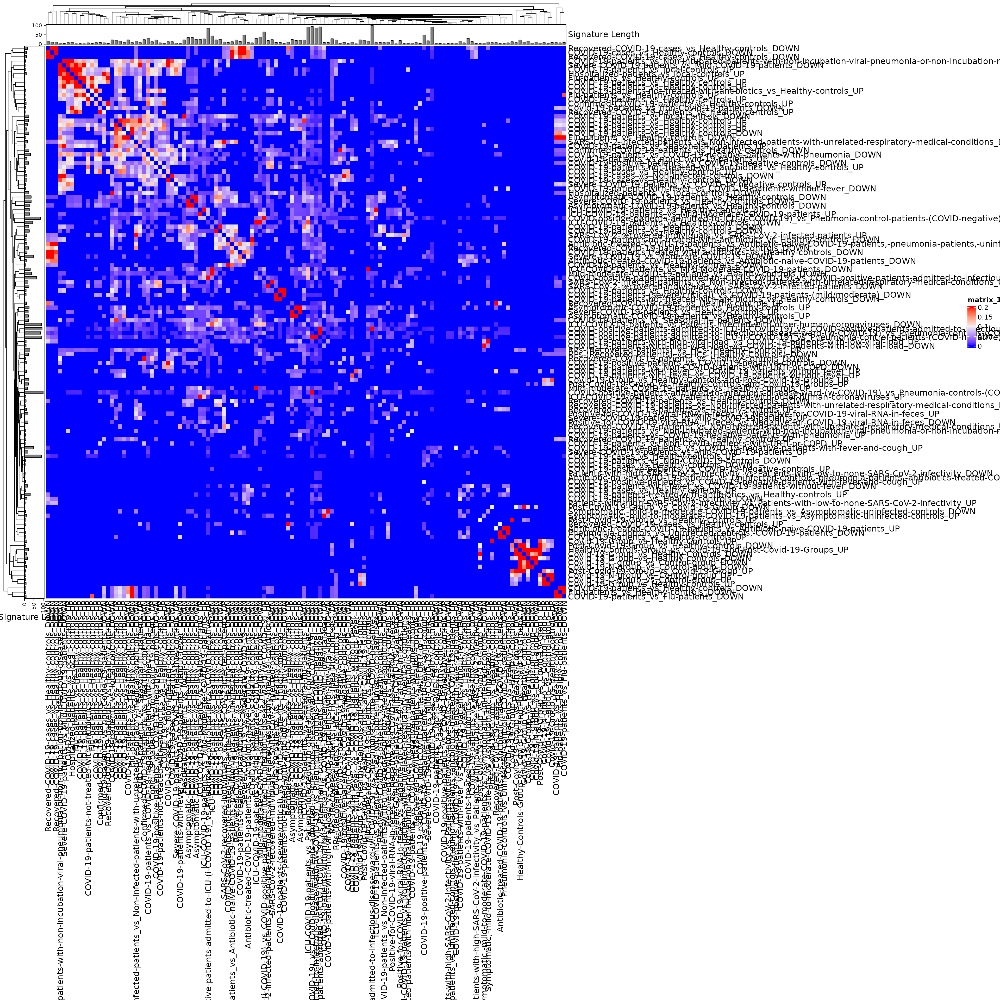
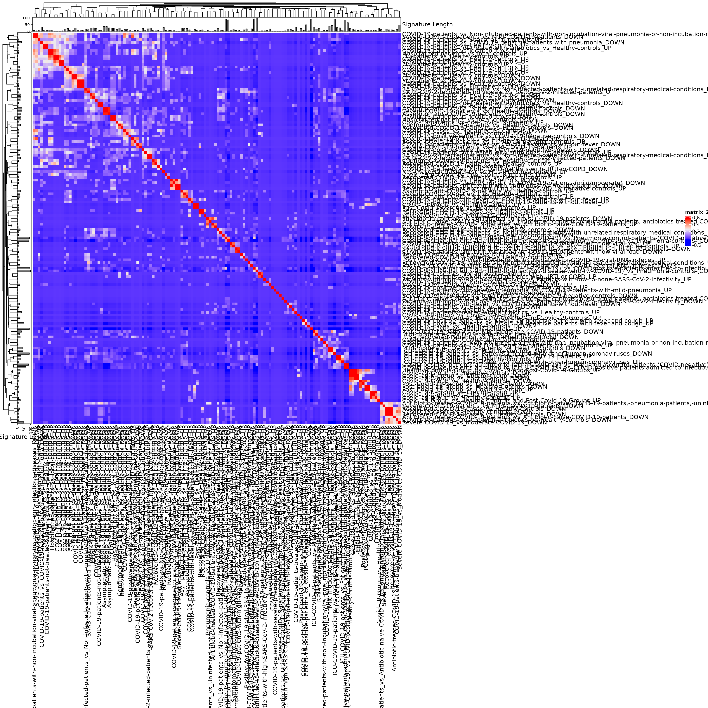

# COVID-19 associated microbiome

## Analysis objectives

1.  Import, recode, and subset data from bugsigdb.org  
2.  Create a table of studies
3.  Create a clustered heatmap showing similarity of signatures from
    independent studies
4.  Calculate the frequency of appearance of each taxa in independent
    signatures, and identify the most frequently reported taxa
5.  Estimate the probability of the most frequently identified taxa
    occuring so frequently by chance

## Packages installation

Install packages (not evaluated in vignette)

``` r

install.packages(c("devtools", "tidyverse", "kableExtra", "gt", "glue"))
devtools::install_github("waldronlab/bugSigSimple")
devtools::install_github("waldronlab/BugSigDBStats")
devtools::install_github("waldronlab/bugsigdbr")
```

## Data import, recoding, and subset

``` r

library(bugSigSimple)
dat <- bugsigdbr::importBugSigDB(cache = TRUE) 
```

    ## Using cached version from 2026-11-09 16:29:54

``` r

dim(dat)
```

    ## [1] 7425   51

``` r

names(dat)
```

    ##  [1] "BSDB ID"                    "Study"                     
    ##  [3] "Study design"               "PMID"                      
    ##  [5] "DOI"                        "URL"                       
    ##  [7] "Authors list"               "Title"                     
    ##  [9] "Journal"                    "Year"                      
    ## [11] "Keywords"                   "Experiment"                
    ## [13] "Location of subjects"       "Host species"              
    ## [15] "Body site"                  "UBERON ID"                 
    ## [17] "Condition"                  "EFO ID"                    
    ## [19] "Group 0 name"               "Group 1 name"              
    ## [21] "Group 1 definition"         "Group 0 sample size"       
    ## [23] "Group 1 sample size"        "Antibiotics exclusion"     
    ## [25] "Sequencing type"            "16S variable region"       
    ## [27] "Sequencing platform"        "Data transformation"       
    ## [29] "Statistical test"           "Significance threshold"    
    ## [31] "MHT correction"             "LDA Score above"           
    ## [33] "Matched on"                 "Confounders controlled for"
    ## [35] "Pielou"                     "Shannon"                   
    ## [37] "Chao1"                      "Simpson"                   
    ## [39] "Inverse Simpson"            "Richness"                  
    ## [41] "Signature page name"        "Source"                    
    ## [43] "Curated date"               "Curator"                   
    ## [45] "Revision editor"            "Description"               
    ## [47] "Abundance in Group 1"       "MetaPhlAn taxon names"     
    ## [49] "NCBI Taxonomy IDs"          "State"                     
    ## [51] "Reviewer"

``` r

library(tidyverse)
```

    ## ── Attaching core tidyverse packages ──────────────────────── tidyverse 2.0.0 ──
    ## ✔ dplyr     1.2.1     ✔ readr     2.2.0
    ## ✔ forcats   1.0.1     ✔ stringr   1.6.0
    ## ✔ ggplot2   4.0.3     ✔ tibble    3.3.1
    ## ✔ lubridate 1.9.5     ✔ tidyr     1.3.2
    ## ✔ purrr     1.2.2     
    ## ── Conflicts ────────────────────────────────────────── tidyverse_conflicts() ──
    ## ✖ dplyr::filter() masks stats::filter()
    ## ✖ dplyr::lag()    masks stats::lag()
    ## ℹ Use the conflicted package (<http://conflicted.r-lib.org/>) to force all conflicts to become errors

``` r

 efo <- bugsigdbr::getOntology("efo")
```

    ## Loading required namespace: ontologyIndex
    ## Using cached version from 2026-11-09 16:21:56

``` r

covid_all <- bugsigdbr::subsetByOntology(dat, column = "Condition", "COVID-19", efo) %>%
  mutate(studyexp = paste(Study, Experiment, sep = "_")) %>%
  mutate(
    site = recode(`Body site`,
      "Feces" = "Gut",
      "Rectum" = "Gut",
      "Nasopharynx" = "aURT",
      "Oropharynx" = "aURT",
      "Nasopharynx,Oropharynx" = "aURT",
      "Nasal cavity" = "aURT",
      "Surface of tongue" = "aURT",
      "Nasopharynx,Throat" = "aURT",
      "Throat" = "aURT",
      "Tongue" = "aURT",
      "Lung" = "LRT",
      "Sputum" = "LRT"
    )
  ) %>%
  mutate(comparison1 = paste(`Group 0 name`, `Group 1 name`, sep = " vs "))
```

### Table of studies

``` r

bugSigSimple::createStudyTable(covid_all)
```

    ## # A tibble: 34 × 9
    ##    `Study Identifier` MaxCases MaxControls `Study design` Condition N_signatures
    ##    <chr>                 <dbl>       <dbl> <chr>          <chr>            <int>
    ##  1 BellatoM._2023           89          17 cross-section… COVID-19…            1
    ##  2 CaoJ._2021               13           8 case-control   COVID-19             6
    ##  3 EngenP.A._2021            9          10 cross-section… COVID-19             2
    ##  4 GaibaniP._2021           24          24 case-control   COVID-19             2
    ##  5 GaoM._2021               94          48 prospective c… COVID-19             2
    ##  6 GuptaA._2021             63          26 cross-section… COVID-19             2
    ##  7 HanY._2022               19          23 cross-section… COVID-19             2
    ##  8 HoqueM.N._2021           11          10 case-control   COVID-19             2
    ##  9 HuX._2023               132         203 prospective c… COVID-19            16
    ## 10 KhanM._2021              10          10 cross-section… COVID-19             6
    ## # ℹ 24 more rows
    ## # ℹ 3 more variables: PMID <chr>, DOI <chr>, URL <chr>

### Taxon frequency tables by body site

``` r

library(dplyr)
gut_sigs <- filter(covid_all, 
                           site == "Gut") %>%
    drop_na(Source)

naso_sigs <- filter(covid_all, 
                           site == "aURT") %>%
    drop_na(Source)
  
resp_sigs <- filter(covid_all, 
                           site == "LRT") %>%
  drop_na(Source)
```

In this table, the Binomial Test p-value corresponds to the null
hypothesis

H0: the proportion of signatures in which the taxon is reported
increased or decreased, relative to the total number of signatures in
which it is reported, is equal to 0.5

``` r

kableExtra::kbl(bugSigSimple::createTaxonTable(gut_sigs))
```

| Taxon Name | Taxonomic Level | total_signatures | increased_signatures | decreased_signatures | Binomial Test pval |
|:---|:---|---:|---:|---:|---:|
| Faecalibacterium | genus | 11 | 1 | 10 | 0.0120 |
| Faecalibacterium prausnitzii | species | 10 | 0 | 10 | 0.0020 |
| Anaerostipes | genus | 10 | 3 | 7 | 0.3400 |
| Blautia obeum | species | 10 | 0 | 10 | 0.0020 |
| Enterococcus | genus | 9 | 9 | 0 | 0.0039 |
| Collinsella aerofaciens | species | 8 | 2 | 6 | 0.2900 |
| Clostridium | genus | 8 | 3 | 5 | 0.7300 |
| Subdoligranulum | genus | 8 | 1 | 7 | 0.0700 |
| Dorea longicatena | species | 8 | 1 | 7 | 0.0700 |
| Roseburia | genus | 8 | 0 | 8 | 0.0078 |

``` r

kableExtra::kbl(bugSigSimple::createTaxonTable(naso_sigs))
```

| Taxon Name | Taxonomic Level | total_signatures | increased_signatures | decreased_signatures | Binomial Test pval |
|:---|:---|---:|---:|---:|---:|
| Veillonella | genus | 12 | 9 | 3 | 0.150 |
| Oribacterium | genus | 10 | 2 | 8 | 0.110 |
| Prevotella | genus | 10 | 4 | 6 | 0.750 |
| Streptococcus | genus | 9 | 2 | 7 | 0.180 |
| Haemophilus | genus | 9 | 1 | 8 | 0.039 |
| Filifactor | genus | 8 | 1 | 7 | 0.070 |
| Megasphaera | genus | 7 | 6 | 1 | 0.130 |
| Raffaelea | genus | 7 | 5 | 2 | 0.450 |
| Alloprevotella | genus | 7 | 4 | 3 | 1.000 |
| Neisseria | genus | 7 | 0 | 7 | 0.016 |

``` r

kableExtra::kbl(bugSigSimple::createTaxonTable(resp_sigs))
```

| Taxon Name | Taxonomic Level | total_signatures | increased_signatures | decreased_signatures | Binomial Test pval |
|:---|:---|---:|---:|---:|---:|
| Rothia mucilaginosa | species | 2 | 1 | 1 | 1 |
| Lachnoclostridium phytofermentans | species | 2 | 1 | 1 | 1 |
| Actinomyces | genus | 1 | 0 | 1 | 1 |
| Actinomyces pacaensis | species | 1 | 1 | 0 | 1 |
| Schaalia meyeri | species | 1 | 1 | 0 | 1 |
| Rothia aeria | species | 1 | 1 | 0 | 1 |
| Atopobium | genus | 1 | 0 | 1 | 1 |
| Bacillus cereus | species | 1 | 1 | 0 | 1 |
| Lysinibacillus sp. B2A1 | species | 1 | 1 | 0 | 1 |
| Lysinibacillus sphaericus | species | 1 | 1 | 0 | 1 |

## gut microbiota analysis

Look specifically at case-control comparisons

``` r

healthy <- grepl(".*(healthy.*COVID|COVID.*healthy).*", gut_sigs$comparison1, ignore.case = TRUE)

cc_gut_sigs1 <- gut_sigs %>%
      filter(healthy == TRUE) 
```

### Overall frequencies of taxa increased in cases for case/control feces studies

Identifying a taxon reported consistently in 8 out of 8 studies is
*much* more compelling that the FDR value here would suggest, since this
taxon also passed a significance threshold in every one of those
studies.

``` r

cc_gut_sigs1_taxontable <- bugSigSimple::createTaxonTable(cc_gut_sigs1) %>% 
  mutate(FDR =  p.adjust(p = `Binomial Test pval`, method="fdr")) %>%
  relocate(FDR, .after = `Binomial Test pval`)
kableExtra::kbl(cc_gut_sigs1_taxontable)
```

| Taxon Name | Taxonomic Level | total_signatures | increased_signatures | decreased_signatures | Binomial Test pval | FDR |
|:---|:---|---:|---:|---:|---:|---:|
| Blautia obeum | species | 7 | 0 | 7 | 0.016 | 0.0620000 |
| Enterococcus | genus | 6 | 6 | 0 | 0.031 | 0.0620000 |
| Lactobacillaceae | family | 6 | 3 | 3 | 1.000 | 1.0000000 |
| Clostridium | genus | 6 | 2 | 4 | 0.690 | 0.7666667 |
| Faecalibacterium | genus | 6 | 0 | 6 | 0.031 | 0.0620000 |
| Ruminococcus | genus | 6 | 1 | 5 | 0.220 | 0.2750000 |
| Coprococcus | genus | 6 | 0 | 6 | 0.031 | 0.0620000 |
| Roseburia | genus | 6 | 0 | 6 | 0.031 | 0.0620000 |
| Faecalibacterium prausnitzii | species | 5 | 0 | 5 | 0.062 | 0.0885714 |
| Ruminococcus bromii | species | 5 | 0 | 5 | 0.062 | 0.0885714 |

### Monte-Carlo simulation for increased abundance taxa

Just for the increased cc_gut_sigs1 for now. I am inclined to skip this
analysis in favor of the clustering and binomial test analysis.

``` r

#library(bugSigSimple)
#gut.sigs.increased <- filter(cc_gut_sigs1, `Abundance in Group 1` == "increased") %>% 
 # bugsigdbr::getSignatures(tax.id.type = "taxname")
# my.siglengths.inc <- sapply(gut.sigs.increased, length)

#getCriticalN(gut.sigs.increased, my.siglengths.inc)
# Compare to observed - enterococcus & streptococcus are the only taxa that equal the critical limit
#frequencySigs(gut.sigs.increased)
```

``` r

library(bugSigSimple)
library(ggplot2)

gut.sigs.increased <- filter(cc_gut_sigs1, `Abundance in Group 1` == "increased") %>%
  bugsigdbr::getSignatures(tax.id.type = "taxname")

my.siglengths.inc <- sapply(gut.sigs.increased, length)
```

``` r

cn_res <- getCriticalN(
  relevant.sigs = gut.sigs.increased,
  siglengths    = my.siglengths.inc,
  alpha         = 0.05,
  nsim          = 1000,   
  ci            = 0.95,
  ci_nsim       = 500
)

cat(sprintf(
  "Critical N (%s): %d\n95%% CI: [%d, %d]\n",
  cn_res$quantile_label,
  round(cn_res$critical_n),
  round(cn_res$ci_lower),
  round(cn_res$ci_upper)
))
```

    ## Critical N (95th percentile): 8
    ## 95% CI: [8, 9]

``` r

shapiro.test(cn_res$simulated_values)
```

    ## 
    ##  Shapiro-Wilk normality test
    ## 
    ## data:  cn_res$simulated_values
    ## W = 0.8844, p-value < 2.2e-16

``` r

obs_max <- max(table(unlist(gut.sigs.increased)))

plotCriticalN(
  cn_result = cn_res,
  obs_max   = obs_max,
  title     = "Normal distribution — max taxon frequency\n(gut microbiome, COVID-19 increased taxa)"
)
```



``` r

sig_df <- significantTaxa(
  sigs      = gut.sigs.increased,
  cn_result = cn_res,
  n         = 20,
  plot      = FALSE,      # suppress internal plot so we can correct significance first
  plot_type = "lollipop",
  title     = "Taxon frequency vs. Monte Carlo threshold\n(gut, COVID-19 increased)"
)
```

``` r

cat("Critical N value:  ", cn_res$critical_n, "\n")
```

    ## Critical N value:   8

``` r

cat("Max observed count:", max(sig_df$count), "\n")
```

    ## Max observed count: 6

``` r

print(sig_df[, c("taxon", "count", "critical_n")])
```

    ##                         taxon count critical_n
    ## 1                Enterococcus     6          8
    ## 2     Enterocloster citroniae     5          8
    ## 3                   Atopobium     4          8
    ## 4                      Rothia     4          8
    ## 5               Streptococcus     4          8
    ## 6                 Eggerthella     3          8
    ## 7          Enterobacteriaceae     3          8
    ## 8       Enterocloster bolteae     3          8
    ## 9             Enterococcaceae     3          8
    ## 10           Lactobacillaceae     3          8
    ## 11              Lactobacillus     3          8
    ## 12   Lactobacillus helveticus     3          8
    ## 13  Mediterraneibacter gnavus     3          8
    ## 14 Parabacteroides distasonis     3          8
    ## 15                   Shigella     3          8
    ## 16                  Weissella     3          8
    ## 17    [Clostridium] symbiosum     2          8
    ## 18                Actinomyces     2          8
    ## 19             Actinomycetota     2          8
    ## 20               Anaerococcus     2          8

``` r

# Correct significance flag from > to >= to include taxa that meet the threshold
sig_df$significant <- sig_df$count >= sig_df$critical_n
```

``` r

cat("\nSignificant taxa:\n")
```

    ## 
    ## Significant taxa:

``` r

print(sig_df[sig_df$significant, c("taxon", "count", "critical_n", "significant")])
```

    ## [1] taxon       count       critical_n  significant
    ## <0 rows> (or 0-length row.names)

``` r

# Re-order factor for clean top-to-bottom ranking
sig_df$taxon <- factor(sig_df$taxon, levels = sig_df$taxon[order(sig_df$count)])
```

``` r

# Now render the lollipop plot with corrected significance
ggplot(sig_df, aes(x = count, y = taxon, colour = factor(significant))) +

  annotate("rect",
           xmin = cn_res$ci_lower, xmax = cn_res$ci_upper,
           ymin = -Inf, ymax = Inf,
           fill = "grey70", alpha = 0.15) +

  geom_vline(xintercept = cn_res$critical_n,
             linetype = "dashed", colour = "grey30", linewidth = 0.8) +

  geom_segment(aes(x = 0, xend = count, yend = taxon),
               linewidth = 0.7, alpha = 0.5) +

  geom_point(size = 5) +

  geom_text(data = subset(sig_df, significant),
            aes(label = paste0("p = ", signif(p_empirical, 2))),
            hjust = -0.25, size = 3.5, colour = "#c0392b", fontface = "bold") +

  annotate("text",
           x = cn_res$critical_n, y = 0.4,
           label = paste0("Critical N = ", round(cn_res$critical_n)),
           hjust = 0.5, vjust = 1, size = 3.2, colour = "grey30") +

  scale_colour_manual(
    values = c("FALSE" = "#2980b9", "TRUE" = "#c0392b"),
    labels = c("FALSE" = "Not significant",
               "TRUE"  = paste0("Significant (>= Critical N = ",
                                round(cn_res$critical_n), ")")),
    name = NULL
  ) +

  scale_x_continuous(expand = expansion(mult = c(0, 0.25))) +
  scale_y_discrete(expand = expansion(add = c(1.2, 1.2))) +

  labs(
    title    = "Taxon frequency vs. Monte Carlo threshold\n(gut, COVID-19 increased)",
    subtitle = paste0("Dashed line = critical N (", cn_res$quantile_label,
                      ");  grey band = 95% CI"),
    x        = "Observed frequency (number of signatures)",
    y        = NULL
  ) +

theme_bw(base_size = 13) +
  theme(
    legend.position    = "bottom",
    plot.title         = element_text(face = "bold"),
    plot.subtitle      = element_text(colour = "grey40"),
    axis.text.y        = element_text(
      size   = 11,
      face   = ifelse(levels(sig_df$taxon) %in%
                        sig_df$taxon[sig_df$significant],
                      "bold.italic", "italic"),
      margin = margin(r = 4)
    ),
    panel.grid.major.y = element_blank(),
    panel.grid.minor   = element_blank(),
    plot.margin        = margin(t = 15, r = 30, b = 15, l = 15)
  )
```

    ## Warning: Vectorized input to `element_text()` is not officially supported.
    ## ℹ Results may be unexpected or may change in future versions of ggplot2.



``` r

# Print the significance table (significant taxa first)
kableExtra::kbl(
  sig_df,
  col.names = c("Taxon", "Observed count", "Critical N",
                "Significant", "Empirical p-value"),
  digits    = 3,
  caption   = "Top 20 taxa: observed frequency vs. Monte Carlo threshold"
) %>%
  kableExtra::kable_styling(bootstrap_options = c("striped", "hover")) %>%
  kableExtra::row_spec(
    which(sig_df$significant),
    bold       = TRUE,
    background = "#fde8e8"
  )
```

| Taxon | Observed count | Critical N | Significant | Empirical p-value |
|:---|---:|---:|:---|---:|
| Enterococcus | 6 | 8 | FALSE | 0.861 |
| Enterocloster citroniae | 5 | 8 | FALSE | 0.998 |
| Atopobium | 4 | 8 | FALSE | 1.000 |
| Rothia | 4 | 8 | FALSE | 1.000 |
| Streptococcus | 4 | 8 | FALSE | 1.000 |
| Eggerthella | 3 | 8 | FALSE | 1.000 |
| Enterobacteriaceae | 3 | 8 | FALSE | 1.000 |
| Enterocloster bolteae | 3 | 8 | FALSE | 1.000 |
| Enterococcaceae | 3 | 8 | FALSE | 1.000 |
| Lactobacillaceae | 3 | 8 | FALSE | 1.000 |
| Lactobacillus | 3 | 8 | FALSE | 1.000 |
| Lactobacillus helveticus | 3 | 8 | FALSE | 1.000 |
| Mediterraneibacter gnavus | 3 | 8 | FALSE | 1.000 |
| Parabacteroides distasonis | 3 | 8 | FALSE | 1.000 |
| Shigella | 3 | 8 | FALSE | 1.000 |
| Weissella | 3 | 8 | FALSE | 1.000 |
| \[Clostridium\] symbiosum | 2 | 8 | FALSE | 1.000 |
| Actinomyces | 2 | 8 | FALSE | 1.000 |
| Actinomycetota | 2 | 8 | FALSE | 1.000 |
| Anaerococcus | 2 | 8 | FALSE | 1.000 |

Top 20 taxa: observed frequency vs. Monte Carlo threshold {.table .table
.table-striped .table-hover
style="margin-left: auto; margin-right: auto;"}

### Overall frequencies of taxa decreased in cases for case/control feces studies

``` r

createTaxonTable(cc_gut_sigs1, n=40)
```

### nasopharyngeal microbiota analysis

Look specifically at case-control comparisons

``` r

library(dplyr)
healthy <- grepl(".*(control.*COVID|COVID.*control).*", naso_sigs$comparison1, ignore.case = TRUE)

cc_naso_sigs1 <- naso_sigs %>%
      filter(healthy == TRUE) %>%
  subset(Study != "Study 458")
```

## Cluster analysis

Note, this EDA should really be done *before* hypothesis testing.

First calculate pairwise overlaps for all signatures of length \> 1:

``` r

allsigs <- bugsigdbr::getSignatures(covid_all, tax.id.type = "taxname")
allsigs <- allsigs[sapply(allsigs, length) > 1] #require length > 1
dim(allsigs)
```

    ## NULL

``` r

mydists <- BugSigDBStats::calcPairwiseOverlaps(allsigs)
dim(mydists)
```

    ## [1] 1850    8

Create a matrix of Jaccard similarities (0 for no overlap, 1 for 100%
overlap)

``` r

jmat <- BugSigDBStats::calcJaccardSimilarity(allsigs)
```

``` r

library(ComplexHeatmap)
```

    ## Loading required package: grid

    ## ========================================
    ## ComplexHeatmap version 2.28.0
    ## Bioconductor page: http://bioconductor.org/packages/ComplexHeatmap/
    ## Github page: https://github.com/jokergoo/ComplexHeatmap
    ## Documentation: http://jokergoo.github.io/ComplexHeatmap-reference
    ## 
    ## If you use it in published research, please cite either one:
    ## - Gu, Z. Complex Heatmap Visualization. iMeta 2022.
    ## - Gu, Z. Complex heatmaps reveal patterns and correlations in multidimensional 
    ##     genomic data. Bioinformatics 2016.
    ## 
    ## 
    ## The new InteractiveComplexHeatmap package can directly export static 
    ## complex heatmaps into an interactive Shiny app with zero effort. Have a try!
    ## 
    ## This message can be suppressed by:
    ##   suppressPackageStartupMessages(library(ComplexHeatmap))
    ## ========================================

``` r

siglengths <- sapply(allsigs, length)
ha <- HeatmapAnnotation(`Signature Length` = anno_barplot(siglengths))
hr <- rowAnnotation(`Signature Length` = anno_barplot(siglengths))
hm <- Heatmap(
  jmat,
  top_annotation = ha, left_annotation = hr,
  row_names_max_width = unit(20, "cm"),
  column_names_max_height = unit(20, "cm"),
  row_labels = sub(".+:", "", rownames(jmat)),
  column_labels = sub(".+:", "", colnames(jmat))
)
```

    ## The automatically generated colors map from the 1^st and 99^th of the
    ## values in the matrix. There are outliers in the matrix whose patterns
    ## might be hidden by this color mapping. You can manually set the color
    ## to `col` argument.
    ## 
    ## Use `suppressMessages()` to turn off this message.

``` r

hm
```



Use this interactively to make an interactive heatmap (not evaluated in
vignette). Some expanding of the default size is required to see
anything. Creating a sub-heatmap, then exporting it as a table, allows
in-depth identification of the subgroups.

``` r

#library(InteractiveComplexHeatmap)
#hm <- draw(hm)
#htShiny(hm)
```

``` r

library(InteractiveComplexHeatmap)
```

    ## ========================================
    ## InteractiveComplexHeatmap version 1.20.0
    ## Bioconductor page: http://bioconductor.org/packages/InteractiveComplexHeatmap/
    ## Github page: https://github.com/jokergoo/InteractiveComplexHeatmap
    ## 
    ## If you use it in published research, please cite:
    ## Gu, Z. Make Interactive Complex Heatmaps in R, 2021, Bioinformatics
    ## 
    ## This message can be suppressed by:
    ##   suppressPackageStartupMessages(library(InteractiveComplexHeatmap))
    ## ========================================

``` r

ht_jaccard <- draw(
  hm,
  heatmap_legend_side = "bottom",
  annotation_legend_side = "bottom"
)
```


``` r

htShiny(
  ht_jaccard,
  width1  = 1000,   # main heatmap panel width  (px)
  height1 = 1000,   # main heatmap panel height (px)
  width2  = 400,    # sub-heatmap panel width   (px)
  height2 = 400     # sub-heatmap panel height  (px)
)
```

Shiny applications not supported in static R Markdown documents

``` r

hc <- hclust(as.dist(jmat))
plot(hc)
```


This tree can be cut to show the clusters, for example. The clusters of
more than 1 signature but less than ~10 signatures are most likely to be
something interesting.

``` r

clusts <- sort(cutree(hc, h = 0.05))
lapply(unique(clusts), function(i) names(clusts)[clusts == i])
```

    ## [[1]]
    ##  [1] "bsdb:32442562/1/1_COVID-19:Antibiotic-naive-COVID-19-patients_vs_Uninfected-controls,-pneumonia-patients,-antibiotics-treated-COVID-19-patients_UP"            
    ##  [2] "bsdb:32442562/2/1_COVID-19:Antibiotic-treated-COVID-19-patients_vs_Antibiotic-naive-COVID-19-patients,-pneumonia-patients,-uninfected-controls_DOWN"           
    ##  [3] "bsdb:32690600/1/1_COVID-19:Patients-with-high-SARS-CoV-2-infectivity_vs_Patients-with-low-to-none-SARS-CoV-2-infectivity_DOWN"                                 
    ##  [4] "bsdb:32690600/1/2_COVID-19:Patients-with-high-SARS-CoV-2-infectivity_vs_Patients-with-low-to-none-SARS-CoV-2-infectivity_UP"                                   
    ##  [5] "bsdb:33431578/1/1_COVID-19:COVID-19-cases_vs_Healthy-controls_UP"                                                                                              
    ##  [6] "bsdb:33431578/2/1_COVID-19:Recovered-COVID-19-cases_vs_Healthy-controls_UP"                                                                                    
    ##  [7] "bsdb:33577896/1/2_COVID-19:Symptomatic,-mild-to-moderate-COVID-19-patients_vs_Asymptomatic-uninfected-controls_DOWN"                                           
    ##  [8] "bsdb:33596245/2/1_COVID-19:COVID-positive-patients-admitted-to-ICU-(i-COVID-19)_vs_COVID-positive-patients-admitted-to-infectious-disease-ward-(w-COVID-19)_UP"
    ##  [9] "bsdb:33672177/4/2_COVID-19:ICU-COVID-19-patients_vs_Patients-infected-with-other-human-coronaviruses_UP"                                                       
    ## [10] "bsdb:33678150/1/2_COVID-19:COVID-19-patients_vs_Healthy-controls_DOWN"                                                                                         
    ## [11] "bsdb:33789966/1/2_COVID-19:Confirmed-COVID-19-patients_vs_Healthy-controls_UP"                                                                                 
    ## [12] "bsdb:33850111/1/1_COVID-19:Severe-COVID-19-patients_vs_Mild-COVID-19-patients_DOWN"                                                                            
    ## [13] "bsdb:33977168/1/2_COVID-19:COVID-19-patients_vs_Non-COVID-patients-with-URTI-or-COPD_DOWN"                                                                     
    ## [14] "bsdb:33978940/1/1_COVID-19:COVID-19-positive-patients_vs_COVID-19-negative-patients-with-fever-and-cough_UP"                                                   
    ## [15] "bsdb:33980943/1/1_COVID-19:COVID-19-patients_vs_COVID-19-negative-patients-with-pneumonia_UP"                                                                  
    ## [16] "bsdb:33986253/3/2_COVID-19:Flu-patients_vs_Healthy-controls_DOWN"                                                                                              
    ## [17] "bsdb:34058978/1/2_COVID-19:COVID-19-positive-patients_vs_COVID-19-negative-controls_UP"                                                                        
    ## [18] "bsdb:34100340/3/1_COVID-19:Recovered-COVID-19-patients_vs_Non-infected-patients-with-unrelated-respiratory-medical-conditions_UP"                              
    ## [19] "bsdb:34100340/4/1_COVID-19:Positive-for-COVID-19-viral-RNA-in-feces_vs_Negative-for-COVID-19-viral-RNA-in-feces_UP"                                            
    ## [20] "bsdb:34151035/1/1_COVID-19:COVID-19-patients_vs_Non-COVID-19-controls_DOWN"                                                                                    
    ## [21] "bsdb:34168484/1/1_COVID-19:COVID-19-patients-with-fever_vs_COVID-19-patients-without-fever_UP"                                                                 
    ## [22] "bsdb:34294722/3/2_COVID-19:COVID-19-patients-not-treated-with-antibiotics_vs_Healthy-controls_DOWN"                                                            
    ## [23] "bsdb:35411293/1/2_COVID-19:COVID-19-cases_vs_Healthy-controls_DOWN"                                                                                            
    ## [24] "bsdb:37119437/1/1_COVID-19:Healthy-Controls-Group_vs_Covid-19-and-Post-Covid-19-Groups_UP"                                                                     
    ## [25] "bsdb:37119437/3/1_COVID-19:Post-Covid-19-Group_vs_Healthy-Controls-and-Covid-19-Groups_UP"                                                                     
    ## [26] "bsdb:37119437/9/1_COVID-19:Post-Covid-19-Group_vs_Healthy-Controls_UP"                                                                                         
    ## 
    ## [[2]]
    ##  [1] "bsdb:32442562/3/1_COVID-19:Pneumonia-controls_vs_Uninfected-controls,-COVID-19-patients_DOWN"                     
    ##  [2] "bsdb:33431578/1/2_COVID-19:COVID-19-cases_vs_Healthy-controls_DOWN"                                               
    ##  [3] "bsdb:33431578/3/1_COVID-19:Recovered-COVID-19-cases_vs_Healthy-controls_UP"                                       
    ##  [4] "bsdb:33577896/1/1_COVID-19:Symptomatic,-mild-to-moderate-COVID-19-patients_vs_Asymptomatic-uninfected-controls_UP"
    ##  [5] "bsdb:33659220/1/1_COVID-19:COVID-19-positive-patients_vs_COVID-19-negative-controls_DOWN"                         
    ##  [6] "bsdb:33672177/1/1_COVID-19:ICU-COVID-19-patients_vs_Healthy-controls_DOWN"                                        
    ##  [7] "bsdb:33672177/1/2_COVID-19:ICU-COVID-19-patients_vs_Healthy-controls_UP"                                          
    ##  [8] "bsdb:33815323/1/1_COVID-19:Severe-COVID-19-patients_vs_COVID-19-negative-controls_UP"                             
    ##  [9] "bsdb:33986253/1/2_COVID-19:COVID-19-patients_vs_Healthy-controls_UP"                                              
    ## [10] "bsdb:34055851/1/1_COVID-19:Recovered-COVID-19-patients_vs_Healthy-controls_UP"                                    
    ## [11] "bsdb:34055851/1/2_COVID-19:Recovered-COVID-19-patients_vs_Healthy-controls_DOWN"                                  
    ## [12] "bsdb:34294722/1/2_COVID-19:COVID-19-patients_vs_Healthy-controls_DOWN"                                            
    ## [13] "bsdb:34294722/5/1_COVID-19:COVID-19-patients-not-treated-with-antibiotics_vs_Healthy-controls_UP"                 
    ## [14] "bsdb:37119437/2/1_COVID-19:Covid-19-Group_vs_Healthy-Controls-and-Post-Covid-19-Groups_UP"                        
    ## [15] "bsdb:37119437/4/2_COVID-19:Covid-19-N-group_vs_Control-group_DOWN"                                                
    ## [16] "bsdb:37119437/8/1_COVID-19:Covid-19-Group_vs_Healthy-Controls_UP"                                                 
    ## 
    ## [[3]]
    ##  [1] "bsdb:33431578/2/2_COVID-19:Recovered-COVID-19-cases_vs_Healthy-controls_DOWN"                                                      
    ##  [2] "bsdb:33431578/4/2_COVID-19:COVID-19-patients-treated-with-antibiotics_vs_Healthy-controls_UP"                                      
    ##  [3] "bsdb:33577896/2/2_COVID-19:COVID-19-patients-with-high-viral-load_vs_COVID-19-patients-with-low-viral-load_DOWN"                   
    ##  [4] "bsdb:33672177/2/1_COVID-19:Mild-moderate-COVID-19-patients_vs_Healthy-controls_DOWN"                                               
    ##  [5] "bsdb:33789966/2/1_COVID-19:Recovered-COVID-19-patients_vs_Healthy-controls_DOWN"                                                   
    ##  [6] "bsdb:33789966/2/2_COVID-19:Recovered-COVID-19-patients_vs_Healthy-controls_UP"                                                     
    ##  [7] "bsdb:33850111/1/2_COVID-19:Severe-COVID-19-patients_vs_Mild-COVID-19-patients_UP"                                                  
    ##  [8] "bsdb:33977168/1/1_COVID-19:COVID-19-patients_vs_Non-COVID-patients-with-URTI-or-COPD_UP"                                           
    ##  [9] "bsdb:33978940/4/1_COVID-19:COVID-19-positive-patients_vs_COVID-19-negative-patients-with-fever-and-cough_UP"                       
    ## [10] "bsdb:33986253/1/1_COVID-19:COVID-19-patients_vs_Healthy-controls_DOWN"                                                             
    ## [11] "bsdb:33986253/3/1_COVID-19:Flu-patients_vs_Healthy-controls_UP"                                                                    
    ## [12] "bsdb:34100340/3/2_COVID-19:Recovered-COVID-19-patients_vs_Non-infected-patients-with-unrelated-respiratory-medical-conditions_DOWN"
    ## [13] "bsdb:34168484/1/2_COVID-19:COVID-19-patients-with-fever_vs_COVID-19-patients-without-fever_DOWN"                                   
    ## [14] "bsdb:37119437/4/1_COVID-19:Covid-19-N-group_vs_Control-group_UP"                                                                   
    ## [15] "bsdb:37119437/5/2_COVID-19:Covid-19-C-group_vs_Control-group_DOWN"                                                                 
    ## [16] "bsdb:37119437/10/2_COVID-19:Post-Covid-19-Group_vs_Covid-19-Group_DOWN"                                                            
    ## 
    ## [[4]]
    ##  [1] "bsdb:33431578/3/2_COVID-19:Recovered-COVID-19-cases_vs_Healthy-controls_DOWN"                                                                           
    ##  [2] "bsdb:33596245/1/1_COVID-19:COVID-positive-patients-admitted-to-ICU-(i-COVID-19)_vs_Pneumonia-control-patients-(COVID-negative)_UP"                      
    ##  [3] "bsdb:33678150/1/1_COVID-19:COVID-19-patients_vs_Healthy-controls_UP"                                                                                    
    ##  [4] "bsdb:33986253/4/2_COVID-19:COVID-19-patients_vs_Healthy-controls_UP"                                                                                    
    ##  [5] "bsdb:33986253/5/1_COVID-19:Flu-patients_vs_Healthy-controls_DOWN"                                                                                       
    ##  [6] "bsdb:34103263/1/1_COVID-19:COVID-19-patients_vs_Non-intubated-patients-with-non-incubation-viral-pneumonia-or-non-incubation-non-infectious-diseases_UP"
    ##  [7] "bsdb:34294722/2/1_COVID-19:COVID-19-patients-(severe/critical)_vs_COVID-19-patients-(mild/moderate)_DOWN"                                               
    ##  [8] "bsdb:36350127/3/1_COVID-19:Covid-19-patients_vs_non-Covid-19-patients_UP"                                                                               
    ##  [9] "bsdb:37119437/5/1_COVID-19:Covid-19-C-group_vs_Control-group_UP"                                                                                        
    ## [10] "bsdb:37119437/8/2_COVID-19:Covid-19-Group_vs_Healthy-Controls_DOWN"                                                                                     
    ## 
    ## [[5]]
    ## [1] "bsdb:33431578/4/1_COVID-19:COVID-19-patients-treated-with-antibiotics_vs_Healthy-controls_DOWN"                                                           
    ## [2] "bsdb:33596245/3/1_COVID-19:COVID-positive-patients-admitted-to-infectious-disease-ward-(w-COVID-19)_vs_Pneumonia-controls-(COVID-negative)_UP"            
    ## [3] "bsdb:33672177/3/1_COVID-19:ICU-COVID-19-patients_vs_Mild-Moderate-COVID-19-patients_DOWN"                                                                 
    ## [4] "bsdb:33986253/2/1_COVID-19:COVID-19-patients_vs_Flu-patients_DOWN"                                                                                        
    ## [5] "bsdb:34103263/1/2_COVID-19:COVID-19-patients_vs_Non-intubated-patients-with-non-incubation-viral-pneumonia-or-non-incubation-non-infectious-diseases_DOWN"
    ## [6] "bsdb:34168484/2/2_COVID-19:COVID-19-patients-with-fever_vs_COVID-19-patients-without-fever_DOWN"                                                          
    ## [7] "bsdb:37119437/7/1_COVID-19:Covid-19-Group_vs_Healthy-controls_UP"                                                                                         
    ## [8] "bsdb:37119437/7/2_COVID-19:Covid-19-Group_vs_Healthy-controls_DOWN"                                                                                       
    ## 
    ## [[6]]
    ## [1] "bsdb:33577896/2/1_COVID-19:COVID-19-patients-with-high-viral-load_vs_COVID-19-patients-with-low-viral-load_UP"                                  
    ## [2] "bsdb:33596245/3/2_COVID-19:COVID-positive-patients-admitted-to-infectious-disease-ward-(w-COVID-19)_vs_Pneumonia-controls-(COVID-negative)_DOWN"
    ## [3] "bsdb:33678150/3/1_COVID-19:Severe-COVID-19-patients_vs_Mild-COVID-19-patients_UP"                                                               
    ## [4] "bsdb:33789966/3/1_COVID-19:COVID-19-patients_vs_Healthy-controls_DOWN"                                                                          
    ## [5] "bsdb:33986253/4/1_COVID-19:COVID-19-patients_vs_Healthy-controls_DOWN"                                                                          
    ## [6] "bsdb:33986253/5/2_COVID-19:Flu-patients_vs_Healthy-controls_UP"                                                                                 
    ## [7] "bsdb:34100340/4/2_COVID-19:Positive-for-COVID-19-viral-RNA-in-feces_vs_Negative-for-COVID-19-viral-RNA-in-feces_DOWN"                           
    ## [8] "bsdb:37119437/9/2_COVID-19:Post-Covid-19-Group_vs_Healthy-Controls_DOWN"                                                                        
    ## 
    ## [[7]]
    ## [1] "bsdb:33596245/1/2_COVID-19:COVID-positive-patients-admitted-to-ICU-(i-COVID-19)_vs_Pneumonia-control-patients-(COVID-negative)_DOWN"
    ## [2] "bsdb:33678150/2/1_COVID-19:Antibiotic-treated-COVID-19-patients_vs_Antibiotic-naive-COVID-19-patients_UP"                           
    ## [3] "bsdb:34173452/2/1_COVID-19:COVID-19-patients_vs_Seasonal-flu-patients_UP"                                                           
    ## [4] "bsdb:34199203/2/1_COVID-19:Asymptomatic-COVID-19-patients_vs_Healthy-controls_UP"                                                   
    ## [5] "bsdb:37119437/10/1_COVID-19:Post-Covid-19-Group_vs_Covid-19-Group_UP"                                                               
    ## 
    ## [[8]]
    ## [1] "bsdb:33596245/2/2_COVID-19:COVID-positive-patients-admitted-to-ICU-(i-COVID-19)_vs_COVID-positive-patients-admitted-to-infectious-disease-ward-(w-COVID-19)_DOWN"
    ## [2] "bsdb:33672177/4/1_COVID-19:ICU-COVID-19-patients_vs_Patients-infected-with-other-human-coronaviruses_DOWN"                                                       
    ## [3] "bsdb:33980943/1/2_COVID-19:COVID-19-patients_vs_COVID-19-negative-patients-with-pneumonia_DOWN"                                                                  
    ## [4] "bsdb:34382150/1/1_COVID-19:Recovered-COVID-19-patients_vs_Healthy-controls_UP"                                                                                   
    ## [5] "bsdb:34423593/1/2_COVID-19:COVID-19-cases_vs_Healthy-controls_DOWN"                                                                                              
    ## [6] "bsdb:36350127/3/2_COVID-19:Covid-19-patients_vs_non-Covid-19-patients_DOWN"                                                                                      
    ## 
    ## [[9]]
    ## [1] "bsdb:33672177/2/2_COVID-19:Mild-moderate-COVID-19-patients_vs_Healthy-controls_UP"                                                
    ## [2] "bsdb:33672177/3/2_COVID-19:ICU-COVID-19-patients_vs_Mild-Moderate-COVID-19-patients_UP"                                           
    ## [3] "bsdb:33678150/2/2_COVID-19:Antibiotic-treated-COVID-19-patients_vs_Antibiotic-naive-COVID-19-patients_DOWN"                       
    ## [4] "bsdb:34100340/1/1_COVID-19:SARS-CoV-2-infected-patients_vs_Non-infected-patients-with-unrelated-respiratory-medical-conditions_UP"
    ## [5] "bsdb:34168484/2/1_COVID-19:COVID-19-patients-with-fever_vs_COVID-19-patients-without-fever_UP"                                    
    ## [6] "bsdb:34199203/2/2_COVID-19:Asymptomatic-COVID-19-patients_vs_Healthy-controls_DOWN"                                               
    ## [7] "bsdb:34294722/3/1_COVID-19:COVID-19-patients-not-treated-with-antibiotics_vs_Healthy-controls_UP"                                 
    ## [8] "bsdb:34294722/4/2_COVID-19:COVID-19-patients_vs_Healthy-controls_DOWN"                                                            
    ## [9] "bsdb:37158877/1/1_COVID-19:RPs-(Recovered-Patients)_vs_HCs-(Healthy-Controls)_UP"                                                 
    ## 
    ## [[10]]
    ## [1] "bsdb:33789966/1/1_COVID-19:Confirmed-COVID-19-patients_vs_Healthy-controls_DOWN"               
    ## [2] "bsdb:34100340/2/2_COVID-19:SARS-CoV-2-recovered-individuals_vs_SARS-CoV-2-infected-patients_UP"
    ## [3] "bsdb:34199203/1/1_COVID-19:Asymptomatic-COVID-19-patients_vs_Healthy-controls_UP"              
    ## [4] "bsdb:37158877/1/2_COVID-19:RPs-(Recovered-Patients)_vs_HCs-(Healthy-Controls)_DOWN"            
    ## 
    ## [[11]]
    ## [1] "bsdb:33789966/3/2_COVID-19:COVID-19-patients_vs_Healthy-controls_UP"            
    ## [2] "bsdb:34382150/1/2_COVID-19:Recovered-COVID-19-patients_vs_Healthy-controls_DOWN"
    ## [3] "bsdb:34425246/1/2_COVID-19:COVID-19-cases_vs_Non-infected-controls_DOWN"        
    ## [4] "bsdb:35411293/1/1_COVID-19:COVID-19-cases_vs_Healthy-controls_UP"               
    ## 
    ## [[12]]
    ## [1] "bsdb:34058978/1/1_COVID-19:COVID-19-positive-patients_vs_COVID-19-negative-controls_DOWN"
    ## [2] "bsdb:34173452/2/2_COVID-19:COVID-19-patients_vs_Seasonal-flu-patients_DOWN"              
    ## [3] "bsdb:34423593/1/1_COVID-19:COVID-19-cases_vs_Healthy-controls_UP"                        
    ## [4] "bsdb:37438797/1/2_COVID-19:Severe-COVID-19_vs_Moderate-COVID-19_DOWN"                    
    ## 
    ## [[13]]
    ## [1] "bsdb:34100340/1/2_COVID-19:SARS-CoV-2-infected-patients_vs_Non-infected-patients-with-unrelated-respiratory-medical-conditions_DOWN"
    ## [2] "bsdb:34100340/2/1_COVID-19:SARS-CoV-2-recovered-individuals_vs_SARS-CoV-2-infected-patients_DOWN"                                   
    ## [3] "bsdb:34294722/5/2_COVID-19:COVID-19-patients-not-treated-with-antibiotics_vs_Healthy-controls_DOWN"                                 
    ## [4] "bsdb:36350127/1/1_COVID-19:COVID-19-patients_vs_local-controls_UP"                                                                  
    ## 
    ## [[14]]
    ## [1] "bsdb:34173452/1/1_COVID-19:COVID-19-patients_vs_Healthy-controls_UP"               
    ## [2] "bsdb:34199203/1/2_COVID-19:Asymptomatic-COVID-19-patients_vs_Healthy-controls_DOWN"
    ## 
    ## [[15]]
    ## [1] "bsdb:34173452/1/2_COVID-19:COVID-19-patients_vs_Healthy-controls_DOWN"     
    ## [2] "bsdb:34199203/3/1_COVID-19:Severe-COVID-19-patients_vs_Healthy-controls_UP"
    ## [3] "bsdb:34294722/1/1_COVID-19:COVID-19-patients_vs_Healthy-controls_UP"       
    ## 
    ## [[16]]
    ## [1] "bsdb:34199203/3/2_COVID-19:Severe-COVID-19-patients_vs_Healthy-controls_DOWN"
    ## [2] "bsdb:34294722/4/1_COVID-19:COVID-19-patients_vs_Healthy-controls_UP"         
    ## [3] "bsdb:36350127/6/2_COVID-19:Hospitalized-patients_vs_local-controls_DOWN"     
    ## 
    ## [[17]]
    ## [1] "bsdb:36350127/1/2_COVID-19:COVID-19-patients_vs_local-controls_DOWN"  
    ## [2] "bsdb:36350127/6/1_COVID-19:Hospitalized-patients_vs_local-controls_UP"

## Create a wide-format dataframe

This would be suitable for regression analysis.

``` r

covid_withsigs <- filter(covid_all, !is.na(covid_all$`NCBI Taxonomy IDs`))
sigs <- bugsigdbr::getSignatures(covid_withsigs, tax.id.type = "taxname")
cmat <- t(safe::getCmatrix(sigs, as.matrix = TRUE, min.size = 0, prune = FALSE))
```

    ## WARNING: rows are sorted elements of keyword.list
    ## 142 categories formed

``` r

cdf <- data.frame(cmat, stringsAsFactors = FALSE, check.names = FALSE)
cdf <- cbind(covid_withsigs, cdf)
colnames(cdf)[1:54]
```

    ##  [1] "BSDB ID"                    "Study"                     
    ##  [3] "Study design"               "PMID"                      
    ##  [5] "DOI"                        "URL"                       
    ##  [7] "Authors list"               "Title"                     
    ##  [9] "Journal"                    "Year"                      
    ## [11] "Keywords"                   "Experiment"                
    ## [13] "Location of subjects"       "Host species"              
    ## [15] "Body site"                  "UBERON ID"                 
    ## [17] "Condition"                  "EFO ID"                    
    ## [19] "Group 0 name"               "Group 1 name"              
    ## [21] "Group 1 definition"         "Group 0 sample size"       
    ## [23] "Group 1 sample size"        "Antibiotics exclusion"     
    ## [25] "Sequencing type"            "16S variable region"       
    ## [27] "Sequencing platform"        "Data transformation"       
    ## [29] "Statistical test"           "Significance threshold"    
    ## [31] "MHT correction"             "LDA Score above"           
    ## [33] "Matched on"                 "Confounders controlled for"
    ## [35] "Pielou"                     "Shannon"                   
    ## [37] "Chao1"                      "Simpson"                   
    ## [39] "Inverse Simpson"            "Richness"                  
    ## [41] "Signature page name"        "Source"                    
    ## [43] "Curated date"               "Curator"                   
    ## [45] "Revision editor"            "Description"               
    ## [47] "Abundance in Group 1"       "MetaPhlAn taxon names"     
    ## [49] "NCBI Taxonomy IDs"          "State"                     
    ## [51] "Reviewer"                   "studyexp"                  
    ## [53] "site"                       "comparison1"

Note this has a number of columns that are mostly zeros, it could be
filtered significantly for any regression or machine learning analysis:

``` r

table(cdf[["[Brevibacterium] frigoritolerans"]])
```

    ## < table of extent 0 >

Create another heatmap on correlations of presence/absence of taxa. This
is not necessary because the previous Jaccard Index heatmap is probably
better, it is just a demonstration of doing something with the taxa
presence/absence directly.

``` r

sigcors <- cor(t(cmat))
siglengths <- sapply(sigs, length)
ha <- HeatmapAnnotation(`Signature Length` = anno_barplot(siglengths))
hr <- rowAnnotation(`Signature Length` = anno_barplot(siglengths))
hm <- Heatmap(
  sigcors,
  top_annotation = ha, left_annotation = hr,
  row_names_max_width = unit(20, "cm"),
  column_names_max_height = unit(20, "cm"),
  row_labels = sub(".+:", "", rownames(sigcors)), ##removing study just to make signature names legible
  column_labels = sub(".+:", "", colnames(sigcors))
)
hm
```



Use this interactively to make an interactive heatmap:

``` r

#library(InteractiveComplexHeatmap)
#hm <- draw(hm)
#htShiny(hm)
```

``` r

library(InteractiveComplexHeatmap)

ht_jaccard <- draw(
  hm,
  heatmap_legend_side = "bottom",
  annotation_legend_side = "bottom"
)
```


``` r

htShiny(
  ht_jaccard,
  width1  = 1000,   # main heatmap panel width  (px)
  height1 = 1000,   # main heatmap panel height (px)
  width2  = 400,    # sub-heatmap panel width   (px)
  height2 = 400     # sub-heatmap panel height  (px)
)
```

Shiny applications not supported in static R Markdown documents
