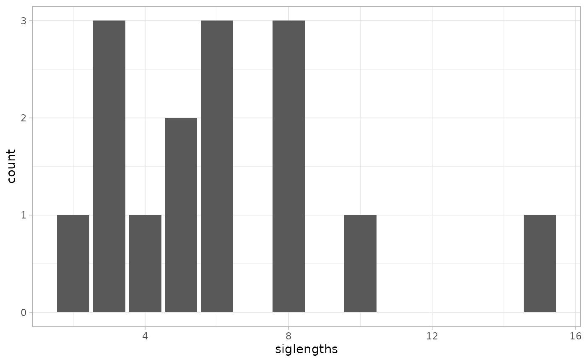
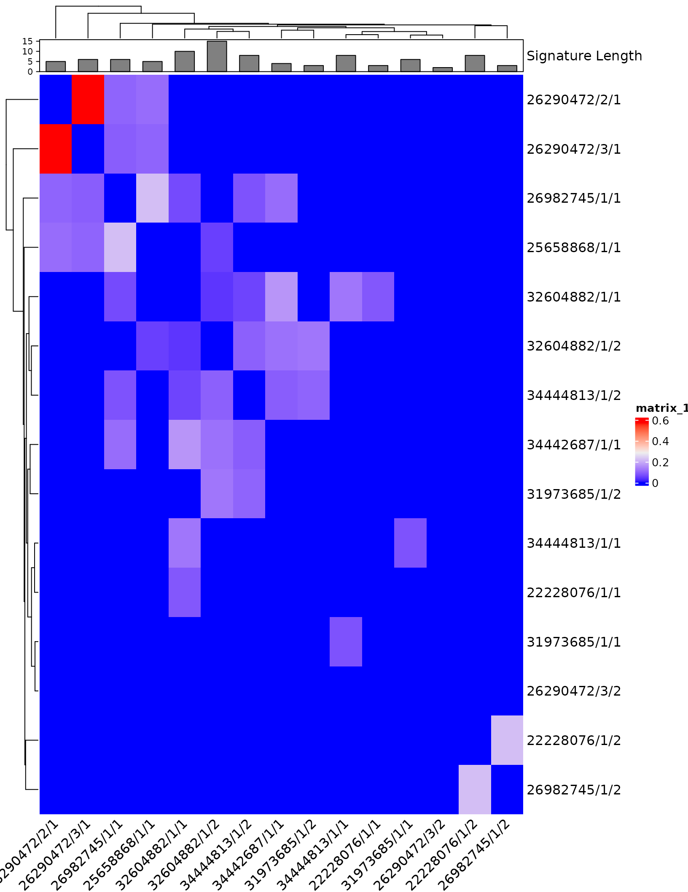
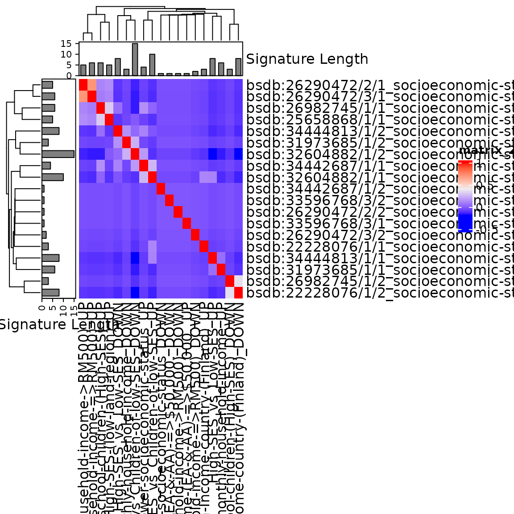
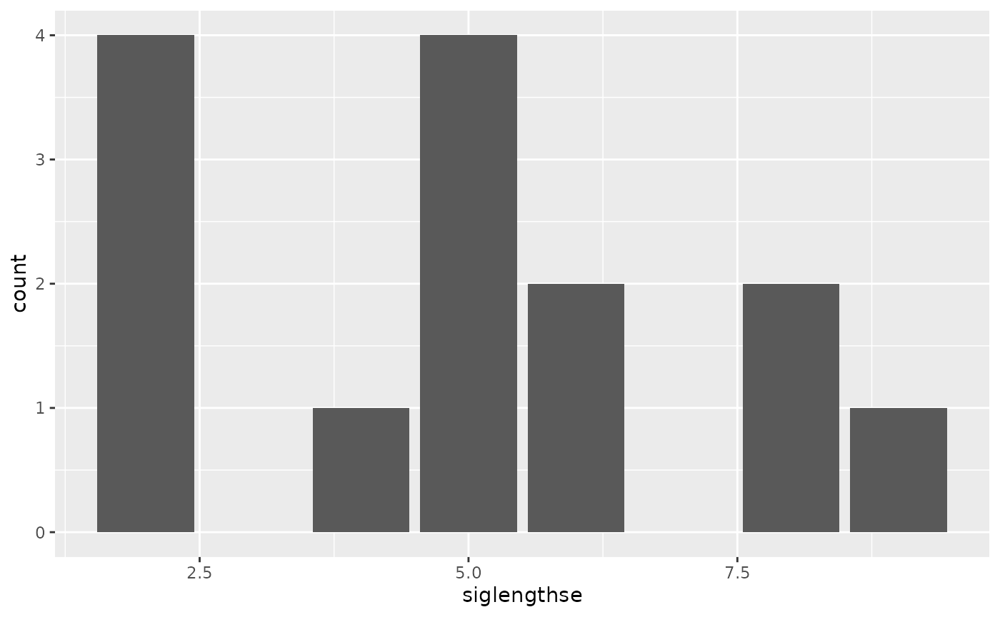
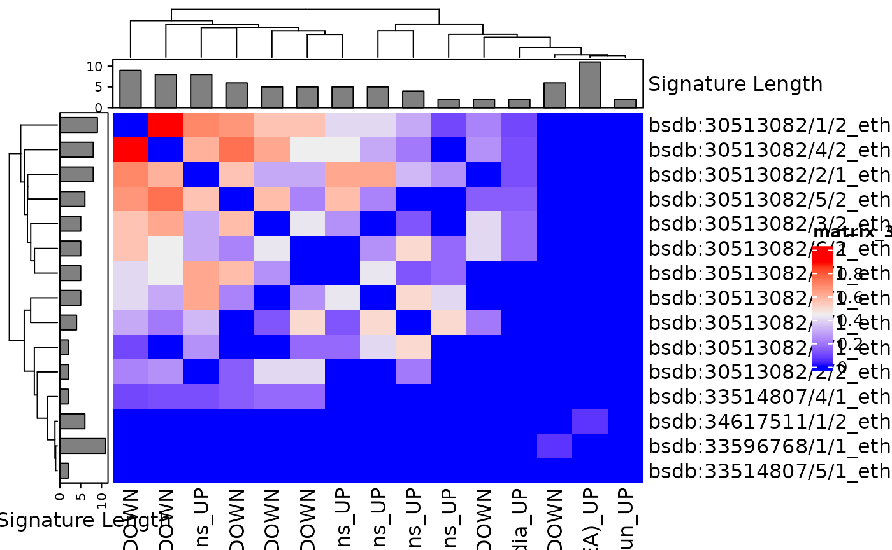
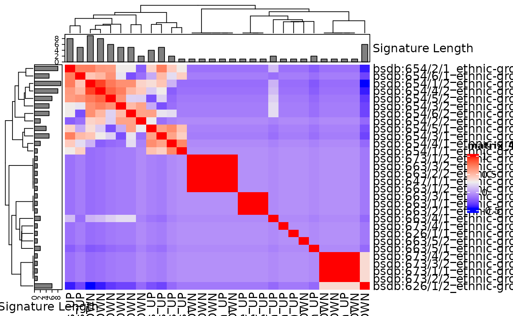

# Distinguishing socioeconomic and racial/ethnic variation of the human gut microbiome by re-analysis of studies from around the world

## Objectives of the study

To assess commonality or heterogeneity in socioeconomic and ethnic
patterning of the fecal microbiome in studies undertaken in various
parts of the world, through cluster analysis of results on
differentially abundant taxa.

## Data Analysis Plan

1.  creating frequency tables of how many signatures each microbial
    taxon (species, genus, or other rank) has been reported – by
    race/ethnicity separately, by SES separately, and for all studies
    combined.

2.  cluster analysis of the signatures. Similarity between all pairs of
    signatures will be calculated using Jaccard Distance, to create a
    distance matrix. This distance matrix will be used for hierarchical
    clustering, to identify subgroups of similar signatures. This
    analysis will be performed separately for signatures of increased
    abundance and of decreased abundance (in low SES and
    non-white/Caucasian ethnicity) repeated using Semantic Similarity as
    an alternative measure of signature similarity, in sensitivity
    analysis.

3.  Common and distinct effects of SES and race/ethnicity on the gut
    microbiome will be identified using meta-regression for the most
    identified taxa. Specifically, the signature will be the unit of
    analysis, with the presence or absence of the taxon in each study
    coded as a 0/1 binary variable in a regression analysis.

## Install Packages

This is not evaluated, run manually if needed.

``` r

if (!require("BiocManager", quietly = TRUE))
    install.packages("BiocManager")
BiocManager::install()
BiocManager::version()
BiocManager::install("remotes", dependencies = TRUE)
BiocManager::install("waldronlab/bugSigSimple")
BiocManager::install("curatedMetagenomicData")
devtools::install_github("waldronlab/BugSigDBStats")
devtools::install_github("waldronlab/bugsigdbr")
```

``` r

suppressPackageStartupMessages({
  library(bugSigSimple)
  library(BugSigDBStats)
  library(bugsigdbr)
  library(tidyverse)
  library(stringr)
  library(kableExtra)
  library(dplyr)
  library(ComplexHeatmap)
  library(jtools) # to make a pretty glm summary output
})

theme_set(theme_light())
```

## Import data from Bugsigdb database

``` r

dat <- bugsigdbr::importBugSigDB(cache = FALSE) #11/27/2022
```

``` r

dim(dat)
```

    ## [1] 7425   51

## Subset Signatures by Curator and Conditions

``` r

dat.sub <- subsetByCurator(dat, "Kaluifeanyi101") %>%
  dplyr::filter(`Body site` == "Feces") %>%
  mutate(`Body site` = tolower(`Body site`)) %>%
  mutate(`Condition` = tolower(`Condition`))

table(dat.sub[,"Condition"]) %>%
  sort(decreasing = TRUE) %>% 
  as.data.frame() %>% 
  kbl() %>% 
  kable_styling()
```

| Var1                                        | Freq |
|:--------------------------------------------|-----:|
| ethnic group                                |   31 |
| socioeconomic status                        |   19 |
| ethnic group,socioeconomic status           |    2 |
| place of residence measurement,ethnic group |    2 |
| risk factor                                 |    2 |
| sampling time                               |    2 |

## Table of studies

``` r

bugSigSimple::createStudyTable(dat.sub) %>%
  kbl() %>%
  kable_styling()
```

| Study Identifier | MaxCases | MaxControls | Study design | Condition | N_signatures | PMID | DOI | URL |
|:---|---:|---:|:---|:---|---:|:---|:---|:---|
| AmaruddinA.I.\_2020 | 74 | 66 | cross-sectional observational, not case-control | socioeconomic status | 2 | 32604882 | <https://doi.org/10.3390/microorganisms8060961> | NA |
| AngQ.Y.\_2021 | 22 | 24 | cross-sectional observational, not case-control | ethnic group | 2 | 34617511 | <https://doi.org/10.7554/eLife.70349> | <https://pubmed.ncbi.nlm.nih.gov/34617511> |
| BalakrishnanB.\_2021 | 30 | 30 | cross-sectional observational, not case-control | ethnic group; socioeconomic status | 3 | 33596768 | <https://doi.org/10.1080/19490976.2021.1882926> | NA |
| BrooksA.W.\_2018 | 88 | 1237 | cross-sectional observational, not case-control | ethnic group | 12 | 30513082 | <https://doi.org/10.1371/journal.pbio.2006842> | <https://pubmed.ncbi.nlm.nih.gov/30513082/> |
| CarsonT.L.\_2018 | 47 | 33 | cross-sectional observational, not case-control | ethnic group | 1 | 29901485 | <https://doi.org/10.1097/PSY.0000000000000614>. | <https://pubmed.ncbi.nlm.nih.gov/29901485/> |
| ChongC.W.\_2015 | 20 | 24 | cross-sectional observational, not case-control | socioeconomic status | 4 | 26290472 | <https://doi.org/10.1038/srep13338> | <https://pubmed.ncbi.nlm.nih.gov/26290472/> |
| DeFilippoC.\_2010 | 14 | 15 | cross-sectional observational, not case-control | place of residence measurement,ethnic group | 2 | 20679230 | <https://doi.org/10.1073/pnas.1005963107> | <https://pubmed.ncbi.nlm.nih.gov/20679230/> |
| DwiyantoJ.\_2021 | 54 | 65 | cross-sectional observational, not case-control | ethnic group | 9 | 33514807 | <https://doi.org/10.1038/s41598-021-82311-3> | <https://pubmed.ncbi.nlm.nih.gov/33514807/> |
| EscobarJ.S.\_2014 | 30 | 54 | cross-sectional observational, not case-control | ethnic group | 6 | 25495462 | <https://doi.org/10.1186/s12866-014-0311-6> | <https://www.ncbi.nlm.nih.gov/pmc/articles/PMC4275940/> |
| GreenhillA.R.\_2015 | 86 | 29 | cross-sectional observational, not case-control | socioeconomic status | 1 | 25658868 | <https://doi.org/10.1371/journal.pone.0117427> | <https://pubmed.ncbi.nlm.nih.gov/25658868/> |
| GrześkowiakŁ.\_2012 | 44 | 31 | cross-sectional observational, not case-control | socioeconomic status | 2 | 22228076 | <https://doi.org/10.1097/MPG.0b013e318249039c>. | <https://pubmed.ncbi.nlm.nih.gov/22228076/> |
| KortekangasE.\_2020 | NA | NA | prospective cohort | sampling time | 2 | 32011017 | <https://doi.org/10.1111/ppe.12623> | NA |
| LapidotY.\_2021 | 70 | 69 | cross-sectional observational, not case-control | socioeconomic status | 2 | 34444813 | <https://doi.org/10.3390/nu13082645> | <https://pubmed.ncbi.nlm.nih.gov/34444813/> |
| LevinA.M.\_2016 | 168 | 130 | prospective cohort | risk factor | 2 | 27558272 | <https://doi.org/10.1038/srep31775> | NA |
| LewisC.R.\_2021 | NA | NA | cross-sectional observational, not case-control | socioeconomic status | 2 | 34442687 | <https://doi.org/10.3390/microorganisms9081608> | <https://pubmed.ncbi.nlm.nih.gov/34442687/> |
| LinA.\_2013 | 6 | 4 | cross-sectional observational, not case-control | ethnic group,socioeconomic status | 2 | 23349750 | <https://doi.org/10.1371/journal.pone.0053838> | <https://pubmed.ncbi.nlm.nih.gov/23349750/> |
| MelloC.S.\_2016 | 100 | 30 | cross-sectional observational, not case-control | socioeconomic status | 2 | 26982745 | <https://doi.org/10.1097/MPG.0000000000001186> | <https://pubmed.ncbi.nlm.nih.gov/26982745/> |
| Moran-RamosS.\_2020 | NA | NA | cross-sectional observational, not case-control | socioeconomic status | 2 | 31973685 | <https://doi.org/10.1080/19490976.2020.1712985> | <https://pubmed.ncbi.nlm.nih.gov/31973685/> |

## Taxon Frequency Table by SES

``` r

dat.sub_SES <- filter(dat.sub, dat.sub$Condition == "socioeconomic status") 
dim(dat.sub_SES)
```

    ## [1] 19 51

``` r

bugSigSimple::createTaxonTable(dat.sub_SES)  %>%
  kbl() %>%
  kable_styling()
```

| Taxon Name | Taxonomic Level | total_signatures | increased_signatures | decreased_signatures | Binomial Test pval |
|:---|:---|---:|---:|---:|---:|
| Eubacterium | genus | 4 | 3 | 1 | 0.63 |
| Bacteroidota | phylum | 4 | 4 | 0 | 0.12 |
| Prevotella | genus | 3 | 0 | 3 | 0.25 |
| Deltaproteobacteria | class | 2 | 2 | 0 | 0.50 |
| Bifidobacterium | genus | 2 | 2 | 0 | 0.50 |
| Atopobiaceae | family | 2 | 1 | 1 | 1.00 |
| Bacillota | phylum | 2 | 2 | 0 | 0.50 |
| Clostridium perfringens | species | 2 | 0 | 2 | 0.50 |
| Oscillospiraceae | family | 2 | 2 | 0 | 0.50 |
| Faecalibacterium | genus | 2 | 1 | 1 | 1.00 |

## Taxon Frequency Table by Race-ethnicity

``` r

dat.sub_ethnic <- dat.sub %>% filter(dat.sub$Condition == "ethnic group") 
dim(dat.sub_ethnic)
```

    ## [1] 31 51

``` r

bugSigSimple::createTaxonTable(dat.sub_ethnic)  %>%
  kbl() %>%
  kable_styling()
```

| Taxon Name | Taxonomic Level | total_signatures | increased_signatures | decreased_signatures | Binomial Test pval |
|:---|:---|---:|---:|---:|---:|
| Eubacteriales | order | 7 | 2 | 5 | 0.450 |
| Coriobacteriaceae | family | 6 | 2 | 4 | 0.690 |
| Christensenellaceae | family | 6 | 1 | 5 | 0.220 |
| Peptococcaceae | family | 6 | 3 | 3 | 1.000 |
| Veillonella | genus | 6 | 6 | 0 | 0.031 |
| Odoribacteraceae | family | 6 | 3 | 3 | 1.000 |
| Odoribacter | genus | 6 | 3 | 3 | 1.000 |
| Rikenellaceae | family | 6 | 2 | 4 | 0.690 |
| Victivallaceae | family | 6 | 4 | 2 | 0.690 |
| Verrucomicrobiaceae | family | 6 | 0 | 6 | 0.031 |

## Taxon Frequency Table by all studies (SES and Ethnicity) combined.

``` r

bugSigSimple::createTaxonTable(dat.sub, n = 50) %>%
  kbl() %>%
  kable_styling()
```

| Taxon Name | Taxonomic Level | total_signatures | increased_signatures | decreased_signatures | Binomial Test pval |
|:---|:---|---:|---:|---:|---:|
| Prevotella | genus | 10 | 6 | 4 | 0.750 |
| Eubacteriales | order | 9 | 4 | 5 | 1.000 |
| Rikenellaceae | family | 8 | 4 | 4 | 1.000 |
| Coriobacteriaceae | family | 7 | 2 | 5 | 0.450 |
| Bacillota | phylum | 7 | 3 | 4 | 1.000 |
| Veillonella | genus | 7 | 7 | 0 | 0.016 |
| Bacteroides | genus | 7 | 2 | 5 | 0.450 |
| Odoribacter | genus | 7 | 4 | 3 | 1.000 |
| Christensenellaceae | family | 6 | 1 | 5 | 0.220 |
| Clostridium | genus | 6 | 4 | 2 | 0.690 |
| Eubacterium | genus | 6 | 4 | 2 | 0.690 |
| Peptococcaceae | family | 6 | 3 | 3 | 1.000 |
| Odoribacteraceae | family | 6 | 3 | 3 | 1.000 |
| Victivallaceae | family | 6 | 4 | 2 | 0.690 |
| Verrucomicrobiaceae | family | 6 | 0 | 6 | 0.031 |
| Ruminococcus | genus | 5 | 3 | 2 | 1.000 |
| Bacteroidota | phylum | 5 | 5 | 0 | 0.062 |
| Bifidobacterium | genus | 4 | 3 | 1 | 0.630 |
| Bifidobacterium longum | species | 4 | 3 | 1 | 0.630 |
| Oscillospiraceae | family | 4 | 4 | 0 | 0.120 |
| Faecalibacterium | genus | 4 | 3 | 1 | 0.630 |
| Faecalibacterium prausnitzii | species | 4 | 2 | 2 | 1.000 |
| Bifidobacterium adolescentis | species | 3 | 1 | 2 | 1.000 |
| Bifidobacterium bifidum | species | 3 | 2 | 1 | 1.000 |
| Lactobacillus | genus | 3 | 2 | 1 | 1.000 |
| Blautia | genus | 3 | 2 | 1 | 1.000 |
| Bacteroides fragilis | species | 3 | 1 | 2 | 1.000 |
| Bacteroides thetaiotaomicron | species | 3 | 0 | 3 | 0.250 |
| Enterobacteriaceae | family | 3 | 1 | 2 | 1.000 |
| Deltaproteobacteria | class | 2 | 2 | 0 | 0.500 |
| Actinomycetota | phylum | 2 | 2 | 0 | 0.500 |
| Bifidobacterium breve | species | 2 | 1 | 1 | 1.000 |
| Bifidobacterium catenulatum | species | 2 | 1 | 1 | 1.000 |
| Bifidobacterium pseudocatenulatum | species | 2 | 1 | 1 | 1.000 |
| Bifidobacterium ruminantium | species | 2 | 1 | 1 | 1.000 |
| Atopobiaceae | family | 2 | 1 | 1 | 1.000 |
| Slackia | genus | 2 | 2 | 0 | 0.500 |
| Staphylococcus | genus | 2 | 1 | 1 | 1.000 |
| Enterococcus | genus | 2 | 2 | 0 | 0.500 |
| Lactococcus | genus | 2 | 1 | 1 | 1.000 |
| Clostridium perfringens | species | 2 | 0 | 2 | 0.500 |
| Anaerotruncus | genus | 2 | 1 | 1 | 1.000 |
| Oscillospira | genus | 2 | 1 | 1 | 1.000 |
| butyrate-producing bacterium M21/2 | species | 2 | 1 | 1 | 1.000 |
| Clostridiales bacterium | species | 2 | 1 | 1 | 1.000 |
| Lachnospiraceae | family | 2 | 1 | 1 | 1.000 |
| Anaerostipes | genus | 2 | 2 | 0 | 0.500 |
| Butyrivibrio | genus | 2 | 2 | 0 | 0.500 |
| Coprococcus | genus | 2 | 1 | 1 | 1.000 |
| Dorea | genus | 2 | 1 | 1 | 1.000 |

## Cluster Analysis for signatures of increased abundance and of decreased abundance in low SES calculated using Jaccard Distance to create a distance matrix.

``` r

allsigs <- bugsigdbr::getSignatures(dat.sub_SES , tax.id.type = "taxname")
allsigs <- allsigs[sapply(allsigs, length) > 1] #require length > 1
length(allsigs)
```

    ## [1] 15

``` r

mydists <- BugSigDBStats::calcPairwiseOverlaps(allsigs)
dim(mydists)
```

    ## [1] 22  8

## Visualize the distribution of the signature lengths

``` r

library(ggplot2)
siglengths <- sapply(allsigs, length)
siglengths.df <- data.frame(siglengths = siglengths)
ggplot(siglengths.df, aes(x=siglengths)) +
  geom_bar()
```



``` r

table(siglengths)
```

    ## siglengths
    ##  2  3  4  5  6  8 10 15 
    ##  1  3  1  2  3  3  1  1

## Create a matrix of Jaccard similarities (0 for no overlap, 1 for 100% overlap)

``` r

jmat <- BugSigDBStats::calcJaccardSimilarity(allsigs)
```

\##Create a Clustered heatmap

``` r

library(ComplexHeatmap)

ha <- HeatmapAnnotation(`Signature Length` = anno_barplot(siglengths))
hr <- rowAnnotation(
  `Signature Length` = anno_barplot(siglengths)
  )
hm <- Heatmap(
  jmat,
  top_annotation = ha,
#  left_annotation = hr,
#  column_names_max_height = unit(23, "cm"),
  column_names_rot = 45,
#  row_names_max_width = unit(15, "cm"),
#  get rid of study labels
  row_labels = sub("bsdb:", "", sub("_.+", "", rownames(jmat)), fixed = TRUE),  
  column_labels = sub("bsdb:", "", sub("_.+", "", colnames(jmat)), fixed = TRUE)
)

hm
```



## Create a wide format dataframe for Regression Analysis

``` r

dat_withsigs <- filter(dat.sub_SES , !is.na(dat.sub_SES$`NCBI Taxonomy IDs`))
sigs <- bugsigdbr::getSignatures(dat_withsigs, tax.id.type = "taxname")
cmat <- t(safe::getCmatrix(sigs, as.matrix = TRUE, min.size = 0, prune = FALSE))
```

    ## WARNING: rows are sorted elements of keyword.list
    ## 19 categories formed

``` r

cdf <- data.frame(cmat, stringsAsFactors = FALSE, check.names = FALSE)
cdf <- cbind(dat_withsigs, cdf)
dim(cdf)
```

    ## [1]  19 122

An arbitrary example of meta-regression:

``` r

fit <-
  glm(
    Prevotella ~ `Location of subjects` + `Sequencing type` + `Abundance in Group 1`,
    family = binomial(link = "logit"),
    data = cdf
  )
```

    ## Warning: glm.fit: fitted probabilities numerically 0 or 1 occurred

``` r

jtools::summ(fit)
```

|                    |                          |
|:-------------------|-------------------------:|
| Observations       |                       19 |
| Dependent variable |               Prevotella |
| Type               | Generalized linear model |
| Family             |                 binomial |
| Link               |                    logit |

|                         |       |
|:------------------------|------:|
| 𝛘²(9)                   | 16.57 |
| p                       |  0.06 |
| Pseudo-R² (Cragg-Uhler) |  1.00 |
| Pseudo-R² (McFadden)    |  1.00 |
| AIC                     | 20.00 |
| BIC                     | 29.44 |

|                                                |   Est. |      S.E. | z val. |    p |
|:-----------------------------------------------|-------:|----------:|-------:|-----:|
| (Intercept)                                    | -25.46 | 204549.83 |  -0.00 | 1.00 |
| `Location of subjects`Finland,Malawi           |   0.00 | 409099.66 |   0.00 | 1.00 |
| `Location of subjects`Indonesia                |  50.34 | 240037.20 |   0.00 | 1.00 |
| `Location of subjects`Israel                   |  50.34 | 240037.20 |   0.00 | 1.00 |
| `Location of subjects`Malaysia                 |   0.00 | 250521.36 |   0.00 | 1.00 |
| `Location of subjects`Mexico                   |  50.34 | 240037.20 |   0.00 | 1.00 |
| `Location of subjects`Papua New Guinea         |  48.67 | 429466.83 |   0.00 | 1.00 |
| `Location of subjects`United States of America |   0.00 | 289277.14 |   0.00 | 1.00 |
| `Sequencing type`WMS                           |  -0.00 | 289277.14 |  -0.00 | 1.00 |
| `Abundance in Group 1`increased                | -49.77 | 125607.00 |  -0.00 | 1.00 |
|  Standard errors: MLE                          |        |           |        |      |

## Create another heatmap on correlations of presence/absence of taxa.

``` r

sigcors <- cor(t(cmat))
siglengths <- sapply(sigs, length)
ha <- HeatmapAnnotation(`Signature Length` = anno_barplot(siglengths))
hr <- rowAnnotation(`Signature Length` = anno_barplot(siglengths))
hm <- Heatmap(
  sigcors,
  top_annotation = ha, left_annotation = hr,
  # row_names_max_width = unit(.05, "cm"),
  # column_names_max_height = unit(.1, "cm"),
 # row_labels = sub(".+:", "", rownames(sigcors)), ##removing study just to make signature names legible
  column_labels = sub(".+:", "", colnames(sigcors))
)
hm
```



## Cluster Analysis for signatures of increased abundance and of decreased abundance in non-white/caucasions calculated using Jaccard Distance to create a distance matrix.

``` r

allsige <- bugsigdbr::getSignatures(dat.sub_ethnic , tax.id.type = "taxname")
allsige <- allsige[sapply(allsige, length) > 1] #require length > 1
length(allsige )
```

    ## [1] 15

``` r

mydistse <- BugSigDBStats::calcPairwiseOverlaps(allsige)
dim(mydistse)
```

    ## [1] 52  8

## Visualize the distribution of the signature lengths

``` r

library(ggplot2)
siglengthse <- sapply(allsige, length)
siglengthse.df <- data.frame(siglengthse = siglengthse)
ggplot(siglengthse.df, aes(x=siglengthse)) +
  geom_bar()
```



``` r

table(siglengthse)
```

    ## siglengthse
    ##  2  4  5  6  8  9 11 
    ##  4  1  4  2  2  1  1

## Create a matrix of Jaccard similarities (0 for no overlap, 1 for 100% overlap)

``` r

jmate <- BugSigDBStats::calcJaccardSimilarity(allsige)
```

## Create a Clustered heatmap

``` r

library(ComplexHeatmap)

hae <- HeatmapAnnotation(`Signature Length` = anno_barplot(siglengthse))
hre <- rowAnnotation(`Signature Length` = anno_barplot(siglengthse))
hme <- Heatmap(
  jmate,
  top_annotation = hae, left_annotation = hre,
  #row_names_max_width = unit(.10,"cm"),
  column_names_max_height = unit(1.0, "cm"),
#  row_labels = sub(".+:", "", rownames(jmate)),  #get rid of study labels
  column_labels = sub(".+:", "", colnames(jmate))
)

hme
```



## Create a wide format dataframe

``` r

dat_withsigse <- filter(dat.sub_ethnic , !is.na(dat.sub_ethnic$`NCBI Taxonomy IDs`))
sigse <- bugsigdbr::getSignatures(dat_withsigse, tax.id.type = "taxname")
cmate <- t(safe::getCmatrix(sigse, as.matrix = TRUE, min.size = 0, prune = FALSE))
```

    ## WARNING: rows are sorted elements of keyword.list
    ## 31 categories formed

``` r

cdfe <- data.frame(cmate, stringsAsFactors = FALSE, check.names = FALSE)
cdfe <- cbind(dat_withsigse, cdfe)
colnames(cdfe)[1:25]
```

    ##  [1] "BSDB ID"               "Study"                 "Study design"         
    ##  [4] "PMID"                  "DOI"                   "URL"                  
    ##  [7] "Authors list"          "Title"                 "Journal"              
    ## [10] "Year"                  "Keywords"              "Experiment"           
    ## [13] "Location of subjects"  "Host species"          "Body site"            
    ## [16] "UBERON ID"             "Condition"             "EFO ID"               
    ## [19] "Group 0 name"          "Group 1 name"          "Group 1 definition"   
    ## [22] "Group 0 sample size"   "Group 1 sample size"   "Antibiotics exclusion"
    ## [25] "Sequencing type"

## Create another heatmap on correlations of presence/absence of taxa.

``` r

sigcorse <- cor(t(cmate))
siglengthse <- sapply(sigse, length)
hae <- HeatmapAnnotation(`Signature Length` = anno_barplot(siglengthse))
hre <- rowAnnotation(`Signature Length` = anno_barplot(siglengthse))
hme <- Heatmap(
  sigcorse,
  top_annotation = hae, left_annotation = hre,
  row_names_max_width = unit(.05, "cm"),
  column_names_max_height = unit(.1, "cm"),
 # row_labels = sub(".+:", "", rownames(sigcors)), ##removing study just to make signature names legible
  column_labels = sub(".+:", "", colnames(sigcorse))
)
hme
```


