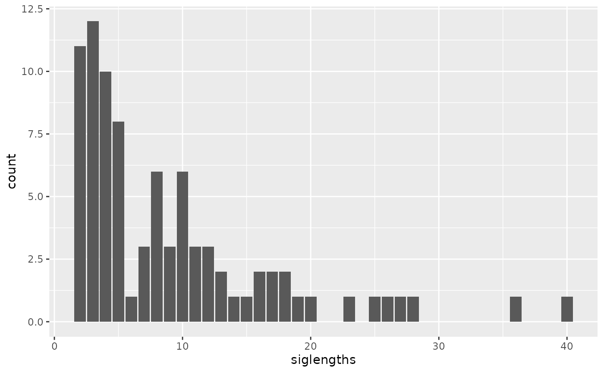
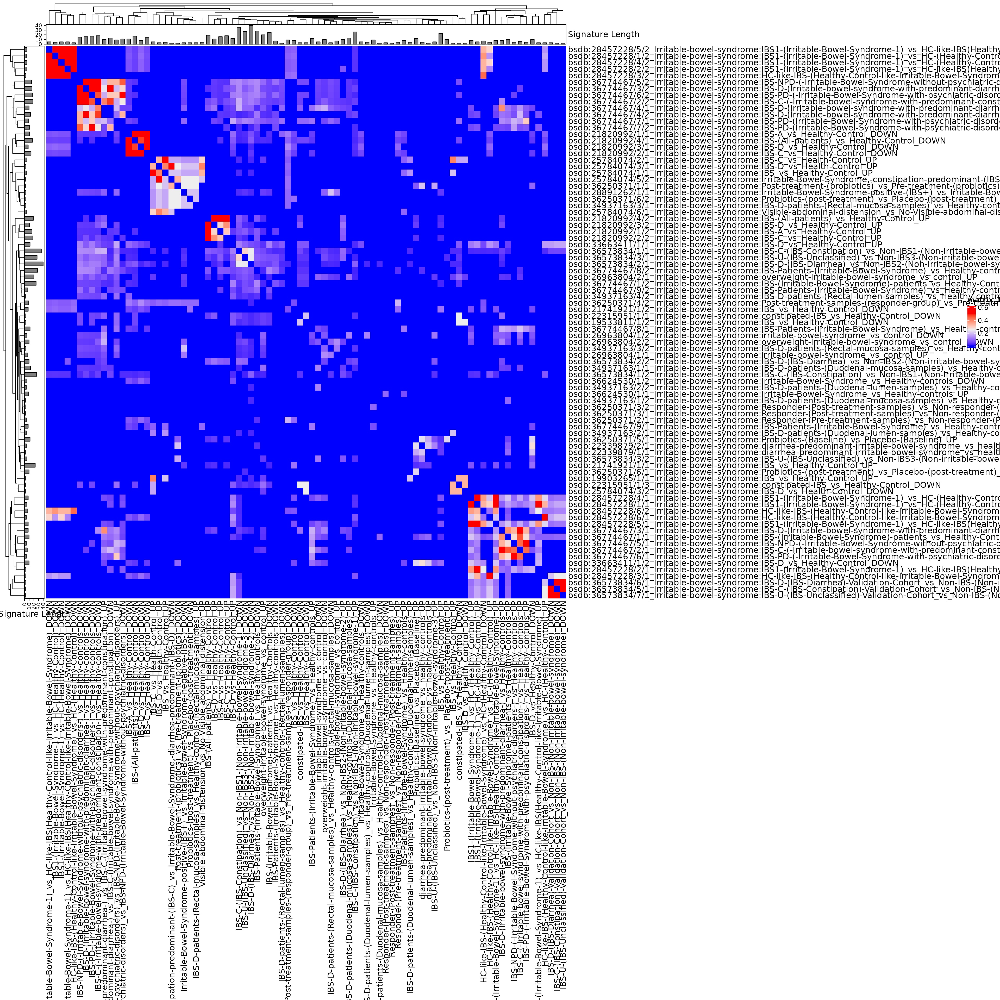
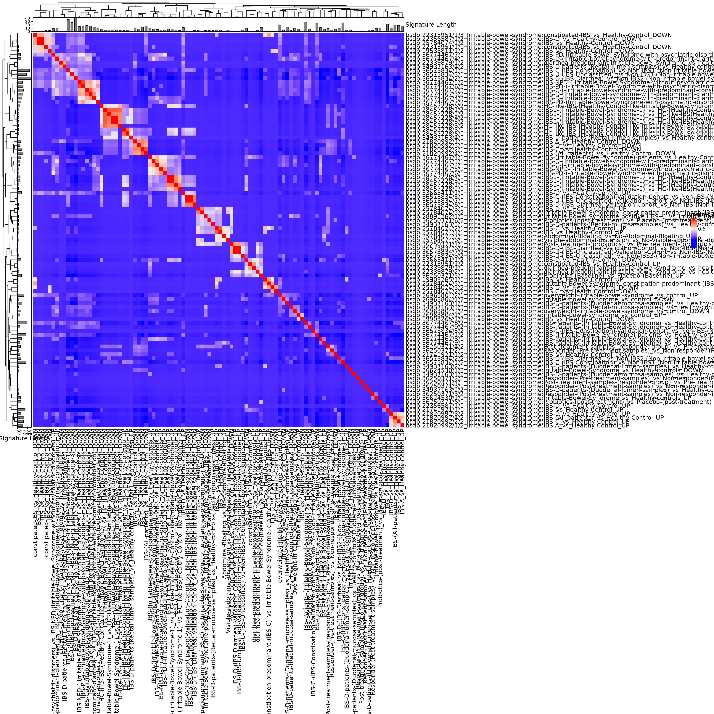

# The Irritable Bowel Syndrome-associated Microbiome

## Analysis objectives

1.  Import, recode, and subset data from bugsigdb.org  
2.  Create a table of studies
3.  Create a clustered heatmap showing similarity of signatures from
    independent studies
4.  Calculate the frequency of appearance of each taxa in independent
    signatures, and identify the most frequently reported taxa
5.  Estimate the probability of the most frequently identified taxa
    occuring so frequently by chance

## Packages installation

Install packages (not evaluated in vignette)

``` r

install.packages(c("devtools", "tidyverse", "kableExtra", "gt", "glue"))
devtools::install_github("waldronlab/bugSigSimple")
devtools::install_github("waldronlab/BugSigDBStats")
devtools::install_github("waldronlab/bugsigdbr")
```

## Data import, recoding, and subset

``` r

library(bugSigSimple)
dat <- bugsigdbr::importBugSigDB(cache = FALSE) 
```

``` r

dim(dat)
```

    ## [1] 7425   51

``` r

names(dat)
```

    ##  [1] "BSDB ID"                    "Study"                     
    ##  [3] "Study design"               "PMID"                      
    ##  [5] "DOI"                        "URL"                       
    ##  [7] "Authors list"               "Title"                     
    ##  [9] "Journal"                    "Year"                      
    ## [11] "Keywords"                   "Experiment"                
    ## [13] "Location of subjects"       "Host species"              
    ## [15] "Body site"                  "UBERON ID"                 
    ## [17] "Condition"                  "EFO ID"                    
    ## [19] "Group 0 name"               "Group 1 name"              
    ## [21] "Group 1 definition"         "Group 0 sample size"       
    ## [23] "Group 1 sample size"        "Antibiotics exclusion"     
    ## [25] "Sequencing type"            "16S variable region"       
    ## [27] "Sequencing platform"        "Data transformation"       
    ## [29] "Statistical test"           "Significance threshold"    
    ## [31] "MHT correction"             "LDA Score above"           
    ## [33] "Matched on"                 "Confounders controlled for"
    ## [35] "Pielou"                     "Shannon"                   
    ## [37] "Chao1"                      "Simpson"                   
    ## [39] "Inverse Simpson"            "Richness"                  
    ## [41] "Signature page name"        "Source"                    
    ## [43] "Curated date"               "Curator"                   
    ## [45] "Revision editor"            "Description"               
    ## [47] "Abundance in Group 1"       "MetaPhlAn taxon names"     
    ## [49] "NCBI Taxonomy IDs"          "State"                     
    ## [51] "Reviewer"

``` r

#library(tidyverse)
#condition_of_interest <- c("irritable bowel syndrome")
#efo <- bugsigdbr::getOntology("efo")
#dat_condition <- bugsigdbr::subsetByOntology(dat, column = "Condition", "irritable bowel syndrome", efo) %>%
#  mutate(comparison1 = paste(`Group 0 name`, `Group 1 name`, sep = " vs "))
library(tidyverse)
```

    ## ── Attaching core tidyverse packages ──────────────────────── tidyverse 2.0.0 ──
    ## ✔ dplyr     1.2.1     ✔ readr     2.2.0
    ## ✔ forcats   1.0.1     ✔ stringr   1.6.0
    ## ✔ ggplot2   4.0.3     ✔ tibble    3.3.1
    ## ✔ lubridate 1.9.5     ✔ tidyr     1.3.2
    ## ✔ purrr     1.2.2     
    ## ── Conflicts ────────────────────────────────────────── tidyverse_conflicts() ──
    ## ✖ dplyr::filter() masks stats::filter()
    ## ✖ dplyr::lag()    masks stats::lag()
    ## ℹ Use the conflicted package (<http://conflicted.r-lib.org/>) to force all conflicts to become errors

``` r

library(bugsigdbr)
dat <- importBugSigDB(cache = TRUE)  
```

    ## Using cached version from 2026-11-09 16:31:45

``` r

dat_condition <- dat %>%
  filter(grepl("irritable bowel syndrome", Condition, ignore.case = TRUE)) %>%
  mutate(comparison1 = paste(`Group 0 name`, `Group 1 name`, sep = " vs "))

nrow(dat_condition)
```

    ## [1] 101

``` r

head(dat_condition)
```

    ##             BSDB ID    Study                    Study design     PMID
    ## 1 bsdb:19533811/1/2 19533811                    case-control 19533811
    ## 2 bsdb:19903265/1/1 19903265                    case-control 19903265
    ## 3 bsdb:19903265/1/2 19903265                    case-control 19903265
    ## 4 bsdb:21741921/1/1 21741921                    case-control 21741921
    ## 5 bsdb:21741921/1/2 21741921                    case-control 21741921
    ## 6 bsdb:21820992/1/1 21820992 case-control,prospective cohort 21820992
    ##                                DOI  URL
    ## 1              10.3748/wjg.15.2887 <NA>
    ## 2 10.1111/j.1365-2982.2009.01427.x <NA>
    ## 3 10.1111/j.1365-2982.2009.01427.x <NA>
    ## 4     10.1053/j.gastro.2011.06.072 <NA>
    ## 5     10.1053/j.gastro.2011.06.072 <NA>
    ## 6     10.1053/j.gastro.2011.07.043 <NA>
    ##                                                                                                                                                                                                    Authors list
    ## 1                                                                                                             Kerckhoffs A.P., Samsom M., van der Rest M.E., de Vogel J., Knol J., Ben-Amor K. , Akkermans L.M.
    ## 2                                                                                                                                             Tana C., Umesaki Y., Imaoka A., Handa T., Kanazawa M. , Fukudo S.
    ## 3                                                                                                                                             Tana C., Umesaki Y., Imaoka A., Handa T., Kanazawa M. , Fukudo S.
    ## 4 Saulnier D.M., Riehle K., Mistretta T.A., Diaz M.A., Mandal D., Raza S., Weidler E.M., Qin X., Coarfa C., Milosavljevic A., Petrosino J.F., Highlander S., Gibbs R., Lynch S.V., Shulman R.J. , Versalovic J.
    ## 5 Saulnier D.M., Riehle K., Mistretta T.A., Diaz M.A., Mandal D., Raza S., Weidler E.M., Qin X., Coarfa C., Milosavljevic A., Petrosino J.F., Highlander S., Gibbs R., Lynch S.V., Shulman R.J. , Versalovic J.
    ## 6                                                                                                               Rajilić-Stojanović M., Biagi E., Heilig H.G., Kajander K., Kekkonen R.A., Tims S. , de Vos W.M.
    ##                                                                                                                      Title
    ## 1 Lower Bifidobacteria counts in both duodenal mucosa-associated and fecal microbiota in irritable bowel syndrome patients
    ## 2    Altered profiles of intestinal microbiota and organic acids may be the origin of symptoms in irritable bowel syndrome
    ## 3    Altered profiles of intestinal microbiota and organic acids may be the origin of symptoms in irritable bowel syndrome
    ## 4                               Gastrointestinal microbiome signatures of pediatric patients with irritable bowel syndrome
    ## 5                               Gastrointestinal microbiome signatures of pediatric patients with irritable bowel syndrome
    ## 6 Global and deep molecular analysis of microbiota signatures in fecal samples from patients with irritable bowel syndrome
    ##                                                                                                       Journal
    ## 1                                                                           World journal of gastroenterology
    ## 2 Neurogastroenterology and motility : the official journal of the European Gastrointestinal Motility Society
    ## 3 Neurogastroenterology and motility : the official journal of the European Gastrointestinal Motility Society
    ## 4                                                                                            Gastroenterology
    ## 5                                                                                            Gastroenterology
    ## 6                                                                                            Gastroenterology
    ##   Year Keywords   Experiment     Location of subjects Host species
    ## 1 2009     <NA> Experiment 1              Netherlands Homo sapiens
    ## 2 2010     <NA> Experiment 1                    Japan Homo sapiens
    ## 3 2010     <NA> Experiment 1                    Japan Homo sapiens
    ## 4 2011     <NA> Experiment 1 United States of America Homo sapiens
    ## 5 2011     <NA> Experiment 1 United States of America Homo sapiens
    ## 6 2011     <NA> Experiment 1                  Finland Homo sapiens
    ##                         Body site                     UBERON ID
    ## 1 Feces,Mucosa of small intestine UBERON:0001204,UBERON:0001988
    ## 2                           Feces                UBERON:0001988
    ## 3                           Feces                UBERON:0001988
    ## 4                           Feces                UBERON:0001988
    ## 5                           Feces                UBERON:0001988
    ## 6                           Feces                UBERON:0001988
    ##                  Condition      EFO ID    Group 0 name Group 1 name
    ## 1 Irritable bowel syndrome EFO:0000555 Healthy Control          IBS
    ## 2 Irritable bowel syndrome EFO:0000555 Healthy Control          IBS
    ## 3 Irritable bowel syndrome EFO:0000555 Healthy Control          IBS
    ## 4 Irritable bowel syndrome EFO:0000555 Healthy Control          IBS
    ## 5 Irritable bowel syndrome EFO:0000555 Healthy Control          IBS
    ## 6 Irritable bowel syndrome EFO:0000555 Healthy Control        IBS-A
    ##                                                                                                                                                                                                                                                                                                                                                                                                    Group 1 definition
    ## 1                                                                                                                                                                                     Twelve male and 29 female IBS patients included in this study fulfilled the Rome II criteria for IBS and were categorized as diarrhea predominant (IBS-D), constipation predominant (IBS-C) or alternating IBS subgroup (IBS-A)
    ## 2 All patients were diagnosed with IBS after conducting a medical interview based on Rome II criteria and positive judgment by a Rome II modular questionnaire retrospectively and positively fulfilling Rome III criteria. According to Rome II criteria related to bowel habits, 11 subjects had constipation-predominant IBS (IBS-C), eight had diarrhoea-predominant IBS (IBS-D) and seven had mixed IBS (IBS-M).
    ## 3 All patients were diagnosed with IBS after conducting a medical interview based on Rome II criteria and positive judgment by a Rome II modular questionnaire retrospectively and positively fulfilling Rome III criteria. According to Rome II criteria related to bowel habits, 11 subjects had constipation-predominant IBS (IBS-C), eight had diarrhoea-predominant IBS (IBS-D) and seven had mixed IBS (IBS-M).
    ## 4                                                                                                                                                                                               Children ages 7-12 who met the Pediatric Rome III criteria for IBS (Table 1). Subtyping of IBS was based on previous recommendations for IBS in adults because no Pediatric Rome subtype criteria exist for children.
    ## 5                                                                                                                                                                                               Children ages 7-12 who met the Pediatric Rome III criteria for IBS (Table 1). Subtyping of IBS was based on previous recommendations for IBS in adults because no Pediatric Rome subtype criteria exist for children.
    ## 6                                                                                                                                                                                                                                                                                                                                                IBS patients fulfilled the Rome II criteria. Alternating IBS (IBS-A)
    ##   Group 0 sample size Group 1 sample size Antibiotics exclusion Sequencing type
    ## 1                  26                  41                  <NA>            <NA>
    ## 2                  26                  26                  <NA>             WMS
    ## 3                  26                  26                  <NA>             WMS
    ## 4                  27                  28              6 months             16S
    ## 5                  27                  28              6 months             16S
    ## 6                  46                  19                  <NA>             16S
    ##   16S variable region         Sequencing platform Data transformation
    ## 1                  NA                     RT-qPCR          raw counts
    ## 2                  NA                     RT-qPCR                <NA>
    ## 3                  NA                     RT-qPCR                <NA>
    ## 4                 123                   PhyloChip relative abundances
    ## 5                 123                   PhyloChip relative abundances
    ## 6                  NA Human Intestinal Tract Chip                <NA>
    ##          Statistical test Significance threshold MHT correction LDA Score above
    ## 1                  T-Test                   0.05           TRUE              NA
    ## 2    Spearman Correlation                   0.05          FALSE              NA
    ## 3    Spearman Correlation                   0.05          FALSE              NA
    ## 4 Mann-Whitney (Wilcoxon)                   0.05          FALSE              NA
    ## 5 Mann-Whitney (Wilcoxon)                   0.05          FALSE              NA
    ## 6                  T-Test                   0.05           TRUE              NA
    ##   Matched on Confounders controlled for Pielou Shannon Chao1 Simpson
    ## 1       <NA>                       <NA>   <NA>    <NA>  <NA>    <NA>
    ## 2    age,sex                       <NA>   <NA>    <NA>  <NA>    <NA>
    ## 3    age,sex                       <NA>   <NA>    <NA>  <NA>    <NA>
    ## 4       <NA>                       <NA>   <NA>    <NA>  <NA>    <NA>
    ## 5       <NA>                       <NA>   <NA>    <NA>  <NA>    <NA>
    ## 6       <NA>                       <NA>   <NA>    <NA>  <NA>    <NA>
    ##   Inverse Simpson  Richness Signature page name
    ## 1            <NA>      <NA>         Signature 2
    ## 2            <NA>      <NA>         Signature 1
    ## 3            <NA>      <NA>         Signature 2
    ## 4            <NA> unchanged         Signature 1
    ## 5            <NA> unchanged         Signature 2
    ## 6            <NA>      <NA>         Signature 1
    ##                             Source Curated date   Curator
    ## 1                   Tables 2 and 3 19 July 2021 Kwekuamoo
    ## 2                          Table 2  4 July 2021 Kwekuamoo
    ## 3                             text 19 July 2023  Atrayees
    ## 4 Figure 2; Supplementary Table 1A  8 July 2021 Kwekuamoo
    ## 5 Figure 2; Supplementary Table 1B  8 July 2021 Kwekuamoo
    ## 6                         Table 1. 15 July 2021 Kwekuamoo
    ##                    Revision editor
    ## 1        Chloe,Kwekuamoo,WikiWorks
    ## 2     Kwekuamoo,Atrayees,WikiWorks
    ## 3               Atrayees,WikiWorks
    ## 4 Kwekuamoo,Claregrieve1,WikiWorks
    ## 5 Kwekuamoo,Claregrieve1,WikiWorks
    ## 6              Kwekuamoo,WikiWorks
    ##                                                                                                                                                                                                                                                                                                                                                                                                                     Description
    ## 1                                                                                                                                                                                                                                                                                                                                          Real time PCR analysis of fecal bifidobacteria in HS, IBS patients and IBS subgroups
    ## 2                                                                                                                                                                                                                                                                                                                                                            Comparison of GI microbiota between IBS patients and the\ncontrols
    ## 3                                                                                                                                                                                                                                                                                                                                             Comparison of GI microbiota between IBS patients and the controls\n\nAbundance in
    ## 4                                                                                                                                                                                                                                                                                                                                                            Differential microbial abundance between IBS patients and controls
    ## 5                                                                                                                                                                                                                                                                                                                                                            Differential microbial abundance between IBS patients and controls
    ## 6 Differences Between Intestinal Microbiota in Healthy and IBS.\nNOTE. Genus-like phylogenetic groups for which the hybridization signal differed significantly between the healthy subjects and (one of the subtypes of) IBS patients are indicated. Gray shading represents phylogenetic groups with a decreased signal in IBS patients. a) Significant (q < .05) correlation. b) Strongly significant (q < .01) correlation.
    ##   Abundance in Group 1
    ## 1            decreased
    ## 2            increased
    ## 3            decreased
    ## 4            increased
    ## 5            decreased
    ## 6            decreased
    ##                                                                                                                                                                                                                                                                                                                                                                                                                                                                                                                                                                                                                                                                                                                                                                                                                                                                                                                                                                                                                                                                                                                                                                                                                                                                                                                                                                                                                                                                                                                                                                                                                                                                                                                                                                                                                                                                                                                                                                                                                                                                                                                                                                            MetaPhlAn taxon names
    ## 1                                                                                                                                                                                                                                                                                                                                                                                                                                                                                                                                                                                                                                                                                                                                                                                                                                                                                                                                                                                                                                                                                                                                                                                                                                                                                                                                                                                                                                                                                                                                                                                                                                                                                                                                                                                               k__Bacillati|p__Actinomycetota|c__Actinomycetes|o__Bifidobacteriales|f__Bifidobacteriaceae|g__Bifidobacterium|s__Bifidobacterium catenulatum, k__Bacillati|p__Bacillota|c__Clostridia|o__Peptostreptococcales|f__Peptostreptococcaceae|g__Romboutsia|s__Romboutsia lituseburensis, k__Bacillati|p__Actinomycetota|c__Actinomycetes|o__Bifidobacteriales|f__Bifidobacteriaceae|g__Bifidobacterium
    ## 2                                                                                                                                                                                                                                                                                                                                                                                                                                                                                                                                                                                                                                                                                                                                                                                                                                                                                                                                                                                                                                                                                                                                                                                                                                                                                                                                                                                                                                                                                                                                                                                                                                                                                                                                                                                                                                                                                                                                                                                                   k__Bacillati|p__Bacillota|c__Negativicutes|o__Veillonellales|f__Veillonellaceae|g__Veillonella, k__Bacillati|p__Bacillota|c__Bacilli|o__Lactobacillales|f__Lactobacillaceae|g__Lactobacillus
    ## 3                                                                                                                                                                                                                                                                                                                                                                                                                                                                                                                                                                                                                                                                                                                                                                                                                                                                                                                                                                                                                                                                                                                                                                                                                                                                                                                                                                                                                                                                                                                                                                                                                                                                                                                                                                                                                                                                                                                                                                                                                                                                                                      k__Bacillati|p__Bacillota|c__Clostridia|o__Eubacteriales|f__Clostridiaceae|g__Clostridium
    ## 4 k__Pseudomonadati|p__Acidobacteriota|c__Terriglobia|o__Terriglobales|f__Acidobacteriaceae, k__Pseudomonadati|p__Pseudomonadota|c__Gammaproteobacteria|o__Aeromonadales|f__Aeromonadaceae, k__Pseudomonadati|p__Pseudomonadota|c__Gammaproteobacteria|o__Alteromonadales|f__Alteromonadaceae, k__Bacillati|p__Bacillota|c__Bacilli|o__Bacillales|f__Bacillaceae, k__Bacillati|p__Actinomycetota|c__Actinomycetes|o__Micrococcales|f__Cellulomonadaceae, k__Bacillati|p__Bacillota|c__Clostridia|o__Eubacteriales|f__Clostridiaceae, k__Pseudomonadati|p__Pseudomonadota|c__Gammaproteobacteria|o__Legionellales|f__Coxiellaceae, k__Pseudomonadati|p__Thermodesulfobacteriota|c__Desulfobacteria|o__Desulfobacterales|f__Desulfobacteraceae, k__Pseudomonadati|p__Thermodesulfobacteriota|c__Desulfovibrionia|o__Desulfovibrionales|f__Desulfovibrionaceae, k__Pseudomonadati|p__Pseudomonadota|c__Gammaproteobacteria|o__Enterobacterales|f__Enterobacteriaceae, k__Pseudomonadati|p__Pseudomonadota|c__Gammaproteobacteria|o__Enterobacterales|f__Enterobacteriaceae|g__Escherichia|s__Escherichia coli, k__Bacillati|p__Bacillota|c__Clostridia|o__Eubacteriales|f__Eubacteriaceae, k__Bacillati|p__Bacillota|c__Clostridia|o__Lachnospirales|f__Lachnospiraceae, k__Pseudomonadati|p__Nitrospirota|c__Nitrospiria|o__Nitrospirales|f__Nitrospiraceae, k__Pseudomonadati|p__Pseudomonadota|c__Gammaproteobacteria|o__Pasteurellales|f__Pasteurellaceae, k__Bacillati|p__Bacillota|c__Clostridia|o__Eubacteriales|f__Peptococcaceae|g__Peptococcus, k__Bacillati|p__Bacillota|c__Clostridia|o__Peptostreptococcales|f__Peptostreptococcaceae, k__Pseudomonadati|p__Myxococcota|o__Polyangiales|f__Polyangiaceae, k__Pseudomonadati|p__Bacteroidota|c__Bacteroidia|o__Bacteroidales|f__Prevotellaceae, k__Bacillati|p__Actinomycetota|c__Actinomycetes|o__Micrococcales|f__Promicromonosporaceae, k__Bacillati|p__Bacillota|c__Bacilli|o__Lactobacillales|f__Streptococcaceae, k__Pseudomonadati|p__Thermodesulfobacteriota|c__Syntrophobacteria|o__Syntrophobacterales|f__Syntrophobacteraceae, k__Pseudomonadati|p__Pseudomonadota|c__Gammaproteobacteria|o__Thiotrichales|f__Thiotrichaceae
    ## 5                                                                                                                                                                                                                                                                                                                                                                                                                                                                                                                                                                                                                                                                                                                                                                                                                                                                                                                                                                                                                                                                                                                                                                                                                                                                                                                                                                                                                                                                                                                          k__Pseudomonadati|p__Bacteroidota|c__Bacteroidia|o__Bacteroidales|f__Bacteroidaceae, k__Bacillati|p__Actinomycetota|c__Actinomycetes|o__Micrococcales|f__Cellulomonadaceae, k__Bacillati|p__Bacillota|c__Clostridia|o__Lachnospirales|f__Lachnospiraceae, k__Bacillati|p__Bacillota|c__Bacilli|o__Bacillales|f__Paenibacillaceae, k__Pseudomonadati|p__Bacteroidota|c__Bacteroidia|o__Bacteroidales|f__Porphyromonadaceae, k__Bacillati|p__Bacillota|c__Bacilli|o__Lactobacillales|f__Streptococcaceae, k__Pseudomonadati|p__Bacteroidota, k__Pseudomonadati|p__Bacteroidota|c__Bacteroidia|o__Bacteroidales|f__Bacteroidaceae|g__Phocaeicola|s__Phocaeicola vulgatus
    ## 6                                                                                                                                                                                                                                                                                                                                                                                                                                                                                                                                                                                                                                                                                                                                                                                                                                                                                          k__Pseudomonadati|p__Bacteroidota|c__Bacteroidia|o__Bacteroidales|f__Rikenellaceae|g__Alistipes, k__Pseudomonadati|p__Bacteroidota|c__Bacteroidia|o__Bacteroidales|f__Prevotellaceae|g__Alloprevotella|s__Alloprevotella tannerae, k__Pseudomonadati|p__Bacteroidota|c__Bacteroidia|o__Bacteroidales|f__Bacteroidaceae|g__Bacteroides|s__Bacteroides fragilis, k__Pseudomonadati|p__Bacteroidota|c__Bacteroidia|o__Bacteroidales|f__Bacteroidaceae|g__Bacteroides|s__Bacteroides intestinalis, k__Pseudomonadati|p__Bacteroidota|c__Bacteroidia|o__Bacteroidales|f__Bacteroidaceae|g__Phocaeicola|s__Phocaeicola plebeius, k__Pseudomonadati|p__Bacteroidota|c__Bacteroidia|o__Bacteroidales|f__Bacteroidaceae|g__Bacteroides|s__Bacteroides uniformis, k__Bacillati|p__Bacillota|c__Clostridia|o__Eubacteriales|f__Oscillospiraceae|g__Faecalibacterium, k__Pseudomonadati|p__Bacteroidota|c__Bacteroidia|o__Bacteroidales|f__Odoribacteraceae|g__Odoribacter, k__Pseudomonadati|p__Bacteroidota|c__Bacteroidia|o__Bacteroidales|f__Tannerellaceae|g__Parabacteroides, k__Pseudomonadati|p__Bacteroidota|c__Bacteroidia|o__Bacteroidales|f__Bacteroidaceae|g__Phocaeicola|s__Phocaeicola vulgatus, k__Pseudomonadati|p__Bacteroidota|c__Bacteroidia|o__Bacteroidales|f__Tannerellaceae|g__Tannerella
    ##                                                                                                                                                                                                                                                                                                                                                                                                                                                                                                                                                                                                                                                                                                                                                                                                NCBI Taxonomy IDs
    ## 1                                                                                                                                                                                                                                                                                                                                                                                                                                                                                                                                                                                                                                                                               1783272|201174|1760|85004|31953|1678|1686, 1783272|1239|186801|3082720|186804|1501226|1537, 1783272|201174|1760|85004|31953|1678
    ## 2                                                                                                                                                                                                                                                                                                                                                                                                                                                                                                                                                                                                                                                                                                                                  1783272|1239|909932|1843489|31977|29465, 1783272|1239|91061|186826|33958|1578
    ## 3                                                                                                                                                                                                                                                                                                                                                                                                                                                                                                                                                                                                                                                                                                                                                                          1783272|1239|186801|186802|31979|1485
    ## 4 3379134|57723|204432|204433|204434, 3379134|1224|1236|135624|84642, 3379134|1224|1236|135622|72275, 1783272|1239|91061|1385|186817, 1783272|201174|1760|85006|85016, 1783272|1239|186801|186802|31979, 3379134|1224|1236|118969|118968, 3379134|200940|3024418|213118|213119, 3379134|200940|3031449|213115|194924, 3379134|1224|1236|91347|543, 3379134|1224|1236|91347|543|561|562, 1783272|1239|186801|186802|186806, 1783272|1239|186801|3085636|186803, 3379134|40117|203693|189778|189779, 3379134|1224|1236|135625|712, 1783272|1239|186801|186802|186807|2740, 1783272|1239|186801|3082720|186804, 3379134|2818505|3031712|49, 3379134|976|200643|171549|171552, 1783272|201174|1760|85006|85017, 1783272|1239|91061|186826|1300, 3379134|200940|3024408|213462|213465, 3379134|1224|1236|72273|135617
    ## 5                                                                                                                                                                                                                                                                                                                                                                                                                                                                                                                                                    3379134|976|200643|171549|815, 1783272|201174|1760|85006|85016, 1783272|1239|186801|3085636|186803, 1783272|1239|91061|1385|186822, 3379134|976|200643|171549|171551, 1783272|1239|91061|186826|1300, 3379134|976, 3379134|976|200643|171549|815|909656|821
    ## 6                                                                                                                                                                                                                                                                                                                                 3379134|976|200643|171549|171550|239759, 3379134|976|200643|171549|171552|1283313|76122, 3379134|976|200643|171549|815|816|817, 3379134|976|200643|171549|815|816|329854, 3379134|976|200643|171549|815|909656|310297, 3379134|976|200643|171549|815|816|820, 1783272|1239|186801|186802|216572|216851, 3379134|976|200643|171549|1853231|283168, 3379134|976|200643|171549|2005525|375288, 3379134|976|200643|171549|815|909656|821, 3379134|976|200643|171549|2005525|195950
    ##      State     Reviewer              comparison1
    ## 1 Complete        Chloe   Healthy Control vs IBS
    ## 2 Complete     Atrayees   Healthy Control vs IBS
    ## 3 Complete     Atrayees   Healthy Control vs IBS
    ## 4 Complete Claregrieve1   Healthy Control vs IBS
    ## 5 Complete Claregrieve1   Healthy Control vs IBS
    ## 6 Complete     Lwaldron Healthy Control vs IBS-A

### Table of studies

``` r

bugSigSimple::createStudyTable(dat_condition)
```

    ## # A tibble: 17 × 9
    ##    `Study Identifier` MaxCases MaxControls `Study design` Condition N_signatures
    ##    <chr>                 <dbl>       <dbl> <chr>          <chr>            <int>
    ##  1 CarrollI.M._2012         23          23 case-control   Irritabl…            3
    ##  2 ChassardC._2012          14          12 case-control   Irritabl…            3
    ##  3 ChenH._2023             354         354 cross-section… Irritabl…           18
    ##  4 DubocH._2012             14          18 case-control   Irritabl…            2
    ##  5 FourieN.H._2016          11          20 case-control   Irritabl…            4
    ##  6 JacobsJ.P._2023         318         177 case-control   Irritabl…            2
    ##  7 KerckhoffsA.P._20…       41          26 case-control   Irritabl…            1
    ##  8 LabusJ.S._2017           16          23 cross-section… Irritabl…           12
    ##  9 MeiL._2021               30          30 case-control   Irritabl…            2
    ## 10 MertsalmiT.H._2017       18          56 case-control   Irritabl…            1
    ## 11 Rajilić-Stojanovi…       62          46 case-control,… Irritabl…            8
    ## 12 SaulnierD.M._2011        28          27 case-control   Irritabl…            2
    ## 13 ShinS.Y._2022            24          24 randomized co… Irritabl…           11
    ## 14 ShuklaR._2015            47          30 case-control   Irritabl…           10
    ## 15 SuQ._2023               460         460 case-control   Irritabl…           12
    ## 16 TanaC._2010              26          26 case-control   Irritabl…            2
    ## 17 ZhuX._2021               74          20 case-control   Irritabl…            8
    ## # ℹ 3 more variables: PMID <chr>, DOI <chr>, URL <chr>

### Taxon frequency tables by body site

``` r

gut_sigs <- filter(dat_condition,
                   `Body site` %in% c("Feces, Mucosa of small intestine", "Feces"))
```

In this table, the Binomial Test p-value corresponds to the null
hypothesis

H0: the proportion of signatures in which the taxon is reported
increased or decreased, relative to the total number of signatures in
which it is reported, is equal to 0.5

``` r

kableExtra::kbl(bugSigSimple::createTaxonTable(gut_sigs))
```

| Taxon Name | Taxonomic Level | total_signatures | increased_signatures | decreased_signatures | Binomial Test pval |
|:---|:---|---:|---:|---:|---:|
| Bifidobacterium | genus | 14 | 2 | 12 | 0.0130 |
| Faecalibacterium | genus | 14 | 3 | 11 | 0.0570 |
| Bacillota | phylum | 12 | 7 | 5 | 0.7700 |
| Ruminococcus | genus | 12 | 3 | 9 | 0.1500 |
| Holdemania | genus | 11 | 9 | 2 | 0.0650 |
| Parabacteroides | genus | 11 | 3 | 8 | 0.2300 |
| Prevotella | genus | 10 | 2 | 8 | 0.1100 |
| Streptococcus | genus | 8 | 7 | 1 | 0.0700 |
| Coprococcus | genus | 8 | 1 | 7 | 0.0700 |
| Enterocloster | genus | 8 | 8 | 0 | 0.0078 |

## Cluster analysis

Note, this EDA should really be done *before* hypothesis testing.

First calculate pairwise overlaps for all signatures of length \> 1:

``` r

allsigs <- bugsigdbr::getSignatures(dat_condition, tax.id.type = "taxname")
allsigs <- allsigs[sapply(allsigs, length) > 1] #require length > 1
length(allsigs)
```

    ## [1] 85

``` r

mydists <- BugSigDBStats::calcPairwiseOverlaps(allsigs)
dim(mydists)
```

    ## [1] 729   8

What is the distribution of signature lengths?

``` r

library(ggplot2)
siglengths <- sapply(allsigs, length)
siglengths.df <- data.frame(siglengths = siglengths)
ggplot(siglengths.df, aes(x=siglengths)) +
  geom_bar()
```



``` r

table(siglengths)
```

    ## siglengths
    ##  2  3  4  5  6  7  8  9 10 11 12 13 14 15 16 17 18 19 20 23 25 26 27 28 36 40 
    ## 11 12 10  8  1  3  6  3  6  3  3  2  1  1  2  2  2  1  1  1  1  1  1  1  1  1

Create a matrix of Jaccard similarities (0 for no overlap, 1 for 100%
overlap)

``` r

jmat <- BugSigDBStats::calcJaccardSimilarity(allsigs)
```

``` r

library(ComplexHeatmap)
```

    ## Loading required package: grid

    ## ========================================
    ## ComplexHeatmap version 2.28.0
    ## Bioconductor page: http://bioconductor.org/packages/ComplexHeatmap/
    ## Github page: https://github.com/jokergoo/ComplexHeatmap
    ## Documentation: http://jokergoo.github.io/ComplexHeatmap-reference
    ## 
    ## If you use it in published research, please cite either one:
    ## - Gu, Z. Complex Heatmap Visualization. iMeta 2022.
    ## - Gu, Z. Complex heatmaps reveal patterns and correlations in multidimensional 
    ##     genomic data. Bioinformatics 2016.
    ## 
    ## 
    ## The new InteractiveComplexHeatmap package can directly export static 
    ## complex heatmaps into an interactive Shiny app with zero effort. Have a try!
    ## 
    ## This message can be suppressed by:
    ##   suppressPackageStartupMessages(library(ComplexHeatmap))
    ## ========================================

``` r

siglengths <- siglengths[rownames(jmat)]
print(paste("jmat dimensions:", nrow(jmat), "x", ncol(jmat)))
```

    ## [1] "jmat dimensions: 85 x 85"

``` r

print(paste("siglengths length:", length(siglengths)))
```

    ## [1] "siglengths length: 85"

``` r

ha <- HeatmapAnnotation(`Signature Length` = anno_barplot(siglengths))
hr <- rowAnnotation(`Signature Length` = anno_barplot(siglengths))

hm <- Heatmap(
  jmat,
  top_annotation = ha, 
  left_annotation = hr,
  row_names_max_width = unit(20, "cm"),
  column_names_max_height = unit(20, "cm"),
  column_labels = sub(".+:", "", colnames(jmat))
)
hm
```



Use this interactively to make an interactive heatmap. Some expanding of
the default size is required to see anything. Creating a sub-heatmap,
then exporting it as a table, allows in-depth identification of the
subgroups.

``` r

#library(InteractiveComplexHeatmap)
#hm <- draw(hm)
#htShiny(hm)
# Interactive heatmap version
library(ComplexHeatmap)
library(InteractiveComplexHeatmap)
siglengths <- siglengths[rownames(jmat)]

ha <- HeatmapAnnotation(`Signature Length` = anno_barplot(siglengths))
hr <- rowAnnotation(`Signature Length` = anno_barplot(siglengths))

hm <- Heatmap(
  jmat,
  name = "Jaccard",
  top_annotation = ha, 
  left_annotation = hr,
  show_row_names = FALSE,      
  show_column_names = FALSE     
)

htShiny(hm)
```

``` r

hc <- hclust(dist(jmat))
plot(hc)
```


This tree can be cut to show the clusters, for example. The clusters of
more than 1 signature but less than ~10 signatures are most likely to be
something interesting.

``` r

clusts <- sort(cutree(hc, k = 8))  #set the number of clusters here with k
lapply(unique(clusts), function(i) names(clusts)[clusts == i])
```

    ## [[1]]
    ##  [1] "bsdb:19533811/1/2_Irritable-bowel-syndrome:IBS_vs_Healthy-Control_DOWN"                                                                
    ##  [2] "bsdb:19903265/1/1_Irritable-bowel-syndrome:IBS_vs_Healthy-Control_UP"                                                                  
    ##  [3] "bsdb:21741921/1/1_Irritable-bowel-syndrome:IBS_vs_Healthy-Control_UP"                                                                  
    ##  [4] "bsdb:21741921/1/2_Irritable-bowel-syndrome:IBS_vs_Healthy-Control_DOWN"                                                                
    ##  [5] "bsdb:21820992/1/2_Irritable-bowel-syndrome:IBS-A_vs_Healthy-Control_UP"                                                                
    ##  [6] "bsdb:21820992/2/2_Irritable-bowel-syndrome:IBS-C_vs_Healthy-Control_UP"                                                                
    ##  [7] "bsdb:21820992/3/2_Irritable-bowel-syndrome:IBS-D_vs_Healthy-Control_UP"                                                                
    ##  [8] "bsdb:21820992/4/2_Irritable-bowel-syndrome:IBS-(All-patients)_vs_Healthy-Control_UP"                                                   
    ##  [9] "bsdb:22315951/1/1_Irritable-bowel-syndrome:constipated-IBS_vs_Healthy-Control_DOWN"                                                    
    ## [10] "bsdb:22315951/1/3_Irritable-bowel-syndrome:constipated-IBS_vs_Healthy-Control_DOWN"                                                    
    ## [11] "bsdb:22339879/1/1_Irritable-bowel-syndrome:diarrhea-predominant-irritable-bowel-syndrome_vs_healthy-controls_UP"                       
    ## [12] "bsdb:22339879/2/1_Irritable-bowel-syndrome:diarrhea-predominant-irritable-bowel-syndrome_vs_healthy-controls_UP"                       
    ## [13] "bsdb:25784074/3/2_Irritable-bowel-syndrome:IBS-D_vs_Health-Control_DOWN"                                                               
    ## [14] "bsdb:26963804/1/1_Irritable-bowel-syndrome:irritable-bowel-syndrome_vs_control_UP"                                                     
    ## [15] "bsdb:26963804/1/2_Irritable-bowel-syndrome:irritable-bowel-syndrome_vs_control_DOWN"                                                   
    ## [16] "bsdb:26963804/2/1_Irritable-bowel-syndrome:overweight-irritable-bowel-syndrome_vs_control_UP"                                          
    ## [17] "bsdb:26963804/2/2_Irritable-bowel-syndrome:overweight-irritable-bowel-syndrome_vs_control_DOWN"                                        
    ## [18] "bsdb:33663411/1/1_Irritable-bowel-syndrome:IBS-D_vs_Healthy-Control_UP"                                                                
    ## [19] "bsdb:34937163/1/1_Irritable-bowel-syndrome:IBS-D-patients-(Duodenal-mucosa-samples)_vs_Healthy-controls-(Duodenal-mucosa-samples)_UP"  
    ## [20] "bsdb:34937163/1/2_Irritable-bowel-syndrome:IBS-D-patients-(Duodenal-mucosa-samples)_vs_Healthy-controls-(Duodenal-mucosa-samples)_DOWN"
    ## [21] "bsdb:34937163/2/1_Irritable-bowel-syndrome:IBS-D-patients-(Duodenal-lumen-samples)_vs_Healthy-controls-(Duodenal-lumen-samples)_UP"    
    ## [22] "bsdb:34937163/2/2_Irritable-bowel-syndrome:IBS-D-patients-(Duodenal-lumen-samples)_vs_Healthy-controls-(Duodenal-lumen-samples)_DOWN"  
    ## [23] "bsdb:34937163/3/2_Irritable-bowel-syndrome:IBS-D-patients-(Rectal-mucosa-samples)_vs_Healthy-controls-(Rectal-mucosa-samples)_DOWN"    
    ## [24] "bsdb:34937163/4/2_Irritable-bowel-syndrome:IBS-D-patients-(Rectal-lumen-samples)_vs_Healthy-controls-(Rectal-lumen-samples)_DOWN"      
    ## [25] "bsdb:36250371/2/1_Irritable-bowel-syndrome:Responder-(Pre-treatment-samples)_vs_Non-responder-(Pre-treatment-samples)_UP"              
    ## [26] "bsdb:36250371/3/1_Irritable-bowel-syndrome:Responder-(Post-treatment-samples)_vs_Non-responder-(Post-treatment-samples)_UP"            
    ## [27] "bsdb:36250371/3/2_Irritable-bowel-syndrome:Responder-(Post-treatment-samples)_vs_Non-responder-(Post-treatment-samples)_DOWN"          
    ## [28] "bsdb:36250371/4/2_Irritable-bowel-syndrome:Post-treatment-samples-(responder-group)_vs_Pre-treatment-samples-(responder-group)_DOWN"   
    ## [29] "bsdb:36250371/5/1_Irritable-bowel-syndrome:Probiotics-(Baseline)_vs_Placebo-(Baseline)_UP"                                             
    ## [30] "bsdb:36250371/6/1_Irritable-bowel-syndrome:Probiotics-(post-treatment)_vs_Placebo-(post-treatment)_UP"                                 
    ## [31] "bsdb:36573834/1/1_Irritable-bowel-syndrome:IBS-C-(IBS-Constipation)_vs_Non-IBS1-(Non-irritable-bowel-syndrome-1)_DOWN"                 
    ## [32] "bsdb:36573834/1/2_Irritable-bowel-syndrome:IBS-C-(IBS-Constipation)_vs_Non-IBS1-(Non-irritable-bowel-syndrome-1)_UP"                   
    ## [33] "bsdb:36573834/2/1_Irritable-bowel-syndrome:IBS-D-(IBS-Diarrhea)_vs_Non-IBS2-(Non-irritable-bowel-syndrome-2)_DOWN"                     
    ## [34] "bsdb:36573834/2/2_Irritable-bowel-syndrome:IBS-D-(IBS-Diarrhea)_vs_Non-IBS2-(Non-irritable-bowel-syndrome-2)_UP"                       
    ## [35] "bsdb:36573834/3/1_Irritable-bowel-syndrome:IBS-U-(IBS-Unclassified)_vs_Non-IBS3-(Non-irritable-bowel-syndrome-3)_DOWN"                 
    ## [36] "bsdb:36573834/3/2_Irritable-bowel-syndrome:IBS-U-(IBS-Unclassified)_vs_Non-IBS3-(Non-irritable-bowel-syndrome-3)_UP"                   
    ## [37] "bsdb:36624530/1/1_Irritable-bowel-syndrome:Irritable-Bowel-Syndrome_vs_Healthy-controls_UP"                                            
    ## [38] "bsdb:36624530/1/2_Irritable-bowel-syndrome:Irritable-Bowel-Syndrome_vs_Healthy-controls_DOWN"                                          
    ## [39] "bsdb:36774467/1/2_Irritable-bowel-syndrome:IBS-(Irritable-Bowel-Syndrome)-patients_vs_Healthy-Controls_DOWN"                           
    ## [40] "bsdb:36774467/8/1_Irritable-bowel-syndrome:IBS-Patients-(Irritable-Bowel-Syndrome)_vs_Healthy-controls_UP"                             
    ## [41] "bsdb:36774467/8/2_Irritable-bowel-syndrome:IBS-Patients-(Irritable-Bowel-Syndrome)_vs_Healthy-controls_DOWN"                           
    ## [42] "bsdb:36774467/9/1_Irritable-bowel-syndrome:IBS-Patients-(Irritable-Bowel-Syndrome)_vs_Healthy-controls_UP"                             
    ## [43] "bsdb:36774467/9/2_Irritable-bowel-syndrome:IBS-Patients-(Irritable-Bowel-Syndrome)_vs_Healthy-controls_DOWN"                           
    ## 
    ## [[2]]
    ## [1] "bsdb:21820992/1/1_Irritable-bowel-syndrome:IBS-A_vs_Healthy-Control_DOWN"             
    ## [2] "bsdb:21820992/2/1_Irritable-bowel-syndrome:IBS-C_vs_Healthy-Control_DOWN"             
    ## [3] "bsdb:21820992/3/1_Irritable-bowel-syndrome:IBS-D_vs_Healthy-Control_DOWN"             
    ## [4] "bsdb:21820992/4/1_Irritable-bowel-syndrome:IBS-(All-patients)_vs_Healthy-Control_DOWN"
    ## 
    ## [[3]]
    ## [1] "bsdb:25784074/1/1_Irritable-bowel-syndrome:IBS_vs_Healthy-Control_UP"                                                                                                
    ## [2] "bsdb:25784074/2/1_Irritable-bowel-syndrome:IBS-C_vs_Health-Control_UP"                                                                                               
    ## [3] "bsdb:25784074/3/1_Irritable-bowel-syndrome:IBS-D_vs_Health-Control_UP"                                                                                               
    ## [4] "bsdb:25784074/5/2_Irritable-bowel-syndrome:Irritable-Bowel-Syndrome,-constipation-predominant-(IBS-C)_vs_Irritable-Bowel-Syndrome,-diarrhea-predominant-(IBS-D)_DOWN"
    ## [5] "bsdb:25784074/6/1_Irritable-bowel-syndrome:Visible-abdominal-distension_vs_No-Visible-abdominal-distension_UP"                                                       
    ## [6] "bsdb:28891262/1/1_Irritable-bowel-syndrome:Irritable-Bowel-Syndrome-positive-(IBS+)_vs_Irritable-Bowel-Syndrome-negative-(IBS-)_DOWN"                                
    ## [7] "bsdb:34937163/3/1_Irritable-bowel-syndrome:IBS-D-patients-(Rectal-mucosa-samples)_vs_Healthy-controls-(Rectal-mucosa-samples)_UP"                                    
    ## [8] "bsdb:36250371/1/1_Irritable-bowel-syndrome:Post-treatment-(probiotics)_vs_Pre-treatment-(probiotics)_DOWN"                                                           
    ## [9] "bsdb:36250371/6/2_Irritable-bowel-syndrome:Probiotics-(post-treatment)_vs_Placebo-(post-treatment)_DOWN"                                                             
    ## 
    ## [[4]]
    ##  [1] "bsdb:28457228/1/1_Irritable-bowel-syndrome:IBS1-(Irritable-Bowel-Syndrome-1)_vs_HC-(Healthy-Control)_UP"                                      
    ##  [2] "bsdb:28457228/2/1_Irritable-bowel-syndrome:IBS1-(Irritable-Bowel-Syndrome-1)_vs_HC-like-IBS(Healthy-Control-like-Irritable-Bowel-Syndrome)_UP"
    ##  [3] "bsdb:28457228/4/1_Irritable-bowel-syndrome:IBS1-(Irritable-Bowel-Syndrome-1)_vs_HC-(Healthy-Control)_UP"                                      
    ##  [4] "bsdb:28457228/5/1_Irritable-bowel-syndrome:IBS1-(Irritable-Bowel-Syndrome-1)_vs_HC-like-IBS(Healthy-Control-like-Irritable-Bowel-Syndrome)_UP"
    ##  [5] "bsdb:28457228/6/1_Irritable-bowel-syndrome:HC-like-IBS-(Healthy-Control-like-Irritable-Bowel-Syndrome)_vs_HC-(Healthy-Control)_UP"            
    ##  [6] "bsdb:28457228/6/2_Irritable-bowel-syndrome:HC-like-IBS-(Healthy-Control-like-Irritable-Bowel-Syndrome)_vs_HC-(Healthy-Control)_DOWN"          
    ##  [7] "bsdb:33663411/1/2_Irritable-bowel-syndrome:IBS-D_vs_Healthy-Control_DOWN"                                                                     
    ##  [8] "bsdb:36774467/1/1_Irritable-bowel-syndrome:IBS-(Irritable-Bowel-Syndrome)-patients_vs_Healthy-Controls_UP"                                    
    ##  [9] "bsdb:36774467/2/1_Irritable-bowel-syndrome:IBS-C-(-Irritable-bowel-syndrome-with-predominant-constipation-)_vs_Healthy-controls_UP"           
    ## [10] "bsdb:36774467/3/1_Irritable-bowel-syndrome:IBS-D-(Irritable-bowel-syndrome-with-predominant-diarrhea-)_vs_Healthy-controls_UP"                
    ## [11] "bsdb:36774467/5/1_Irritable-bowel-syndrome:IBS-NPD-(-Irritable-Bowel-Syndrome-without-psychiatric-disorders-)_vs_Healthy-controls_UP"         
    ## [12] "bsdb:36774467/6/1_Irritable-bowel-syndrome:IBS-PD-(-Irritable-Bowel-Syndrome-with-psychiatric-disorders-)_vs_Healthy-controls_UP"             
    ## 
    ## [[5]]
    ## [1] "bsdb:28457228/1/2_Irritable-bowel-syndrome:IBS1-(Irritable-Bowel-Syndrome-1)_vs_HC-(Healthy-Control)_DOWN"                                      
    ## [2] "bsdb:28457228/2/2_Irritable-bowel-syndrome:IBS1-(Irritable-Bowel-Syndrome-1)_vs_HC-like-IBS(Healthy-Control-like-Irritable-Bowel-Syndrome)_DOWN"
    ## [3] "bsdb:28457228/3/2_Irritable-bowel-syndrome:HC-like-IBS-(Healthy-Control-like-Irritable-Bowel-Syndrome)_vs_HC-(Healthy-Control)_DOWN"            
    ## [4] "bsdb:28457228/4/2_Irritable-bowel-syndrome:IBS1-(Irritable-Bowel-Syndrome-1)_vs_HC-(Healthy-Control)_DOWN"                                      
    ## [5] "bsdb:28457228/5/2_Irritable-bowel-syndrome:IBS1-(Irritable-Bowel-Syndrome-1)_vs_HC-like-IBS(Healthy-Control-like-Irritable-Bowel-Syndrome)_DOWN"
    ## 
    ## [[6]]
    ## [1] "bsdb:28457228/3/1_Irritable-bowel-syndrome:HC-like-IBS-(Healthy-Control-like-Irritable-Bowel-Syndrome)_vs_HC-(Healthy-Control)_UP"   
    ## [2] "bsdb:36573834/5/1_Irritable-bowel-syndrome:IBS-C-(IBS-Constipation)-Validation-Cohort_vs_Non-IBS-(Non-irritable-bowel-syndrome)_DOWN"
    ## [3] "bsdb:36573834/6/1_Irritable-bowel-syndrome:IBS-D-(IBS-Diarrhea)-Validation-Cohort_vs_Non-IBS-(Non-irritable-bowel-syndrome)_DOWN"    
    ## 
    ## [[7]]
    ## [1] "bsdb:36573834/7/1_Irritable-bowel-syndrome:IBS-U-(IBS-Unclassified)-Validation-Cohort_vs_Non-IBS-(Non-irritable-bowel-syndrome)_DOWN"
    ## 
    ## [[8]]
    ## [1] "bsdb:36774467/2/2_Irritable-bowel-syndrome:IBS-C-(-Irritable-bowel-syndrome-with-predominant-constipation-)_vs_Healthy-controls_DOWN"                                            
    ## [2] "bsdb:36774467/3/2_Irritable-bowel-syndrome:IBS-D-(Irritable-bowel-syndrome-with-predominant-diarrhea-)_vs_Healthy-controls_DOWN"                                                 
    ## [3] "bsdb:36774467/4/1_Irritable-bowel-syndrome:IBS-D-(Irritable-bowel-syndrome-with-predominant-diarrhea-)_vs_IBS-C-(Irritable-bowel-syndrome-with-predominant-constipation)_UP"     
    ## [4] "bsdb:36774467/4/2_Irritable-bowel-syndrome:IBS-D-(Irritable-bowel-syndrome-with-predominant-diarrhea-)_vs_IBS-C-(Irritable-bowel-syndrome-with-predominant-constipation)_DOWN"   
    ## [5] "bsdb:36774467/5/2_Irritable-bowel-syndrome:IBS-NPD-(-Irritable-Bowel-Syndrome-without-psychiatric-disorders-)_vs_Healthy-controls_DOWN"                                          
    ## [6] "bsdb:36774467/6/2_Irritable-bowel-syndrome:IBS-PD-(-Irritable-Bowel-Syndrome-with-psychiatric-disorders-)_vs_Healthy-controls_DOWN"                                              
    ## [7] "bsdb:36774467/7/1_Irritable-bowel-syndrome:IBS-PD-(Irritable-Bowel-Syndrome-with-psychiatric-disorders)_vs_IBS-NPD-(Irritable-Bowel-Syndrome-without-psychiatric-disorders)_UP"  
    ## [8] "bsdb:36774467/7/2_Irritable-bowel-syndrome:IBS-PD-(Irritable-Bowel-Syndrome-with-psychiatric-disorders)_vs_IBS-NPD-(Irritable-Bowel-Syndrome-without-psychiatric-disorders)_DOWN"

## Create a wide-format dataframe

This would be suitable for regression analysis.

``` r

dat_withsigs <- filter(dat_condition, !is.na(dat_condition$`NCBI Taxonomy IDs`))
sigs <- bugsigdbr::getSignatures(dat_withsigs, tax.id.type = "taxname")
cmat <- t(safe::getCmatrix(sigs, as.matrix = TRUE, min.size = 0, prune = FALSE))
```

    ## WARNING: rows are sorted elements of keyword.list
    ## 100 categories formed

``` r

cdf <- data.frame(cmat, stringsAsFactors = FALSE, check.names = FALSE)
cdf <- cbind(dat_withsigs, cdf)
colnames(cdf)[1:54]
```

    ##  [1] "BSDB ID"                    "Study"                     
    ##  [3] "Study design"               "PMID"                      
    ##  [5] "DOI"                        "URL"                       
    ##  [7] "Authors list"               "Title"                     
    ##  [9] "Journal"                    "Year"                      
    ## [11] "Keywords"                   "Experiment"                
    ## [13] "Location of subjects"       "Host species"              
    ## [15] "Body site"                  "UBERON ID"                 
    ## [17] "Condition"                  "EFO ID"                    
    ## [19] "Group 0 name"               "Group 1 name"              
    ## [21] "Group 1 definition"         "Group 0 sample size"       
    ## [23] "Group 1 sample size"        "Antibiotics exclusion"     
    ## [25] "Sequencing type"            "16S variable region"       
    ## [27] "Sequencing platform"        "Data transformation"       
    ## [29] "Statistical test"           "Significance threshold"    
    ## [31] "MHT correction"             "LDA Score above"           
    ## [33] "Matched on"                 "Confounders controlled for"
    ## [35] "Pielou"                     "Shannon"                   
    ## [37] "Chao1"                      "Simpson"                   
    ## [39] "Inverse Simpson"            "Richness"                  
    ## [41] "Signature page name"        "Source"                    
    ## [43] "Curated date"               "Curator"                   
    ## [45] "Revision editor"            "Description"               
    ## [47] "Abundance in Group 1"       "MetaPhlAn taxon names"     
    ## [49] "NCBI Taxonomy IDs"          "State"                     
    ## [51] "Reviewer"                   "comparison1"               
    ## [53] "[Clostridium] cellulosi"    "[Clostridium] colinum"

Note this has a number of columns that are mostly zeros, it could be
filtered significantly for any regression or machine learning analysis:

``` r

table(cdf[["Bifidobacterium catenulatum"]])
```

    ## 
    ##  0  1 
    ## 97  3

Create another heatmap on correlations of presence/absence of taxa. This
is not necessary because the previous Jaccard Index heatmap is probably
better, it is just a demonstration of doing something with the taxa
presence/absence directly.

``` r

library(ComplexHeatmap)

sigcors <- cor(t(cmat))
siglengths <- sapply(sigs, length)

# FIX: Ensure siglengths matches sigcors
siglengths <- siglengths[rownames(sigcors)]

ha <- HeatmapAnnotation(`Signature Length` = anno_barplot(siglengths))
hr <- rowAnnotation(`Signature Length` = anno_barplot(siglengths))

hm <- Heatmap(
  sigcors,
  top_annotation = ha, 
  left_annotation = hr,
  row_names_max_width = unit(20, "cm"),
  column_names_max_height = unit(20, "cm"),
  column_labels = sub(".+:", "", colnames(sigcors))
)
hm
```



Use this interactively to make an interactive heatmap:

``` r

#library(InteractiveComplexHeatmap)
#hm <- draw(hm)
#htShiny(hm)
library(ComplexHeatmap)
library(InteractiveComplexHeatmap)

sigcors <- cor(t(cmat))
siglengths <- sapply(sigs, length)

siglengths <- siglengths[rownames(sigcors)]

ha <- HeatmapAnnotation(`Signature Length` = anno_barplot(siglengths))
hr <- rowAnnotation(`Signature Length` = anno_barplot(siglengths))

hm <- Heatmap(
  sigcors,
  name = "Correlation",
  top_annotation = ha, 
  left_annotation = hr,
  show_row_names = FALSE,      
  show_column_names = FALSE     
)

htShiny(hm)
```
