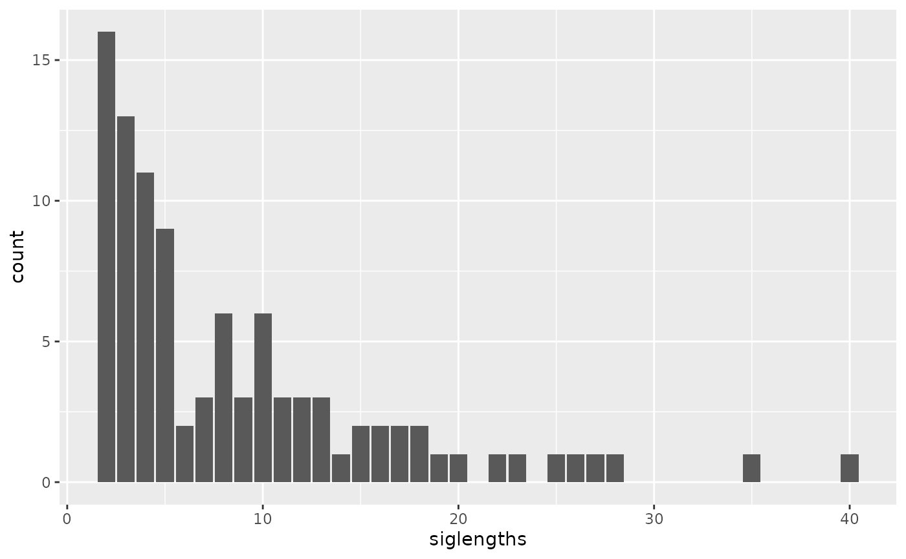
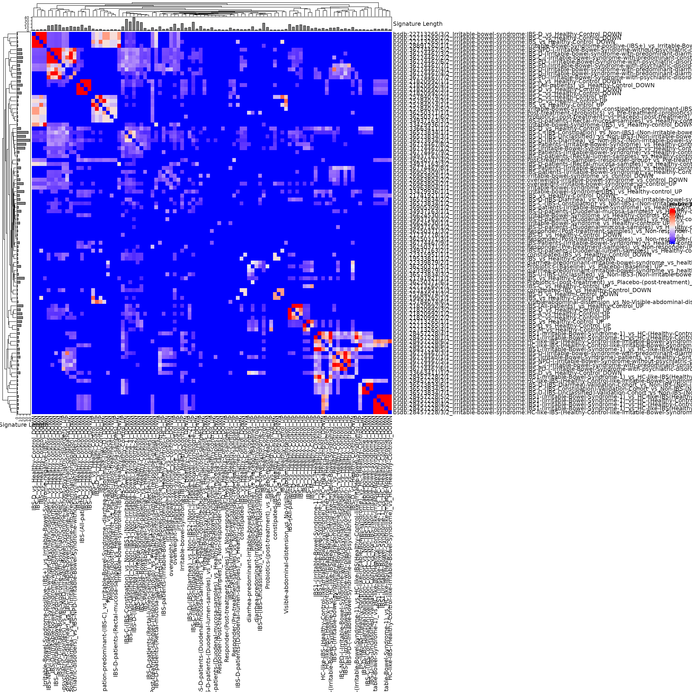
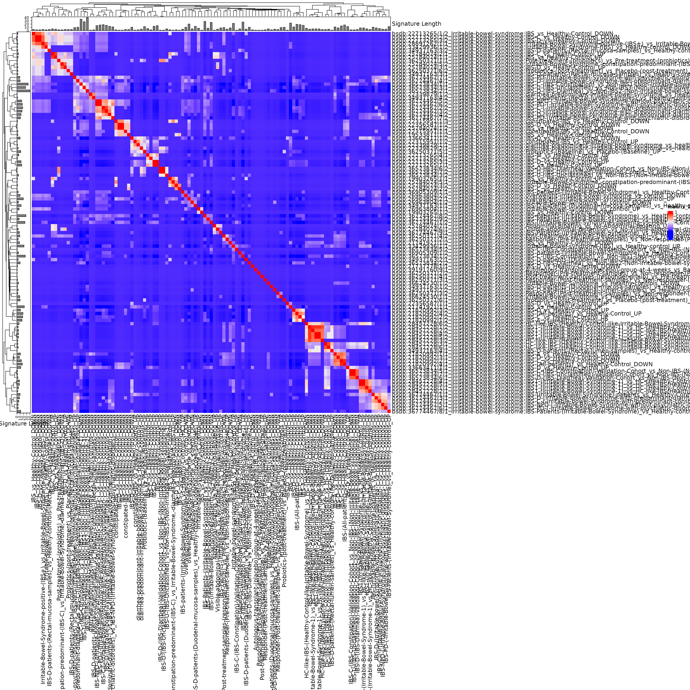

# The Irritable Bowel Syndrome-associated Microbiome

## Analysis objectives

1.  Import, recode, and subset data from bugsigdb.org  
2.  Create a table of studies
3.  Create a clustered heatmap showing similarity of signatures from
    independent studies
4.  Calculate the frequency of appearance of each taxa in independent
    signatures, and identify the most frequently reported taxa
5.  Estimate the probability of the most frequently identified taxa
    occuring so frequently by chance

## Packages installation

Install packages (not evaluated in vignette)

``` r

install.packages(c("devtools", "tidyverse", "kableExtra", "gt", "glue"))
devtools::install_github("waldronlab/bugSigSimple")
devtools::install_github("waldronlab/BugSigDBStats")
devtools::install_github("waldronlab/bugsigdbr")
```

## Data import, recoding, and subset

``` r

library(bugSigSimple)
dat <- bugsigdbr::importBugSigDB(cache = FALSE) 
```

``` r

dim(dat)
```

    ## [1] 12086    57

``` r

names(dat)
```

    ##  [1] "BSDB ID"                    "Study"                     
    ##  [3] "Study design"               "PMID"                      
    ##  [5] "DOI"                        "URL"                       
    ##  [7] "Authors list"               "Title"                     
    ##  [9] "Journal"                    "Year"                      
    ## [11] "Keywords"                   "Curation method"           
    ## [13] "Curation protocol"          "submittedBy"               
    ## [15] "submissionDate"             "Review state"              
    ## [17] "Quality control tag"        "Experiment"                
    ## [19] "Location of subjects"       "Host species"              
    ## [21] "Body site"                  "UBERON ID"                 
    ## [23] "Condition"                  "EFO ID"                    
    ## [25] "Group 0 name"               "Group 1 name"              
    ## [27] "Group 1 definition"         "Group 0 sample size"       
    ## [29] "Group 1 sample size"        "Antibiotics exclusion"     
    ## [31] "Sequencing type"            "16S variable region"       
    ## [33] "Sequencing platform"        "Data transformation"       
    ## [35] "Statistical test"           "Significance threshold"    
    ## [37] "MHT correction"             "LDA Score above"           
    ## [39] "Matched on"                 "Confounders controlled for"
    ## [41] "Pielou"                     "Shannon"                   
    ## [43] "Chao1"                      "Simpson"                   
    ## [45] "Inverse Simpson"            "Richness"                  
    ## [47] "Signature page name"        "Source"                    
    ## [49] "Curated date"               "Curator"                   
    ## [51] "Revision editor"            "Description"               
    ## [53] "Abundance in Group 1"       "MetaPhlAn taxon names"     
    ## [55] "NCBI Taxonomy IDs"          "State"                     
    ## [57] "Reviewer"

``` r

#library(tidyverse)
#condition_of_interest <- c("irritable bowel syndrome")
#efo <- bugsigdbr::getOntology("efo")
#dat_condition <- bugsigdbr::subsetByOntology(dat, column = "Condition", "irritable bowel syndrome", efo) %>%
#  mutate(comparison1 = paste(`Group 0 name`, `Group 1 name`, sep = " vs "))
library(tidyverse)
```

    ## ── Attaching core tidyverse packages ──────────────────────── tidyverse 2.0.0 ──
    ## ✔ dplyr     1.2.1     ✔ readr     2.2.0
    ## ✔ forcats   1.0.1     ✔ stringr   1.6.0
    ## ✔ ggplot2   4.0.4     ✔ tibble    3.3.1
    ## ✔ lubridate 1.9.5     ✔ tidyr     1.3.2
    ## ✔ purrr     1.2.2     
    ## ── Conflicts ────────────────────────────────────────── tidyverse_conflicts() ──
    ## ✖ dplyr::filter() masks stats::filter()
    ## ✖ dplyr::lag()    masks stats::lag()
    ## ℹ Use the conflicted package (<http://conflicted.r-lib.org/>) to force all conflicts to become errors

``` r

library(bugsigdbr)
dat <- importBugSigDB(cache = TRUE)  
```

    ## Using cached version from 2026-11-20 02:52:13

``` r

dat_condition <- dat %>%
  filter(grepl("irritable bowel syndrome", Condition, ignore.case = TRUE)) %>%
  mutate(comparison1 = paste(`Group 0 name`, `Group 1 name`, sep = " vs "))

nrow(dat_condition)
```

    ## [1] 117

``` r

head(dat_condition)
```

    ##              BSDB ID    Study Study design     PMID
    ## 1  bsdb:19533811/1/2 19533811 case-control 19533811
    ## 2 bsdb:19533811/2/NA 19533811 case-control 19533811
    ## 3 bsdb:19533811/3/NA 19533811 case-control 19533811
    ## 4 bsdb:19533811/4/NA 19533811 case-control 19533811
    ## 5  bsdb:19903265/1/1 19903265 case-control 19903265
    ## 6  bsdb:19903265/1/2 19903265 case-control 19903265
    ##                                DOI  URL
    ## 1              10.3748/wjg.15.2887 <NA>
    ## 2              10.3748/wjg.15.2887 <NA>
    ## 3              10.3748/wjg.15.2887 <NA>
    ## 4              10.3748/wjg.15.2887 <NA>
    ## 5 10.1111/j.1365-2982.2009.01427.x <NA>
    ## 6 10.1111/j.1365-2982.2009.01427.x <NA>
    ##                                                                                        Authors list
    ## 1 Kerckhoffs A.P., Samsom M., van der Rest M.E., de Vogel J., Knol J., Ben-Amor K. , Akkermans L.M.
    ## 2 Kerckhoffs A.P., Samsom M., van der Rest M.E., de Vogel J., Knol J., Ben-Amor K. , Akkermans L.M.
    ## 3 Kerckhoffs A.P., Samsom M., van der Rest M.E., de Vogel J., Knol J., Ben-Amor K. , Akkermans L.M.
    ## 4 Kerckhoffs A.P., Samsom M., van der Rest M.E., de Vogel J., Knol J., Ben-Amor K. , Akkermans L.M.
    ## 5                                 Tana C., Umesaki Y., Imaoka A., Handa T., Kanazawa M. , Fukudo S.
    ## 6                                 Tana C., Umesaki Y., Imaoka A., Handa T., Kanazawa M. , Fukudo S.
    ##                                                                                                                      Title
    ## 1 Lower Bifidobacteria counts in both duodenal mucosa-associated and fecal microbiota in irritable bowel syndrome patients
    ## 2 Lower Bifidobacteria counts in both duodenal mucosa-associated and fecal microbiota in irritable bowel syndrome patients
    ## 3 Lower Bifidobacteria counts in both duodenal mucosa-associated and fecal microbiota in irritable bowel syndrome patients
    ## 4 Lower Bifidobacteria counts in both duodenal mucosa-associated and fecal microbiota in irritable bowel syndrome patients
    ## 5    Altered profiles of intestinal microbiota and organic acids may be the origin of symptoms in irritable bowel syndrome
    ## 6    Altered profiles of intestinal microbiota and organic acids may be the origin of symptoms in irritable bowel syndrome
    ##                                                                                                       Journal
    ## 1                                                                           World journal of gastroenterology
    ## 2                                                                           World journal of gastroenterology
    ## 3                                                                           World journal of gastroenterology
    ## 4                                                                           World journal of gastroenterology
    ## 5 Neurogastroenterology and motility : the official journal of the European Gastrointestinal Motility Society
    ## 6 Neurogastroenterology and motility : the official journal of the European Gastrointestinal Motility Society
    ##   Year Keywords Curation method Curation protocol    submittedBy
    ## 1 2009     <NA>              NA                NA User:Kwekuamoo
    ## 2 2009     <NA>              NA                NA User:Kwekuamoo
    ## 3 2009     <NA>              NA                NA User:Kwekuamoo
    ## 4 2009     <NA>              NA                NA User:Kwekuamoo
    ## 5 2010     <NA>              NA                NA User:Kwekuamoo
    ## 6 2010     <NA>              NA                NA User:Kwekuamoo
    ##          submissionDate Review state Quality control tag   Experiment
    ## 1 19 July 2021 02:57:53     Reviewed                  NA Experiment 1
    ## 2 19 July 2021 02:57:53     Reviewed                  NA Experiment 2
    ## 3 19 July 2021 02:57:53     Reviewed                  NA Experiment 3
    ## 4 19 July 2021 02:57:53     Reviewed                  NA Experiment 4
    ## 5  4 July 2021 17:08:08     Reviewed                  NA Experiment 1
    ## 6  4 July 2021 17:08:08     Reviewed                  NA Experiment 1
    ##   Location of subjects Host species                       Body site
    ## 1          Netherlands Homo sapiens Feces,Mucosa of small intestine
    ## 2          Netherlands Homo sapiens Feces,Mucosa of small intestine
    ## 3          Netherlands Homo sapiens Feces,Mucosa of small intestine
    ## 4          Netherlands Homo sapiens Feces,Mucosa of small intestine
    ## 5                Japan Homo sapiens                           Feces
    ## 6                Japan Homo sapiens                           Feces
    ##                       UBERON ID                Condition        EFO ID
    ## 1 UBERON:0001204,UBERON:0001988 Irritable bowel syndrome MONDO:0005052
    ## 2 UBERON:0001204,UBERON:0001988 Irritable bowel syndrome MONDO:0005052
    ## 3 UBERON:0001204,UBERON:0001988 Irritable bowel syndrome MONDO:0005052
    ## 4 UBERON:0001204,UBERON:0001988 Irritable bowel syndrome MONDO:0005052
    ## 5                UBERON:0001988 Irritable bowel syndrome MONDO:0005052
    ## 6                UBERON:0001988 Irritable bowel syndrome MONDO:0005052
    ##      Group 0 name Group 1 name
    ## 1 Healthy Control          IBS
    ## 2 Healthy Control        IBS-D
    ## 3 Healthy Control        IBS-A
    ## 4 Healthy Control        IBS-C
    ## 5 Healthy Control          IBS
    ## 6 Healthy Control          IBS
    ##                                                                                                                                                                                                                                                                                                                                                                                                    Group 1 definition
    ## 1                                                                                                                                                                                     Twelve male and 29 female IBS patients included in this study fulfilled the Rome II criteria for IBS and were categorized as diarrhea predominant (IBS-D), constipation predominant (IBS-C) or alternating IBS subgroup (IBS-A)
    ## 2                                                                                                                                                                                                                                                                                     IBS patients included in this study fulfilled the Rome II criteria for IBS and were categorized as diarrhea predominant (IBS-D)
    ## 3                                                                                                                                                                                                                                                                                IBS patients included in this study fulfilled the Rome II criteria for IBS and were categorized as  alternating IBS subgroup (IBS-A)
    ## 4                                                                                                                                                                                                                                                                                IBS patients included in this study fulfilled the Rome II criteria for IBS and were categorized as  constipation predominant (IBS-C)
    ## 5 All patients were diagnosed with IBS after conducting a medical interview based on Rome II criteria and positive judgment by a Rome II modular questionnaire retrospectively and positively fulfilling Rome III criteria. According to Rome II criteria related to bowel habits, 11 subjects had constipation-predominant IBS (IBS-C), eight had diarrhoea-predominant IBS (IBS-D) and seven had mixed IBS (IBS-M).
    ## 6 All patients were diagnosed with IBS after conducting a medical interview based on Rome II criteria and positive judgment by a Rome II modular questionnaire retrospectively and positively fulfilling Rome III criteria. According to Rome II criteria related to bowel habits, 11 subjects had constipation-predominant IBS (IBS-C), eight had diarrhoea-predominant IBS (IBS-D) and seven had mixed IBS (IBS-M).
    ##   Group 0 sample size Group 1 sample size Antibiotics exclusion Sequencing type
    ## 1                  26                  41                  <NA>            <NA>
    ## 2                  26                  14                  <NA>            <NA>
    ## 3                  26                  16                  <NA>            <NA>
    ## 4                  26                  11                  <NA>            <NA>
    ## 5                  26                  26                  <NA>             WMS
    ## 6                  26                  26                  <NA>             WMS
    ##   16S variable region Sequencing platform Data transformation
    ## 1                  NA             RT-qPCR          raw counts
    ## 2                  NA             RT-qPCR          raw counts
    ## 3                  NA             RT-qPCR          raw counts
    ## 4                  NA             RT-qPCR          raw counts
    ## 5                  NA             RT-qPCR                <NA>
    ## 6                  NA             RT-qPCR                <NA>
    ##       Statistical test Significance threshold MHT correction LDA Score above
    ## 1               T-Test                   0.05           TRUE              NA
    ## 2               T-Test                   0.05           TRUE              NA
    ## 3               T-Test                   0.05           TRUE              NA
    ## 4               T-Test                   0.05           TRUE              NA
    ## 5 Spearman Correlation                   0.05          FALSE              NA
    ## 6 Spearman Correlation                   0.05          FALSE              NA
    ##   Matched on Confounders controlled for Pielou Shannon Chao1 Simpson
    ## 1       <NA>                       <NA>   <NA>    <NA>  <NA>    <NA>
    ## 2       <NA>                       <NA>   <NA>    <NA>  <NA>    <NA>
    ## 3       <NA>                       <NA>   <NA>    <NA>  <NA>    <NA>
    ## 4       <NA>                       <NA>   <NA>    <NA>  <NA>    <NA>
    ## 5    age,sex                       <NA>   <NA>    <NA>  <NA>    <NA>
    ## 6    age,sex                       <NA>   <NA>    <NA>  <NA>    <NA>
    ##   Inverse Simpson Richness Signature page name         Source Curated date
    ## 1            <NA>     <NA>         Signature 2 Tables 2 and 3 19 July 2021
    ## 2            <NA>     <NA>                <NA>           <NA>         <NA>
    ## 3            <NA>     <NA>                <NA>           <NA>         <NA>
    ## 4            <NA>     <NA>                <NA>           <NA>         <NA>
    ## 5            <NA>     <NA>         Signature 1        Table 2  4 July 2021
    ## 6            <NA>     <NA>         Signature 2           text 19 July 2023
    ##     Curator              Revision editor
    ## 1 Kwekuamoo    Chloe,Kwekuamoo,WikiWorks
    ## 2      <NA>                         <NA>
    ## 3      <NA>                         <NA>
    ## 4      <NA>                         <NA>
    ## 5 Kwekuamoo Kwekuamoo,Atrayees,WikiWorks
    ## 6  Atrayees           Atrayees,WikiWorks
    ##                                                                            Description
    ## 1 Real time PCR analysis of fecal bifidobacteria in HS, IBS patients and IBS subgroups
    ## 2                                                                                 <NA>
    ## 3                                                                                 <NA>
    ## 4                                                                                 <NA>
    ## 5                   Comparison of GI microbiota between IBS patients and the\ncontrols
    ## 6    Comparison of GI microbiota between IBS patients and the controls\n\nAbundance in
    ##   Abundance in Group 1
    ## 1            decreased
    ## 2                 <NA>
    ## 3                 <NA>
    ## 4                 <NA>
    ## 5            increased
    ## 6            decreased
    ##                                                                                                                                                                                                                                                                                                                                                                              MetaPhlAn taxon names
    ## 1 k__Bacillati|p__Actinomycetota|c__Actinomycetes|o__Bifidobacteriales|f__Bifidobacteriaceae|g__Bifidobacterium|s__Bifidobacterium catenulatum, k__Bacillati|p__Bacillota|c__Clostridia|o__Peptostreptococcales|f__Peptostreptococcaceae|g__Romboutsia|s__Romboutsia lituseburensis, k__Bacillati|p__Actinomycetota|c__Actinomycetes|o__Bifidobacteriales|f__Bifidobacteriaceae|g__Bifidobacterium
    ## 2                                                                                                                                                                                                                                                                                                                                                                                               NA
    ## 3                                                                                                                                                                                                                                                                                                                                                                                               NA
    ## 4                                                                                                                                                                                                                                                                                                                                                                                               NA
    ## 5                                                                                                                                                                                                     k__Bacillati|p__Bacillota|c__Negativicutes|o__Veillonellales|f__Veillonellaceae|g__Veillonella, k__Bacillati|p__Bacillota|c__Bacilli|o__Lactobacillales|f__Lactobacillaceae|g__Lactobacillus
    ## 6                                                                                                                                                                                                                                                                                                        k__Bacillati|p__Bacillota|c__Clostridia|o__Eubacteriales|f__Clostridiaceae|g__Clostridium
    ##                                                                                                                  NCBI Taxonomy IDs
    ## 1 1783272|201174|1760|85004|31953|1678|1686, 1783272|1239|186801|3082720|186804|1501226|1537, 1783272|201174|1760|85004|31953|1678
    ## 2                                                                                                                               NA
    ## 3                                                                                                                               NA
    ## 4                                                                                                                               NA
    ## 5                                                    1783272|1239|909932|1843489|31977|29465, 1783272|1239|91061|186826|33958|1578
    ## 6                                                                                            1783272|1239|186801|186802|31979|1485
    ##      State Reviewer              comparison1
    ## 1 Complete    Chloe   Healthy Control vs IBS
    ## 2     <NA>     <NA> Healthy Control vs IBS-D
    ## 3     <NA>     <NA> Healthy Control vs IBS-A
    ## 4     <NA>     <NA> Healthy Control vs IBS-C
    ## 5 Complete Atrayees   Healthy Control vs IBS
    ## 6 Complete Atrayees   Healthy Control vs IBS

### Table of studies

``` r

bugSigSimple::createStudyTable(dat_condition)
```

    ## # A tibble: 22 × 9
    ##    `Study Identifier` MaxCases MaxControls `Study design` Condition N_signatures
    ##    <chr>                 <dbl>       <dbl> <chr>          <chr>            <int>
    ##  1 BarandouziZ.A._20…       80          21 case-control   Irritabl…            2
    ##  2 CarrollI.M._2011         16          21 case-control   Irritabl…            1
    ##  3 CarrollI.M._2012         23          23 case-control   Irritabl…            3
    ##  4 ChassardC._2012          14          12 case-control   Irritabl…            3
    ##  5 ChenH._2023             354         354 cross-section… Irritabl…           18
    ##  6 DubocH._2012             14          18 case-control   Irritabl…            2
    ##  7 FourieN.H._2016          11          20 case-control   Irritabl…            4
    ##  8 HartikainenA.K._2…       26          26 randomized co… Irritabl…            1
    ##  9 JacobsJ.P._2023         318         177 case-control   Irritabl…            2
    ## 10 KerckhoffsA.P._20…       41          26 case-control   Irritabl…            4
    ## # ℹ 12 more rows
    ## # ℹ 3 more variables: PMID <chr>, DOI <chr>, URL <chr>

### Taxon frequency tables by body site

``` r

gut_sigs <- filter(dat_condition,
                   `Body site` %in% c("Feces, Mucosa of small intestine", "Feces"))
```

In this table, the Binomial Test p-value corresponds to the null
hypothesis

H0: the proportion of signatures in which the taxon is reported
increased or decreased, relative to the total number of signatures in
which it is reported, is equal to 0.5

``` r

kableExtra::kbl(bugSigSimple::createTaxonTable(gut_sigs))
```

| Taxon Name | Taxonomic Level | total_signatures | increased_signatures | decreased_signatures | Binomial Test pval |
|:---|:---|---:|---:|---:|---:|
| Bifidobacterium | genus | 14 | 2 | 12 | 0.013 |
| Faecalibacterium | genus | 14 | 3 | 11 | 0.057 |
| Prevotella | genus | 14 | 2 | 12 | 0.013 |
| Ruminococcus | genus | 13 | 4 | 9 | 0.270 |
| Bacillota | phylum | 12 | 7 | 5 | 0.770 |
| Parabacteroides | genus | 12 | 4 | 8 | 0.390 |
| Holdemania | genus | 11 | 9 | 2 | 0.065 |
| Bacteroides | genus | 11 | 3 | 8 | 0.230 |
| Enterobacteriaceae | family | 10 | 9 | 1 | 0.021 |
| Streptococcus | genus | 9 | 8 | 1 | 0.039 |

## Cluster analysis

Note, this EDA should really be done *before* hypothesis testing.

First calculate pairwise overlaps for all signatures of length \> 1:

``` r

allsigs <- bugsigdbr::getSignatures(dat_condition, tax.id.type = "taxname")
allsigs <- allsigs[sapply(allsigs, length) > 1] #require length > 1
length(allsigs)
```

    ## [1] 97

``` r

mydists <- BugSigDBStats::calcPairwiseOverlaps(allsigs)
dim(mydists)
```

    ## [1] 941   8

What is the distribution of signature lengths?

``` r

library(ggplot2)
siglengths <- sapply(allsigs, length)
siglengths.df <- data.frame(siglengths = siglengths)
ggplot(siglengths.df, aes(x=siglengths)) +
  geom_bar()
```



``` r

table(siglengths)
```

    ## siglengths
    ##  2  3  4  5  6  7  8  9 10 11 12 13 14 15 16 17 18 19 20 22 23 25 26 27 28 35 
    ## 16 13 11  9  2  3  6  3  6  3  3  3  1  2  2  2  2  1  1  1  1  1  1  1  1  1 
    ## 40 
    ##  1

Create a matrix of Jaccard similarities (0 for no overlap, 1 for 100%
overlap)

``` r

jmat <- BugSigDBStats::calcJaccardSimilarity(allsigs)
```

``` r

library(ComplexHeatmap)
```

    ## Loading required package: grid

    ## ========================================
    ## ComplexHeatmap version 2.28.0
    ## Bioconductor page: http://bioconductor.org/packages/ComplexHeatmap/
    ## Github page: https://github.com/jokergoo/ComplexHeatmap
    ## Documentation: http://jokergoo.github.io/ComplexHeatmap-reference
    ## 
    ## If you use it in published research, please cite either one:
    ## - Gu, Z. Complex Heatmap Visualization. iMeta 2022.
    ## - Gu, Z. Complex heatmaps reveal patterns and correlations in multidimensional 
    ##     genomic data. Bioinformatics 2016.
    ## 
    ## 
    ## The new InteractiveComplexHeatmap package can directly export static 
    ## complex heatmaps into an interactive Shiny app with zero effort. Have a try!
    ## 
    ## This message can be suppressed by:
    ##   suppressPackageStartupMessages(library(ComplexHeatmap))
    ## ========================================

``` r

siglengths <- siglengths[rownames(jmat)]
print(paste("jmat dimensions:", nrow(jmat), "x", ncol(jmat)))
```

    ## [1] "jmat dimensions: 97 x 97"

``` r

print(paste("siglengths length:", length(siglengths)))
```

    ## [1] "siglengths length: 97"

``` r

ha <- HeatmapAnnotation(`Signature Length` = anno_barplot(siglengths))
hr <- rowAnnotation(`Signature Length` = anno_barplot(siglengths))

hm <- Heatmap(
  jmat,
  top_annotation = ha, 
  left_annotation = hr,
  row_names_max_width = unit(20, "cm"),
  column_names_max_height = unit(20, "cm"),
  column_labels = sub(".+:", "", colnames(jmat))
)
```

    ## The automatically generated colors map from the 1^st and 99^th of the
    ## values in the matrix. There are outliers in the matrix whose patterns
    ## might be hidden by this color mapping. You can manually set the color
    ## to `col` argument.
    ## 
    ## Use `suppressMessages()` to turn off this message.

``` r

hm
```



Use this interactively to make an interactive heatmap. Some expanding of
the default size is required to see anything. Creating a sub-heatmap,
then exporting it as a table, allows in-depth identification of the
subgroups.

``` r

#library(InteractiveComplexHeatmap)
#hm <- draw(hm)
#htShiny(hm)
# Interactive heatmap version
library(ComplexHeatmap)
library(InteractiveComplexHeatmap)
siglengths <- siglengths[rownames(jmat)]

ha <- HeatmapAnnotation(`Signature Length` = anno_barplot(siglengths))
hr <- rowAnnotation(`Signature Length` = anno_barplot(siglengths))

hm <- Heatmap(
  jmat,
  name = "Jaccard",
  top_annotation = ha, 
  left_annotation = hr,
  show_row_names = FALSE,      
  show_column_names = FALSE     
)

htShiny(hm)
```

``` r

hc <- hclust(dist(jmat))
plot(hc)
```


This tree can be cut to show the clusters, for example. The clusters of
more than 1 signature but less than ~10 signatures are most likely to be
something interesting.

``` r

clusts <- sort(cutree(hc, k = 8))  #set the number of clusters here with k
lapply(unique(clusts), function(i) names(clusts)[clusts == i])
```

    ## [[1]]
    ##  [1] "bsdb:19533811/1/2_Irritable-bowel-syndrome:IBS_vs_Healthy-Control_DOWN"                                                                                              
    ##  [2] "bsdb:19903265/1/1_Irritable-bowel-syndrome:IBS_vs_Healthy-Control_UP"                                                                                                
    ##  [3] "bsdb:21737778/1/1_Irritable-bowel-syndrome:IBS-D_vs_Healthy-Control_DOWN"                                                                                            
    ##  [4] "bsdb:21741921/1/1_Irritable-bowel-syndrome:IBS_vs_Healthy-Control_UP"                                                                                                
    ##  [5] "bsdb:21741921/1/2_Irritable-bowel-syndrome:IBS_vs_Healthy-Control_DOWN"                                                                                              
    ##  [6] "bsdb:22315951/1/1_Irritable-bowel-syndrome:constipated-IBS_vs_Healthy-Control_DOWN"                                                                                  
    ##  [7] "bsdb:22315951/1/3_Irritable-bowel-syndrome:constipated-IBS_vs_Healthy-Control_DOWN"                                                                                  
    ##  [8] "bsdb:22339879/1/1_Irritable-bowel-syndrome:diarrhea-predominant-irritable-bowel-syndrome_vs_healthy-controls_UP"                                                     
    ##  [9] "bsdb:22339879/2/1_Irritable-bowel-syndrome:diarrhea-predominant-irritable-bowel-syndrome_vs_healthy-controls_UP"                                                     
    ## [10] "bsdb:22713265/2/1_Irritable-bowel-syndrome:IBS-C_vs_Healthy-Control_UP"                                                                                              
    ## [11] "bsdb:25784074/1/1_Irritable-bowel-syndrome:IBS_vs_Healthy-Control_UP"                                                                                                
    ## [12] "bsdb:25784074/2/1_Irritable-bowel-syndrome:IBS-C_vs_Health-Control_UP"                                                                                               
    ## [13] "bsdb:25784074/3/1_Irritable-bowel-syndrome:IBS-D_vs_Health-Control_UP"                                                                                               
    ## [14] "bsdb:25784074/3/2_Irritable-bowel-syndrome:IBS-D_vs_Health-Control_DOWN"                                                                                             
    ## [15] "bsdb:25784074/5/2_Irritable-bowel-syndrome:Irritable-Bowel-Syndrome,-constipation-predominant-(IBS-C)_vs_Irritable-Bowel-Syndrome,-diarrhea-predominant-(IBS-D)_DOWN"
    ## [16] "bsdb:25784074/6/1_Irritable-bowel-syndrome:Visible-abdominal-distension_vs_No-Visible-abdominal-distension_UP"                                                       
    ## [17] "bsdb:26963804/1/1_Irritable-bowel-syndrome:irritable-bowel-syndrome_vs_control_UP"                                                                                   
    ## [18] "bsdb:26963804/1/2_Irritable-bowel-syndrome:irritable-bowel-syndrome_vs_control_DOWN"                                                                                 
    ## [19] "bsdb:26963804/2/1_Irritable-bowel-syndrome:overweight-irritable-bowel-syndrome_vs_control_UP"                                                                        
    ## [20] "bsdb:26963804/2/2_Irritable-bowel-syndrome:overweight-irritable-bowel-syndrome_vs_control_DOWN"                                                                      
    ## [21] "bsdb:33429936/1/1_Irritable-bowel-syndrome:Irritable-bowel-syndrome-(IBS)_vs_Healthy-control_UP"                                                                     
    ## [22] "bsdb:33429936/1/2_Irritable-bowel-syndrome:Irritable-bowel-syndrome-(IBS)_vs_Healthy-control_DOWN"                                                                   
    ## [23] "bsdb:33663411/1/1_Irritable-bowel-syndrome:IBS-D_vs_Healthy-Control_UP"                                                                                              
    ## [24] "bsdb:34937163/1/1_Irritable-bowel-syndrome:IBS-D-patients-(Duodenal-mucosa-samples)_vs_Healthy-controls-(Duodenal-mucosa-samples)_UP"                                
    ## [25] "bsdb:34937163/1/2_Irritable-bowel-syndrome:IBS-D-patients-(Duodenal-mucosa-samples)_vs_Healthy-controls-(Duodenal-mucosa-samples)_DOWN"                              
    ## [26] "bsdb:34937163/2/1_Irritable-bowel-syndrome:IBS-D-patients-(Duodenal-lumen-samples)_vs_Healthy-controls-(Duodenal-lumen-samples)_UP"                                  
    ## [27] "bsdb:34937163/2/2_Irritable-bowel-syndrome:IBS-D-patients-(Duodenal-lumen-samples)_vs_Healthy-controls-(Duodenal-lumen-samples)_DOWN"                                
    ## [28] "bsdb:34937163/3/1_Irritable-bowel-syndrome:IBS-D-patients-(Rectal-mucosa-samples)_vs_Healthy-controls-(Rectal-mucosa-samples)_UP"                                    
    ## [29] "bsdb:34937163/3/2_Irritable-bowel-syndrome:IBS-D-patients-(Rectal-mucosa-samples)_vs_Healthy-controls-(Rectal-mucosa-samples)_DOWN"                                  
    ## [30] "bsdb:34937163/4/2_Irritable-bowel-syndrome:IBS-D-patients-(Rectal-lumen-samples)_vs_Healthy-controls-(Rectal-lumen-samples)_DOWN"                                    
    ## [31] "bsdb:36250371/1/1_Irritable-bowel-syndrome:Post-treatment-(probiotics)_vs_Pre-treatment-(probiotics)_DOWN"                                                           
    ## [32] "bsdb:36250371/2/1_Irritable-bowel-syndrome:Responder-(Pre-treatment-samples)_vs_Non-responder-(Pre-treatment-samples)_UP"                                            
    ## [33] "bsdb:36250371/3/1_Irritable-bowel-syndrome:Responder-(Post-treatment-samples)_vs_Non-responder-(Post-treatment-samples)_UP"                                          
    ## [34] "bsdb:36250371/3/2_Irritable-bowel-syndrome:Responder-(Post-treatment-samples)_vs_Non-responder-(Post-treatment-samples)_DOWN"                                        
    ## [35] "bsdb:36250371/4/2_Irritable-bowel-syndrome:Post-treatment-samples-(responder-group)_vs_Pre-treatment-samples-(responder-group)_DOWN"                                 
    ## [36] "bsdb:36250371/5/1_Irritable-bowel-syndrome:Probiotics-(Baseline)_vs_Placebo-(Baseline)_UP"                                                                           
    ## [37] "bsdb:36250371/6/1_Irritable-bowel-syndrome:Probiotics-(post-treatment)_vs_Placebo-(post-treatment)_UP"                                                               
    ## [38] "bsdb:36250371/6/2_Irritable-bowel-syndrome:Probiotics-(post-treatment)_vs_Placebo-(post-treatment)_DOWN"                                                             
    ## [39] "bsdb:36573834/1/1_Irritable-bowel-syndrome:IBS-C-(IBS-Constipation)_vs_Non-IBS1-(Non-irritable-bowel-syndrome-1)_DOWN"                                               
    ## [40] "bsdb:36573834/1/2_Irritable-bowel-syndrome:IBS-C-(IBS-Constipation)_vs_Non-IBS1-(Non-irritable-bowel-syndrome-1)_UP"                                                 
    ## [41] "bsdb:36573834/2/1_Irritable-bowel-syndrome:IBS-D-(IBS-Diarrhea)_vs_Non-IBS2-(Non-irritable-bowel-syndrome-2)_DOWN"                                                   
    ## [42] "bsdb:36573834/2/2_Irritable-bowel-syndrome:IBS-D-(IBS-Diarrhea)_vs_Non-IBS2-(Non-irritable-bowel-syndrome-2)_UP"                                                     
    ## [43] "bsdb:36573834/3/1_Irritable-bowel-syndrome:IBS-U-(IBS-Unclassified)_vs_Non-IBS3-(Non-irritable-bowel-syndrome-3)_DOWN"                                               
    ## [44] "bsdb:36573834/3/2_Irritable-bowel-syndrome:IBS-U-(IBS-Unclassified)_vs_Non-IBS3-(Non-irritable-bowel-syndrome-3)_UP"                                                 
    ## [45] "bsdb:36624530/1/1_Irritable-bowel-syndrome:Irritable-Bowel-Syndrome_vs_Healthy-controls_UP"                                                                          
    ## [46] "bsdb:36624530/1/2_Irritable-bowel-syndrome:Irritable-Bowel-Syndrome_vs_Healthy-controls_DOWN"                                                                        
    ## [47] "bsdb:36774467/1/2_Irritable-bowel-syndrome:IBS-(Irritable-Bowel-Syndrome)-patients_vs_Healthy-Controls_DOWN"                                                         
    ## [48] "bsdb:36774467/8/1_Irritable-bowel-syndrome:IBS-Patients-(Irritable-Bowel-Syndrome)_vs_Healthy-controls_UP"                                                           
    ## [49] "bsdb:36774467/8/2_Irritable-bowel-syndrome:IBS-Patients-(Irritable-Bowel-Syndrome)_vs_Healthy-controls_DOWN"                                                         
    ## [50] "bsdb:36774467/9/1_Irritable-bowel-syndrome:IBS-Patients-(Irritable-Bowel-Syndrome)_vs_Healthy-controls_UP"                                                           
    ## [51] "bsdb:36774467/9/2_Irritable-bowel-syndrome:IBS-Patients-(Irritable-Bowel-Syndrome)_vs_Healthy-controls_DOWN"                                                         
    ## [52] "bsdb:36905309/1/1_Irritable-bowel-syndrome:IBS-patients-(Irritable-Bowel-Syndrome)_vs_Healthy-Controls-(HC)_UP"                                                      
    ## [53] "bsdb:36905309/1/2_Irritable-bowel-syndrome:IBS-patients-(Irritable-Bowel-Syndrome)_vs_Healthy-Controls-(HC)_DOWN"                                                    
    ## 
    ## [[2]]
    ## [1] "bsdb:21820992/1/1_Irritable-bowel-syndrome:IBS-A_vs_Healthy-Control_DOWN"             
    ## [2] "bsdb:21820992/2/1_Irritable-bowel-syndrome:IBS-C_vs_Healthy-Control_DOWN"             
    ## [3] "bsdb:21820992/3/1_Irritable-bowel-syndrome:IBS-D_vs_Healthy-Control_DOWN"             
    ## [4] "bsdb:21820992/4/1_Irritable-bowel-syndrome:IBS-(All-patients)_vs_Healthy-Control_DOWN"
    ## 
    ## [[3]]
    ## [1] "bsdb:21820992/1/2_Irritable-bowel-syndrome:IBS-A_vs_Healthy-Control_UP"             
    ## [2] "bsdb:21820992/2/2_Irritable-bowel-syndrome:IBS-C_vs_Healthy-Control_UP"             
    ## [3] "bsdb:21820992/3/2_Irritable-bowel-syndrome:IBS-D_vs_Healthy-Control_UP"             
    ## [4] "bsdb:21820992/4/2_Irritable-bowel-syndrome:IBS-(All-patients)_vs_Healthy-Control_UP"
    ## [5] "bsdb:22713265/1/1_Irritable-bowel-syndrome:IBS_vs_Healthy-Control_UP"               
    ## [6] "bsdb:22713265/3/1_Irritable-bowel-syndrome:IBS-D_vs_Healthy-Control_UP"             
    ## [7] "bsdb:22713265/4/1_Irritable-bowel-syndrome:IBS-M_vs_Healthy-Control_UP"             
    ## 
    ## [[4]]
    ## [1] "bsdb:22713265/1/2_Irritable-bowel-syndrome:IBS_vs_Healthy-Control_DOWN"                                                              
    ## [2] "bsdb:22713265/2/2_Irritable-bowel-syndrome:IBS-C_vs_Healthy-Control_DOWN"                                                            
    ## [3] "bsdb:22713265/3/2_Irritable-bowel-syndrome:IBS-D_vs_Healthy-Control_DOWN"                                                            
    ## [4] "bsdb:28891262/1/1_Irritable-bowel-syndrome:Irritable-Bowel-Syndrome-positive-(IBS+)_vs_Irritable-Bowel-Syndrome-negative-(IBS-)_DOWN"
    ## 
    ## [[5]]
    ##  [1] "bsdb:28457228/1/1_Irritable-bowel-syndrome:IBS1-(Irritable-Bowel-Syndrome-1)_vs_HC-(Healthy-Control)_UP"                                      
    ##  [2] "bsdb:28457228/2/1_Irritable-bowel-syndrome:IBS1-(Irritable-Bowel-Syndrome-1)_vs_HC-like-IBS(Healthy-Control-like-Irritable-Bowel-Syndrome)_UP"
    ##  [3] "bsdb:28457228/4/1_Irritable-bowel-syndrome:IBS1-(Irritable-Bowel-Syndrome-1)_vs_HC-(Healthy-Control)_UP"                                      
    ##  [4] "bsdb:28457228/5/1_Irritable-bowel-syndrome:IBS1-(Irritable-Bowel-Syndrome-1)_vs_HC-like-IBS(Healthy-Control-like-Irritable-Bowel-Syndrome)_UP"
    ##  [5] "bsdb:28457228/6/1_Irritable-bowel-syndrome:HC-like-IBS-(Healthy-Control-like-Irritable-Bowel-Syndrome)_vs_HC-(Healthy-Control)_UP"            
    ##  [6] "bsdb:28457228/6/2_Irritable-bowel-syndrome:HC-like-IBS-(Healthy-Control-like-Irritable-Bowel-Syndrome)_vs_HC-(Healthy-Control)_DOWN"          
    ##  [7] "bsdb:33663411/1/2_Irritable-bowel-syndrome:IBS-D_vs_Healthy-Control_DOWN"                                                                     
    ##  [8] "bsdb:36774467/1/1_Irritable-bowel-syndrome:IBS-(Irritable-Bowel-Syndrome)-patients_vs_Healthy-Controls_UP"                                    
    ##  [9] "bsdb:36774467/2/1_Irritable-bowel-syndrome:IBS-C-(-Irritable-bowel-syndrome-with-predominant-constipation-)_vs_Healthy-controls_UP"           
    ## [10] "bsdb:36774467/3/1_Irritable-bowel-syndrome:IBS-D-(Irritable-bowel-syndrome-with-predominant-diarrhea-)_vs_Healthy-controls_UP"                
    ## [11] "bsdb:36774467/5/1_Irritable-bowel-syndrome:IBS-NPD-(-Irritable-Bowel-Syndrome-without-psychiatric-disorders-)_vs_Healthy-controls_UP"         
    ## [12] "bsdb:36774467/6/1_Irritable-bowel-syndrome:IBS-PD-(-Irritable-Bowel-Syndrome-with-psychiatric-disorders-)_vs_Healthy-controls_UP"             
    ## 
    ## [[6]]
    ## [1] "bsdb:28457228/1/2_Irritable-bowel-syndrome:IBS1-(Irritable-Bowel-Syndrome-1)_vs_HC-(Healthy-Control)_DOWN"                                      
    ## [2] "bsdb:28457228/2/2_Irritable-bowel-syndrome:IBS1-(Irritable-Bowel-Syndrome-1)_vs_HC-like-IBS(Healthy-Control-like-Irritable-Bowel-Syndrome)_DOWN"
    ## [3] "bsdb:28457228/3/2_Irritable-bowel-syndrome:HC-like-IBS-(Healthy-Control-like-Irritable-Bowel-Syndrome)_vs_HC-(Healthy-Control)_DOWN"            
    ## [4] "bsdb:28457228/4/2_Irritable-bowel-syndrome:IBS1-(Irritable-Bowel-Syndrome-1)_vs_HC-(Healthy-Control)_DOWN"                                      
    ## [5] "bsdb:28457228/5/2_Irritable-bowel-syndrome:IBS1-(Irritable-Bowel-Syndrome-1)_vs_HC-like-IBS(Healthy-Control-like-Irritable-Bowel-Syndrome)_DOWN"
    ## 
    ## [[7]]
    ## [1] "bsdb:28457228/3/1_Irritable-bowel-syndrome:HC-like-IBS-(Healthy-Control-like-Irritable-Bowel-Syndrome)_vs_HC-(Healthy-Control)_UP"   
    ## [2] "bsdb:36573834/5/1_Irritable-bowel-syndrome:IBS-C-(IBS-Constipation)-Validation-Cohort_vs_Non-IBS-(Non-irritable-bowel-syndrome)_DOWN"
    ## [3] "bsdb:36573834/6/1_Irritable-bowel-syndrome:IBS-D-(IBS-Diarrhea)-Validation-Cohort_vs_Non-IBS-(Non-irritable-bowel-syndrome)_DOWN"    
    ## [4] "bsdb:36573834/7/1_Irritable-bowel-syndrome:IBS-U-(IBS-Unclassified)-Validation-Cohort_vs_Non-IBS-(Non-irritable-bowel-syndrome)_DOWN"
    ## 
    ## [[8]]
    ## [1] "bsdb:36774467/2/2_Irritable-bowel-syndrome:IBS-C-(-Irritable-bowel-syndrome-with-predominant-constipation-)_vs_Healthy-controls_DOWN"                                            
    ## [2] "bsdb:36774467/3/2_Irritable-bowel-syndrome:IBS-D-(Irritable-bowel-syndrome-with-predominant-diarrhea-)_vs_Healthy-controls_DOWN"                                                 
    ## [3] "bsdb:36774467/4/1_Irritable-bowel-syndrome:IBS-D-(Irritable-bowel-syndrome-with-predominant-diarrhea-)_vs_IBS-C-(Irritable-bowel-syndrome-with-predominant-constipation)_UP"     
    ## [4] "bsdb:36774467/4/2_Irritable-bowel-syndrome:IBS-D-(Irritable-bowel-syndrome-with-predominant-diarrhea-)_vs_IBS-C-(Irritable-bowel-syndrome-with-predominant-constipation)_DOWN"   
    ## [5] "bsdb:36774467/5/2_Irritable-bowel-syndrome:IBS-NPD-(-Irritable-Bowel-Syndrome-without-psychiatric-disorders-)_vs_Healthy-controls_DOWN"                                          
    ## [6] "bsdb:36774467/6/2_Irritable-bowel-syndrome:IBS-PD-(-Irritable-Bowel-Syndrome-with-psychiatric-disorders-)_vs_Healthy-controls_DOWN"                                              
    ## [7] "bsdb:36774467/7/1_Irritable-bowel-syndrome:IBS-PD-(Irritable-Bowel-Syndrome-with-psychiatric-disorders)_vs_IBS-NPD-(Irritable-Bowel-Syndrome-without-psychiatric-disorders)_UP"  
    ## [8] "bsdb:36774467/7/2_Irritable-bowel-syndrome:IBS-PD-(Irritable-Bowel-Syndrome-with-psychiatric-disorders)_vs_IBS-NPD-(Irritable-Bowel-Syndrome-without-psychiatric-disorders)_DOWN"

## Create a wide-format dataframe

This would be suitable for regression analysis.

``` r

dat_withsigs <- filter(dat_condition, !is.na(dat_condition$`NCBI Taxonomy IDs`))
sigs <- bugsigdbr::getSignatures(dat_withsigs, tax.id.type = "taxname")
cmat <- t(safe::getCmatrix(sigs, as.matrix = TRUE, min.size = 0, prune = FALSE))
```

    ## WARNING: rows are sorted elements of keyword.list
    ## 113 categories formed

``` r

cdf <- data.frame(cmat, stringsAsFactors = FALSE, check.names = FALSE)
cdf <- cbind(dat_withsigs, cdf)
colnames(cdf)[1:54]
```

    ##  [1] "BSDB ID"                    "Study"                     
    ##  [3] "Study design"               "PMID"                      
    ##  [5] "DOI"                        "URL"                       
    ##  [7] "Authors list"               "Title"                     
    ##  [9] "Journal"                    "Year"                      
    ## [11] "Keywords"                   "Curation method"           
    ## [13] "Curation protocol"          "submittedBy"               
    ## [15] "submissionDate"             "Review state"              
    ## [17] "Quality control tag"        "Experiment"                
    ## [19] "Location of subjects"       "Host species"              
    ## [21] "Body site"                  "UBERON ID"                 
    ## [23] "Condition"                  "EFO ID"                    
    ## [25] "Group 0 name"               "Group 1 name"              
    ## [27] "Group 1 definition"         "Group 0 sample size"       
    ## [29] "Group 1 sample size"        "Antibiotics exclusion"     
    ## [31] "Sequencing type"            "16S variable region"       
    ## [33] "Sequencing platform"        "Data transformation"       
    ## [35] "Statistical test"           "Significance threshold"    
    ## [37] "MHT correction"             "LDA Score above"           
    ## [39] "Matched on"                 "Confounders controlled for"
    ## [41] "Pielou"                     "Shannon"                   
    ## [43] "Chao1"                      "Simpson"                   
    ## [45] "Inverse Simpson"            "Richness"                  
    ## [47] "Signature page name"        "Source"                    
    ## [49] "Curated date"               "Curator"                   
    ## [51] "Revision editor"            "Description"               
    ## [53] "Abundance in Group 1"       "MetaPhlAn taxon names"

Note this has a number of columns that are mostly zeros, it could be
filtered significantly for any regression or machine learning analysis:

``` r

table(cdf[["Bifidobacterium catenulatum"]])
```

    ## 
    ##   0   1 
    ## 110   3

Create another heatmap on correlations of presence/absence of taxa. This
is not necessary because the previous Jaccard Index heatmap is probably
better, it is just a demonstration of doing something with the taxa
presence/absence directly.

``` r

library(ComplexHeatmap)

sigcors <- cor(t(cmat))
siglengths <- sapply(sigs, length)

# FIX: Ensure siglengths matches sigcors
siglengths <- siglengths[rownames(sigcors)]

ha <- HeatmapAnnotation(`Signature Length` = anno_barplot(siglengths))
hr <- rowAnnotation(`Signature Length` = anno_barplot(siglengths))

hm <- Heatmap(
  sigcors,
  top_annotation = ha, 
  left_annotation = hr,
  row_names_max_width = unit(20, "cm"),
  column_names_max_height = unit(20, "cm"),
  column_labels = sub(".+:", "", colnames(sigcors))
)
hm
```



Use this interactively to make an interactive heatmap:

``` r

#library(InteractiveComplexHeatmap)
#hm <- draw(hm)
#htShiny(hm)
library(ComplexHeatmap)
library(InteractiveComplexHeatmap)

sigcors <- cor(t(cmat))
siglengths <- sapply(sigs, length)

siglengths <- siglengths[rownames(sigcors)]

ha <- HeatmapAnnotation(`Signature Length` = anno_barplot(siglengths))
hr <- rowAnnotation(`Signature Length` = anno_barplot(siglengths))

hm <- Heatmap(
  sigcors,
  name = "Correlation",
  top_annotation = ha, 
  left_annotation = hr,
  show_row_names = FALSE,      
  show_column_names = FALSE     
)

htShiny(hm)
```
