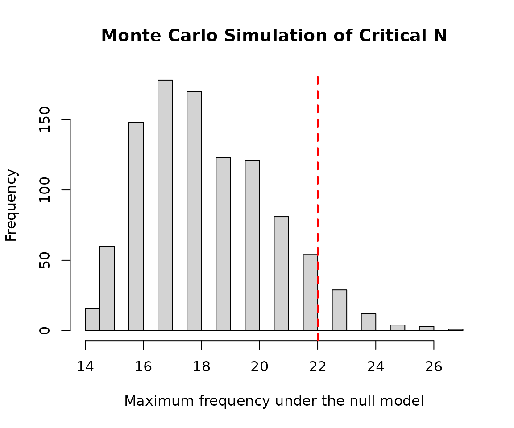
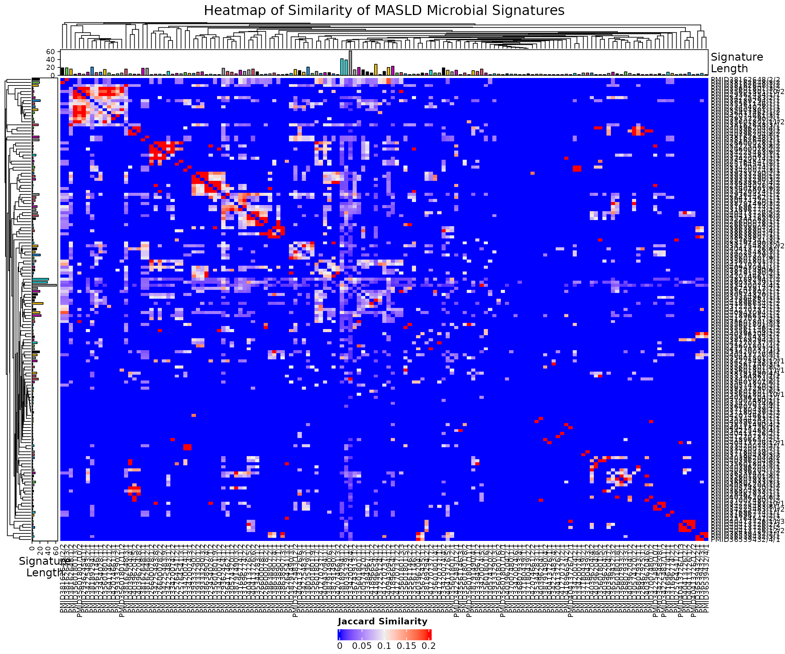

# Exploratory Analysis of MASLD Microbial Signatures

## Introduction

This vignette demonstrates an exploratory analysis of microbial
signatures associated with metabolic dysfunction-associated steatotic
liver disease (MASLD) using data obtained from BugSigDB and functions
provided by the bugSigSimple package.

## Analysis objectives

1.  Downloading the data from BugSigDB
2.  Filtering of the data to select relevant signatures and remove
    similar/duplicate signatures
3.  Description of the studies
4.  Description of the taxa
5.  Basic statistical tests
6.  Monte Carlo simulation to calculate critical N
7.  Heatmaps and dendrograms

## Making sure packages are installed

``` r

if (!require("BiocManager", quietly = TRUE))
    install.packages("BiocManager")
BiocManager::install(c("devtools", "tidyverse", "kableExtra"))
BiocManager::install(c("waldronlab/bugSigSimple", "waldronlab/BugSigDBStats", "waldronlab/bugsigdbr"))
```

## Download BugSigDB data

``` r

full.dat <- bugsigdbr::importBugSigDB(cache = FALSE)
```

``` r

dim(full.dat)
```

    ## [1] 12086    57

The BugSigDB database was downloaded using the
[`importBugSigDB()`](https://rdrr.io/pkg/bugsigdbr/man/importBugSigDB.html)
function from the **bugsigdbr** package. The result contains all curated
microbial signatures together with study metadata such as disease, body
site, sequencing platform, and abundance direction.

## Remove empty signatures

``` r

ind1 <- lengths(full.dat[["MetaPhlAn taxon names"]]) > 0
ind2 <- lengths(full.dat[["NCBI Taxonomy IDs"]]) > 0

dat <- full.dat[ind1 & ind2, ]

dim(dat)
```

    ## [1] 12086    57

Signatures without annotated taxa were removed to ensure that only
complete microbial signatures were included in downstream analyses.

## Select MASLD-related signatures

``` r

pattern <- paste(
  "Metabolic dysfunction-associated steatotic liver disease",
  "Metabolic dysfunction-associated liver disease",
  "Metabolic dysfunction-associated steatohepatitis",
  "Non-alcoholic steatohepatitis",
  "Nonalcoholic steatohepatitis",
  "Non alcoholic steatohepatitis",
  "Non-alcoholic fatty liver disease",
  "Nonalcoholic fatty liver disease",
  "Non alcoholic fatty liver disease",
  "MASLD",
  "MAFLD",
  "MASH",
  "NASH",
  "NAFLD",
  sep = "|"
)

masld.dat <- dat %>%
  filter(
    grepl(pattern, Condition, ignore.case = TRUE) |
      grepl(pattern, `Group 0 name`, ignore.case = TRUE) |
      grepl(pattern, `Group 1 name`, ignore.case = TRUE)
  ) %>%
  filter(
    grepl(pattern, Condition, ignore.case = TRUE)
  )

nrow(masld.dat)
```

    ## [1] 185

``` r

masld.dat %>%
  count(Condition, sort = TRUE)
```

    ##                                                                       Condition
    ## 1                                             Non-alcoholic fatty liver disease
    ## 2                                                 Non-alcoholic steatohepatitis
    ## 3                                     Non-alcoholic fatty liver disease,Obesity
    ## 4      Non-alcoholic fatty liver disease,Aspartate aminotransferase measurement
    ## 5                    Non-alcoholic fatty liver disease,Hepatocellular carcinoma
    ## 6  Non-alcoholic fatty liver disease,Serum alanine aminotransferase measurement
    ## 7                        Non-alcoholic fatty liver disease severity measurement
    ## 8                          Colorectal adenoma,Non-alcoholic fatty liver disease
    ## 9                    Hepatocellular carcinoma,Non-alcoholic fatty liver disease
    ## 10                         Non-alcoholic fatty liver disease,Colorectal adenoma
    ## 11                 Non-alcoholic fatty liver disease,Inflammatory bowel disease
    ## 12              Non-alcoholic steatohepatitis,Non-alcoholic fatty liver disease
    ##      n
    ## 1  102
    ## 2   52
    ## 3    6
    ## 4    4
    ## 5    4
    ## 6    4
    ## 7    3
    ## 8    2
    ## 9    2
    ## 10   2
    ## 11   2
    ## 12   2

To capture the complete body of evidence related to metabolic
dysfunction-associated steatotic liver disease (MASLD), signatures were
identified using both the current disease terminology (MASLD) and
historical terms (MAFLD, NAFLD, and NASH). Disease-related terms were
searched across the Condition, Group 0 name, and Group 1 name fields to
recover studies curated under different naming conventions. Finally,
only records whose primary condition corresponded to a MASLD-related
disease were retained, excluding studies focused primarily on clinical
biomarkers or laboratory measurements.

## Remove similar signatures

``` r

masld.filtered <- masld.dat %>%
  distinct()

nrow(masld.filtered)
```

    ## [1] 185

Exact duplicate records were removed using distinct() to reduce
redundancy before downstream analyses. This step retains unique
MASLD-associated microbial signatures while preserving the overall study
representation.

## Study characteristics

``` r

study.summary <-
  masld.filtered %>%
  count(`Body site`, `Sequencing type`)

knitr::kable(study.summary)
```

| Body site                   | Sequencing type |   n |
|:----------------------------|:----------------|----:|
| Feces                       | 16S             | 115 |
| Feces                       | PCR             |   2 |
| Feces                       | WMS             |  63 |
| Saliva                      | WMS             |   1 |
| Supragingival dental plaque | 16S             |   2 |
| Supragingival dental plaque | WMS             |   2 |

The selected MASLD signatures span multiple studies and sequencing
approaches. Summarizing study characteristics provides context for
interpreting downstream analyses and highlights the diversity of
experimental designs represented in BugSigDB.

## Taxonomic summary

``` r

taxa.table <- createTaxonTable(masld.filtered)

head(taxa.table)
```

    ## # A tibble: 6 × 6
    ##   `Taxon Name`  `Taxonomic Level` total_signatures increased_signatures
    ##   <chr>         <chr>                        <int>                <int>
    ## 1 Alistipes     genus                           16                    5
    ## 2 Bacteroides   genus                           15                    4
    ## 3 Prevotella    genus                           15                    5
    ## 4 Lactobacillus genus                           13                   10
    ## 5 Megasphaera   genus                           13                    6
    ## 6 Bacteroidota  phylum                          13                    2
    ## # ℹ 2 more variables: decreased_signatures <int>, `Binomial Test pval` <dbl>

``` r

knitr::kable(head(taxa.table,10))
```

| Taxon Name | Taxonomic Level | total_signatures | increased_signatures | decreased_signatures | Binomial Test pval |
|:---|:---|---:|---:|---:|---:|
| Alistipes | genus | 16 | 5 | 11 | 0.21000 |
| Bacteroides | genus | 15 | 4 | 11 | 0.12000 |
| Prevotella | genus | 15 | 5 | 10 | 0.30000 |
| Lactobacillus | genus | 13 | 10 | 3 | 0.09200 |
| Megasphaera | genus | 13 | 6 | 7 | 1.00000 |
| Bacteroidota | phylum | 13 | 2 | 11 | 0.02200 |
| Oscillospiraceae | family | 12 | 0 | 12 | 0.00049 |
| Prevotellaceae | family | 12 | 4 | 8 | 0.39000 |
| Bacillota | phylum | 11 | 7 | 4 | 0.55000 |
| Roseburia | genus | 11 | 4 | 7 | 0.55000 |

The taxonomic summary identifies microorganisms that recur across
MASLD-associated signatures. Frequently reported taxa may represent
microbial features that are consistently observed across independent
MASLD studies.

## Monte Carlo critical N

``` r

siglengths <- lengths(masld.filtered$`MetaPhlAn taxon names`)

criticalN <- getCriticalN(
  relevant.sigs = masld.filtered$`MetaPhlAn taxon names`,
  siglengths = siglengths
)

criticalN
```

    ## $critical_n
    ## 95% 
    ##  22 
    ## 
    ## $ci_lower
    ## 2.5% 
    ##   22 
    ## 
    ## $ci_upper
    ## 97.5% 
    ##    23 
    ## 
    ## $simulated_values
    ##    [1] 19 19 17 18 17 16 19 18 17 16 17 17 19 20 20 17 22 18 19 18 19 18 19 21
    ##   [25] 23 21 16 16 20 19 17 17 18 18 19 24 15 16 19 20 20 15 19 18 17 15 18 20
    ##   [49] 17 16 18 22 17 16 18 17 22 19 16 18 17 21 20 20 16 18 19 17 19 20 23 21
    ##   [73] 17 16 16 21 18 20 16 17 20 15 19 21 17 21 24 16 16 22 21 17 22 21 16 16
    ##   [97] 16 16 17 18 14 18 17 17 14 17 20 17 20 18 14 15 21 22 16 16 15 21 19 16
    ##  [121] 14 17 18 23 22 17 18 17 18 20 24 15 22 23 20 15 17 18 18 21 15 17 18 17
    ##  [145] 17 17 21 21 21 21 19 24 19 23 18 18 20 18 17 19 21 19 19 17 17 20 19 17
    ##  [169] 18 20 18 17 16 21 23 17 16 15 15 14 20 18 18 19 19 17 20 22 17 18 21 16
    ##  [193] 18 18 16 18 18 21 17 18 19 20 18 16 20 23 19 22 19 17 20 21 19 16 18 16
    ##  [217] 14 16 20 19 22 17 23 16 20 20 17 18 20 17 17 19 19 20 17 18 17 22 16 21
    ##  [241] 18 16 20 16 15 22 17 20 15 19 16 19 16 21 16 23 18 17 20 17 17 20 21 20
    ##  [265] 17 19 20 19 16 16 20 23 21 18 18 16 15 21 15 16 21 14 19 15 21 16 16 16
    ##  [289] 16 17 17 15 17 18 18 18 18 22 19 20 20 18 21 21 19 15 18 17 20 15 17 19
    ##  [313] 19 20 18 19 19 16 18 18 21 20 23 22 18 20 20 17 17 14 19 15 20 16 20 17
    ##  [337] 21 17 20 18 23 18 19 18 20 20 20 21 21 17 16 15 17 23 17 17 17 17 19 17
    ##  [361] 21 21 15 15 17 17 19 17 19 18 18 16 17 17 16 18 23 15 26 16 18 19 18 19
    ##  [385] 19 18 20 19 16 15 22 17 17 22 18 16 20 16 17 22 16 18 19 18 22 17 15 16
    ##  [409] 21 18 16 21 16 23 22 22 21 20 18 20 18 22 17 22 17 18 14 16 18 21 17 16
    ##  [433] 18 14 15 20 15 19 19 21 15 16 22 16 17 18 16 18 18 17 21 18 16 21 22 18
    ##  [457] 19 16 19 19 17 19 20 20 16 16 20 18 19 23 19 20 20 16 21 18 17 22 18 19
    ##  [481] 18 21 19 21 16 19 17 16 17 19 15 18 18 16 21 19 19 18 22 18 21 17 19 16
    ##  [505] 18 15 17 16 23 15 20 20 23 19 23 17 22 20 19 17 17 24 20 19 23 19 18 21
    ##  [529] 21 18 19 17 21 16 18 18 15 22 19 18 16 15 15 15 16 23 16 17 15 19 19 19
    ##  [553] 20 23 17 17 21 17 15 18 21 25 18 18 16 17 17 18 24 15 21 22 22 19 18 16
    ##  [577] 22 16 16 22 19 21 19 20 19 18 17 18 17 16 18 17 17 16 16 22 16 16 17 15
    ##  [601] 20 20 18 15 16 21 18 20 19 17 16 21 16 22 17 25 16 21 17 19 19 20 16 21
    ##  [625] 18 14 19 20 21 18 18 21 17 24 19 16 18 17 16 16 17 18 20 15 18 16 19 16
    ##  [649] 18 18 18 16 19 17 16 20 18 18 18 17 18 20 17 20 20 19 22 16 16 17 17 17
    ##  [673] 17 18 20 18 20 17 20 16 15 17 18 18 21 19 22 22 19 17 16 16 17 16 18 17
    ##  [697] 20 16 17 18 21 16 22 14 20 19 17 17 22 17 17 16 21 16 20 16 22 18 22 19
    ##  [721] 21 22 17 18 21 20 15 18 20 14 17 18 18 17 17 24 18 16 18 15 17 16 20 19
    ##  [745] 17 16 18 17 19 25 17 20 16 15 19 17 16 18 17 21 18 15 19 19 18 17 17 17
    ##  [769] 16 18 19 24 17 20 18 17 16 19 16 20 17 14 17 19 26 20 21 19 17 22 23 20
    ##  [793] 21 16 18 20 17 20 21 16 20 16 16 17 17 18 21 20 20 22 18 17 17 20 20 17
    ##  [817] 19 22 16 17 17 18 15 20 21 20 16 18 17 22 17 17 20 20 19 17 18 16 19 22
    ##  [841] 23 22 17 18 15 21 18 17 19 17 20 17 19 16 17 20 20 14 17 16 16 20 17 17
    ##  [865] 17 18 16 16 24 15 18 22 16 15 16 15 19 21 16 24 20 19 18 18 15 19 17 18
    ##  [889] 25 15 20 26 19 16 17 18 18 18 20 21 19 19 20 15 19 16 18 19 18 15 16 19
    ##  [913] 20 18 18 20 17 16 23 21 23 17 20 18 19 18 19 20 21 22 20 16 23 18 14 20
    ##  [937] 16 16 16 16 17 22 16 16 16 19 21 18 24 22 17 20 23 17 18 17 21 20 21 19
    ##  [961] 27 16 18 20 18 22 18 18 18 18 20 15 15 17 17 20 16 17 16 21 18 23 20 20
    ##  [985] 20 19 19 17 15 19 19 18 18 18 17 16 18 15 18 16
    ## 
    ## $alpha
    ## [1] 0.05
    ## 
    ## $quantile_label
    ## [1] "95th percentile"

The Monte Carlo simulation estimates the critical number of independent
studies required before repeated observation of a taxon is unlikely to
occur by chance.

## Plot critical N

``` r

hist(
  criticalN$simulated_values,
  breaks = 30,
  main = "Monte Carlo Simulation of Critical N",
  xlab = "Maximum frequency under the null model"
)

abline(
  v = criticalN$critical_n,
  col = "red",
  lwd = 2,
  lty = 2
)
```



The simulated distribution illustrates the study count threshold
required for statistical significance under random sampling.

## Signature similarity

``` r

allsigs <- bugsigdbr::getSignatures(
  masld.filtered,
  tax.id.type = "taxname"
)

# Keep signatures containing at least two taxa
allsigs <- allsigs[sapply(allsigs, length) > 1]

length(allsigs)
```

    ## [1] 153

``` r

# Pairwise overlaps
mydists <- BugSigDBStats::calcPairwiseOverlaps(allsigs)

dim(mydists)
```

    ## [1] 1477    8

``` r

# Jaccard similarity matrix
jmat <- BugSigDBStats::calcJaccardSimilarity(allsigs)

# Keep BugSigDB study/experiment identifiers
row_labels <- sub("^bsdb:", "PMID", sub("_.*$", "", rownames(jmat)))
col_labels <- sub("^bsdb:", "PMID", sub("_.*$", "", colnames(jmat)))
```

Microbial signatures were converted into a pairwise Jaccard similarity
matrix using functions provided by BugSigDBStats. This matrix was
subsequently used for both the heatmap and hierarchical clustering
analyses.

## Heatmap

``` r

library(grid)
library(ComplexHeatmap)

# Calculate signature lengths
siglengths <- sapply(allsigs, length)

# Short labels for display
short.labels <- paste0("S", seq_len(nrow(jmat)))

# Top annotation
ha <- HeatmapAnnotation(
  `Signature\nLength` = anno_barplot(
    siglengths,
    gp = gpar(fill = 4:(length(siglengths) + 3)),
    annotation_name_gp = gpar(
      fontsize = 10,
      lineheight = 0.8
    )
  )
)

# Left annotation
hr <- rowAnnotation(
  `Signature\nLength` = anno_barplot(
    siglengths,
    gp = gpar(fill = 4:(length(siglengths) + 3)),
    annotation_name_gp = gpar(
      fontsize = 10,
      lineheight = 0.8
    )
  )
)

# Create heatmap
hm <- Heatmap(
  jmat,

  top_annotation = ha,
  left_annotation = hr,

  row_names_max_width = unit(10, "cm"),
  column_names_max_height = unit(3, "cm"),

  row_labels = row_labels,
  column_labels = col_labels,

  row_names_gp = gpar(fontsize = 8),
  column_names_gp = gpar(fontsize = 8),

  column_title = "Heatmap of Similarity of MASLD Microbial Signatures",
  column_title_gp = gpar(fontsize = 15),

  heatmap_legend_param = list(
    title = "Jaccard Similarity",
    direction = "horizontal"
  )
)

# Draw heatmap
draw(
  hm,
  heatmap_legend_side = "bottom",
  annotation_legend_side = "right"
)
```



``` r

# Save the heatmap as a high-resolution PNG
png(
  filename = file.path(tempdir(), "MASLD_heatmap.png"),
  width = 14,
  height = 10,
  units = "in",
  res = 300
)

draw(
  hm,
  heatmap_legend_side = "bottom",
  annotation_legend_side = "right"
)

dev.off()
```

    ## agg_png 
    ##       2

The heatmap visualizes pairwise Jaccard similarities among
MASLD-associated microbial signatures, highlighting groups of studies
with similar taxonomic compositions.

## Dendrogram

``` r

# Convert similarity to distance
hc <- hclust(as.dist(1 - jmat))

plot(
  hc,
  labels = row_labels,
  main = "Hierarchical Cluster Map of MASLD Microbial Signatures",
  xlab = "",
  sub = "",
  cex = 0.6
)
```


Hierarchical clustering groups microbial signatures according to
taxonomic similarity, revealing patterns of shared microbial composition
across MASLD studies.

## Discussion

This vignette demonstrates a complete exploratory analysis of
MASLD-associated microbial signatures curated in BugSigDB using the
existing functionality provided by **bugSigSimple**. After selecting
disease-relevant signatures and reducing redundancy, study
characteristics and taxonomic patterns were summarized, Monte Carlo
simulation estimated the critical number of supporting studies, and
clustering methods visualized relationships among microbial signatures.
Together, these analyses illustrate a reproducible workflow for
exploring disease-associated microbial signatures while reusing
established package functions rather than implementing new analytical
methods.
